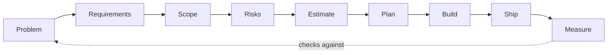

## Start with the project nobody could finish

Ashby Mutual, an insurer, asked its FDE for "an AI support agent", and the FDE's team started coding the happy path on day one. In week three a rule surfaced that nobody had mentioned: some policy changes need a second approver. The account-system integration turned out harder than expected, and the date slipped.

At the review the FDE reported the pilot done. The sponsor asked why customers could not use it yet, because the sponsor had been pricing a full release. Nobody had been careless. They had never agreed what the work was. Call this **the moving finish line**: a project whose end was never written down, so every party measures it against a different one.

> **What you'll learn**
>
> - Explain why projects usually fail in their first week rather than their last.
> - Turn a solution-shaped request into a problem with a measurable goal.
> - Separate a prototype, an MVP and a production service before any date is discussed.

Scoping is not predicting the future. It is writing down what is in, what is assumed and what is still open, so everyone shares one picture. The first three things to pin down are the real problem, a goal with a number in it, and which kind of "done" is being bought.

## Draw the map before writing code

A developer asks how to build a feature. A project lead asks a wider set of questions: what to build, how long it will take, what could break, and how anyone will know it worked. The lead's job is to answer those so the team does not have to guess.

Without that map, the sequence at Ashby plays out. The team codes the happy path at once. Midway through, a rule surfaces that nobody mentioned. An integration turns out harder than expected. The date slips, and people disagree about whether the project is finished.

A useful map shows four things:

- **What is included now.**
- **The assumptions behind the estimate.**
- **The questions still open.**
- **The signals that would change direction.**

It will be wrong in places. Its job is to be shared and to be updated as facts arrive.

## Start from the problem, not the requested solution

"We want an AI support agent" is a solution, not a problem. The scoping guide behind this module models delivery as a chain, shown in Figure 1. The chain starts with the problem because every later link depends on it.

*Figure 1: The delivery chain. Each link rests on the one before it, and measuring at the end only means something if the problem at the start was written down.*

Three questions find the problem:

1. **Who feels the pain?** The customer, the support agent, an operator or a manager.
2. **What is slow, costly, risky or frustrating today?**
3. **Which result would make the project worth its cost?**

## Put a number in the goal

A goal without a number cannot be checked. "Build an AI assistant for support" gives the team nothing to aim at. "Cut average ticket handling time from 12 minutes to under 5, with no rise in escalations or complaints" does.

Once the goal has a number, the technical questions gain a purpose:

- Which ticket types count?
- May the system only read data, or also change accounts?
- How many mistakes are acceptable?
- Where must a human approve?

Each question now has an answer that either helps or hurts the number. For how to choose a metric the customer recognises, see [success metrics and evaluation data](../T6.1_Customer_Discovery_and_Problem_Decomposition/03_Success_Metrics_and_Evaluation_Data.md).

## Agree which "done" is being built

A demo, a small pilot and a production service are three different projects with three different price tags.

| Level | Its purpose | What it typically contains |
|---|---|---|
| Prototype | Show the idea could work | Manual setup, a small data sample, the smooth path only |
| MVP | Deliver real value to a small group of real users | Login, the core workflow, basic error handling, simple operations |
| Production | Serve real customers reliably | Security, monitoring, support, rollback, scale, recovery, compliance |

*Table 1: Three levels of done. Each row adds work the row above leaves out.*

Ask one question before any date is mentioned: "When you say done, do you mean a demo, a pilot for about 20 users, or a full release?"

> **Pitfall:** A date given before "done" is defined is a date for the wrong project. The customer may be pricing a production service while the team is pricing a demo. Settle the level first.

## Worked example: reframing "we want an AI support agent"

The walkthrough replays Ashby's opening request the way it should have gone: from a one-line solution to a scoping map, before any architecture.

Work back from the request to a goal and a level of done. Each step shows the question asked and what the map gains.

<button type="button" data-step="0" aria-pressed="false" aria-controls="reframe-step-0">1. Pain</button><button type="button" data-step="1" aria-pressed="false" aria-controls="reframe-step-1">2. Goal</button><button type="button" data-step="2" aria-pressed="false" aria-controls="reframe-step-2">3. Done</button><button type="button" data-step="3" aria-pressed="false" aria-controls="reframe-step-3">4. Map</button>

<section id="reframe-step-0" class="step-panel" aria-labelledby="reframe-heading-0"><h4 id="reframe-heading-0">1. Find who feels the pain</h4><dl><dt>Question</dt><dd>Who suffers today, and what does it cost?</dd><dt>Answer</dt><dd>Support agents spend 12 minutes on an average ticket. The cost is handling time.</dd></dl></section><section id="reframe-step-1" class="step-panel" aria-labelledby="reframe-heading-1"><h4 id="reframe-heading-1">2. Put a number in the goal</h4><dl><dt>Question</dt><dd>Which result would justify the project?</dd><dt>Answer</dt><dd>Handling time under 5 minutes, with escalations and complaints no worse than today.</dd></dl></section><section id="reframe-step-2" class="step-panel" aria-labelledby="reframe-heading-2"><h4 id="reframe-heading-2">3. Ask which done</h4><dl><dt>Question</dt><dd>A demo, a pilot for about 20 users, or a full release?</dd><dt>Answer</dt><dd>A pilot for about 20 agents, not a full release.</dd></dl></section><section id="reframe-step-3" class="step-panel" aria-labelledby="reframe-heading-3"><h4 id="reframe-heading-3">4. Write the map</h4><dl><dt>In</dt><dd>Draft replies for the pilot group.</dd><dt>Assumed</dt><dd>Read-only access to account data.</dd><dt>Open</dt><dd>Which ticket types count.</dd></dl></section>

<button type="button" data-walk="previous">Previous</button>

<button type="button" data-walk="next">Next step</button>

One sentence of request became a measurable goal and a defined level of done, before any architecture.

## Limits of this lesson

- **A map is not a contract.** It records today's understanding and changes as facts arrive. Date each version.
- **Some goals resist one number.** Safety or compliance outcomes may need a threshold and a review rather than a single target.
- **Composite engagement.** Ashby Mutual and its figures are illustrative, not a real customer.

## Interview angle

Each answer is an outline to say in about two minutes. Open each question and try it aloud before reading.

Interview question 1. A regional manager says, "Our claims team is drowning. Can AI help?" Turn that into a problem statement and a metric.

- **Answer:** Find who drowns and in what: ask which claims pile up, how long each takes now and what the delay costs. Then write one sentence with a number, for example "Cut the backlog of simple claims from ten days to two, with no rise in payment errors." That names the user, the measure, the target and the guard metric.
- **Trade-off:** Pinning a number early can feel premature. Without it, nobody can say whether the work succeeded.
- **Follow-up to expect:** "We don't know today's figure." Then measuring it is the first task.

Interview question 2. The sponsor asks for a date in your first meeting. What do you say?

- **Answer:** Ask which done they mean: a demo, a pilot for a small group, or a full release. Explain that the three differ by weeks or months, and offer a rough range for the level they choose, with the assumptions behind it. Commit to a firmer date once the open questions on the map are answered.
- **Trade-off:** Declining to give one number can look evasive. One number for the wrong level of done costs more trust later.
- **Follow-up to expect:** "Give me a ballpark anyway." Give a range for each level.

Interview question 3. What do you put on a scoping map, and how do you keep it useful?

- **Answer:** Four things: what is included now, the assumptions behind the estimate, the open questions, and the signals that would change direction. Share it with the team and the customer, date each version, and update it when an assumption fails or a question is answered.
- **Trade-off:** A shared map exposes gaps early, which can be uncomfortable. Hidden gaps surface later, when they are dearer.
- **Follow-up to expect:** "Who owns the map?" The project lead.

## References

1. The repository's scoping guide, *Scoping an FDE Project: Complete Guide*, Module 1 "Understand the Request Before You Build Anything" (Topics 1.1 and 1.2), summarised in our own words. The guide is itself based on the fdehandbook.com "Scope a Project" course.
2. The site's [success metrics and evaluation data](../T6.1_Customer_Discovery_and_Problem_Decomposition/03_Success_Metrics_and_Evaluation_Data.md) lesson, for choosing a metric the customer recognises.
3. The site's [baselines, value and ROI](08_Baselines_Value_and_ROI.md) lesson, for measuring the number in the goal before the change.

## Key takeaways

- Most projects fail early, because the team never agreed what the work was. A shared, updatable map prevents that.
- Begin from who feels the pain and what it costs, not from the requested solution.
- A goal with a number turns open technical questions into decisions with a purpose.
- Prototype, MVP and production are different projects. Agree which one before any date.

## Check yourself

1. What four things should a scoping map show?

What is included now, the assumptions behind the estimate, the open questions, and the signals that would change direction.

2. Rewrite "build an AI assistant for support" as a measurable goal.

For example: cut average ticket handling time from 12 minutes to under 5, with no increase in escalations or complaints.

3. Why ask about the definition of done before giving a date?

A prototype, an MVP and a production service differ hugely in effort. A date given before the level is agreed may be a date for a different project.

