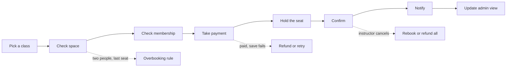

## Start with the six-screen estimate

Tempo Studios, a fictional chain of fitness studios, wanted a class-booking product. The team counted six screens: schedule, class detail, booking, checkout, account and an admin page. At two or three days a screen, they quoted three weeks.

Week two found the waitlist. Week three found refunds, two people taking the last seat at once, and an instructor cancelling an hour before class. Support could not cancel a booking without a developer. The six screens were finished on time, and the product could not run. Call this **the screen-count estimate**: sizing a system by what people see instead of by what changes underneath.

> **What you'll learn**
>
> - Work down from surfaces to entities, states and workflows.
> - Spot the properties that make a project hard regardless of its size.
> - List the hidden work a demo never shows before committing to a date.

A page count is a poor proxy for effort. A small booking flow can be harder than a large content site. Once the goal and level of done are set, as in [Problem, Goal, and Definition of Done](01_Problem_Goal_and_Definition_of_Done.md), dig below the screens to find the real system.

## Dig from surfaces down to workflows

Work through four layers, top to bottom. The walkthrough takes Tempo's booking product through each one.

Dig through the four layers of a class-booking product. Each step shows what the layer holds and what it adds to the estimate.

<button type="button" data-step="0" aria-pressed="false" aria-controls="layers-step-0">1. Surfaces</button><button type="button" data-step="1" aria-pressed="false" aria-controls="layers-step-1">2. Entities</button><button type="button" data-step="2" aria-pressed="false" aria-controls="layers-step-2">3. States</button><button type="button" data-step="3" aria-pressed="false" aria-controls="layers-step-3">4. Workflows</button>

<section id="layers-step-0" class="step-panel" aria-labelledby="layers-heading-0"><h4 id="layers-heading-0">1. Surfaces: what people touch</h4><dl><dt>Holds</dt><dd>Web pages and dashboards, mobile apps with their notifications and permissions, admin tools for settings and refunds, and operational views for reports, alerts and moderation.</dd><dt>Adds</dt><dd>The visible part of the estimate, and the only part a screen count sees.</dd></dl></section><section id="layers-step-1" class="step-panel" aria-labelledby="layers-heading-1"><h4 id="layers-heading-1">2. Entities: the business nouns</h4><dl><dt>Holds</dt><dd>Users, instructors, classes, sessions, studios, rooms, memberships, bookings and payments.</dd><dt>Adds</dt><dd>Data design, and the relations each screen depends on.</dd></dl></section><section id="layers-step-2" class="step-panel" aria-labelledby="layers-heading-2"><h4 id="layers-heading-2">3. States: how the nouns change</h4><dl><dt>Holds</dt><dd>A booking is never only "booked". It may be available, reserved, paid, confirmed, attended, waitlisted, promoted from the waitlist or refunded.</dd><dt>Adds</dt><dd>Rules for each transition: who may trigger it, what must already be true, what gets recorded and what happens on failure. One "Book" button can hide a dozen of these.</dd></dl></section><section id="layers-step-3" class="step-panel" aria-labelledby="layers-heading-3"><h4 id="layers-heading-3">4. Workflows: the journeys</h4><dl><dt>Holds</dt><dd>The journey in plain words, before any architecture: pick a class, check space, check membership, take payment, hold the seat, confirm, notify, update the admin view.</dd><dt>Adds</dt><dd>The failure paths you find when you break the journey on purpose.</dd></dl></section>

<button type="button" data-walk="previous">Previous</button>

<button type="button" data-walk="next">Next step</button>

Then break the workflow on purpose. Two people grab the last seat at once. Payment succeeds but saving the booking fails. The instructor cancels an hour before class. These are not edge cases. They are part of the product, and Figure 1 shows where they sit.

*Figure 1: One booking journey with three deliberate breaks. Each dotted branch is work the happy path never shows.*

## Judge complexity by interaction, not size

A project is hard when many rules, systems and failure paths interact. The scoping guide compares a content platform with a booking platform to show it.

| Question | Content platform | Booking platform |
|---|---|---|
| What changes state? | Viewed, completed, subscribed | Available, reserved, paid, cancelled, refunded, waitlisted |
| Must it be real-time? | Rarely | Yes, when seats are scarce |
| What does it integrate with? | Login, billing, content | Payments, calendar, notifications, door access, maps |
| What does a failure cost? | Lost progress | A double charge, an overbooking, a locked door |
| What does operating it involve? | Managing content | Scheduling, refunds, waitlists, no-shows, support |

*Table 1: Two platforms of similar size. The booking platform is harder on every row.*

Several properties quietly inflate an estimate:

- **Concurrency.** Many users editing the same thing at once.
- **Money.** It brings refunds, reconciliation and audit trails.
- **Role-based permissions.**
- **Physical-world state.** Software that must match a room, a shipment or a person's calendar.
- **Outside systems.** Dependence on systems outside the team's control.
- **Irreversible actions.** Actions that cannot be undone.

The guide's heading promises five of these but lists six. All six are worth checking.

## Count the work the demo hides

A demo shows the happy path. The production project also contains everything that keeps the service safe and runnable, and that hidden work often decides whether the system can be trusted.

Before committing to a date, check:

- login and account recovery
- roles and permissions
- admin and support tooling
- migration of existing data
- analytics, logging and alerting
- safe retries that never repeat an action
- abuse and usage limits
- a security and privacy review
- testing with a staging environment
- a rollout and rollback plan
- support with incident response

> **Pitfall:** A feature support staff cannot operate is not finished. If customers can book a class but support cannot cancel it, refund it, change capacity or see why a confirmation failed, the service does not work in practice, however good the customer screen looks.

## Worked example: the resume-feedback page

A manager asks for a page where people upload a resume and receive AI feedback. It looks like one screen and one model call.

List what the screen hides:

| Area | Hidden work |
|---|---|
| The file | Validate it, scan it for viruses, parse it |
| Storage | Store it, delete it later, protect the personal data |
| Access | User login |
| The AI call | Failure handling, content-safety checks, usage and cost limits |
| History | Save past feedback |
| Running it | Analytics, support tools, monitoring, tests |

*Table 2: The work behind one upload button.*

That is more than a dozen tasks behind a single upload button. The estimate must be built from this list, not from the screen. [Estimating AI Work as a Product](03_Estimating_AI_Work_as_a_Product.md) adds the work the AI call itself brings.

## Limits of this lesson

- **Layers are a checklist, not a design.** They find the work. Architecture choices come later.
- **Size still matters.** Interaction drives difficulty, but a large surface still takes time to build and test.
- **Fictional data.** Tempo Studios and its figures are illustrative.

## Interview angle

Each answer is an outline to say in about two minutes. Open each question and try it aloud before reading.

Interview question 1. A customer says the app is "only five screens". How do you check that estimate?

- **Answer:** Dig under each screen: list the entities, the states each one moves through and the rules on every transition. Trace the main workflow, then break it on purpose: concurrent users, a payment that succeeds while the save fails, a cancellation. Add the hidden work such as admin tools, migration and monitoring, then size from that list.
- **Trade-off:** The deeper list takes a day or two to build. A screen count is faster and wrong.
- **Follow-up to expect:** "Which property worries you most?" Money or irreversible actions, because failures there cost the customer directly.

Interview question 2. Two products have the same number of screens. Why might one take three times as long?

- **Answer:** Effort follows interaction, not size. One may need real-time state, payments, several outside systems and actions that cannot be undone. The other may only store and show content. I compare them on what changes state, real-time needs, integrations, the cost of a failure and what operating them involves.
- **Trade-off:** Comparing on these questions needs more discovery. It is the only way the estimate matches the real system.
- **Follow-up to expect:** "Give an example." A content site against a booking platform.

Interview question 3. What do you check before committing to a date that a demo would not show?

- **Answer:** Login and recovery, permissions, admin and support tooling, data migration, analytics and alerting, safe retries, abuse limits, a security review, staging and tests, a rollout and rollback plan, and support with incident response. I also check that support staff can operate every feature, such as cancelling or refunding a booking.
- **Trade-off:** Listing this work makes the estimate larger. Leaving it out makes the date wrong.
- **Follow-up to expect:** "The customer only wants the demo." Then agree that the level of done is a prototype.

## References

1. The repository's scoping guide, `05_FDE_Delivery_and_Scoping/Scoping_An_FDE_Project/Scoping-an-FDE-Project-Complete-Guide.md`, Module 2 "Figure Out What You Are Really Building" (Topics 2.1 to 2.3), summarised in our own words. The guide is itself based on the fdehandbook.com "Scope a Project" course.
2. The site's [stakeholder and workflow maps](../T6.1_Customer_Discovery_and_Problem_Decomposition/07_Stakeholder_and_Workflow_Maps.md) lesson, for tracing real workflows and their exceptions.

## Key takeaways

- Work down from surfaces to entities, states and workflows, then break the workflows on purpose.
- Complexity comes from interacting states, systems and failure paths, not from page count.
- Concurrency, money, permissions, physical-world state, outside systems and irreversible actions all inflate estimates.
- Hidden operational work decides whether a system is trustworthy. Count it before giving a date.

## Check yourself

1. Why can a small booking flow be harder than a large content site?

It has many states, real-time constraints, several external integrations and costly failures such as double charges. The content site has few of these.

2. Name three ways to deliberately break a booking workflow while scoping it.

Two users take the last seat at once. Payment succeeds but the booking save fails. The instructor cancels shortly before class.

3. Name six items of hidden work to check before committing to a date.

Any six of: login and recovery, permissions, admin tools, data migration, analytics, logging and alerts, safe retries, abuse limits, security review, testing and staging, rollout and rollback, support and incident response.

