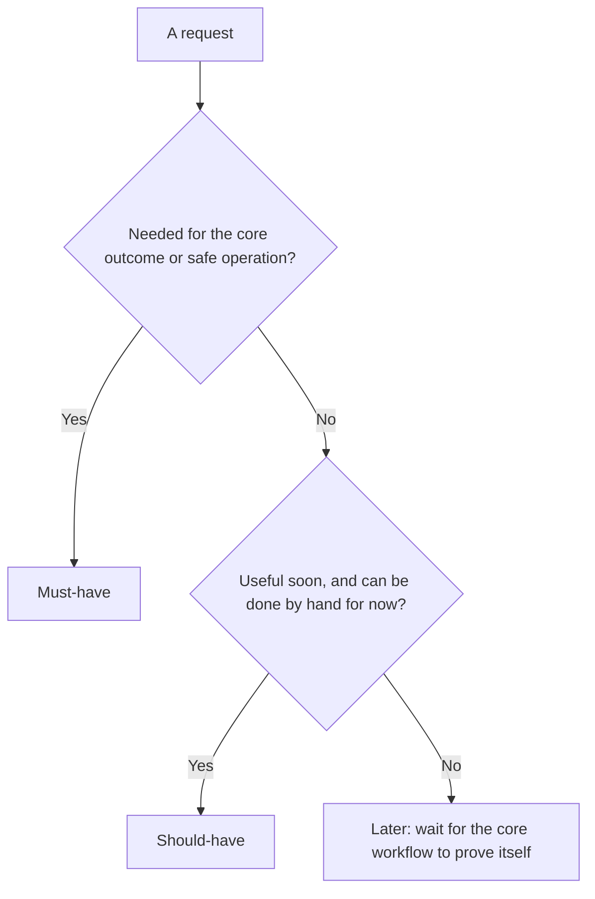

## Start with the release that had everything

Northgate Engineering, a fictional engineering firm, gave its FDE team six weeks to build a document assistant. The request listed chat, Slack, email, permissions, analytics, many languages, document editing and automatic actions. The lead accepted all of it, and every stakeholder left the kick-off happy.

At week six, each feature was half built. Chat worked in English but leaked a restricted document in testing, because permissions had slipped behind the Slack integration. Nothing could go to users. Nobody had learned whether staff wanted the assistant at all. Call this **the whole-list release**: a first release sized by what people asked for instead of by what the outcome needs.

> **What you'll learn**
>
> - Define an MVP as narrow rather than careless.
> - Sort every request into must-have, should-have and later.
> - Choose the first release around the assumption most likely to kill the project.

A large number attached to a large wish list is not a plan. The lead's job is to find the narrowest release that delivers the core outcome safely, using the sizes from [Estimating AI Work as a Product](03_Estimating_AI_Work_as_a_Product.md) to show what each cut saves.

## Make the MVP narrow, not sloppy

An MVP serves a clearly defined group of users, is safe to run, and answers a real question about the product or about how it is being built. Narrow means fewer users, fewer workflows and fewer integrations. It never means skipping safety.

The value of a first release rises with the core value users get and with how fast the team learns. It falls with what it costs to deliver. Compare options on those three terms.

## Sort every request into three buckets

Put each request in one of three buckets:

- **Must-have** items are needed for the core outcome or for safe operation.
- **Should-have** items are useful soon but can be done by hand for now.
- **Later** items are valuable once the core workflow has proved itself.

Figure 1 shows the sorting questions in order.

*Figure 1: Sorting a request. Safety lands in must-have, whatever its size.*

The scoping guide's class-booking product shows the split.

| First release | Held back |
|---|---|
| A responsive website | Native iOS and Android apps |
| Class schedule and booking | A community feed |
| Hosted payment checkout | Movement feedback |
| A simple admin portal | Automatic studio door access |
| Email confirmation | Advanced loyalty and membership rules |

*Table 1: A class-booking first release. Everything on the right waits for evidence from the left.*

## Keep manual steps that teach something

Automate the core value, not every task around it. Early on, support staff can approve refunds, an operator can upload a spreadsheet, and a small script can produce the weekly report. Replace each manual step only when volume or error rates justify it. A manual step still needs an owner, a safe procedure and a way to measure its load.

## Retire the riskiest assumption first

Build the first release around the assumption most likely to sink the project. If nobody has shown that people want interview feedback, test that before building community features, complex billing or a content platform. A release that proves the wrong thing wastes the time it saved.

> **Pitfall:** Owning a project includes saying "not yet". A lead who cannot move items to "later" has handed scope control to whoever asks loudest. The sequence is scope, prioritise, reduce, deliver.

## Worked example: a six-week document assistant

The scoping guide's exercise is Northgate's request: six weeks for an enterprise document assistant with chat, Slack, email, permissions, analytics, many languages, document editing and automatic actions. The guide leaves the answer open, so the switcher shows one defensible sort using its buckets.

Choose a bucket to see which document-assistant requests land in it, and why.

<button type="button" data-mode="must" aria-pressed="false" aria-controls="must-result">Must-have</button>
<button type="button" data-mode="should" aria-pressed="false" aria-controls="should-result">Should-have</button>
<button type="button" data-mode="later" aria-pressed="false" aria-controls="later-result">Later</button>

<section id="must-result" class="mode-panel" data-announcement="Must-have selected. Permissions, chat and basic analytics."><h4>Must-have</h4><ul><li>Permissions: an assistant that leaks documents is unsafe at any size.</li><li>Chat: the core value.</li><li>Basic analytics: needed to prove the outcome.</li></ul></section>
<section id="should-result" class="mode-panel" data-announcement="Should-have selected. Slack and email."><h4>Should-have</h4><ul><li>Slack and email: users can open the chat for six weeks.</li></ul></section>
<section id="later-result" class="mode-panel" data-announcement="Later selected. Languages, editing and automatic actions."><h4>Later</h4><ul><li>Many languages, document editing and automatic actions.</li><li>Each adds evaluation and risk without testing whether people want the assistant at all.</li></ul></section>

The six-week MVP is permission-aware chat over the documents, with enough analytics to show whether it is used and useful. Everything else waits for that evidence.

## Limits of this lesson

- **One sort is not the only sort.** Another customer's risk profile may move Slack into must-have, for example if staff cannot reach a browser.
- **Manual steps have a ceiling.** They hold while volume is small. Watch their load and plan the switch.
- **Fictional data.** Northgate Engineering and its figures are illustrative.

## Interview angle

Each answer is an outline to say in about two minutes. Open each question and try it aloud before reading.

Interview question 1. Every stakeholder says their feature is essential for launch. How do you cut scope?

- **Answer:** Sort each request against the core outcome and safe operation. Must-haves serve the outcome or safety. Should-haves can be done by hand for now. The rest wait until the core workflow proves itself. I show each stakeholder what their item costs in weeks and when it returns, and record the decision.
- **Trade-off:** Saying "not yet" disappoints people now. Accepting everything delivers nothing usable.
- **Follow-up to expect:** "The loudest stakeholder is the sponsor." Show the sponsor the date each feature moves.

Interview question 2. What is the difference between a narrow MVP and a rushed one?

- **Answer:** A narrow MVP has fewer users, workflows and integrations, but it is safe to run and answers a real question. A rushed one keeps the full scope and drops safety, testing or operations. I narrow scope, never quality: permissions, error handling and a way to support users stay in.
- **Trade-off:** A narrow release can look small to the customer. A rushed one looks big and fails in use.
- **Follow-up to expect:** "What would you never cut?" Anything that makes the release unsafe.

Interview question 3. How do you choose what the first release should test?

- **Answer:** Find the assumption most likely to sink the project and build around it. If nobody has shown that users want the core feature, test that before building community features, billing or extra channels. A release that proves the wrong thing wastes the time it saved.
- **Trade-off:** Testing demand first can delay impressive features. Building them on an untested premise risks building something nobody uses.
- **Follow-up to expect:** "How do you find the riskiest assumption?" Ask what would make the project pointless if it were false.

## References

1. The repository's scoping guide, `05_FDE_Delivery_and_Scoping/Scoping_An_FDE_Project/Scoping-an-FDE-Project-Complete-Guide.md`, Module 3 Topic 3.2 "Cut scope without losing the outcome", summarised in our own words. The guide is itself based on the fdehandbook.com "Scope a Project" course.
2. The site's [choosing the first use case](../T6.1_Customer_Discovery_and_Problem_Decomposition/04_Choosing_the_First_Use_Case.md) lesson, for picking the workflow the first release serves.

## Key takeaways

- An MVP is narrow, safe and answers a real question. Narrow never means unsafe.
- Sort requests into must-have, should-have and later, and say "not yet" out loud.
- Keep manual steps where they are cheap and instructive, each with an owner.
- Build the first release around the assumption most likely to kill the project.

## Check yourself

1. What makes a release an MVP rather than a rushed product?

It serves a defined group, is safe to run, and answers a real question. It is narrow in scope, not careless in quality.

2. When should a manual step be automated?

When volume or error rates justify it. Until then it needs an owner, a safe process and a measure of its workload.

3. Why build community features after testing whether people want interview feedback?

Feedback is the riskiest assumption. If it fails, the community features have no reason to exist.

