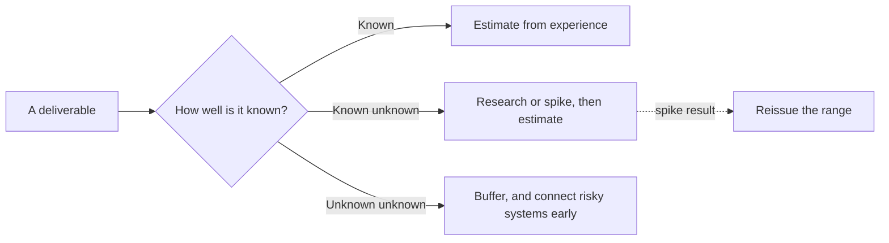

## Start with the twenty-one days

Tempo Studios, the studio chain from [Sizing the Work a Demo Hides](02_Sizing_the_Work_a_Demo_Hides.md), asked its FDE how long the booking MVP would take. The FDE answered "21 working days". The sponsor booked a launch event for day 25.

On day 12 the team learned that the payment provider did not support Tempo's refund rules. Nobody had written that assumption down, so nobody had tested it. The work grew by two weeks, and the FDE spent a week defending a number whose basis had gone. Call this **the bare number**: an estimate stripped of the assumptions and risks that would let anyone check it.

> **What you'll learn**
>
> - Break scope into deliverables and sort each by how well it is known.
> - Give a range with best, expected and risk cases, and say what moves it.
> - Re-estimate openly when an assumption fails, and speak clearly under uncertainty.

Precision early in a project is usually invented. A trustworthy estimate is one another engineer can read, question and challenge, built from the scoped first release in [Shrinking to a First Release](04_Shrinking_to_a_First_Release.md).

## Break the work into deliverables

Estimate deliverables, not the project as a whole. The scoping guide's breakdown runs:

1. Product clarification and technical design.
2. The front end.
3. The back end and data.
4. Integrations and infrastructure.
5. The AI workflow with its quality testing.
6. Admin and operations.
7. Testing, rollout and monitoring.

Each can be estimated and challenged on its own.

## Separate what is known from what is guessed

Each deliverable falls into one of three kinds, and each kind is handled differently.

| Kind | Example | How to handle it |
|---|---|---|
| Known | A standard dashboard with login | Estimate from experience |
| Known unknown | Whether the payment provider supports the refund rules | Research it, or run a short technical test (a spike) |
| Unknown unknown | A surprise limit in a vendor's system | Hold a buffer, and connect to risky systems early |

*Table 1: Three kinds of deliverable. Tempo's refund rules were a known unknown treated as known.*

*Figure 1: Handling each kind of deliverable. A spike turns a known unknown into a known, and the range narrows.*

## Give a range and say what moves it

"21 working days" early in a project is false precision. "Three to five weeks" is more honest, provided the lead can say what keeps it near three and what pushes it to five. Think in three cases:

- **Best case:** the known path works.
- **Expected case:** includes normal rework and review.
- **Risk case:** a major assumption fails or scope grows.

The range should narrow as the team learns and integrates.

Write the assumptions next to the range. A usable estimate reads: for one experienced engineer, the MVP is about three to five weeks. That assumes hosted login, hosted payment checkout and an existing design system. A production pilot is about six to eight weeks. The largest unknowns are the refund rules and the door-access integration.

## Re-estimate when a fact changes

Never defend a number whose assumptions have failed. Re-estimate:

- after the first integration
- after a spike
- when scope changes
- when the target moves from demo to pilot

Explain the change in terms of work. The estimate moved from four weeks to six because the new requirement adds custom permissions and a data migration. Then offer the trade-off.

> **Pitfall:** "This should take about three weeks" hides the one risk that matters. A stronger version names it: the core workflow is likely three to four weeks, the biggest risk is payment reconciliation, so run a two-day spike on it before committing to a final date.

## Speak plainly when uncertain

Avoid both "it depends" and fake certainty. Give the current range, the assumption behind it, and the next piece of evidence that will narrow it.

| Situation | A clear way to say it |
|---|---|
| Early estimate | It is a rough range on today's scope, expected to narrow after the integration test. |
| Missing requirement | The timeline hinges on whether the agent only reads data or can act on accounts, because those carry different risk. |
| Scope increase | It can go in, but it adds permissions and support work, so the date moves or something else comes out. |
| Technical risk | The vendor API is the main unknown. Test it first rather than hide it in a buffer. |
| Estimate change | An assumption changed. Here is the new work and the trade-off. |

*Table 2: Plain wording under uncertainty. Each line gives a range or a cause, never a shrug.*

When a sponsor asks you to guarantee a date for their board, [updates, decision notes and bad news](../../../05_FDE_Delivery_and_Scoping/FDE_Track/fde-in-the-field/stakeholder-communication/04_Updates_Decision_Notes_and_Bad_News.md) shows how to commit to what you control and give a range for the rest.

## Worked example: estimating the class-booking MVP

A stakeholder asks how long the class-booking MVP will take. Break it down. Login and checkout are hosted and therefore known. The booking workflow with waitlists is known but has many states. The refund rules are a known unknown: the payment provider may not support them. Door access is a known unknown too.

The answer is three to five weeks for one experienced engineer, assuming hosted login, hosted checkout and an existing design system. A spike on refunds comes first, and the range is reissued after it.

Choose a case to see what has to be true for the booking MVP to land there.

<button type="button" data-mode="best" aria-pressed="false" aria-controls="best-result">Best case</button>
<button type="button" data-mode="expected" aria-pressed="false" aria-controls="expected-result">Expected case</button>
<button type="button" data-mode="risk" aria-pressed="false" aria-controls="risk-result">Risk case</button>

<section id="best-result" class="mode-panel" data-announcement="Best case selected. Near three weeks."><h4>Best case: near three weeks</h4><ul><li>The payment provider handles the refund rules.</li><li>Hosted login and checkout work as documented.</li></ul></section>
<section id="expected-result" class="mode-panel" data-announcement="Expected case selected. Inside the range."><h4>Expected case: inside the range</h4><ul><li>The known path works, with normal rework and review.</li><li>The waitlist states take their usual share of testing.</li></ul></section>
<section id="risk-result" class="mode-panel" data-announcement="Risk case selected. Near five weeks or beyond."><h4>Risk case: near five weeks or beyond</h4><ul><li>The provider does not support the refund rules.</li><li>Or door access joins the first release.</li></ul>
Either one means re-estimating, not stretching the old number.
</section>

The booking case study in [Scoping in Practice](07_Scoping_in_Practice.md) sizes a single-location booking MVP at six to ten weeks. That version adds memberships, an admin portal and operations work. The two figures rest on different scope. The gap is itself the lesson: a number means little without its assumptions.

## Limits of this lesson

- **Ranges are not a licence to pad.** A range that never narrows tells the customer nothing. Name what will narrow it.
- **Buffers cover unknown unknowns only.** A known risk belongs in a spike, not a buffer.
- **Composite engagement.** Tempo Studios and its figures are illustrative, not a real customer.

## Interview angle

Each answer is an outline to say in about two minutes. Open each question and try it aloud before reading.

Interview question 1. A director wants one number, not a range. What do you give them?

- **Answer:** Give the range and the one number they can plan around, with what keeps it there. For example: plan on four weeks, with three as the best case and five if the refund integration fails. Name the spike that will settle it and when the range will narrow.
- **Trade-off:** A range can sound unsure. A single number with hidden assumptions breaks the first time one fails.
- **Follow-up to expect:** "What if the spike fails?" Then re-estimate and offer a trade-off in scope or date.

Interview question 2. Halfway through, an assumption fails. How do you tell the sponsor?

- **Answer:** Early and in terms of work. Say which assumption failed, what new work it adds and the new range. Then offer the choice: a later date, more people, or something removed. Never defend the old number once its basis has gone.
- **Trade-off:** Raising it early invites a hard conversation now. Waiting turns it into a missed date.
- **Follow-up to expect:** "The sponsor is angry." Show that the original estimate named the assumption.

Interview question 3. How do you handle a part of the work nobody on the team has done before?

- **Answer:** Classify it. If you know the question, it is a known unknown: research it or run a short spike before committing. If you cannot name the question, hold a buffer and connect to the risky system early so surprises appear in week one, not the last week.
- **Trade-off:** A spike costs days up front. Guessing costs weeks later.
- **Follow-up to expect:** "How long should a spike be?" A few days, with one question to answer.

## References

1. The repository's scoping guide, *Scoping an FDE Project: Complete Guide*, Module 2 Topic 2.2 ("Do not hide uncertainty behind confidence"), Module 3 Topic 3.3 "Turn scope into an estimate people can trust" and Module 7 Topic 7.4 "How to speak clearly when you are not certain", summarised in our own words. The guide is itself based on the fdehandbook.com "Scope a Project" course.
2. The site's [from estimate to build plan](06_From_Estimate_to_Build_Plan.md) lesson, for turning the range into milestones.

## Key takeaways

- Estimate deliverables one by one so each can be challenged.
- Sort work into known, known unknown and unknown unknown, and treat each differently.
- Give a range with best, expected and risk cases, and write the assumptions beside it.
- Re-estimate openly when facts change, and explain the change as work and trade-offs.
- Under uncertainty, state the range, the assumption and the next piece of evidence.

## Check yourself

1. How should a known unknown be handled differently from an unknown unknown?

A known unknown gets research or a short spike. An unknown unknown gets a buffer and early connection to the risky systems.

2. Why is "21 working days" a weak early estimate?

It claims precision the team does not have. A range with stated assumptions is more honest and easier to challenge.

3. The scope grows mid-project. What should the lead say?

That it can be added, but it costs time, people or another item. Then re-estimate and explain the change as added work.

