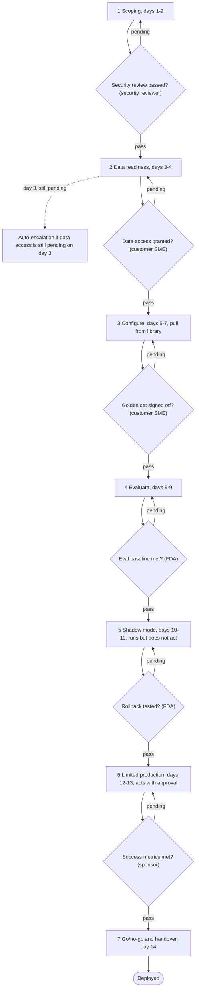

## Start with the director who signed

An FDE's engagement with an insurer was two days behind on an agent that drafted claim letters. The FDE had written the rollback plan but never run it. To save a day, the delivery director, the most senior person on the engagement, signed the "rollback tested" gate himself. On the second day of limited production the agent sent 40 letters with the wrong policy dates. The rollback failed on a configuration step nobody had rehearsed, and letters kept going out for three more hours. Call this **the senior override**: a gate that the person under the most deadline pressure can wave through.

> **What you'll learn**
>
> - List the six gates, what each blocks and who may sign it.
> - Apply the three deny rules and explain why seniority is never an override.
> - Tell apart the two pairs of gates that sound alike.
> - Describe how a stalled engagement behaves, and what each environment is for.

## Name six gates and six signers

A stage is not done because time passed. It is done because a specific, checkable fact is true and the right role has said so with evidence. The six gates between the stages of [delivery as a repeatable process](02_Delivery_as_a_Repeatable_Process.md) are where that rule lives.

| Gate | Blocks entry to | Who signs it |
|---|---|---|
| Security review passed | Data readiness | Security reviewer |
| Data access granted | Configure | Customer SME |
| Golden set signed off | Evaluate | Customer SME |
| Evaluation baseline met | Shadow mode | Forward Deployed Architect (FDA) |
| Rollback tested | Limited production | Forward Deployed Architect |
| Success metrics met | Go/no-go and deploy | Executive sponsor |

*Table 1: The six gates, the stage each blocks and the only role that may sign it.*

The sources use two labels for one role. The delivery framework's README calls the signer of the evaluation and rollback gates the "FDE lead". The theory doc and handbook call the same role the Forward Deployed Architect. Both mean the delivery lead on the engagement.

A gate sign-off has the same shape as an attribute-based access decision: a named rule, deny overriding allow, and an explicit reason. The FDA cannot pass the security gate, because only a security reviewer can. This is not bureaucracy. It is the rule that no model is ever the enforcement point, applied to people: the person closest to the work is not automatically the person authorised to certify it is safe.

## Deny on role, evidence and order

Every sign-off attempt is checked against three rules, and any one of them denies.

| Rule | Denies when |
|---|---|
| Wrong role | The signer's role is not one the gate allows, regardless of seniority |
| No evidence | The approval has no artefact behind it; "looks good" is not evidence |
| Prior gate incomplete | An earlier gate has not passed; no signing out of order |

*Table 2: The three deny rules. Any one of them denies the attempt.*

Every attempt, allowed or denied, goes into the event log. A checkbox anyone can tick is a status. A gate is a decision with a named authority behind it.

## Tell the look-alike gates apart

Two pairs of gates sound similar but check different things.

**Security review versus data access.** Both sit early and both sound like access. The security review asks whether it is safe to touch this customer's systems at all. It clears the engagement before any connection exists, and a security reviewer signs it. Data access asks whether the agreed sources are connected and live. It is an operational fact, signed by the customer's SME after clearance. One is permission to proceed. The other confirms the proceeding worked.

**Golden set versus evaluation baseline.** Both concern the same test set, one stage apart. The golden-set sign-off asks whether the test represents what this customer needs. That is a judgement about the test, made by the SME who knows the business. The baseline asks whether the assembled agent cleared the bar on that test. That is a judgement about the score, made by the FDA. One certifies the exam is fair. The other certifies it was passed. A good test with a failing score fails, and so does a strong score on a bad test. The checks are independent on purpose.

## Encode the order so no stage can be skipped

Figure 1 shows every stage, every gate and its signer.

*Figure 1: The seven stages and six gates. A pending gate loops back to its stage, and data access escalates on its own on day 3.*

Each diamond asks the same question: has the right role signed, with evidence, in order? A stage cannot be entered while any gate blocking it is pending. The ordering lives in the code that advances stages, not in anyone's memory. Advancing only ever moves to the next stage, so there is no path that jumps one. The property is in the structure, the same way a well-built RAG pipeline has no path that queries the index without the access filter.

> **Warning: a gate with an override path is a gate in name only.** If seniority or deadline pressure can bypass a sign-off, it will, on exactly the engagement that needed it.

## Let a stalled engagement say why

The framework does not promise every engagement deploys in 14 days. It promises that when one does not, everyone knows which gate stopped it and why. A vague "it is taking longer than expected" never appears.

| What happens | How the framework behaves |
|---|---|
| A gate is denied, not just late | The engagement stays at its stage; the denial is a first-class event in the log |
| The wrong person tries to sign | Denied and logged; the engagement state is unchanged |
| The customer never signs off the golden set | Evaluation stays blocked; this is a customer-side failure to surface, not route around |
| The success metrics are not met by day 14 | The go/no-go gate does not pass; no-go is a legitimate outcome, not a framework failure |

*Table 3: How the framework behaves when an engagement stalls.*

The negative-control demonstration is the one to show anyone who doubts the gates are real. Intake refuses an unmeasurable request. The FDA is denied the security gate for wrong role. The SME is denied for no evidence. An out-of-order sign-off is denied. A stage skip has no code path to call. The day-3 escalation fires on its own. A demo of things being stopped proves more than a demo of things working.

The walkthrough replays why the Northwind Logistics engagement stalled at day 3, from its event log.

Someone asks why Northwind Logistics stalled at day 3. Step through the event log.

<button type="button" data-step="0" aria-pressed="false" aria-controls="stall-step-0">1. Security gate</button><button type="button" data-step="1" aria-pressed="false" aria-controls="stall-step-1">2. Data access</button><button type="button" data-step="2" aria-pressed="false" aria-controls="stall-step-2">3. Day 3</button>

<section id="stall-step-0" class="step-panel" aria-labelledby="stall-heading-0"><h4 id="stall-heading-0">1. The FDA signs the security gate</h4><dl><dt>Attempt</dt><dd>The FDA tries to sign the security gate personally.</dd><dt>Result</dt><dd>Denied: wrong role. Only a security reviewer may sign it, however senior the FDA is.</dd></dl></section><section id="stall-step-1" class="step-panel" aria-labelledby="stall-heading-1"><h4 id="stall-heading-1">2. The SME signs data access</h4><dl><dt>Attempt</dt><dd>The customer SME signs the data-access gate with "looks good" as evidence.</dd><dt>Result</dt><dd>Denied: no evidence. An approval with no artefact behind it is not a sign-off.</dd></dl></section><section id="stall-step-2" class="step-panel" aria-labelledby="stall-heading-2"><h4 id="stall-heading-2">3. Day 3 arrives</h4><dl><dt>Event</dt><dd>Data access is still not granted on day 3.</dd><dt>Result</dt><dd>The system escalates on its own. Nobody had to notice and raise it.</dd></dl></section>

<button type="button" data-walk="previous">Previous</button>

<button type="button" data-walk="next">Next step</button>

Each stall had a named rule and a reason. That is the difference between gates that are enforced and a process document that says "get security sign-off".

## Give each environment one job

The gates decide when work may move forward. The environments decide where it runs while it does. Each one answers a different question, and mixing them is how a demo ends up holding customer data.

| Environment | What it is for | What it must not hold |
|---|---|---|
| Development | Building and breaking things quickly, with fake or synthetic data | Customer data or production credentials |
| Staging | Rehearsing the release: the same configuration, network rules and versions as production, with masked or sampled data | Real users, or a configuration that has drifted from production |
| Production | Serving the customer's real work | Experiments without a flag and a way back |

*Table 4: Each environment's one job and what it must never hold.*

The rollback-tested gate only means something if staging matches production. A rollback rehearsed against a different database version or network path proves little.

Before the limited-production gate, three ownership questions need a named answer, not a team name:

- **Who notices?** The alert or dashboard that fires, and the person it reaches at three in the morning.
- **Who responds?** The first responder on each side, the customer's on-call and ours, and how they reach each other.
- **How do we recover?** The rollback or workaround, who may trigger it, and how long it takes.

An engagement that cannot answer all three is not ready for production, however good its evaluation results. For running the incident itself, see [incidents with a customer watching](../../../05_FDE_Delivery_and_Scoping/FDE_Track/fde-deploying-in-the-estate/operating-after-go-live/03_Incidents_With_a_Customer_Watching.md).

## Limits of this lesson

- **Small teams compress gates.** A one-person delivery team cannot separate every role. The gates then compress, with a second reviewer from outside the team, rather than disappear.
- **Day ranges are the framework's plan.** The stage days come from the two-week framework and change with the engagement.
- **Composite engagement.** Northwind Logistics and the insurer are illustrative, not real customers.

## Interview angle

Each answer is an outline to say in about two minutes. Open each question and try it aloud before reading.

Interview question 1. The delivery director wants to sign the rollback gate to save a day. What do you say?

- **Answer:** No, and explain why in terms of risk, not rules. The gate exists to prove the rollback runs, in a staging environment that matches production. A signature without that evidence turns the gate into a status. Offer the fastest honest route: run the rollback rehearsal today with the director watching, then the FDA signs with the run log as evidence.
- **Trade-off:** Holding the gate costs a day and some goodwill. Waving it through risks an unrecoverable incident in front of the customer.
- **Follow-up to expect:** "What if the rehearsal fails?" Then the gate stays closed and the plan moves, which is the point of having it.

Interview question 2. Why should the customer's SME, not your team, sign off the golden set?

- **Answer:** The golden-set gate certifies the test represents the customer's real work. Only someone who knows that work can judge it. If your team signs, you are grading your own exam. The evaluation baseline is the separate gate your FDA signs: it certifies the agent passed the test.
- **Trade-off:** Waiting for the SME can stall the stage. Self-signing gives a strong score on a test nobody on the customer side trusts.
- **Follow-up to expect:** "The SME never signs." Surface it as a customer-side block with a date, and escalate through the sponsor.

Interview question 3. Day 14 arrives and the success metrics are not met. Has the framework failed?

- **Answer:** No. No-go is a legitimate outcome. The go/no-go gate does not pass, the engagement stays in limited production, and the event log shows which metric missed and by how much. Agree with the sponsor whether to extend with a fix, narrow the scope, or stop.
- **Trade-off:** A no-go is uncomfortable to report. A forced go on missed metrics hands the customer a system that does not meet the goal they signed.
- **Follow-up to expect:** "How do you keep the sponsor on side?" Show the trend and the specific gap, with a dated plan.

Interview question 4. Your staging environment uses a different database version from production. Does it matter for the gates?

- **Answer:** Yes. The rollback-tested gate rests on a rehearsal in staging. If staging differs in versions, configuration or network paths, the rehearsal tests a different system. Bring staging in line, or rehearse against a production-like copy, before signing. Development stays on synthetic data either way.
- **Trade-off:** Keeping staging matched costs effort and licences. A drifted staging gives false confidence at the gate that matters most.
- **Follow-up to expect:** "Who notices drift?" A scheduled comparison of versions and configuration, owned by a named person.

## References

1. NIST CSRC, [Glossary: separation of duty](https://csrc.nist.gov/glossary/term/separation_of_duty), accessed 18 November 2026. No user should hold enough privileges to misuse the system alone, the principle behind role-gated sign-off.
2. The Twelve-Factor App, [Dev/prod parity](https://12factor.net/dev-prod-parity), accessed 18 November 2026. Keeping environments as similar as possible.
3. Sources in this repository, the author's own material: *Theory* (§B.3), *Architecture End to End* (§2), overview ("The six decision gates"), interview script (Steps 3, 4A and 5), and *Scoping to Production in Two Weeks* and *Gates, Risks and Metrics*. The gate model builds on the DevRev interview preparation guide's delivery-framework prompt, summarised in our own words.
4. The author's own field experience, the basis for the environment rules and the three ownership questions.

## Key takeaways

- Six gates block six stage entries, each signable only by a named role. The shape mirrors an access decision with deny overriding.
- Three deny rules apply to every attempt: wrong role, no evidence, prior gate incomplete.
- Security review and data access check different things, and so do golden set and evaluation baseline.
- Stage order is encoded so no stage can be skipped and no override exists.
- A stalled engagement names the gate that stopped it. No-go at day 14 is a legitimate outcome.
- Development, staging and production each have one job, and production waits until someone is named to notice, respond and recover.

## Check yourself

1. The FDA is the most senior person on the engagement. Why can they not sign the security gate?

The gate allows only the security reviewer role. Seniority is not an override, because the person closest to the work is not the one authorised to certify it is safe.

2. Distinguish the golden-set sign-off from the evaluation baseline.

The golden-set sign-off certifies the test represents the customer's needs, signed by the SME. The baseline certifies the agent passed that test, signed by the FDA.

3. What happens when the success metrics are not met by day 14?

The go/no-go gate does not pass. No-go is a legitimate, first-class outcome, and the log shows exactly why.

4. The rollback works in staging. Why might that prove little?

Only if staging matches production in configuration, versions and network paths does the rehearsal predict production. A drifted staging tests a different system.

5. Before limited production, which three questions must have named answers?

Who notices a failure, who responds on each side, and how the system recovers, including who may trigger the rollback.

