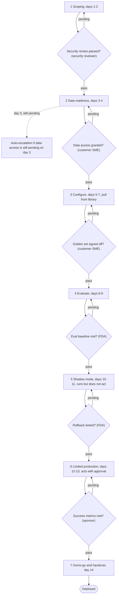

# Role-Gated Stage Gates

*Letting the most senior person sign anything keeps an engagement moving, but a gate only means something if the wrong role cannot pass it however senior they are.*

◷ 7 min

A stage is not done because time passed; it is done because a specific, checkable fact is true and the right role has said so with evidence. The six gates between the stages of [Delivery as a Repeatable Process](02_Delivery_as_a_Repeatable_Process.md) are where that rule lives.

**Objectives:**

- list the six gates, what each blocks and who may sign it;
- apply the three deny rules and explain why seniority is never an override;
- tell apart the two pairs of gates that sound alike, and describe how a stalled engagement behaves.

---

## Name Six Gates and Six Signers

| Gate | Blocks entry to | Who signs it |
|---|---|---|
| Security review passed | Data readiness | Security reviewer |
| Data access granted | Configure | Customer SME |
| Golden set signed off | Evaluate | Customer SME |
| Evaluation baseline met | Shadow mode | Forward Deployed Architect (FDA) |
| Rollback tested | Limited production | Forward Deployed Architect |
| Success metrics met | Go/no-go and deploy | Executive sponsor |

The sources disagree on one label. The delivery framework's README calls the signer of the evaluation and rollback gates the "FDE lead"; the theory doc and handbook call the same role the Forward Deployed Architect. They mean the delivery lead on the engagement.

A gate sign-off has the same shape as an attribute-based access decision: a named rule, deny overriding allow, and an explicit reason. The FDA cannot pass the security gate, because only a security reviewer can. This is not bureaucracy. It is the rule that no model is ever the enforcement point, applied to people: the person closest to the work is not automatically the person authorised to certify it is safe.

## Deny on Role, Evidence and Order

Every sign-off attempt is checked against three rules, and any one of them denies.

| Rule | Denies when |
|---|---|
| Wrong role | The signer's role is not one the gate allows, regardless of seniority |
| No evidence | The approval has no artefact behind it; "looks good" is not evidence |
| Prior gate incomplete | An earlier gate has not passed; no signing out of order |

Every attempt, allowed or denied, goes into the event log. A checkbox anyone can tick is a status. A gate is a decision with a named authority behind it.

## Tell the Look-Alike Gates Apart

Two pairs of gates sound similar but check different things.

**Security review versus data access.** Both sit early and both sound like access. The security review asks whether it is safe to touch this customer's systems at all. It clears the engagement before any connection exists, and a security reviewer signs it. Data access asks whether the agreed sources are actually connected and live. It is an operational fact, signed by the customer's SME after clearance. One is permission to proceed; the other confirms the proceeding worked.

**Golden set versus evaluation baseline.** Both concern the same test set, one stage apart. The golden-set sign-off asks whether the test represents what this customer needs. That is a judgement about the test, made by the SME who knows the business. The baseline asks whether the assembled agent cleared the bar on that test. That is a judgement about the score, made by the FDA. One certifies the exam is fair; the other certifies it was passed. A good test with a failing score fails, and so does a strong score on a bad test. The checks are independent on purpose.

## Encode the Order So No Stage Can Be Skipped

Each diamond asks the same question: has the right role signed, with evidence, in order? A stage cannot be entered while any gate blocking it is pending. The ordering lives in the code that advances stages, not in anyone's memory. Advancing only ever moves to the next stage, so there is no path that jumps one. The property is in the structure, the same way a well-built RAG pipeline has no path that queries the index without the access filter.

> **Warning: a gate with an override path is a gate in name only.** If seniority or deadline pressure can bypass a sign-off, it will, on exactly the engagement that needed it.

## Let a Stalled Engagement Say Why

The framework does not promise every engagement deploys in 14 days. It promises that when one does not, everyone knows which gate stopped it and why. A vague "it is taking longer than expected" never appears.

| What happens | How the framework behaves |
|---|---|
| A gate is genuinely denied, not just late | The engagement stays at its stage; the denial is a first-class event in the log |
| The wrong person tries to sign | Denied and logged; the engagement state is unchanged |
| The customer never signs off the golden set | Evaluation stays blocked; this is a customer-side failure to surface, not route around |
| The success metrics are not met by day 14 | The go/no-go gate does not pass; no-go is a legitimate outcome, not a framework failure |

The negative-control demonstration is the one to show anyone who doubts the gates are real. Intake refuses an unmeasurable request. The FDA is denied the security gate for wrong role. The SME is denied for no evidence. An out-of-order sign-off is denied. A stage skip has no code path to call. The day-3 escalation fires on its own. A demo of things being stopped proves more than a demo of things working.

## Worked Example: Why Northwind Stalled on Day 3

Someone asks why the Northwind Logistics engagement stalled at day 3. The event log answers it.

The FDA tried to sign the security gate personally. Denied: wrong role, because only a security reviewer may sign it, however senior the FDA is. The customer SME then signed the data-access gate with "looks good" as evidence. Denied: no evidence, because an approval with no artefact behind it is not a sign-off. And on day 3, with data access still not granted, the system escalated on its own; nobody had to notice and raise it.

Each stall had a named rule and a reason. That is the difference between gates that are enforced and a process document that says "get security sign-off".

---

## Key Takeaways

- Six gates block six stage entries, each signable only by a named role; the shape mirrors an access decision with deny overriding.
- Three deny rules apply to every attempt: wrong role, no evidence, prior gate incomplete.
- Security review and data access check different things, and so do golden set and evaluation baseline.
- Stage order is encoded so no stage can be skipped and no override exists.
- A stalled engagement names the gate that stopped it; no-go at day 14 is a legitimate outcome.

## Check Yourself

1. **The FDA is the most senior person on the engagement. Why can they not sign the security gate?**
   The gate allows only the security reviewer role. Seniority is not an override, because the person closest to the work is not the one authorised to certify it is safe.

2. **Distinguish the golden-set sign-off from the evaluation baseline.**
   The golden-set sign-off certifies the test represents the customer's needs, signed by the SME. The baseline certifies the agent passed that test, signed by the FDA.

3. **What happens when the success metrics are not met by day 14?**
   The go/no-go gate does not pass. No-go is a legitimate, first-class outcome, and the log shows exactly why.

## References

**Sources:** `05_FDE_Delivery_and_Scoping/Delivery_Framework/docs/01-theory.md`: §B.3. `05_FDE_Delivery_and_Scoping/Delivery_Framework/docs/02-architecture-end-to-end.md`: §2. `05_FDE_Delivery_and_Scoping/Delivery_Framework/README.md`: "The six decision gates". `05_FDE_Delivery_and_Scoping/Delivery_Framework/INTERVIEW_SCRIPT.md`: Steps 3, 4A and 5 (failure modes). `01_Concept_Tutorials/FDE_Handbook/10_FDE_Delivery_Operating_Model/03_Scoping_To_Production_In_Two_Weeks.md`: the state machine and the Northwind case study. `01_Concept_Tutorials/FDE_Handbook/10_FDE_Delivery_Operating_Model/04_Gates_Risks_Metrics.md`: "The six gates" and "The negative-control demo". The gate model builds on the DevRev interview preparation guide's delivery-framework prompt, summarised in our own words.
