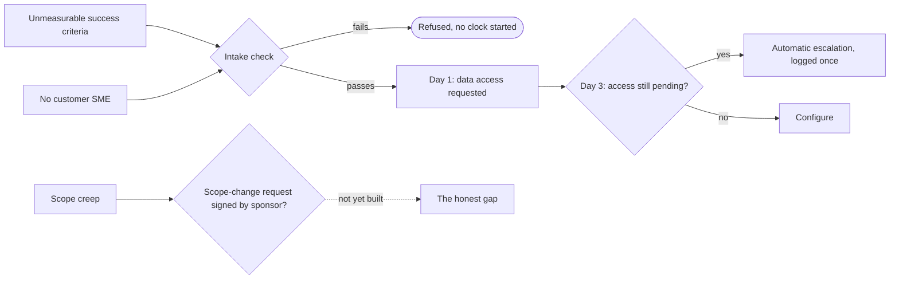

## Start with the line in the plan

A fictional retail customer's delivery plan had a risk register with a sensible line: "Data access delays. Mitigation: delivery lead escalates on day 3." On day 3 the delivery lead was at another customer's go-live. Nobody chased the access request. It was granted on day 8, and the two-week date slipped by a week.

Nobody had ignored the risk. The mitigation depended on one person's calendar in the busiest week of the month. Call this **the reminder mitigation**: a risk response that works only if someone remembers it at the moment they are busiest.

> **What you'll learn**
>
> - Match each of the four named delivery risks to the check that mitigates it.
> - Explain why some engagements should not be two weeks.
> - Read the five delivery metrics and what each reveals.
> - State plainly what a single engagement's numbers do and do not prove.

## Turn each risk into a check

A risk mitigation that lives as a reminder on a tracker is not a mitigation. The delivery framework answers each named risk with a mechanism, not a to-do item.

| Risk | Mitigation | How it is enforced |
|---|---|---|
| Data access delays | Start on day 1, escalate on day 3 | An automatic date check: if data access is still pending on day 3, the system raises the escalation itself, once, and logs it |
| Scope creep | Change control on the signed scope | Any change after intake goes through the same sponsor-level authority that approved the original metrics |
| Unmeasurable success criteria | Refuse to start | Intake refuses the engagement before a clock starts |
| No customer SME | Make the SME a contractual prerequisite | Also enforced at intake; three of the six gates need an SME signature, so an engagement with no SME can never finish |

*Table 1: The four named delivery risks and the check that enforces each mitigation.*

The escalation is automatic because a person remembering to chase access is the very thing that fails under load. It fires whether anyone is watching or not. Figure 1 shows where each check sits.

*Figure 1: Three of the four risks have a check that runs by itself. Scope-change control is the gap.*

Scope-change control is the honest gap. The interview script marks it not yet built and suggests reusing the sign-off pattern for a scope-change request that requires the sponsor role. The handbook sizes that as low effort. So three of the four mitigations are real checks today.

The script counts this two ways. Its risk table shows three of four built, while its closing summary says "two of four" are automatic. The table is the more specific statement. Treat three as the accurate figure and say the scope-change check is the missing one.

> **Warning: a reminder on a tracker is not a mitigation.** "Escalate on day 3" written in a plan depends on someone's calendar. Written as a check against the engagement's day and gate state, it cannot be forgotten.

## Accept that some engagements should not be two weeks

The prep guide states an honest limit: some engagements should not be two weeks, and knowing which to reject is part of the framework. Intake refusal makes that judgement literal. Not every request should have a clock started against it.

## Read five metrics, not one

| Metric | What it reveals |
|---|---|
| Time to first value | How long until the customer saw something real, not a status update |
| Evaluation score at handover | The number that was true when responsibility transferred |
| Human-approval override rate | Falling over time means trust is being earned; flat means the agent is not ready for less supervision |
| Week-4 retention | Whether the deployed thing is still the thing being used a month later; left empty until recorded, never a fake zero |
| Accelerator reuse rate | The direct measure of productised process against bespoke heroics |

*Table 2: The five delivery metrics and what each one reveals.*

The first four come from the prep guide. The reuse rate is the framework's own addition, because it turns the governing question, pulled from the library or built from scratch, into a number. Metrics are computed from the engagement's own history when asked, not tracked separately.

## Worked example: reading the Northwind numbers with their limits

The Northwind Logistics demo reports:

- time to first value of 1 day;
- an evaluation score of 0.83;
- an override rate of 0.27;
- a reuse rate of 0.83;
- all 6 of 6 gates passed, and one escalation raised automatically on day 3, resolved when the gate passed.

Read them with care. This is one engagement, run once. The 0.83 evaluation score is a demo-scripted value, not a measurement. The interview script admits the evaluate stage asserts a score rather than calling a real evaluation harness. What the run does prove is that the pipeline enforces its own gates and fires its own escalation.

Saying that out loud is stronger than presenting 0.83 as a result. An interviewer probing the number finds the candidate already named its limit.

## Limits of this lesson

- **Four risks, not all risks.** The framework names four. Real engagements add others, such as a key person leaving, and each still needs a mechanism.
- **One run.** The Northwind numbers come from one scripted engagement and prove the mechanism, not the outcome.
- **Illustrative cases.** Northwind Logistics and the retail customer are illustrative.

## Interview angle

Each answer is an outline to say in about two minutes. Open each question and try it aloud before reading.

Interview question 1. Your risk register says "escalate if data access is late". Why is that not enough?

- **Answer:** It depends on a person remembering at the moment they are busiest. Turn it into a check: data access is requested on day 1, and if the gate is still pending on day 3 the system raises the escalation itself, once, and logs it. Do the same for each named risk where you can.
- **Trade-off:** Building the check takes time up front. A reminder costs nothing until the week it fails.
- **Follow-up to expect:** "Who receives the escalation?" A named owner on the customer side with authority over access, plus your delivery lead.

Interview question 2. Midway through, the customer asks for a second use case "while you are in there". How do you handle it?

- **Answer:** Route it through change control on the signed scope. The same sponsor who approved the original metrics decides whether to add it, swap it for something, or schedule it after go-live. Show what it does to the date and to the gates already passed.
- **Trade-off:** A quick yes pleases the customer today. Silent scope growth breaks the two-week date and the metrics everyone signed.
- **Follow-up to expect:** "Is that check built in your framework?" Not yet. Name it as the one gap and the sign-off pattern you would reuse.

Interview question 3. Which metrics would you report at the end of a two-week delivery, and why those?

- **Answer:** Time to first value, the evaluation score at handover, the human-approval override rate, week-4 retention, and the accelerator reuse rate. Together they cover speed, quality at handover, trust, real use and how repeatable the process is. Leave retention empty until it is measured.
- **Trade-off:** Five numbers take longer to explain than one. One number hides either quality or repeatability.
- **Follow-up to expect:** "The override rate is flat at 27%." The agent is not earning trust. Look at which actions are overridden before reducing supervision.

Interview question 4. An interviewer asks where your 0.83 evaluation score came from. It was scripted in a demo. What do you say?

- **Answer:** Say so plainly. The demo asserts the score instead of calling a real evaluation harness, so 0.83 proves nothing about quality. What the run does prove is that the gates block the wrong signer, missing evidence and out-of-order sign-offs, and that the escalation fires by itself. Then say how you would wire in a real harness.
- **Trade-off:** Admitting the gap feels weak. Defending a scripted number fails at the next question.
- **Follow-up to expect:** "What would the harness check?" The golden set signed off by the SME, scored the same way every run.

## References

1. DORA, [DORA's software delivery performance metrics](https://dora.dev/guides/dora-metrics-four-keys/), accessed 18 November 2026. Measuring a delivery process by throughput and instability rather than by activity.
2. Sources in this repository, the author's own material: *Theory* (§B.4–B.5), interview script (Step 4A automatic escalation, Step 4B "What the library is honestly not", the Step 5 risk table and Step 6 summary), and *Gates, Risks and Metrics* ("Risk mitigations are checks, not reminders" and "The five metrics").
3. The risks and metrics come from the DevRev interview preparation guide's delivery-framework prompt, summarised in our own words.
4. The author's own field experience, the basis for the opening story and the limits.

## Key takeaways

- Each delivery risk needs a mechanism, not a reminder: auto-escalation, change control, intake refusal, SME prerequisite.
- Scope-change control is the honest gap. Three of four mitigations are real checks.
- Some engagements should not be two weeks, and rejecting them is part of the design.
- Track five metrics, with reuse rate as the measure of productised delivery and week-4 retention left empty until recorded.
- Report demo numbers with their limits: one run, one scripted score.

## Check yourself

1. Why is the day-3 escalation automatic rather than a task for the delivery lead?

A person remembering to chase access is what fails under load. An automatic check against day and gate state fires whether anyone is watching.

2. What does a flat override rate tell you?

Humans keep overriding the agent at the same rate, so trust is not being earned and the agent is not ready for less supervision.

3. Why should week-4 retention show as empty rather than 0.0 before it is recorded?

A zero claims nobody uses the agent. An empty value says the measurement has not happened yet.

