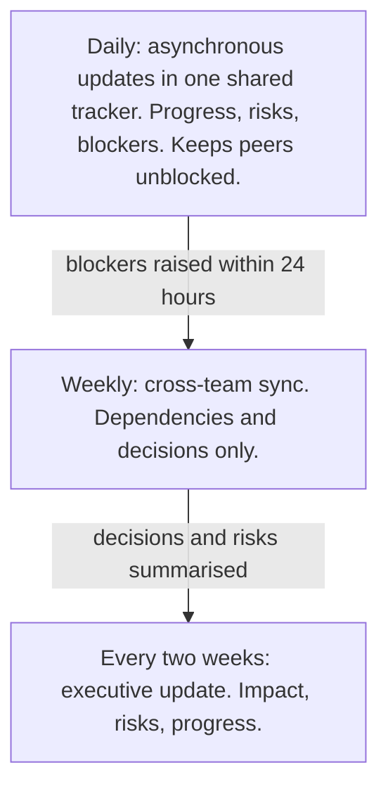

## Start with the fourth weekly sync

A fictional retailer's forecasting platform had five teams and, by month two, four recurring meetings a week. Each meeting opened with every team reading out its status. The ingestion team's schema change came up in the third meeting, after the forecasting team had already trained on the old schema.

Nobody owned the decision to change the schema. Everyone had been informed, in a meeting, after the fact. The forecast release slipped three weeks.

More meetings feel like more alignment. Coupled teams stay aligned through clear ownership, a tiered cadence and interfaces, not through volume of contact. Call this **the status-meeting spiral**: adding meetings to fix a problem that comes from unclear ownership.

> **What you'll learn**
>
> - Map stakeholder groups and their different definitions of done.
> - Assign ownership across workstreams with a RACI and exactly one accountable owner each.
> - Match communication frequency to altitude with a three-tier cadence.
> - Resolve a priority conflict with an interface rather than a loser.

## Map the stakeholders and their definitions of done

The hard part of a cross-team AI platform is rarely the technology. It is aligning teams with different priorities and tightly coupled dependencies. Naming that first, then showing three mechanisms that address it, is what separates a senior answer from "we had a lot of syncs".

The example is a global data and AI platform producing seller and executive insights. Five groups were tightly coupled:

- **Software teams** owned upstream applications and APIs.
- **Data engineering** built ingestion and the lake.
- **AI and ML engineers** built forecasting and insight models.
- **A project manager** handled timelines and coordination.
- **Business stakeholders** defined success metrics and consumed the outputs.

Each group had a different stake and a different meaning of "done". Their dependencies were tight enough that one team's delay cascaded into the others. That coupling, not any single technical problem, was the main challenge.

## Give every workstream one accountable owner

A RACI removes ownership ambiguity. For each workstream it names who is Responsible for doing the work, who is Accountable for the outcome, who is Consulted before decisions and who is Informed after them.

| Workstream | Responsible | Accountable | Consulted | Informed |
|---|---|---|---|---|
| Data ingestion | DE team | Data platform lead | Software teams | PM, business |
| Data modelling in the lake | DE team | Data platform lead | AI engineers | PM |
| ML forecasting models | AI engineers | ML lead | DE team, business | PM |
| API and data access | Software teams | Engineering manager | DE team | PM, business |
| Dashboards and insights | BI and AI team | Product owner | Business stakeholders | PM |
| Programme delivery | Project manager | Programme sponsor | All teams | Leadership |

*Table 1: The RACI for the platform. DE is data engineering, PM the project manager and BI business intelligence.*

A workstream with an unclear owner is where cross-team projects quietly stall. Exactly one accountable owner per deliverable sped up decisions and put accountability at every stage. The delivery gates in [role-gated stage gates](03_Role_Gated_Stage_Gates.md) are the same idea with harder edges: a named role may sign, and no one else.

## Match meeting frequency to altitude

The cadence had three tiers, each answering a different question. Higher frequency carried more detail. Lower frequency carried more altitude. Figure 1 shows the tiers.

*Figure 1: The three-tier cadence. Each tier answers a different question, and detail falls as altitude rises.*

Four rules made it work:

1. **No status-only meetings.** Every interaction had to unblock or decide something.
2. **One source of truth.** A single tracker, not five spreadsheets and a chat thread each claiming to be current.
3. **Write first.** Decisions were documented before discussion, so meetings resolved disagreements rather than drafting them.
4. **Fast escalation.** Blockers were raised within 24 hours, because a dependency left for a week is how coupled work cascades into delay. That is the human version of the automatic day-3 escalation.

Bridging technical and business language mattered too. "Data delay affects forecast accuracy and seller decisions" lands with a business stakeholder. "The ingestion job failed" does not. The customer stayed engaged throughout instead of being briefed at delivery.

> **Warning: a meeting that only reports status is a written update with a calendar invite.** It costs everyone's time and decides nothing. Send the update. Meet only to unblock or decide.

## Resolve conflict with an interface

The conflict was real. Software teams prioritised fast feature delivery. Data engineering and AI teams needed stable, high-quality data. Neither was wrong. They were optimising for different stages of the same pipeline.

Two mechanisms resolved it without a loser:

- **Data contracts** turned an ownership argument into an interface agreement.
- **Two-phase delivery** balanced speed and reliability. Phase one shipped a reliable core dataset, and phase two layered advanced features once the base was stable.

The shape matches narrowing a first build to prove a model before expanding, and a staged rollout: earn trust on a stable core, then extend.

## Worked example: answering the cross-team question

The prompt: "Tell me about a time you led a cross-team data or AI project with multiple stakeholders. How did you ensure alignment, ownership and communication?"

1. **Name the real difficulty.** Five groups with conflicting priorities and coupled dependencies.
2. **Show ownership.** The RACI and the rule of one accountable owner.
3. **Show the cadence.** The three tiers and the four rules.
4. **Tell the conflict.** Speed against data stability, and how data contracts and two phases resolved it. Execution followed RACI ownership, with dependency tracking visible to everyone and integration checkpoints before divergence got expensive.
5. **Close on outcomes.** The platform improved demand forecasting and reduced stockouts and wastage. More valuable still, it left a repeatable collaboration model that other programmes reused without rebuilding the RACI and cadence.

"I built a way of working other teams now reuse" meets the senior bar in a way "I built a platform" does not. Behavioural storytelling for this question is also practised in the communication track.

## Limits of this lesson

- **One programme's shape.** Five groups and three tiers fitted this platform. A smaller project may need two tiers, and a larger one a programme board.
- **A RACI is a start.** It names owners. It does not make them act, so the cadence and escalation rules still matter.
- **Illustrative story.** The retailer in the opening story is illustrative. The platform example is drawn from the author's own experience.

## Interview angle

Each answer is an outline to say in about two minutes. Open each question and try it aloud before reading.

Interview question 1. Two teams both think they own the customer data model. Decisions keep stalling. What do you do?

- **Answer:** Make ownership explicit. Draw a RACI for the workstream with exactly one accountable owner, agreed with both teams' leads and the sponsor. The other team becomes consulted before changes. Write the decision down in the shared tracker so it does not reopen in the next meeting.
- **Trade-off:** One team gives up a veto. Shared ownership feels fair and leaves every decision waiting for both.
- **Follow-up to expect:** "They still disagree on a change." The accountable owner decides after consulting, and the other team can escalate within 24 hours.

Interview question 2. The sponsor wants a weekly hour-long status meeting with all five teams. How do you respond?

- **Answer:** Offer the same visibility for less time. Daily asynchronous updates in one tracker cover progress and blockers. A weekly sync covers only cross-team dependencies and decisions. A fortnightly executive update gives the sponsor impact, risks and progress. Every meeting must unblock or decide something.
- **Trade-off:** Fewer meetings rely on people writing updates. A big status meeting feels reassuring and decides nothing.
- **Follow-up to expect:** "What if updates are not written?" The tracker is the source of truth, and the weekly sync starts from what is missing.

Interview question 3. The application team wants to ship features weekly. The ML team needs a stable schema. How do you settle it?

- **Answer:** Turn the argument into an interface. Agree a data contract for the fields the ML team depends on, with a change process and notice period. Deliver in two phases: a reliable core dataset first, then advanced features once the base is stable. Each team keeps its pace inside the contract.
- **Trade-off:** A contract slows some application changes. No contract means every release can break the model.
- **Follow-up to expect:** "How do you catch a breaking change?" A contract test in the producer's pipeline that fails before release.

Interview question 4. How do you explain a data delay to a business stakeholder?

- **Answer:** In terms of their decision. "The data delay means this week's forecast is a day old, so store orders on Tuesday may be off by a few per cent" lands. "The ingestion job failed" does not. Say what it affects, how long, and what you are doing about it.
- **Trade-off:** Translating takes thought each time. Technical language leaves stakeholders unable to act.
- **Follow-up to expect:** "Should they wait or act?" Give a recommendation, not only the facts.

## References

1. Wikipedia, [Responsibility assignment matrix](https://en.wikipedia.org/wiki/Responsibility_assignment_matrix), accessed 18 November 2026. The RACI roles and the rule of one accountable person per task.
2. Martin Fowler, [Consumer-driven contracts: a service evolution pattern](https://martinfowler.com/articles/consumerDrivenContracts.html), accessed 18 November 2026. Agreeing interfaces between producer and consumer teams.
3. Sources in this repository, the author's own material: `01_Concept_Tutorials/FDE_Handbook/10_FDE_Delivery_Operating_Model/05_Cross_Team_Collaboration.md` (all sections).
4. The author's own field experience, the basis for the platform example.

## Key takeaways

- Name the coupling between stakeholder groups before any technical detail.
- A RACI with exactly one accountable owner per workstream removes the ambiguity where projects stall.
- A three-tier cadence matches frequency to altitude: no status-only meetings, one source of truth, write first, escalate within 24 hours.
- Resolve priority conflicts with interfaces such as data contracts and phased delivery, so nobody has to lose.
- The most senior outcome is a collaboration model others reuse.

## Check yourself

1. What does each letter of RACI mean, and why does "exactly one A" matter?

Responsible, Accountable, Consulted, Informed. One accountable owner per workstream means decisions have a clear owner and nothing stalls in ambiguity.

2. What question does each tier of the cadence answer?

Daily asynchronous updates keep peers unblocked. The weekly sync resolves cross-team dependencies. The executive update every two weeks keeps leadership informed without detail.

3. How was the speed-versus-stability conflict resolved without a loser?

Data contracts turned it into an interface agreement, and two-phase delivery shipped a reliable core first, then advanced features.

