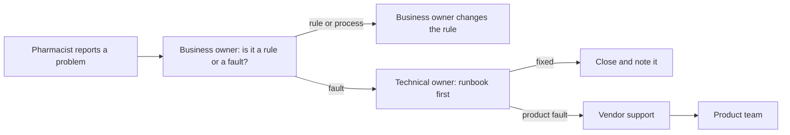

## Start with the queue nobody watched

Dunmore Pharmacy, a fictional chain of 40 pharmacies, had an FDE team build an assistant that sorts repeat-prescription requests from its website and drafts replies for pharmacists to approve. After twelve weeks the system worked well, the sponsor signed off and the FDE team moved to another customer. The handover was a 90-minute call and a wiki page.

Six weeks later a doctors' practice system changed the format of one field. The assistant could no longer read those requests and put them in an "unclassified" queue. Nobody watched that queue. About 210 requests a day landed there, and it was nine days before a pharmacist noticed the phones ringing about late prescriptions. By then about 1,900 requests were waiting.

When the operations director asked who owned the system, pharmacy operations said IT did, IT said the business did, and the vendor's support desk said the field mapping was customer configuration. Each answer was partly right. Call this **the orphaned system**: a working system with no single person accountable for keeping it working.

> **What you'll learn**
>
> - Define what the receiving team must be able to operate, monitor and fix.
> - Split duties between the customer, their IT team and vendor support.
> - Build and use a handover checklist.
> - Hand over in stages, and act when an engagement is ending with no owner.

## What the receiving team must be able to do

A handover is complete when the receiving team can run the system without the FDE. Documents help, but the test is what people can do. Group it in three verbs:

| Verb | What the team must be able to do | Dunmore example |
| --- | --- | --- |
| Operate | Deploy a change, add and remove users, rotate credentials, restart a failed job | Add a new pharmacy's staff and renew the practice-system key |
| Monitor | Read the dashboard, know what normal looks like, receive alerts on a named rota | Alert when the unclassified queue passes 50 requests |
| Fix | Diagnose the common failures from the runbook, roll back, adjust rules within agreed limits, escalate the rest | Update a field mapping when a practice system changes |

*Table 1: Operate, monitor, fix. Each row is checked by watching the team do it, not by asking whether they read the page.*

Dunmore's team could operate the system. Nobody could monitor it, because no alert existed for the queue that mattered. Nobody had practised the fix, because the FDE had always done it.

Google's Site Reliability Engineering (SRE) book describes a production readiness review, in which the team that will run a service checks its reliability needs before taking it on. A field handover borrows the same idea: the receiver inspects the system before accepting it.

## Customer duties and support boundaries

Ownership has several layers, and each needs a named holder. Write them into the support agreement before go-live:

- **Business owner.** A person in the customer's operations who is accountable for the outcome, decides on changes and owns the rules the system applies.
- **Technical owner.** A person in the customer's IT team who runs the platform, the integrations and the on-call rota.
- **Vendor support.** Your company's support desk, for faults in the product itself, under its normal service levels.
- **Product team.** Engineering at your company, reached through vendor support, never directly by users.

The customer also has duties that no vendor can perform for them: telling the technical owner before upstream systems change, keeping access and data owners current, and staffing the rota. Write those down too. Figure 1 shows the route a problem takes.

*Figure 1: The support route agreed at Dunmore after the incident. Each box is a named person or desk with a response time.*

The site's [where the role ends](../../../05_FDE_Delivery_and_Scoping/FDE_Track/fde-in-the-field/fde-role-and-boundaries/03_Where_the_Role_Ends.md) lesson explains why the FDE must not remain the hidden support desk. This lesson covers how to make the alternative real.

## The handover checklist

The checklist turns the three verbs and the support split into items someone can tick. Each item has an owner on the receiving side who confirms it.

| Area | Items |
| --- | --- |
| People | Business owner and technical owner named, a staffed on-call rota, a deputy for each owner |
| Documents | Architecture notes, data flows, the runbook for the top failures, decision records, known limits |
| Access | Credentials moved to the customer's vault, FDE access removed or time-limited, admin rights with the technical owner |
| Monitoring | Dashboards, alerts routed to the rota, thresholds the team agreed, one test alert received |
| Change | How to change rules and prompts, who approves, how to roll back, the evaluation set to rerun after changes |
| Support | Agreement signed, support route tested with one ticket, vendor service levels known |
| Open items | Known defects, deferred work and risks, each with an owner and a date |
| Acceptance | The receiving team has run a release and handled a practice incident, then signed |

*Table 2: A handover checklist. The last row is the one that proves the others.*

Runbooks are worth a note. Write them for the failures that have happened or are likely, in the order a tired person needs them: the symptom, how to confirm it, the fix, how to check it worked and when to escalate.

## Hand over in stages

One call at the end cannot transfer the skill to fix a system. Move responsibility in steps, while the FDE is still there to catch mistakes. The walkthrough shows the plan Dunmore used when it later added a second assistant.

Four stages over about four weeks. Each shows who does the work, who watches and what must be true to move on.

<button type="button" data-step="0" aria-pressed="false" aria-controls="handover-step-0">1. Shadow</button><button type="button" data-step="1" aria-pressed="false" aria-controls="handover-step-1">2. Reverse</button><button type="button" data-step="2" aria-pressed="false" aria-controls="handover-step-2">3. On call</button><button type="button" data-step="3" aria-pressed="false" aria-controls="handover-step-3">4. Exit</button>

<section id="handover-step-0" class="step-panel" aria-labelledby="handover-heading-0"><h4 id="handover-heading-0">1. Owners shadow the FDE</h4><dl><dt>Does the work</dt><dd>The FDE runs releases, triages alerts and changes rules.</dd><dt>Watches</dt><dd>The business and technical owners, taking notes into the runbook.</dd><dt>Move on when</dt><dd>The owners can explain each runbook entry in their own words.</dd></dl></section><section id="handover-step-1" class="step-panel" aria-labelledby="handover-heading-1"><h4 id="handover-heading-1">2. FDE shadows the owners</h4><dl><dt>Does the work</dt><dd>The technical owner runs one release and handles one practice incident.</dd><dt>Watches</dt><dd>The FDE, stepping in only to prevent harm.</dd><dt>Move on when</dt><dd>Both were done without the FDE touching the keyboard.</dd></dl></section><section id="handover-step-2" class="step-panel" aria-labelledby="handover-heading-2"><h4 id="handover-heading-2">3. Owners run, FDE on call</h4><dl><dt>Does the work</dt><dd>The owners, for two weeks, through the real rota and support route.</dd><dt>Watches</dt><dd>The FDE, reachable for questions, logging each one.</dd><dt>Move on when</dt><dd>Questions have dropped to near zero and every one is now in the runbook.</dd></dl></section><section id="handover-step-3" class="step-panel" aria-labelledby="handover-heading-3"><h4 id="handover-heading-3">4. Exit review</h4><dl><dt>Does the work</dt><dd>The owners walk the checklist with the sponsor.</dd><dt>Watches</dt><dd>The FDE and the vendor's support lead.</dd><dt>Move on when</dt><dd>Both owners sign, FDE access is removed and open items have dates.</dd></dl></section>

<button type="button" data-walk="previous">Previous</button>

<button type="button" data-walk="next">Next step</button>

The walkthrough is a scripted illustration. The logged questions in stage 3 are the best runbook material you will get, because they are what the owners did not know.

## When the engagement is ending with no owner

Sometimes the end date arrives and nobody has accepted the system. The customer may be reorganising, the intended owner may have left, or IT may refuse to run something it did not choose. Handle it early and in the open:

1. **Raise it by the pilot.** Name the owner as a gate condition. A missing owner at the pilot gate is a risk, and at the exit it is a crisis.
2. **Put the risk in writing to the sponsor.** State what fails without an owner, how soon and who is affected. At Dunmore that was late prescriptions.
3. **Offer options with costs.** Extend the engagement for a paid transition, shrink the system to what an existing team can run, move the work to a managed service, or switch it off with a plan.
4. **Never leave it running silently.** A system nobody watches fails without anyone noticing, which is worse than one that was switched off on purpose.

Record the sponsor's decision. If they accept the risk, the record shows it was their choice.

## Limits of this lesson

- **Contracts vary.** Some engagements include managed support, which changes who holds the technical owner role. The checklist still applies.
- **Small customers.** One person may hold both owner roles. Name a deputy anyway.
- **Fictional data.** Dunmore Pharmacy and its figures are illustrative.

## Interview angle

Each answer is an outline to say in about two minutes. Open each question and try it aloud before reading.

Interview question 1. After go-live, who owns what between you, the customer and your support team?

- **Answer:** The customer's business owner is accountable for the outcome and the rules. Their technical owner runs the platform, integrations and on-call rota. Vendor support handles product faults under its service levels, and the product team is reached only through support. The customer must warn before upstream changes and keep access current. The FDE moves out of the support path after an agreed transition.
- **Trade-off:** Clear lines can feel unhelpful to the customer at first. Blurred lines make the FDE the permanent help desk.
- **Follow-up to expect:** "The customer wants you on call." Offer a time-limited transition, not an open-ended role.

Interview question 2. The engagement ends in two weeks and nobody on the customer side has agreed to own the system. What do you do?

- **Answer:** Put the risk in writing to the sponsor: what breaks without an owner, how soon and who is hurt. Offer options with costs: a paid extension for transition, a smaller system an existing team can run, a managed service, or switching it off with a plan. Ask for a decision by a date and record it. In future, make the owner a pilot gate condition.
- **Trade-off:** Escalating late is uncomfortable. Leaving quietly makes a failure certain and likely blamed on you.
- **Follow-up to expect:** "The sponsor says to leave it running." Record that as their accepted risk, with monitoring set up first.

Interview question 3. How do you run an operational handover so the receiving team can really run the system?

- **Answer:** Define what they must do: operate, monitor and fix. Then move responsibility in stages. They shadow you, then you shadow them through a release and a practice incident, then they run it with you on call while you log every question into the runbook. Finish with an exit review against the checklist, signed by both owners, and remove your access.
- **Trade-off:** A staged handover costs two to four weeks of FDE time. A one-call handover costs the first incident.
- **Follow-up to expect:** "How do you know it worked?" They handled a real or practice incident without you.

## References

1. Google SRE, [The evolving SRE engagement model](https://sre.google/sre-book/evolving-sre-engagement-model/), accessed 17 November 2026. The production readiness review a receiving team runs before taking on a service.
2. Google SRE, [Accelerating SREs to on-call and beyond](https://sre.google/sre-book/accelerating-sre-on-call/), accessed 17 November 2026. Building the skills to run a system through practice and shadowing.
3. The site's [where the role ends](../../../05_FDE_Delivery_and_Scoping/FDE_Track/fde-in-the-field/fde-role-and-boundaries/03_Where_the_Role_Ends.md) and [cross-team ownership and cadence](06_Cross_Team_Ownership_and_Cadence.md) lessons.
4. The author's own field experience, the basis for the staged handover and the checklist.

## Key takeaways

- A handover is complete when the receiving team can operate, monitor and fix the system without you.
- Name a business owner and a technical owner, and write the support route and customer duties down.
- Use a checklist whose last item is proof: a release and an incident handled by the owners.
- Hand over in stages: shadow, reverse shadow, on call, exit review.
- An engagement ending with no owner is escalated early, with options and a recorded decision.

## Check yourself

1. Dunmore's team could operate the system. Which of the three verbs failed, and how?

Monitor and fix. No alert watched the unclassified queue, and nobody but the FDE had practised updating a field mapping.

2. Why does the handover checklist end with a release and a practice incident instead of a signature alone?

A signature shows agreement, not ability. Running a release and an incident shows the owners can do the work without the FDE.

3. Why is a system nobody watches worse than one switched off on purpose?

Its failures go unnoticed until users are harmed. A system switched off with a plan has a known state and a known fallback.

