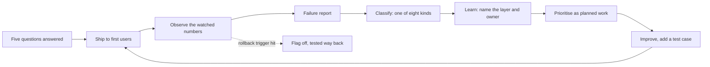

## Start with the untested switch

Wrenfield Mutual, an insurer, had its FDE switch on a claims assistant for all 300 of its handlers on a Monday. The runbook said the feature could be turned off, and nobody had tried it. On Wednesday the assistant began quoting an excess figure from last year's policy wording. Turning it off took most of the day, because the setting lived in a deployment file and the only person who knew that was on leave. Every handler saw the bad answers in the meantime. Call this **the one-way launch**: a rollout that can only go forward.

> **What you'll learn**
>
> - Answer the five questions every launch needs before it starts.
> - Run the ship, observe, learn, prioritise, improve loop after launch.
> - Classify a production failure before choosing a fix.

## Answer five questions before launch

Shipping is not the finish line. Delivery is the result the system produces in real use, and that result starts with a deliberate rollout. Before any user sees the feature, settle five things:

1. **Who gets it first?**
2. **Can it be turned on and off with a feature flag?**
3. **Which numbers will be watched?**
4. **Which conditions trigger a rollback?**
5. **Who is on hand if it fails?**

Each answer limits the cost of being wrong. A small first group limits who is affected. A flag limits how long they are affected. Named numbers and rollback triggers turn "it feels off" into a decision someone can make in minutes. A named responder means the decision gets made.

The two-week delivery framework builds the same caution into its stages. Shadow mode runs on real traffic without acting, and limited production acts only with a human approving and a rollback that has been tested. See [Delivery as a Repeatable Process](../T6.3_Delivery_Six_Stages_Gates_and_Two_Week_Launch/02_Delivery_as_a_Repeatable_Process.md).

> **Warning: a rollback that was documented but never exercised is a hope, not a plan.** Test the way back before the first real user depends on it.

## Expect production to prove the plan wrong

Real use will show that parts of the original plan were wrong. That is normal, and it is why delivery continues after launch as a loop: ship, observe, learn, prioritise, improve. Figure 1 shows the loop, with the classification step that keeps it pointed at the right layer.

*Figure 1: The post-launch loop. Each failure is classified before it becomes planned work, and a rollback trigger skips the loop entirely.*

The loop only works if failures become planned work rather than firefights. Each important failure should become a scheduled fix and, where it involves AI behaviour, a new test case, so the same failure is caught next time.

When the first failure report arrives from a customer who calls you through an SDK or client library, support needs three facts before anyone debugs: the exact version, the runtime and the last known good request. See [Stabilise the Customer First](../../../05_FDE_Delivery_and_Scoping/FDE_Track/forward-deployed/debugging-customer-environment/01_Stabilise_the_Customer_First.md).

## Classify the failure before fixing it

A failure report rarely names its cause. Before choosing a fix, sort it into one of eight kinds.

| Kind | Who usually acts |
| --- | --- |
| Product design | Product owner and delivery lead |
| Code | Engineering |
| Data | Data owners and pipeline engineers |
| Operations | Whoever runs the service |
| Search and retrieval | Data and indexing work |
| AI behaviour | Prompt, model and evaluation work |
| Documentation | Whoever owns the docs |
| User training | Onboarding and team leads |

*Table 1: The eight kinds of production failure. The kind decides which layer and which team acts.*

The classification decides who acts. A retrieval failure goes to the data and indexing work. A training failure goes to onboarding, and no code change will fix it. Fixing the wrong layer spends effort and leaves the failure in place.

## Worked example: launching a support assistant to 25 agents

A support-assistant pilot is ready. Answer the five questions:

- **First users:** 25 support agents.
- **Switch:** a feature flag per agent.
- **Numbers:** median resolution time and the escalation rate.
- **Rollback trigger:** escalations rising more than a set margin above normal.
- **On hand:** the delivery lead and one support supervisor.

In the first weeks, the most common failure is an answer built on an outdated policy document. Classify it: search and retrieval, specifically stale knowledge, not AI behaviour. The planned work is an automatic knowledge refresh plus tests for lookup quality, not a prompt change. The loop turned a recurring complaint into a fix at the right layer.

## Limits of this lesson

- **The rollback trigger and responders are illustrative.** Set real margins from the baseline you measured before launch.
- **Some changes cannot be switched off.** A flag hides a feature, but it does not undo data the feature already wrote or messages it already sent. Plan the way back for those separately.
- **Composite engagement.** Wrenfield Mutual and its figures are illustrative, not a real customer.

## Interview angle

Each answer is an outline to say in about two minutes. Open each question and try it aloud before reading.

Interview question 1. You are asked to launch an AI assistant to 400 staff next week. What do you settle before anyone uses it?

- **Answer:** Five things. A first group, perhaps one team of 20 to 30, chosen so the failures are visible and survivable. A feature flag per user or team. Two or three watched numbers, one for the outcome and one for harm, such as escalations. A written rollback trigger with a threshold. A named responder for the first weeks. Then I test the flag off and on with a real user before launch.
- **Trade-off:** A staged rollout delays value for 370 people. A full launch makes every early failure everyone's problem.
- **Follow-up to expect:** "The sponsor wants everyone on day one." Offer a short first stage with a date to widen it, tied to the watched numbers.

Interview question 2. Users say the assistant gives wrong answers. How do you decide what to fix?

- **Answer:** Collect concrete failing cases first, then classify each one: product design, code, data, operations, search and retrieval, AI behaviour, documentation or user training. A wrong answer built on a stale document is a retrieval problem, fixed by refreshing the knowledge and testing lookups. A wrong answer from the right document is AI behaviour. Each class has an owner, and each fix gets a test case.
- **Trade-off:** Classifying takes a day before any fix ships. Skipping it often fixes the wrong layer.
- **Follow-up to expect:** "What if a case fits two kinds?" Fix the earliest layer in the chain first, then re-test.

Interview question 3. What makes a rollback plan believable?

- **Answer:** It has been exercised. The switch exists, a named person can use it in minutes, and someone has turned it off and on again in a test with real users. The trigger is written as a number, not a feeling. And the plan says what the switch cannot undo, such as records already written, with a separate step for those.
- **Trade-off:** Rehearsing rollback costs time before launch. An untested rollback fails at the worst moment.
- **Follow-up to expect:** "How fast must rollback be?" Faster than the harm builds up. Measure that in minutes for anything users see.

## References

1. Pete Hodgson on martinfowler.com, [Feature Toggles (aka Feature Flags)](https://martinfowler.com/articles/feature-toggles.html), accessed 18 November 2026. Release toggles and ops toggles as a way to switch features on and off without a deployment.
2. Google SRE, [Canarying Releases](https://sre.google/workbook/canarying-releases/), accessed 18 November 2026. Exposing a change to a small part of traffic first and rolling back quickly.
3. *Scoping an FDE Project: Complete Guide*, Module 5 Topics 5.1 "Choose first users and a way back", 5.3 "Turn production failures into planned work" and the pilot example in 5.4, summarised in our own words. The guide is itself based on the fdehandbook.com "Scope a Project" course.
4. The site's [Delivery as a Repeatable Process](../T6.3_Delivery_Six_Stages_Gates_and_Two_Week_Launch/02_Delivery_as_a_Repeatable_Process.md) and [Stabilise the Customer First](../../../05_FDE_Delivery_and_Scoping/FDE_Track/forward-deployed/debugging-customer-environment/01_Stabilise_the_Customer_First.md) lessons.

## Key takeaways

- Before launch, decide the first users, the feature flag, the watched numbers, the rollback triggers and the responder.
- Test the way back before the first real user depends on it.
- Production will prove parts of the plan wrong. Run the ship, observe, learn, prioritise, improve loop.
- Classify each failure into one of eight kinds before fixing it, so the fix lands on the right layer.

## Check yourself

1. Name the five questions to answer before a launch.

Who goes first, whether a feature flag can switch it, which numbers are watched, what triggers a rollback, and who is on hand.

2. Why classify a failure before fixing it?

The class decides which layer and which team acts. A training or documentation failure is not fixed by changing code or prompts.

3. Answers cite an outdated policy. Is that an AI behaviour problem?

No. It is a search and retrieval problem, stale knowledge, fixed by refreshing the knowledge base and testing lookup quality.

