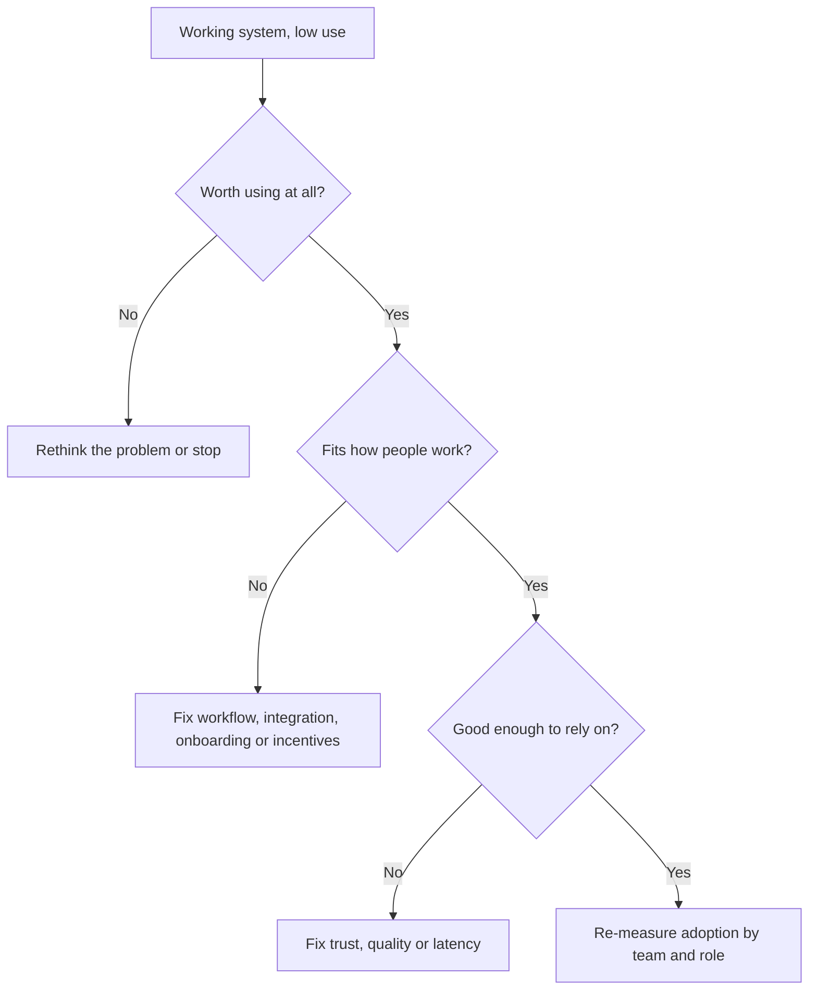

## Start with the better model

Corrin Tools, a fictional hardware distributor, gave its trade-counter staff an assistant that finds a part from a customer's description. Six weeks after launch, staff used it on fewer than one order in ten. The team spent the next month on a larger model and better search. Accuracy rose from 88% to 94%. Use did not move.

When someone finally stood at the counter, the reason was plain. Staff took orders standing at a till, and the assistant ran on a desktop in the back office. The model was never the problem.

A technically ready system invites more technical fixes. When nobody uses it, the cause is usually workflow, trust or incentives. Call this **the model reflex**: answering an adoption problem with a quality fix.

> **What you'll learn**
>
> - Run a structured investigation when a working system is not adopted.
> - Separate product-fit causes from quality and friction causes.
> - Plan adoption measurement before launch rather than after.

## Investigate fit before quality

"It launched; nobody uses it" is an interview prompt and a common field reality. The question bank's scale-up case ends with this follow-up: the system is technically ready but users are not adopting it, so what should be investigated? Its list has nine items, and they fall into three groups.

| Question behind the symptom | What to investigate |
|---|---|
| Is this worth using at all? | Whether the problem is important enough; whether the product solves the user's actual pain point |
| Does it fit how people work? | Workflow fit, integration friction, training and onboarding, incentives |
| Is it good enough to rely on? | User trust, response quality, latency |

*Table 1: The nine causes of low adoption, grouped by the question behind them. Investigate from the top row down.*

Start at the top, as Figure 1 shows. A fast, accurate assistant for a problem nobody feels will not be adopted, and no amount of quality work changes that. Only once the first two rows check out is a quality or latency fix likely to move usage.

*Figure 1: The order of investigation. Quality and latency fixes come last, because they move usage only once worth and fit are confirmed.*

> **Warning: improving the model is the default reaction and often the wrong one.** If the tool sits outside the workflow, or using it earns nobody anything, a better model leaves adoption where it was.

## Plan adoption measurement from the start

Adoption is easier to diagnose when it was planned for. The bank lists change management and adoption measurement among the things to cover when scaling a prototype from 100 to 100,000 users. Its rollout questions ask, before launch, how adoption and business impact will be measured.

The account-research case shows what that looks like. Its success metrics include seller adoption and time saved alongside brief accuracy and citation coverage. Measuring adoption next to quality makes the gap visible early. High accuracy with low adoption points straight to fit or friction.

## Worked example: the unused account-brief assistant

An account-brief assistant for sales reps passes its accuracy tests, but few reps open it. Walk Table 1 from top to bottom.

1. **Is the problem important enough?** Reps do spend time preparing for meetings, so the pain is real.
2. **Does it fit the workflow?** The briefs live in a separate tool, while reps prepare inside the CRM (customer relationship management system). That is integration friction.
3. **Are there incentives?** Nothing in the reps' targets rewards preparation time saved.
4. **Training?** Reps were never shown when a brief is ready.

The diagnosis is fit and friction, not quality. The next steps are to surface briefs inside the CRM and to brief sales managers, and the success metric stays seller adoption next to brief accuracy. The model was never the bottleneck.

## Limits of this lesson

- **The nine causes are a starting list, not a complete one.** Policy, union agreements or a manager's instruction can also block use. Ask the users.
- **Low use is sometimes the right answer.** If the problem was not worth solving, the honest outcome is to stop, as [realised versus estimated value](06_Realised_Versus_Estimated_Value.md) covers.
- **Corrin Tools and the worked example's findings are illustrative.**

## Interview angle

Each answer is an outline to say in about two minutes. Open each question and try it aloud before reading. The practice questions on low usage and duplicate entry are in [practise adoption and value](07_Practise_Adoption_and_Value.md).

Interview question 1. Adoption is low, and the team proposes fine-tuning the model to fix it. How do you respond?

- **Answer:** I ask what evidence links low use to quality first. If spot checks show the answers are mostly right, quality is not the cause. I would spend two days watching users work and checking three things: whether the problem matters to them, whether the tool sits inside their workflow, and whether anything in their targets rewards using it. Fine-tuning comes only if those check out and users name wrong answers as the reason.
- **Trade-off:** Field observation delays the technical work by days. Fine-tuning first can spend weeks on the wrong layer.
- **Follow-up to expect:** "What would change your mind?" Users who open the tool and abandon it after reading poor answers.

Interview question 2. How do you plan adoption measurement before launch?

- **Answer:** Set adoption metrics next to quality metrics in the success criteria, such as share of eligible work done in the tool and time saved, beside accuracy. Agree the source for each, ideally the system of record, so work done elsewhere shows. Split by team and role. Take a baseline before launch and agree a review date. Then high accuracy with low adoption is visible in the first weeks, not at renewal.
- **Trade-off:** Instrumenting adoption adds work to the build. Without it, low use surfaces late and without a cause.
- **Follow-up to expect:** "Which split matters most?" By role, because one role often carries the friction.

Interview question 3. Users like the tool in demos, but it lives outside the system they work in. Do you integrate it?

- **Answer:** First I measure the cost of the gap: how many extra steps, logins or copy-and-paste moves each use takes, and how often users skip it. If staff work all day in the CRM, a separate tool loses to habit almost every time. I would surface the output where the work happens, starting with the smallest integration, such as a link or panel, and check whether use rises.
- **Trade-off:** Integration costs engineering time and adds a dependency on the customer's system. Staying separate keeps the build simple and the tool unused.
- **Follow-up to expect:** "The customer will not grant API access." Start with a lighter route, such as a browser extension or a scheduled export, and agree the access as a later step.

## References

1. Google People + AI Research, [People + AI Guidebook: user needs and defining success](https://pair.withgoogle.com/chapter/user-needs/), accessed 18 November 2026. Starting from a real user need before deciding what AI should do.
2. Kerry Rodden, Hilary Hutchinson and Xin Fu, Google Research, [Measuring the User Experience on a Large Scale](https://research.google/pubs/measuring-the-user-experience-on-a-large-scale-user-centered-metrics-for-web-applications/), accessed 18 November 2026. Adoption and task success as metrics set alongside product goals.
3. *FDE Problem Decomposition Question Bank*: case 17 "Scale a Successful AI Prototype to Production" (its adoption follow-up), case 4 "AI-Powered Sales or Account-Research Assistant" and "Rollout questions".
4. The site's [measuring trust and overrides](05_Measuring_Trust_and_Overrides.md) lesson, for spot checks and work finishing outside the tool.

## Key takeaways

- Investigate low adoption in order: is the problem worth solving, does the tool fit the workflow, and only then is it good enough.
- Workflow fit, integration friction, onboarding and incentives are causes to rule out before model quality.
- Plan adoption measurement before launch, next to quality metrics, so the gap shows early.
- High accuracy with low adoption points to fit, friction, trust or incentives, not the model.

## Check yourself

1. Name three of the nine adoption causes the bank lists.

Any three of: problem importance, workflow fit, user trust, response quality, latency, training and onboarding, incentives, integration friction, and whether it solves the actual pain point.

2. Why investigate fit before quality?

A high-quality tool for an unimportant problem, or one outside the workflow, still goes unused. Quality fixes help only once fit is confirmed.

3. What does high accuracy with low adoption suggest?

A fit, friction, trust or incentive problem rather than a model problem.

