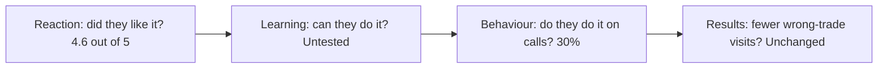

## Start with the well-rated course

Elstree Council, a fictional local authority, added an assistant to its housing repairs contact centre. While an adviser takes a call, the assistant suggests the repair category, the priority and the trade to send. The goal was fewer jobs sent to the wrong trade, which cost a wasted visit each time.

All 45 advisers attended one two-hour classroom session. They rated it 4.6 out of 5. Four weeks later, advisers accepted or edited the suggestion on only 30% of calls. On the rest they typed into the old free-text box, as before. The late shift and the Saturday team had watched a recording instead of attending.

In week six the one team leader who had championed the tool, Priya, left for another council. Use on her team fell from 70% of calls to 35% within a fortnight.

The training had measured whether people enjoyed it, not whether they changed what they did. Call this **the well-rated course**: training judged by the room's reaction while the work stays the same.

> **What you'll learn**
>
> - Plan onboarding by role and by shift.
> - Measure training by behaviour on the job, not by satisfaction.
> - Choose, support and back up champions.
> - Respond when a champion leaves.
> - Run a 30-day adoption plan after launch.

## Train by role, not by headcount

Different roles need different things from the same tool. One session for everyone teaches each person a little of what they need and a lot of what they do not.

| Role | What they need to learn | Format | When |
| --- | --- | --- | --- |
| Advisers | Use the suggestion on a live call, edit it, and know when to ignore it | Practice on recorded calls, then live calls with a floor walker | Inside their own shift, in the days before go-live |
| Team leaders | Read their team's use and override figures, coach from them | Short session on the dashboard, with their own team's data | A week before advisers |
| Repair schedulers | What changed in the jobs they receive | A one-page note and a ten-minute briefing | Launch week |
| Quality reviewers | How to sample calls and record wrong suggestions | Walk-through of the review form | Before launch |
| New starters | The tool as part of the job, not an extra | Built into induction | From launch onwards |

*Table 1: Onboarding by role at Elstree. The format follows what each role does with the tool.*

Shifts need the same care. People on late, night and weekend shifts often get a recording while day staff get a trainer. Run live sessions inside every shift, even if that means more sessions. Put a floor walker, someone who knows the tool well, on each shift for the first live week.

## Training that changes behaviour

The Kirkpatrick model separates four levels of training evaluation: reaction, learning, behaviour and results. Elstree measured the first and assumed the rest.

*Figure 1: Elstree's training at the four Kirkpatrick levels. A high score at the first level said nothing about the third.*

When people like the training and carry on as before, look for three causes:

- **No practice on the real task.** A demo shows the tool. A session where each adviser handles ten recorded calls with it builds the skill.
- **The old way is still easier.** If the free-text box is quicker, people use it. Make the new path the shorter one, for example by putting the suggestion where the cursor already is. Removing the old path needs the process owner's agreement and a fallback.
- **Nothing around them changed.** If team leaders still coach on call length alone, advisers optimise for call length. Add use and accuracy to what leaders review.

Measure behaviour directly. Track the share of calls where the suggestion was used, by adviser and by week, from the system's own records. That number shows within days whether training worked.

## Champions

A **champion** is a respected peer who uses the tool well, helps colleagues in the moment and passes their problems back to the team. A good champion does more for adoption than a better slide deck, because colleagues ask a peer before they ask a trainer.

Choose and support champions deliberately:

- **One or two per shift and team.** A champion on days does not help the Saturday team.
- **Pick for respect, not enthusiasm.** The person others already ask for help is worth more than the keenest volunteer.
- **Give them time.** Agree, with their manager, a fixed slice of the week for helping, such as two hours, and protect it.
- **Give them a channel.** A direct route to the delivery team, with problems answered within a set time.
- **Recognise them.** Name their contribution to their manager. Unrecognised extra work tends to stop.

## When a champion leaves

Champions move on, get promoted or burn out. If one person carried a team's use, it falls when they go, as Priya's team showed. Plan for it:

1. **Never rely on one.** Two champions per team, so one can leave without the team losing its help.
2. **Watch use by team.** A sharp fall on one team, with no technical change, often means the local help has gone.
3. **Replace quickly.** Ask the team leader to name a successor from the same team within a week, and pass on the departing champion's notes and contacts.
4. **Cover the gap.** Put a floor walker on that team for a week or two while the new champion settles.

Elstree named two new champions on Priya's team and ran a floor walker for ten days. Use recovered to 60% of calls by the end of the month.

## A 30-day adoption plan

Launch is the start of adoption, not the end. The walkthrough shows a 30-day plan for a contact centre like Elstree's.

Four stages from go-live to the day-30 review. Each shows the actions, the measure watched and the decision point.

<button type="button" data-step="0" aria-pressed="false" aria-controls="adoption-step-0">1. Days 1 to 3</button><button type="button" data-step="1" aria-pressed="false" aria-controls="adoption-step-1">2. Week 1</button><button type="button" data-step="2" aria-pressed="false" aria-controls="adoption-step-2">3. Weeks 2 to 3</button><button type="button" data-step="3" aria-pressed="false" aria-controls="adoption-step-3">4. Day 30</button>

<section id="adoption-step-0" class="step-panel" aria-labelledby="adoption-heading-0"><h4 id="adoption-heading-0">1. Days 1 to 3: supported start</h4><dl><dt>Actions</dt><dd>Floor walkers and champions on every shift. A daily 15-minute stand-up to collect problems.</dd><dt>Measure</dt><dd>Use by shift, and the list of problems raised.</dd><dt>Decision</dt><dd>Fix anything that blocks a call the same day.</dd></dl></section><section id="adoption-step-1" class="step-panel" aria-labelledby="adoption-heading-1"><h4 id="adoption-heading-1">2. Week 1: find the gaps</h4><dl><dt>Actions</dt><dd>Compare use by adviser, team and shift. Visit the lowest groups and watch calls.</dd><dt>Measure</dt><dd>Share of calls using the suggestion, and the top reasons for not using it.</dd><dt>Decision</dt><dd>Which groups need extra coaching, and which need a tool or process fix.</dd></dl></section><section id="adoption-step-2" class="step-panel" aria-labelledby="adoption-heading-2"><h4 id="adoption-heading-2">3. Weeks 2 to 3: coach from data</h4><dl><dt>Actions</dt><dd>Team leaders review use and override figures weekly with each adviser. Release small fixes.</dd><dt>Measure</dt><dd>Use, overrides, and wrong-trade visits from the scheduling system.</dd><dt>Decision</dt><dd>Whether floor walkers can step back on each shift.</dd></dl></section><section id="adoption-step-3" class="step-panel" aria-labelledby="adoption-heading-3"><h4 id="adoption-heading-3">4. Day 30: review</h4><dl><dt>Actions</dt><dd>Review against the targets set before launch with the sponsor and team leaders.</dd><dt>Measure</dt><dd>Use above 75% on every shift, and wrong-trade visits against the baseline.</dd><dt>Decision</dt><dd>Hand over to business as usual, extend support for named groups, or redesign.</dd></dl></section>

<button type="button" data-walk="previous">Previous</button>

<button type="button" data-walk="next">Next step</button>

The walkthrough is a scripted illustration, and the 75% target is Elstree's, not a standard. Set targets with the customer before launch.

Change-management frameworks give this plan a wider frame. Prosci's ADKAR model, for example, names awareness, desire, knowledge, ability and reinforcement. Training covers knowledge and ability. The 30-day plan and the leaders' reviews cover reinforcement, the part most often skipped.

## Limits of this lesson

- **Training cannot fix a poor tool.** If the suggestions are often wrong, better training makes people reject them faster. See the site's [diagnosing low adoption](03_Diagnosing_Low_Adoption.md) lesson.
- **Union and policy rules.** Changes to how work is measured may need consultation. Ask the process owner early.
- **Fictional data.** Elstree Council and its figures are illustrative.

## Interview angle

Each answer is an outline to say in about two minutes. Open each question and try it aloud before reading.

Interview question 1. How would you plan training for a tool used by several roles across three shifts?

- **Answer:** Start from what each role does with the tool. Users practise the real task on real or recorded cases. Team leaders learn to read their team's figures and coach. Downstream teams get a short note on what changes for them. Run live sessions inside every shift, train leaders before their teams, and put a floor walker on each shift for the first week.
- **Trade-off:** Role and shift sessions take more trainer time. One session for all wastes everyone's time and misses the night shift.
- **Follow-up to expect:** "There is no budget for trainers." Train champions per shift and let them run the shift sessions.

Interview question 2. What makes a champion programme work?

- **Answer:** Pick respected peers that colleagues already ask, one or two per shift and team. Agree protected time with their managers. Give them a direct channel to the delivery team with fast answers, and recognise their work to their managers. Watch use by team, so you see when a champion's area slips.
- **Trade-off:** Protected time costs the customer capacity. Unpaid goodwill fades within weeks.
- **Follow-up to expect:** "Who should not be a champion?" Someone chosen only for enthusiasm, whom colleagues do not go to for help.

Interview question 3. Users rated the training highly, but a month later they still work the old way. What do you do?

- **Answer:** The training measured reaction, not behaviour. Watch real work to find why: no practice on the real task, an old path that is still easier, or managers who still reward the old way. Fix each: practise on real cases, make the new path the shorter one, and add use to what team leaders review. Measure use weekly by person and team.
- **Trade-off:** Changing what managers review needs their buy-in. Retraining alone repeats the same result.
- **Follow-up to expect:** "Should we remove the old way?" Only with the process owner's agreement and a fallback.

Interview question 4. Your strongest champion has left and use on their team is falling. What do you do?

- **Answer:** Confirm with the data that the fall is on that team and has no technical cause. Ask the team leader to name a successor from the same team within a week, and pass on the champion's notes. Put a floor walker on the team meanwhile. Then fix the cause: every team gets two champions, so one departure does not remove all local help.
- **Trade-off:** Two champions per team cost more time. One champion makes adoption depend on one person's career.
- **Follow-up to expect:** "Nobody volunteers." Ask the team leader who people already ask, and offer recognition and time.

## References

1. Kirkpatrick Partners, [The Kirkpatrick model](https://www.kirkpatrickpartners.com/the-kirkpatrick-model/), accessed 17 November 2026. The four levels of training evaluation: reaction, learning, behaviour and results.
2. Prosci, [The Prosci ADKAR model](https://www.prosci.com/methodology/adkar), accessed 17 November 2026. Awareness, desire, knowledge, ability and reinforcement in individual change.
3. The site's [rolling out with a way back](01_Rolling_Out_With_a_Way_Back.md) and [diagnosing low adoption](03_Diagnosing_Low_Adoption.md) lessons.
4. The author's own field experience, the basis for the role table, the champion rules and the 30-day plan.

## Key takeaways

- Train by role and inside each shift. Leaders learn before their teams.
- Judge training by behaviour on the job, measured from system records, not by satisfaction scores.
- Choose respected champions, two per team, with protected time and a direct channel.
- When a champion leaves, replace them quickly and cover the gap with a floor walker.
- Run a 30-day plan after launch and decide at day 30 against targets set beforehand.

## Check yourself

1. Why did Elstree's 4.6 rating say little about whether the training worked?

It measured reaction, the first Kirkpatrick level. Behaviour on calls, the third level, stayed at 30% use, and results did not change.

2. Why does a one-champion team lose so much use when that person leaves?

All the local help sat with one person. Colleagues lose the peer they asked, problems stop reaching the delivery team, and nobody replaces the habit.

3. Why should team leaders be trained before their teams?

They coach and review their teams. If they cannot read the use figures or still reward the old way, the team's behaviour follows them, not the training.

