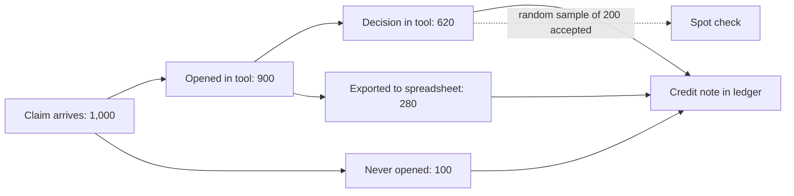

## Start with the two per cent

Fallow Foods, a fictional food wholesaler, receives claims from restaurants for short or damaged deliveries. An FDE team built an assistant that recommends whether to approve each claim and for how much. Credit controllers review the recommendation and record the decision.

At the end of the first month the dashboard showed an override rate of 2%. Controllers changed the recommendation on only 12 of 620 decisions. The sponsor read it as a sign of trust and asked about expanding to a second team.

A senior controller then checked 200 accepted recommendations by hand. She found 23 wrong, 11.5%, most of them paying in full on claims with no photo of the damage. Median time to accept a recommendation was 8 seconds. The finance ledger also showed 1,000 credit notes that month, while the tool had recorded 620 decisions. The other 380 had been finished in a spreadsheet.

The low override rate was not trust. It was agreement without checking, from the people who still used the tool. Call this **the quiet agreement**: a low override rate read as success when nobody measured whether the accepted answers were right.

> **What you'll learn**
>
> - Read override rates against spot checks.
> - Tell blind acceptance, avoidance and calibrated trust apart.
> - Use telemetry to find work finishing outside the tool.
> - Build an adoption scorecard and run a one-month review.

## What an override rate can tell you

An **override** is a recorded case where the user changed or rejected the tool's recommendation. The override rate is overrides divided by decisions made in the tool. It measures disagreement, not correctness.

A low rate fits two very different stories. The tool may be right and users rightly agree. Or users may accept without reading. A high rate also fits two stories: the tool is wrong and users catch it, or the tool is right and users distrust it. The rate alone cannot tell you which.

To read it, you need ground truth on a sample, and that comes from spot checks.

## Three patterns of trust

People can over-rely on automated advice, accepting it without checking, especially when busy. Researchers call this automation bias. The opposite failure is avoidance: people distrust the tool and work around it. The goal is **calibrated trust**, where users accept good recommendations and catch bad ones. The switcher shows the signals for each pattern.

The same override rate can mean different things. Pick a pattern to see its signals and the response it calls for.

<button type="button" data-mode="blind" aria-pressed="false" aria-controls="blind-result">Blind acceptance</button>
<button type="button" data-mode="avoid" aria-pressed="false" aria-controls="avoid-result">Avoidance</button>
<button type="button" data-mode="calibrated" aria-pressed="false" aria-controls="calibrated-result">Calibrated</button>

<section id="blind-result" class="mode-panel" data-announcement="Blind acceptance selected. Low overrides, high errors on spot checks."><h4>Blind acceptance</h4><ul><li>Override rate low, such as Fallow's 2%.</li><li>Spot checks find errors among accepted answers, 11.5% at Fallow.</li><li>Decisions take seconds, even on complex cases.</li></ul>
Response: show the evidence behind each recommendation, flag weak cases such as missing photos, and require a reason on high-value approvals.
</section>
<section id="avoid-result" class="mode-panel" data-announcement="Avoidance selected. Many cases never reach a decision in the tool."><h4>Avoidance</h4><ul><li>Override rate high, or few decisions recorded at all.</li><li>Spot checks find the tool mostly right.</li><li>Cases are opened and exported, or never opened.</li></ul>
Response: watch users work to find what the tool cannot handle or why they doubt it, then fix that gap.
</section>
<section id="calibrated-result" class="mode-panel" data-announcement="Calibrated selected. Overrides match the real error rate."><h4>Calibrated</h4><ul><li>Overrides land on the cases spot checks would mark wrong.</li><li>Spot-check errors among accepted answers are low.</li><li>Decision time rises on harder cases and falls on easy ones.</li></ul>
Response: keep sampling, and watch for drift as cases change.
</section>

The response to blind acceptance is not friction on every case. Adding a confirmation click to every decision teaches people to click twice. Put the friction where the risk is: high amounts, missing evidence, unusual claims. Google's People + AI Guidebook calls this helping users calibrate their trust, by showing what the system is confident about and where it may be wrong.

## Spot checks

A **spot check** is a sample of decisions reviewed by an expert to find out how often the accepted answer was right. It turns the override rate into something you can interpret. Design it so it measures what you need:

- **Sample at random from accepted decisions.** Fallow sampled 200 of 608 accepted recommendations. Random sampling stops the reviewer from choosing easy cases.
- **Also sample overrides.** Were users right to change the answer? That shows whether their corrections help.
- **Review without the tool's answer on screen,** where practical, so the reviewer forms their own view first.
- **Split by case type and value.** Fallow's errors clustered on claims without photos. An overall rate would have hidden that.
- **Repeat on a schedule.** Weekly at first, then monthly, because case mix and tool behaviour drift.

Add decision time as a cheap signal. Accepting a complex claim in 8 seconds suggests the recommendation was not read. It is a prompt to look, not proof by itself.

## Work that finishes somewhere else

Users who avoid a tool rarely say so. They open the case, look, and finish it in the old place. Telemetry can find this if you instrument the whole journey, as Figure 1 shows.

*Figure 1: Fallow's claims for one month, traced from arrival to the ledger. Completion in the tool was 620 of 1,000, 62%.*

Compare the tool's count with the system of record. The ledger is the truth for how many claims were settled. The gap between the two is work finishing elsewhere. Export clicks, copy events and cases closed in the ledger with no decision in the tool all point to it.

At Fallow, controllers explained the spreadsheet in one afternoon on the floor. The tool could not split one claim across several invoices, which about a quarter of large customers needed. The fix was a feature, not training.

## The adoption scorecard

Put the measures in one scorecard, each with a target and a source, so the one-month review reads from data rather than impressions.

| Measure | Definition | Fallow, month 1 | Target | Source |
| --- | --- | --- | --- | --- |
| Reach | Eligible claims opened in the tool | 90% | 95% | Tool logs against ledger |
| Completion | Claims decided in the tool | 62% | 90% | Tool decisions against ledger |
| Override rate | Changed recommendations per decision | 2% | Watch, no target | Tool logs |
| Spot-check error | Wrong answers among sampled accepted decisions | 11.5% | Under 3% | Weekly expert sample |
| Decision time | Median time to accept, by case type | 8 seconds | Rises with case complexity | Tool logs |
| Outcome | Days from claim to credit note, and value of wrong credits | 4 days, from 9 | Under 3 days, wrong credits at or below baseline | Ledger |

*Table 1: Fallow's adoption scorecard after one month. The override rate has no target, because pushing it down rewards blind acceptance.*

The one-month review then has three parts:

1. **Performance.** Is the system up, fast and accurate on spot checks? Fallow: up and fast, accuracy below target on claims without photos.
2. **Adoption.** Do people reach and finish work in the tool, with calibrated trust? Fallow: reach good, completion low, blind acceptance among users.
3. **Outcomes.** Did the business metric move, with no hidden cost? Fallow: claims settled faster, but wrong credits rose.

Close with actions, owners and dates. Fallow's were: flag claims without photos, add invoice splitting, require a reason on approvals over £500, and hold the second team until the next review.

## Limits of this lesson

- **Spot checks cost expert time.** Size the sample to the decision's risk. A low-value, reversible decision needs fewer checks.
- **Ground truth can be uncertain.** Two experts may disagree. Measure their agreement on a shared sample first.
- **Fictional data.** Fallow Foods and its figures are illustrative.

## Interview angle

Each answer is an outline to say in about two minutes. Open each question and try it aloud before reading.

Interview question 1. How do you measure whether users trust an AI tool, and whether they finish their work in it?

- **Answer:** Track reach, completion, overrides and decision time from the tool's logs, and compare counts with the system of record to find work finishing elsewhere. Then add spot checks: an expert reviews a random sample of accepted and overridden decisions. Trust is calibrated when overrides land on the cases that are wrong and accepted cases are mostly right.
- **Trade-off:** Spot checks cost expert time. Without them, the override rate cannot be interpreted.
- **Follow-up to expect:** "Which single metric would you watch?" Completion against the system of record, because it catches avoidance that no other number shows.

Interview question 2. Overrides are rare, yet several bad decisions have slipped through. What is happening and what do you do?

- **Answer:** Probably blind acceptance. Confirm with a random spot check of accepted decisions and with decision times. If errors cluster, such as claims without evidence, flag those cases, show the evidence behind each recommendation and require a reason on high-risk approvals. Keep the friction off low-risk cases, and re-check after two weeks.
- **Trade-off:** Friction slows every flagged case. Without it, errors pass at machine speed.
- **Follow-up to expect:** "Should we push for more overrides?" No. Push for correct decisions. A target on overrides rewards random disagreement.

Interview question 3. Run a one-month review of a deployment. What do you cover?

- **Answer:** Three parts, each against targets set before launch. Performance: availability, speed and accuracy on spot checks. Adoption: reach, completion against the system of record, overrides and trust pattern, by team. Outcomes: the business metric against baseline and guard metrics such as error cost. Close with actions, owners and dates, and a decision on expansion.
- **Trade-off:** A data-led review takes preparation. A review of impressions misses avoidance and blind acceptance.
- **Follow-up to expect:** "Results are mixed. Expand or not?" Expand only where every scorecard row holds, and fix the rest first.

## References

1. Wikipedia, [Automation bias](https://en.wikipedia.org/wiki/Automation_bias), accessed 17 November 2026. Over-reliance on automated aids and the conditions that increase it.
2. Google PAIR, [People + AI Guidebook: explainability and trust](https://pair.withgoogle.com/chapter/explainability-trust/), accessed 17 November 2026. Helping users calibrate their trust in AI systems.
3. The site's [proving business impact](02_Proving_Business_Impact.md) and [diagnosing low adoption](03_Diagnosing_Low_Adoption.md) lessons.
4. The author's own field experience, the basis for the scorecard and the review structure.

## Key takeaways

- An override rate measures disagreement, not correctness. Read it against spot checks.
- Blind acceptance shows as few overrides, spot-check errors and very fast decisions. Avoidance shows as work that never finishes in the tool.
- Compare the tool's counts with the system of record to find work finishing in spreadsheets.
- Put reach, completion, overrides, spot-check error, decision time and outcome in one scorecard, with targets and sources.
- Run the one-month review on performance, adoption and outcomes, and close with owned actions.

## Check yourself

1. Why does Fallow's scorecard set no target for the override rate?

A target would push people to override less or more for its own sake. The aim is correct decisions, which spot checks measure.

2. How did Fallow find that 38% of claims were finished elsewhere?

The ledger showed 1,000 credit notes and the tool showed 620 decisions. The gap of 380 was claims exported to a spreadsheet or never opened.

3. Why sample overridden decisions as well as accepted ones?

To learn whether users' corrections make decisions better. If overrides are often wrong, users need help, or the tool is right more than they think.

