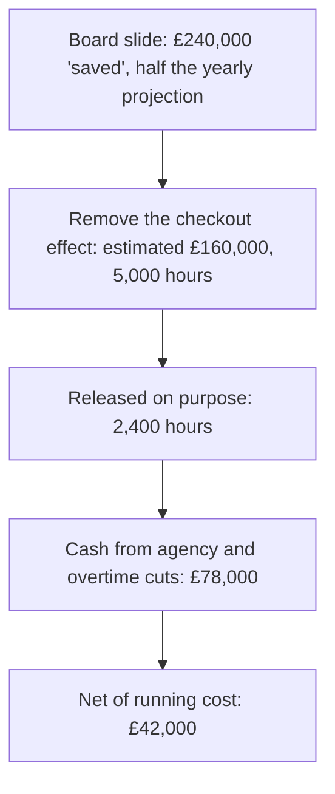

## Start with the slide-deck saving

Caverly Logistics, a fictional parcel carrier, runs an assistant that drafts fixes for failed deliveries at two of its three depots. The business case promised £480,000 a year. Six months after launch, the sponsor's board slide said "£240,000 saved so far".

The finance director asked where the money was. The team's headcount had not changed and its budget line was almost the same. Two other things had also changed in those six months. A large retail customer had added address checks at its checkout, which cut the slowest kind of exception. And the team had hired four new starters.

The £240,000 was half the yearly estimate, written as if it had happened. Call this **the slide-deck saving**: a projected saving reported as a realised one.

> **What you'll learn**
>
> - Compare results with a baseline when other things changed too.
> - Separate estimated savings, released capacity and realised cash.
> - Correct projected savings presented as real.
> - Recommend continue, expand, redesign or stop.

## Comparing against a baseline when other things changed

A **baseline** is the process measured before the change, by the method you use afterwards. The site's [baselines, value and ROI](../T6.2_Scoping_an_FDE_Project/08_Baselines_Value_and_ROI.md) lesson covers building one. After launch, the harder problem is that the world keeps moving. Volume, case mix, staffing and policy all change, and each moves the numbers.

Caverly's handling time at the two tool depots fell from 9.0 to 6.0 minutes per exception. The third depot, still without the tool, also fell, from 9.0 to 8.0 minutes, because the checkout change cut slow address exceptions everywhere. The fall that the tool explains is the difference between the two changes:

| Group | Before | After | Change |
| --- | --- | --- | --- |
| Tool depots | 9.0 minutes | 6.0 minutes | −3.0 |
| Comparison depot | 9.0 minutes | 8.0 minutes | −1.0 |
| Effect of the tool | Tool change minus comparison change | −3.0 − (−1.0) | −2.0 |

*Table 1: A difference-in-differences estimate. The comparison depot absorbs the checkout change that affected every depot.*

This method, **difference-in-differences**, assumes both groups would have moved in parallel without the change. Check that by comparing their trends for several months before launch.

Three more habits protect the comparison:

- **Measure per unit.** Minutes per exception, not team hours. Headcount changes, such as Caverly's new starters, then do not distort the result.
- **Split by case type.** If the mix shifts toward easy cases, an average can fall while no type got faster. Compare type by type, then reweight to the old mix. The reverse can happen too, a pattern known as Simpson's paradox.
- **Write down every other change** in the period, with its date, and say which ones the comparison controls for.

## Estimated, released and realised

With the effect isolated, three numbers remain, and they are often confused:

- **Estimated saving.** The effect multiplied by volume and cost. Caverly: 2.0 minutes × 1,200 exceptions a day × 250 working days is 10,000 hours a year, or £320,000 at a loaded cost of £32 an hour. Over six months, 5,000 hours and £160,000.
- **Released capacity.** Hours that management removed or moved on purpose. Caverly cut 250 agency hours and 150 overtime hours a month, 2,400 hours over six months.
- **Realised cash.** Money that left a budget line. The cut agency hours cost £28 each and the overtime £40, so six months saved £78,000. After the tool's running cost of £6,000 a month, the net is £42,000.

The switcher sets the three side by side.

Caverly, six months after launch. Pick a view to see what each number means and who can rely on it.

<button type="button" data-mode="estimated" aria-pressed="false" aria-controls="estimated-result">Estimated</button>
<button type="button" data-mode="released" aria-pressed="false" aria-controls="released-result">Released</button>
<button type="button" data-mode="realised" aria-pressed="false" aria-controls="realised-result">Realised</button>

<section id="estimated-result" class="mode-panel" data-announcement="Estimated selected. 5,000 hours, worth 160,000 pounds at loaded cost."><h4>Estimated: 5,000 hours, £160,000</h4><ul><li>The tool's effect times volume and loaded cost.</li><li>Real time saved, spread across hundreds of shifts in small pieces.</li></ul>
Use it to show the tool works. Do not call it money.
</section>
<section id="released-result" class="mode-panel" data-announcement="Released selected. 2,400 hours removed on purpose."><h4>Released: 2,400 hours</h4><ul><li>Agency and overtime hours management chose to cut.</li><li>The other 2,600 hours went to onboarding the new starters and to slack.</li></ul>
Use it to show what management did with the time.
</section>
<section id="realised-result" class="mode-panel" data-announcement="Realised selected. 78,000 pounds gross, 42,000 pounds net."><h4>Realised: £78,000 gross, £42,000 net</h4><ul><li>Agency and overtime spend that stopped, from the ledger.</li><li>Net of six months' running cost.</li></ul>
The only number finance can bank.
</section>

Figure 1 follows the slide's figure down to the cash.

*Figure 1: From the slide to the ledger at Caverly, over six months. Each step is a different claim with a different owner.*

The gap between estimated and released is not failure. It is a decision nobody made. Freed time becomes cash only when someone cuts spend or avoids a hire.

## When projected savings are presented as real

Correct it quickly, privately first, and with a better version in hand. A wrong number on a board slide will be found, and when it is, every other number loses credibility.

1. **Talk to the sponsor before the next meeting.** Explain the difference between projected and realised, without blame.
2. **Bring the three numbers** with their method, agreed with finance, who will be asked anyway.
3. **Relabel, do not delete.** "Projected yearly saving £320,000. Realised to date £42,000 net. Capacity released 2,400 hours."
4. **Add the plan** that turns more of the estimate into cash, with an owner.

## When requirements are met and the outcome did not move

Sometimes every requirement passes and the business metric stays flat. The usual causes are that the tool improved a step that was not the bottleneck, that its output is not used downstream, or that the requirement measured activity rather than the outcome. Trace one case end to end, find where the time or error lives now, and check whether the original target was tied to that step. Report it plainly: delivered to specification, outcome unchanged, and why.

## Continue, expand, redesign or stop

The review ends with a recommendation. Base it on the evidence, not on the effort spent.

| Recommendation | When the evidence shows |
| --- | --- |
| Continue | The outcome improved against a fair comparison, net value is positive or on a credible path, and adoption is stable |
| Expand | As for continue, plus the expansion checklist holds and the value scales with the new users |
| Redesign | A real effect exists but is blocked by a fixable cause, such as one case type, a workflow gap or capacity nobody released |
| Stop | No effect after a fair trial, costs exceed any realistic value, or the tool causes harm that cannot be fixed |

*Table 2: Four recommendations and the evidence each needs.*

Caverly's team recommended continuing at both depots and expanding to the third, on one condition: an agreed plan with finance to release capacity as agency contracts renewed. Stopping a tool that works because cash lags is a mistake, and so is expanding a tool whose savings nobody will collect.

## Limits of this lesson

- **Comparison groups are imperfect.** Parallel trends are an assumption. Show the pre-launch trends so readers can judge it.
- **Not all value is cash.** Faster service and fewer errors matter in their own units. Report them as such.
- **Fictional data.** Caverly Logistics and its figures are illustrative.

## Interview angle

Each answer is an outline to say in about two minutes. Open each question and try it aloud before reading.

Interview question 1. How do you compare post-launch results with the baseline?

- **Answer:** Measure the same thing the same way as the baseline, per unit of work. List everything else that changed in the period. Use a comparison group that did not get the change, and take the difference between the two groups' changes. Split by case type so a mix shift does not fake an improvement.
- **Trade-off:** A comparison group delays the benefit for some users. Without one, you cannot separate the tool from the world.
- **Follow-up to expect:** "No comparison group exists." Use the trend before launch, or stagger the rollout to create one.

Interview question 2. Explain estimated savings, released capacity and realised savings.

- **Answer:** Estimated is the effect times volume and cost: time the tool saves. Released is the hours management removed or moved on purpose. Realised is cash that left a budget line, net of running cost. Each is smaller than the one before, and only the last is money finance can bank. Report all three, labelled.
- **Trade-off:** Three numbers are harder to present than one. One number invites the wrong one.
- **Follow-up to expect:** "How do you turn capacity into cash?" Agree with the customer, before launch, which spend will fall or which hire will be avoided.

Interview question 3. How do you decide whether to continue, redesign or stop?

- **Answer:** Against criteria agreed before the review. Continue when the outcome improved against a fair comparison, value is positive or on a credible path, and adoption holds. Redesign when an effect exists but a fixable cause blocks it. Stop when a fair trial shows no effect, cost exceeds realistic value, or harm cannot be fixed. Expand only if the checklist holds too.
- **Trade-off:** Stopping wastes the sunk effort. Continuing a failure wastes more.
- **Follow-up to expect:** "The sponsor wants to continue regardless." Record the evidence and the decision, and set a date to review again.

Interview question 4. You met every requirement, but the business outcome did not improve. What happened?

- **Answer:** The requirements and the outcome have come apart. Common causes: the tool sped up a step that was not the bottleneck, its output is not used downstream, or the requirements measured activity. Trace a case end to end, find where time or error now lives, and report plainly: delivered to specification, outcome unchanged, and the next step.
- **Trade-off:** Admitting it is uncomfortable. Hiding it costs trust when the outcome data arrives.
- **Follow-up to expect:** "How would you prevent it?" Tie each requirement to the outcome metric at scoping.

Interview question 5. The sponsor presented projected savings to the board as realised savings. What do you do?

- **Answer:** Speak to the sponsor privately before the next meeting, without blame. Bring the three numbers, estimated, released and realised, agreed with finance. Propose relabelling the slide, not deleting it, and add a plan that converts more of the estimate into cash, with an owner.
- **Trade-off:** Correcting a sponsor risks the relationship. A wrong board number, once found, risks the whole programme.
- **Follow-up to expect:** "The sponsor refuses." Make sure finance has the correct figures, and record that you raised it.

## References

1. Wikipedia, [Difference in differences](https://en.wikipedia.org/wiki/Difference_in_differences), accessed 17 November 2026. The method and its parallel trend assumption.
2. Wikipedia, [Simpson's paradox](https://en.wikipedia.org/wiki/Simpson%27s_paradox), accessed 17 November 2026. How a hidden variable can reverse an overall comparison.
3. The site's [baselines, value and ROI](../T6.2_Scoping_an_FDE_Project/08_Baselines_Value_and_ROI.md) and [proving business impact](02_Proving_Business_Impact.md) lessons.
4. The author's own field experience, the basis for the three value numbers and the recommendation table.

## Key takeaways

- Measure per unit, list every other change, and use a comparison group to isolate the effect.
- Report estimated savings, released capacity and realised cash as three labelled numbers.
- Correct a projected saving shown as real, early and privately, with a better version.
- When requirements pass and the outcome does not, find where the work now waits.
- Recommend continue, expand, redesign or stop from evidence agreed in advance.

## Check yourself

1. Why is the tool's effect at Caverly 2.0 minutes and not 3.0?

The comparison depot fell by 1.0 minute without the tool, because of the checkout change. Only the extra 2.0 minutes at the tool depots belong to the tool.

2. Caverly estimated 5,000 hours saved over six months but released 2,400. Is the gap a failure?

Not of the tool. It is capacity nobody chose to remove. It becomes value only when someone cuts spend, avoids a hire or moves the time to other work on purpose.

3. Why measure minutes per exception instead of total team hours?

Team hours move with headcount, such as Caverly's four new starters. A per-unit measure stays comparable when staffing changes.

