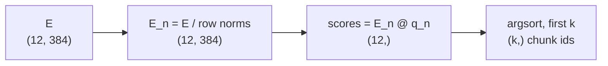

<!-- Generated by site/scripts/rag-theory-import.mjs from rag-agents-engineering. Edit the source there. -->
# lesson 3 of T2.1 Theory: NumPy, pandas and Matplotlib

<!-- subtitle: Retrieval is one array operation, and an evaluation is one table: the shapes and missing values that break both -->
<!-- format: approved -->

## NumPy arrays

> **What you'll learn**
>
> - **Explain** retrieval as three array operations on an embedding matrix: normalise, dot product, sort.
> - **Diagnose** the broadcasting bug that square test data hides and a real embedding matrix exposes.
> - **Estimate** the memory an index needs from its row count, dimension and dtype.
> - **Diagnose** a mean that silently skips failed evaluation runs.

A teammate tests a cosine-similarity function on three toy chunks, sees sensible scores, and ships it. On the real index it either crashes or, on the toy data, quietly ranks the wrong chunk first. Both outcomes come from one missing argument. This page explains the array and table habits that catch it.

A **NumPy array** holds numbers of one dtype in a fixed shape. Arithmetic then runs on the whole array in compiled code instead of a Python loop. Notebook 03a covers creation (`np.array`, `np.zeros`, `np.arange`, `np.linspace`), indexing and boolean masks, `reshape` and `.T`, ufuncs, aggregation along an `axis`, broadcasting, `@` for matrix products and `np.linalg`. Retrieval code uses a handful of these on one object: the embedding matrix.

An index of the twelve Larkspur handbook chunks, embedded with a 384-dimension model, is an array `E` of shape `(12, 384)`: one row per chunk, one column per dimension. A question embeds to a vector `q` of shape `(384,)`. Cosine similarity is the dot product of unit-length vectors, so retrieval takes three operations:

*Figure 1: Retrieval as array operations, with the shape after each step.*

With three chunks and three dimensions you can check every number by hand. The question is *How long does a refund take?*:

| Step | What it does | Shape | Values |
|---|---|---|---|
| Chunk matrix `E` | `refund-window`, `refund-timing`, `sla`, three made-up dimensions | (3, 3) | (0.9, 0.1, 0.0), (0.7, 0.3, 0.1), (0.0, 0.2, 0.9) |
| Question `q` | the refund question | (3,) | (0.8, 0.2, 0.1) |
| Row norms, `keepdims=True` | one length per chunk | (3, 1) | one length per row |
| Scores | normalised rows times the normalised question | (3,) | 0.984, 0.987, 0.170 |
| Top 2 | indices of the two highest scores | (2,) | `refund-timing`, then `refund-window` |

*Table 1: The toy retrieval traced step by step. The vectors are illustrative; the scores were recomputed with NumPy.*

**`keepdims=True` is what makes the division correct.** Without it, `np.linalg.norm(E, axis=1)` returns the row lengths as a flat array of shape `(3,)`. Broadcasting lines shapes up from the last axis, so a flat `(3,)` divides each *column* by a different row's length. On this toy matrix that runs without an error and gives scores of 0.989, 0.852 and 0.180, which puts `refund-window` first. With `keepdims=True` the norms have shape `(3, 1)` and stretch across the columns, one length per row.

On the real `(12, 384)` matrix the flat version fails with `ValueError: operands could not be broadcast together with shapes (12,384) (12,)`. That is the better outcome. We call the toy case the **square-matrix trap**: test data whose row and column counts match lets a wrong broadcast run and return plausible numbers.

*Figure 2: Row norms with and without `keepdims` against the embedding matrix.*

Three more habits from the notebook pay off later:

- **Check `.shape`, `.ndim` and `.dtype` before you trust a result.** A `(384,)` query gives scores of shape `(12,)`. The same query as a `(384, 1)` column gives `(12, 1)`, and `np.argsort` on that sorts each one-element row instead of the twelve scores.
- **Choose the dtype for memory.** `astype` converts it. A million 1,536-dimension vectors take 6,144,000,000 bytes (6.1 GB) as `float32` and twice that as `float64`, the default for arrays built from Python floats. Most vector libraries, FAISS among them, expect `float32`.
- **Top-k does not need a full sort.** `np.argsort` sorts all `n` scores. On millions of rows, `np.argpartition` finds the `k` best without ordering the rest; sort only those `k` afterwards.

The vectors live in NumPy. Everything describing them, from chunk ids to evaluation scores, lives in a table.

## pandas DataFrames

A **DataFrame** is a table of named columns, each a Series with its own dtype, plus an index that labels the rows. NumPy holds the vectors; pandas holds everything around them: chunk ids and text, metadata, golden questions, and the results of every evaluation run.

Notebook 03b opens by loading a customer churn CSV from the module's assets. Run `df.info()` on it before anything else. It has 15,929 rows and 21 columns:

| Column | Loads as | Missing values | Why |
|---|---|---|---|
| `dependents` | `float64` | 1,348 | Whole numbers, but `NaN` is a float, so the column becomes float |
| `city` | `float64` | 460 | The same reason |
| `gender` | `object` | 288 | Text column with gaps |
| `occupation` | `object` | 47 | Text column with gaps |
| `last_transaction` | `object` | 0 | A date kept as text until `pd.to_datetime` converts it |

*Table 2: What `df.info()` reveals about the churn data, recomputed from the CSV.*

The same thing happens to chunk metadata loaded from a CSV: a page-number column with one blank becomes floats, and a date column stays text.

The operations the notebook teaches map onto evaluation work directly:

- **Select and filter**: keep the rows whose recall is below 1 to list the questions that missed evidence. `.loc` selects by label, `.iloc` by position.
- **Add columns**: text length divided by four gives a rough token count. `.apply` and `.map` handle anything a vectorised expression cannot.
- **Join**: `pd.merge` on `chunk_id` brings chunk text next to the scores. Merge on an id, never on row order.
- **Group and pivot**: the baseline row is a `groupby`.

[T5.1](../../p04_rag_foundations/m10_rag_lifecycle/00_overview.md)'s top-k lab scores three golden questions at four values of `k`. Stored as a long table, one row per question and `k`, its baseline is one `groupby` on `k` taking the mean of recall and precision:

| `k` | Mean recall | Mean precision |
|---|---|---|
| 1 | 0.33 | 0.67 |
| 2 | 0.50 | 0.50 |
| 5 | 0.50 | 0.20 |
| 12 | 0.50 | 0.08 |

*Table 3: The [T5.1](../../p04_rag_foundations/m10_rag_lifecycle/00_overview.md) baseline by `k`, the output of one `groupby`.*

A `pivot_table` with questions as rows and `k` as columns shows where each mean comes from: the export question reaches 1.0 at `k = 2`, the refund question stays at 0.5 and the outage question at 0.0. Plotting the grouped recall draws the curve through Matplotlib, which the optional notebook 03c covers.

Missing values deserve a check of their own. `mean()` skips `NaN` by default. If the outage question errors at `k = 2` and its recall is recorded as `NaN`, mean recall@2 becomes 0.75 instead of 0.50, with no warning. We call this a **silent skip**.

> **Pitfall: silent skip.** Compare `count()` (2) with `size()` (3) per group before reading a mean. Record failures in a status column instead of a missing number, so a failed run shows up as a failure.

## Limits of this evidence

- **Toy vectors.** The three-dimension vectors in Table 1 are made up so the arithmetic fits on a page. Real 384-dimension scores differ, though the broadcasting behaviour is the same.
- **Recomputed numbers.** The scores, the 6,144,000,000 bytes and Table 2 were recomputed with NumPy and pandas from this repo's environment. The notebooks ship without outputs.
- **Lab values.** Table 3 comes from [T5.1](../../p04_rag_foundations/m10_rag_lifecycle/00_overview.md)'s top-k lab over three questions: each recall step is 0.5 or a third. It shows the shape of a baseline, not a benchmark.

## References

1. NumPy, [broadcasting rules](https://numpy.org/doc/stable/user/basics.broadcasting.html), on how shapes line up from the last axis.
2. NumPy, [argpartition](https://numpy.org/doc/stable/reference/generated/numpy.argpartition.html), for selecting the top k without a full sort.
3. pandas, [working with missing data](https://pandas.pydata.org/docs/user_guide/missing_data.html), on how `NaN` changes dtypes and aggregations.

## Run the notebooks

The code for this lesson is in these notebooks. Colab runs one in your browser: install the packages its first cell imports and set the API keys it reads. To run every notebook as written, clone the repository and use its uv environment.

| Notebook | GitHub | Colab |
|---|---|---|
| Numpy basics | [Open on GitHub](https://github.com/Sourav692/rag-agents-engineering/blob/main/p01_ai_engineering_foundations/m01_python_data_refresher/mandatory/notebook/03a_numpy_basics.ipynb) | [Open in Colab](https://colab.research.google.com/github/Sourav692/rag-agents-engineering/blob/main/p01_ai_engineering_foundations/m01_python_data_refresher/mandatory/notebook/03a_numpy_basics.ipynb) |
| Pandas basics for data analysis | [Open on GitHub](https://github.com/Sourav692/rag-agents-engineering/blob/main/p01_ai_engineering_foundations/m01_python_data_refresher/mandatory/notebook/03b_pandas_basics_for_data_analysis.ipynb) | [Open in Colab](https://colab.research.google.com/github/Sourav692/rag-agents-engineering/blob/main/p01_ai_engineering_foundations/m01_python_data_refresher/mandatory/notebook/03b_pandas_basics_for_data_analysis.ipynb) |
| Matplotlib basics (optional) | [Open on GitHub](https://github.com/Sourav692/rag-agents-engineering/blob/main/p01_ai_engineering_foundations/m01_python_data_refresher/optional/notebook/03c_matplotlib_basics.ipynb) | [Open in Colab](https://colab.research.google.com/github/Sourav692/rag-agents-engineering/blob/main/p01_ai_engineering_foundations/m01_python_data_refresher/optional/notebook/03c_matplotlib_basics.ipynb) |

## Key Takeaways

- Retrieval is normalise, dot product, sort. Divide by row norms with `keepdims=True`, because square test data hides the broadcasting bug that a `(12, 384)` matrix exposes.
- Check `.shape`, `.ndim` and `.dtype` before you trust a result. Store vectors as `float32`, and use `np.argpartition` for top-k on millions of rows.
- Run `df.info()` first, merge on an id rather than row order, and compare `count()` with `size()` per group, since `mean()` skips `NaN` without a warning.

## Check yourself

1. Why does dividing E by np.linalg.norm(E, axis=1) without keepdims run silently on a 3 by 3 matrix but fail on a (12, 384) one?

Without `keepdims=True` the norms are a flat `(n,)` array, and broadcasting lines shapes up from the last axis, so each column is divided by a different row's length. On the square toy matrix the shapes happen to match: it runs and gives 0.989, 0.852 and 0.180, which puts `refund-window` first. On `(12, 384)` a `(12,)` array cannot line up with 384 columns, so it raises `ValueError`. With `keepdims=True` the norms have shape `(12, 1)` and give one length per row.

2. You plan to store a million 1,536-dimension vectors. How much memory do they need as float32, and what happens if you build the array from Python floats?

6,144,000,000 bytes (6.1 GB) as `float32`. An array built from Python floats defaults to `float64`, which doubles that. Convert it with `astype`, since most vector libraries, FAISS among them, expect `float32`.

3. Mean recall@2 over the three golden questions reads 0.75, but the baseline says 0.50. What do you check first?

Compare `count()` with `size()` per group. `mean()` skips `NaN`, so if the outage question errored at `k = 2` and its recall was stored as `NaN`, the mean covers only two questions and becomes 0.75 with no warning. Record failures in a status column instead of a missing number.

