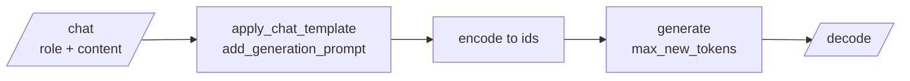

<!-- Generated by site/scripts/rag-theory-import.mjs from rag-agents-engineering. Edit the source there. -->
# lesson 2 of T2.2 Theory: Open-source LLMs via Hugging Face Inference and locally

<!-- subtitle: The model id names the weights, not the server: who runs an open model, and what you do yourself when it is you -->
<!-- format: approved -->

## Inference endpoints

> **What you'll learn**
>
> - **Compare** the three places an open model can run: a vendor, a routed provider, or your own GPU.
> - **Explain** why the same model id can reach different servers, and what to record with each answer.
> - **Diagnose** a client that sends a token you thought you had left out.
> - **Explain** the steps a hosted endpoint performs that a local run makes you do yourself.

Two runs of the same Llama question through Hugging Face come back with different latencies, and nobody changed the code. The model id was the same both times. The server was not, and the client never said which one it wanted.

An **inference endpoint** is a server that holds a model's weights and answers calls to it. For an open model you choose who runs that server. The notebooks show two of the three options:

| | Where the weights run | The call | What you manage |
|---|---|---|---|
| Vendor API (lesson 1 of T2.2) | The vendor's servers | `openai.chat.completions.create(...)` | A key and a budget |
| Hugging Face Inference (02a) | A provider Hugging Face routes to | `InferenceClient(...).chat.completions.create(...)` | A token, and which provider serves the model |
| Local (02b) | Your GPU | `model.generate(...)` or a `pipeline` | Memory, the chat template, generation settings |

*Table 1: Three places an open model can run.*

Notebook 02a calls `meta-llama/Llama-3.1-8B-Instruct`, an 8B-parameter instruction-tuned model, and `deepseek-ai/DeepSeek-V3-0324` with the same messages and `max_tokens=1000`. The client mirrors the OpenAI call on purpose: the same `chat.completions.create` method with a model and messages, and the reply in the first choice's message content. Code written against the OpenAI shape moves to an open model by changing the client and the model id.

Two details of the hosted path decide what you are actually calling:

- **The model id names the weights, not the server.** In the installed `huggingface_hub` 1.16.1, a chat call with no `provider` argument defaults to `"auto"`: Hugging Face routes the call to a provider that hosts the model, by default the fastest one. Latency and price can differ by provider, so a production client passes `provider=` explicitly and records it with each answer. We call the alternative **unpinned routing**.
- **The notebook's "client without API key" still sends one.** It creates a client with no token after setting `HF_TOKEN` in the environment. With `token=None` the library falls back to `HF_TOKEN`, so both of the notebook's clients are authenticated; building the request headers with `token=None` returns the bearer token from the environment. To send no token at all, pass `token=False`.

> **Pitfall: unpinned routing.** Two answers to the same question can come from different providers with different latency, price and serving settings. Without the provider recorded, a regression cannot be traced to its cause.

The notebooks price only the OpenAI models, so this module has no per-answer figure for the open ones. Measure them the same way lesson 4 of T2.2 measures `o4-mini`: from `usage` where the provider returns it, or from GPU hours when you host the model.

## Running a model locally

Optional notebook 02b loads `google/recurrentgemma-2b-it` with `transformers` in `bfloat16` on a CUDA device, and states that it needs at least 5 GB of GPU memory. Running locally exposes the steps a hosted endpoint does for you:

*Figure 1: The local generation path, from chat messages to decoded text.*

Each step has one thing to get right:

| Step | What it does | What goes wrong |
|---|---|---|
| Chat template | Writes the model's own markup around roles, ending with the cue for the assistant's turn | A wrong template gives fluent but off-format replies |
| Encode | Turns the templated text into token ids, without adding special tokens again | Adding them twice duplicates the start markers |
| Generate | Extends the ids, capped by `max_new_tokens` (150 in the first call) or `max_length` (prompt plus reply) | Setting both is redundant; the notebook uses one or the other |
| Decode | Turns ids back into text | `generate` returns the prompt ids followed by the new ones |

*Table 2: The four local steps and their failure points.*

- **The chat template.** Each chat model was trained on its own markup around roles. A hosted endpoint applies the template on the server; locally you call it yourself with the generation prompt switched on, then encode the result with `add_special_tokens=False` because the template already added them.
- **Generation settings.** `do_sample=False` is greedy decoding, the same answer every run; sampling with a temperature of 0.5 varies it.
- **What comes back.** Decoding the whole first output prints the template and the question before the answer. The text-generation `pipeline` with `return_full_text=False` returns only the new text.

The notebook's Markdown calls the model "Google Gemma 2B IT" while the code loads RecurrentGemma, a recurrent variant that the notebook says needs less memory than Gemma on long sequences. The model id in the code is the one that runs.

## Limits of this evidence

- **No calls made.** Both notebooks ship without outputs, and neither the hosted calls nor the local GPU run were repeated for this page. The routing default and the token fallback were read from the installed `huggingface_hub` 1.16.1, and the fallback was checked by building headers.
- **Providers change.** Which providers host a model, and which one is fastest, change over time; that is the reason to record the provider.
- **No open-model prices.** This module has no measured cost for the open models.

## References

1. Hugging Face, [Inference Providers](https://huggingface.co/docs/inference-providers/index), on routing a model id to a provider.
2. Hugging Face, [chat templates](https://huggingface.co/docs/transformers/chat_templating), on applying a model's role markup and the generation prompt.

## Run the notebooks

The code for this lesson is in these notebooks. Colab runs one in your browser: install the packages its first cell imports and set the API keys it reads. To run every notebook as written, clone the repository and use its uv environment.

| Notebook | GitHub | Colab |
|---|---|---|
| Open source LLMs via hugging face inference API | [Open on GitHub](https://github.com/Sourav692/rag-agents-engineering/blob/main/p01_ai_engineering_foundations/m02_llm_apis_and_model_selection/mandatory/notebook/02a_open_source_llms_via_hugging_face_inference_api.ipynb) | [Open in Colab](https://colab.research.google.com/github/Sourav692/rag-agents-engineering/blob/main/p01_ai_engineering_foundations/m02_llm_apis_and_model_selection/mandatory/notebook/02a_open_source_llms_via_hugging_face_inference_api.ipynb) |
| Open source LLMs locally (optional) | [Open on GitHub](https://github.com/Sourav692/rag-agents-engineering/blob/main/p01_ai_engineering_foundations/m02_llm_apis_and_model_selection/optional/notebook/02b_open_source_llms_locally.ipynb) | [Open in Colab](https://colab.research.google.com/github/Sourav692/rag-agents-engineering/blob/main/p01_ai_engineering_foundations/m02_llm_apis_and_model_selection/optional/notebook/02b_open_source_llms_locally.ipynb) |

## Key Takeaways

- For an open model you choose who runs the weights: a routed provider through Hugging Face Inference or your own GPU. The client mirrors the OpenAI call, so moving code means changing the client and the model id.
- The model id names the weights, not the server. Pass `provider=` explicitly, record it with each answer, and price open models from `usage` or GPU hours.
- Running locally means doing the hosted steps yourself: apply the model's chat template, cap the reply with `max_new_tokens`, and strip the prompt ids that `generate` returns before the answer.

## Check yourself

1. Why should a production client pass provider explicitly when it calls an open model through Hugging Face Inference?

The model id names the weights, not the server. With no `provider` argument, `huggingface_hub` 1.16.1 uses server-side auto routing and Hugging Face picks a provider that hosts the model, and latency and price can differ by provider. Passing `provider=` and recording it with each answer tells you what you actually called.

2. You create InferenceClient() with no token to test an unauthenticated call, after the notebook set HF_TOKEN. Is the call unauthenticated?

No. With `token=None` the library falls back to `HF_TOKEN` from the environment, so the client sends the bearer token anyway; `build_hf_headers(token=None)` shows it. Pass `token=False` to send no token at all.

3. Running RecurrentGemma locally, decoding the first output of model.generate prints the chat template and the question before the answer. Is something wrong?

No. `model.generate` returns the prompt's token ids followed by the new ones, so decoding the whole output prints both. The `pipeline("text-generation", ...)` call with `return_full_text=False` returns only the new text.

