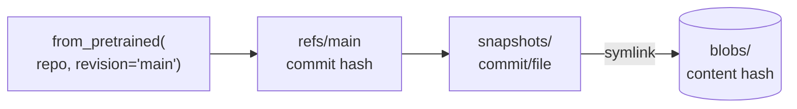

<!-- Generated by site/scripts/rag-theory-import.mjs from rag-agents-engineering. Edit the source there. -->
# lesson 1 of T2.3 Theory: Hub setup, datasets and models

<!-- subtitle: A model name is a moving branch: how the Hub and its local cache decide which weights you load -->
<!-- format: approved -->

## Hub & cache

> **What you'll learn**
>
> - **Explain** how a Hub repo, a branch and a commit hash relate, and why a name is not a version.
> - **Read** the local cache layout: refs, snapshots and content-addressed blobs.
> - **Configure** where the cache lives and stop a server from calling the Hub.
> - **Diagnose** an accuracy figure that silently depends on a hard-coded split size.

In an illustrative case, the Larkspur retriever embeds the handbook with `all-MiniLM-L6-v2` on a laptop in March and on a server in June. The two indexes disagree on a handful of questions, though both loaded "the same model". The owner had pushed a new commit in between, and both machines asked for whatever `main` pointed to that day.

The **Hugging Face Hub** stores models, datasets and Spaces as git repositories named `owner/name`, such as `sentence-transformers/all-MiniLM-L6-v2`. Every change to a repo is a commit with a 40-character hash, and branch names such as `main` point to the latest one. Notebook 01a logs in with `notebook_login()`, which saves an access token; scripts and servers read the same token from the `HF_TOKEN` environment variable. Public models download without a token, but gated models need one, and anonymous requests get lower rate limits (the library prints a warning saying so).

The first `from_pretrained` or `pipeline` call for a repo downloads its files into a local cache. Every later call reads the files from disk. The cache entry for the embedding model [T5.4](../../p04_rag_foundations/m13_embeddings/00_overview.md) and [T6.1](../../p05_retrieval_quality_and_rag_apps/m16_retrievers_hybrid_search/00_overview.md) use sits under the hub cache folder as `models--sentence-transformers--all-MiniLM-L6-v2`, and holds four parts:

| Path in the entry | What it holds | For `all-MiniLM-L6-v2` |
|---|---|---|
| `refs/main` | the commit hash `main` pointed to at download time, 40 bytes | `1110a243…` |
| `blobs/` | each file once, named by the hash of its content | the weights, 90,868,376 bytes; `tokenizer.json`, 466,247 bytes |
| `snapshots/<commit>/` | the repo as it was at that commit; every file is a symlink into `blobs/` | `model.safetensors` and `tokenizer.json` link to their blobs |
| `.no_exist/` | files the library asked for that the repo does not have | so it does not ask again |

*Table 1: The cache entry for `all-MiniLM-L6-v2`, read from a local cache.*

A load resolves a name through those parts in order:

*Figure 1: How a load resolves `main` to a file on disk.*

Three consequences follow from that layout:

- **A name is not a version.** `main` moves when the owner pushes. Pass `revision=` with a commit hash to load the same weights in every environment, which is how `transformers` pins its own default models (lesson 2 of T2.3). We call loading by branch name **floating weights**.
- **Revisions share files.** Two snapshots of one repo point at the same blob when a file did not change, so a new commit downloads only what changed. Old revisions stay on disk until you remove them.
- **The cache is a folder you can move.** `HF_HOME` (default `~/.cache/huggingface`) or `HF_HUB_CACHE` (default `$HF_HOME/hub`) relocate it, for example to a volume shared by several containers; `HF_HUB_OFFLINE=1` makes the library read only from it and never call the Hub.

> **Pitfall: floating weights.** Two environments that both load `main` agree only until the owner pushes. Pin a commit hash wherever results must be reproducible, such as an index you rebuild or an evaluation you compare against.

To see what the cache holds, `scan_cache_dir()` in 01a returns an `HFCacheInfo` object with every repo, revision and size. The notebook also suggests the older `huggingface-cli scan-cache`; in `huggingface_hub` 1.16.1, the version this course locks, that command prints "`huggingface-cli` is deprecated and no longer works". Use `hf cache ls` to list repos and sizes, `hf cache rm` to delete one, and `hf cache prune` to remove revisions no branch points to.

Datasets use the same Hub and their own cache. Notebook 01b loads the `rotten_tomatoes` movie-review dataset with a relative `cache_dir`, which writes a data folder next to the notebook instead of into the shared cache. The dataset has three splits (8,530 training, 1,066 validation and 1,066 test reviews), and the notebook divides its correct predictions by a hard-coded 1066. Divide by the length of the test table instead, so the accuracy stays right if the split changes. The Hub now lists the dataset as `cornell-movie-review-data/rotten_tomatoes`, and the short name redirects to it; if it stops resolving, use the full id.

## Limits of this evidence

- **One local cache.** Table 1 was read from one machine's cache at commit `1110a243`. Another commit has different hashes and possibly different sizes.
- **Version-dependent commands.** The `hf cache` commands and the deprecation message come from `huggingface_hub` 1.16.1. Older releases still ship `huggingface-cli`.
- **Notebook not rerun.** The split sizes and the redirect were read from the Hub's dataset metadata, not from a run of notebook 01b.

## References

1. Hugging Face, [managing the cache](https://huggingface.co/docs/huggingface_hub/guides/manage-cache), on refs, snapshots, blobs and cleaning up.
2. Hugging Face, [environment variables](https://huggingface.co/docs/huggingface_hub/package_reference/environment_variables), for `HF_HOME`, `HF_HUB_CACHE`, `HF_TOKEN` and `HF_HUB_OFFLINE`.

## Run the notebooks

The code for this lesson is in these notebooks. Colab runs one in your browser: install the packages its first cell imports and set the API keys it reads. To run every notebook as written, clone the repository and use its uv environment.

| Notebook | GitHub | Colab |
|---|---|---|
| HF setup | [Open on GitHub](https://github.com/Sourav692/rag-agents-engineering/blob/main/p01_ai_engineering_foundations/m03_hugging_face_models/mandatory/notebook/01a_hf_setup.ipynb) | [Open in Colab](https://colab.research.google.com/github/Sourav692/rag-agents-engineering/blob/main/p01_ai_engineering_foundations/m03_hugging_face_models/mandatory/notebook/01a_hf_setup.ipynb) |
| HF basics | [Open on GitHub](https://github.com/Sourav692/rag-agents-engineering/blob/main/p01_ai_engineering_foundations/m03_hugging_face_models/mandatory/notebook/01b_hf_basics.ipynb) | [Open in Colab](https://colab.research.google.com/github/Sourav692/rag-agents-engineering/blob/main/p01_ai_engineering_foundations/m03_hugging_face_models/mandatory/notebook/01b_hf_basics.ipynb) |

## Key Takeaways

- Hub repos are git repositories, and a branch such as `main` moves when the owner pushes. Pin `revision=` to a commit hash to load the same weights in every environment.
- The cache stores each file once as a content-hashed blob and links snapshots to it, so a new commit downloads only what changed. Clear old revisions with `hf cache prune`.
- Relocate the cache with `HF_HOME` or `HF_HUB_CACHE` and set `HF_HUB_OFFLINE=1` on servers that must never call the Hub. Compute accuracy from `len(test_df)`, never a hard-coded count.

## Check yourself

1. Why does loading a model with revision main not guarantee the same weights in every environment?

A name is not a version. `main` is a branch that moves when the owner pushes, and `refs/main` holds whichever commit hash it points to now. Pass `revision=` with a commit hash to load the same weights everywhere, which is how `transformers` pins its own default models.

2. The owner of all-MiniLM-L6-v2 pushes a commit that changes only tokenizer.json. What does your next load of main download, and what stays on disk?

Only the new `tokenizer.json`. The new snapshot's `model.safetensors` symlink points at the same 90,868,376-byte blob, because that file did not change. The old revision stays on disk until you remove it; `hf cache prune` removes revisions no branch points to.

3. Several containers share one model cache, and the servers must never call the Hub. Which settings do you use?

Point `HF_HOME` or `HF_HUB_CACHE` at the shared volume, and set `HF_HUB_OFFLINE=1` so the library reads only from the cache. Pin each model with `revision=` and a commit hash so every container loads the same snapshot.

