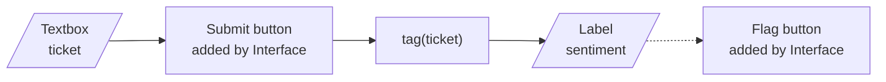
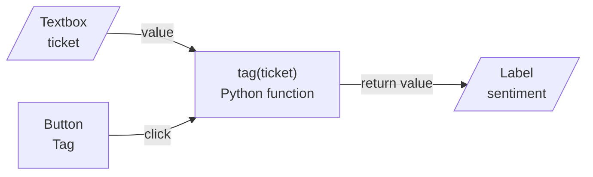

<!-- Generated by site/scripts/rag-theory-import.mjs from rag-agents-engineering. Edit the source there. -->
# lesson 5 of T2.3 Theory: Building demos with Gradio

<!-- subtitle: A Python function becomes a web page: a quick form with Interface, your own layout and events with Blocks -->
<!-- format: approved -->

## Gradio Blocks

> **What you'll learn**
>
> - **Compare** `gr.Interface` and `gr.Blocks` on what each builds for you and what you wire yourself.
> - **Trace** one event from a button click through a Python function to an output component.
> - **Apply** three habits: load the model once, fail with a message, style through `launch()`.
> - **Explain** why a demo is not a production service.

The Larkspur support lead wants to try the ticket tagger before anyone builds a service around it. They do not run notebooks. A demo page with a ticket box and a Tag button lets them, provided each click is fast and an empty box gives a clear message instead of a stack trace.

**Gradio** turns a Python function into a web page. The function stays ordinary Python; Gradio draws an input component for each argument, an output component for each return value, and calls the function when the user acts. `launch()` serves the page at `http://localhost:7860`, or the next free port above it.

Gradio has two ways to build that page.

**`gr.Interface(fn, inputs, outputs)`** builds a form around one function: the input components, a Submit button and the outputs. Notebook 05a wraps an adder, a text reverser, a greyscale filter and a classifier this way, and 05d sets `live=True` so the function reruns on every change instead of on Submit. Interface also adds a Flag button; in Gradio 6.31 flagged examples go to `.gradio/flagged`, not the `flagged` folder 05a names.

*Figure 1: The ticket tagger as an Interface. Gradio adds the Submit and Flag buttons and wires them.*

**`gr.Blocks()`** is a context manager in which you place components yourself, inside rows, columns with a `scale`, tabs, accordions and groups (05b). Blocks adds no button and calls nothing by itself. You connect each event to a function (05c): a button's `click` runs on a click, a slider's `change` on every change of value. One page can hold many components and many events, each with its own function.

*Figure 2: The ticket tagger as a Blocks app. You place the button and name the event's inputs and outputs.*

The event names its inputs and outputs by component, and Gradio passes values between the browser and the function. The Larkspur ticket tagger as a Blocks app has four pieces:

| Piece | What it is | Why it is built that way |
|---|---|---|
| Classifier | the sentiment pipeline from lesson 2 of T2.3, pinned to `distilbert/distilbert-base-uncased-finetuned-sst-2-english` at `714eb0f` | built once when the app starts |
| `tag(ticket)` | raises `gr.Error("Paste a ticket first.")` on an empty box, otherwise returns the label with its score | a `gr.Label` shows a label with its confidence |
| Layout | one row: a wide column (scale 2) with the ticket box and the Tag button, a narrow column (scale 1) with the label | placed by hand, which Interface cannot do |
| Event | the button's click runs `tag` with the ticket box as input and the label as output | Blocks wires nothing by itself |

*Table 1: The ticket tagger's pieces. The design follows the notebooks; it is not a notebook cell.*

Build the same ticket tagger both ways and compare what Gradio does for you.

<button type="button" data-mode="interface" aria-pressed="false" aria-controls="ui-interface">gr.Interface</button>
<button type="button" data-mode="blocks" aria-pressed="false" aria-controls="ui-blocks">gr.Blocks</button>

<section id="ui-interface" class="mode-panel" data-announcement="Interface: a ready-made form around one function."><h4>gr.Interface</h4><dl><dt>You write</dt><dd>the function, its input and output components</dd><dt>Gradio adds</dt><dd>a Submit button, a Flag button and the wiring between them</dd><dt>Layout and events</dt><dd>fixed: one form, one function</dd></dl></section>
<section id="ui-blocks" class="mode-panel" data-announcement="Blocks: your layout and your events."><h4>gr.Blocks</h4><dl><dt>You write</dt><dd>the function, every component, the rows and columns, and each event</dd><dt>Gradio adds</dt><dd>nothing until you wire an event</dd><dt>Layout and events</dt><dd>yours: many components and many events, each with its own function</dd></dl></section>

Three habits from the notebooks carry over to every demo:

- **Load the model once, outside the function.** 05e builds its sentiment pipeline at the top of the notebook and only calls it inside its prediction function. A pipeline built inside the event function would reload the weights on every click. We call that a **per-click reload**.
- **Fail with a message.** Raising `gr.Error` stops the function and shows the message in the page; `gr.Warning` shows a notice and lets the function finish (05f).
- **Style through `launch()` in Gradio 6.** 05g passes `theme=` to `gr.Interface` and `css=` to `gr.Blocks`. Gradio 6.31, the version this course locks, still accepts both but warns "The parameters have been moved from the Blocks constructor to the launch() method in Gradio 6.0"; pass them to `launch()` instead.

Notebook 05e's last cell calls `gr.load` with the model's Hub name and `src="models"`, which runs the model on Hugging Face's servers instead of locally.

A demo is a tool for trying a model with people who do not run notebooks, such as the Larkspur support lead. It has no login, rate limit or monitoring unless you add them. In production the model runs behind a service with those controls, and the demo stays a way to try it.

## Limits of this evidence

- **Version-bound.** The flag folder, the port search from 7860 and the styling warning were checked against Gradio 6.31.0. Earlier and later releases differ.
- **No app launched.** The tagger in Table 1 is a design assembled from the notebooks' patterns; no page was served for this lesson.
- **A demo, not a service.** Nothing on this page covers authentication, rate limits or monitoring.

## References

1. Gradio, [Blocks and event listeners](https://www.gradio.app/guides/blocks-and-event-listeners), on layouts and wiring events to functions.
2. Gradio, [the Interface class](https://www.gradio.app/docs/gradio/interface), including `live` and flagging.

## Run the notebooks

The code for this lesson is in these notebooks. Colab runs one in your browser: install the packages its first cell imports and set the API keys it reads. To run every notebook as written, clone the repository and use its uv environment.

| Notebook | GitHub | Colab |
|---|---|---|
| Gradio introduction | [Open on GitHub](https://github.com/Sourav692/rag-agents-engineering/blob/main/p01_ai_engineering_foundations/m03_hugging_face_models/mandatory/notebook/05a_gradio_introduction.ipynb) | [Open in Colab](https://colab.research.google.com/github/Sourav692/rag-agents-engineering/blob/main/p01_ai_engineering_foundations/m03_hugging_face_models/mandatory/notebook/05a_gradio_introduction.ipynb) |
| Gradio layout (optional) | [Open on GitHub](https://github.com/Sourav692/rag-agents-engineering/blob/main/p01_ai_engineering_foundations/m03_hugging_face_models/optional/notebook/05b_gradio_layout.ipynb) | [Open in Colab](https://colab.research.google.com/github/Sourav692/rag-agents-engineering/blob/main/p01_ai_engineering_foundations/m03_hugging_face_models/optional/notebook/05b_gradio_layout.ipynb) |
| Gradio interactions (optional) | [Open on GitHub](https://github.com/Sourav692/rag-agents-engineering/blob/main/p01_ai_engineering_foundations/m03_hugging_face_models/optional/notebook/05c_gradio_interactions.ipynb) | [Open in Colab](https://colab.research.google.com/github/Sourav692/rag-agents-engineering/blob/main/p01_ai_engineering_foundations/m03_hugging_face_models/optional/notebook/05c_gradio_interactions.ipynb) |
| Gradio image ml integration (optional) | [Open on GitHub](https://github.com/Sourav692/rag-agents-engineering/blob/main/p01_ai_engineering_foundations/m03_hugging_face_models/optional/notebook/05d_gradio_image_ml_integration.ipynb) | [Open in Colab](https://colab.research.google.com/github/Sourav692/rag-agents-engineering/blob/main/p01_ai_engineering_foundations/m03_hugging_face_models/optional/notebook/05d_gradio_image_ml_integration.ipynb) |
| Gradio text ml integration (optional) | [Open on GitHub](https://github.com/Sourav692/rag-agents-engineering/blob/main/p01_ai_engineering_foundations/m03_hugging_face_models/optional/notebook/05e_gradio_text_ml_integration.ipynb) | [Open in Colab](https://colab.research.google.com/github/Sourav692/rag-agents-engineering/blob/main/p01_ai_engineering_foundations/m03_hugging_face_models/optional/notebook/05e_gradio_text_ml_integration.ipynb) |
| Gradio modals errors (optional) | [Open on GitHub](https://github.com/Sourav692/rag-agents-engineering/blob/main/p01_ai_engineering_foundations/m03_hugging_face_models/optional/notebook/05f_gradio_modals_errors.ipynb) | [Open in Colab](https://colab.research.google.com/github/Sourav692/rag-agents-engineering/blob/main/p01_ai_engineering_foundations/m03_hugging_face_models/optional/notebook/05f_gradio_modals_errors.ipynb) |
| Gradio styling and themes (optional) | [Open on GitHub](https://github.com/Sourav692/rag-agents-engineering/blob/main/p01_ai_engineering_foundations/m03_hugging_face_models/optional/notebook/05g_gradio_styling_and_themes.ipynb) | [Open in Colab](https://colab.research.google.com/github/Sourav692/rag-agents-engineering/blob/main/p01_ai_engineering_foundations/m03_hugging_face_models/optional/notebook/05g_gradio_styling_and_themes.ipynb) |

## Key Takeaways

- Use `gr.Interface` for a quick form around one function, and `gr.Blocks` when you need your own layout and many events, each wired to a function with calls such as `button.click(fn, inputs, outputs)`.
- Load the model once when the app starts, raise `gr.Error` to stop with a message, and pass `theme=` and `css=` to `launch()` in Gradio 6.
- A demo has no login, rate limit or monitoring. Use it to let people try a model, and serve production traffic from a service with those controls.

## Check yourself

1. What does gr.Blocks leave you to do that gr.Interface does for you?

`gr.Interface` builds a form around one function: input components, a Submit button, the outputs and a Flag button. `gr.Blocks` adds no button and calls nothing by itself: you place the components in rows, columns and tabs, and connect each event to a function, such as `button.click(fn, inputs, outputs)`. In return one page can hold many components and events.

2. In the Larkspur ticket tagger, the support lead clicks Tag with an empty ticket box. What does the page show, and does the classifier run?

The page shows "Paste a ticket first." and the classifier does not run. `tag` checks for an empty ticket first, and `raise gr.Error(...)` stops the function there and shows the message. `gr.Warning` would show a notice and let the function finish.

3. Every click in a colleague's Gradio demo reloads the model weights. Where did they build the pipeline, and where should it go?

Inside the event function, so each call builds the pipeline again. Build it once outside the function, when the app starts, as `05e` and the ticket tagger do, and only call it inside the function.

