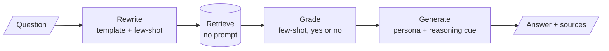

<!-- Generated by site/scripts/rag-theory-import.mjs from rag-agents-engineering. Edit the source there. -->
# M05 Theory: Prompt engineering patterns

Every LLM step in a RAG pipeline is a prompt: the query rewrite, the relevance grade, the route and the final answer. A prompt pattern is a reusable way to write one of those steps. The M05 notebooks build on four ideas: showing the model worked examples, asking it to reason before it answers, sampling several reasoning paths and voting, and running a loop of thoughts and tool calls.

The notebooks use their own material: news headlines, product reviews, phone fact sheets and an NFL game summary. These pages carry each pattern over to the Larkspur Cloud handbook from [M11](../../p04_rag_foundations/m11_rag_lifecycle/00_overview.md) to [M13](../../p05_ingestion_and_indexing/m13_chunking/00_overview.md), as the prompts a support assistant over that handbook would run: grading whether a chunk answers *How long does a refund take?*, computing the refund for *Can I get a refund after 45 days?*, and searching the handbook for *Can I export my data after I cancel my plan?*

## In short

- A few-shot prompt teaches the label set and the output format by example. Every example is sent on every call: the notebook's three-example news classifier is 321 tokens, against 31 for the zero-shot version.
- Chain-of-thought asks for the steps before the answer. In few-shot CoT the model copies the exemplar's reasoning, mistakes included; two of the notebook's exemplars contain a wrong step.
- Self-consistency samples several reasoning paths and keeps the most common answer. It helps when wrong answers scatter and hurts when they agree: at one-path accuracy 0.40, a 15-path vote reaches 0.780 with four distinct wrong answers and falls to 0.213 on a yes/no question.
- ReAct interleaves Thought, Action and Observation until the model can answer. With tool calling, the Action is a structured call the framework runs; the Thought and Action lines in the system prompt are guidance, not a format anything parses.
- A prompt set is a test asset. Keep it fixed, change the model, and score the outputs against your own labels.

## Mental model

Three of the four steps between the question and the answer are prompts, and each is assembled from the patterns in this module. When the pipeline gives a wrong answer, the fault sits in one of those prompts or in retrieval, and each can be tested on its own against a labelled set.

## Interactive lab

[**Self-consistency: when a vote helps**](/labs/rag/m05_prompt_engineering_patterns/self-consistency-vote-lab.html): open the file in a browser. Set one wrong answer (a yes/no grade) and a one-path accuracy of 0.60, then slide N from 1 to 15 and watch the vote creep from 0.600 to 0.787 while the calls climb to 16. Drop the accuracy to 0.40 and the same vote falls to 0.213. Then pick four wrong answers at 0.40 and the vote rises instead, to 0.780 at N = 15.

## How it connects

- **Before:** [M02](../../p01_ai_engineering_foundations/m02_llm_apis_and_model_selection/00_overview.md) calls the provider APIs these prompts are sent through; [M04](../../p01_ai_engineering_foundations/m04_fine_tuning_fundamentals/00_overview.md) covers fine-tuning, the alternative when a prompt cannot carry enough examples.
- **Next:** [M06](../m06_multimodal_prompting/00_overview.md) applies the patterns to image inputs, and [M07](../../p03_langchain_and_langgraph/m07_langchain_core/00_overview.md) turns them into LangChain prompt templates and output parsers. The rewrite prompt returns in [M18](../../p06_retrieval_quality/m18_query_transformation/00_overview.md), the grading prompt in [M28](../../p09_agentic_rag/m28_retrieval_grading_rewriting/00_overview.md), the ReAct loop in [M23](../../p08_agent_foundations/m23_agent_loop_and_tools/00_overview.md) and [M24](../../p08_agent_foundations/m24_react_agents/00_overview.md), and self-consistency with tree of thoughts in [M26](../../p08_agent_foundations/m26_planning_reflection_reasoning/00_overview.md).

## Key Takeaways

- Write each LLM step as a pattern you can name: examples, a reasoning cue, a template, a persona. A named pattern is easier to test and to change.
- Examples are part of the prompt's cost and its correctness. Check that they cover every label and that every worked step in them is right.
- Vote only on short answers that can be compared, and only when one sample is right more often than any single wrong answer.
- Freeze a labelled prompt set before you change the model, the prompt or the sampling, and judge every change against it.
