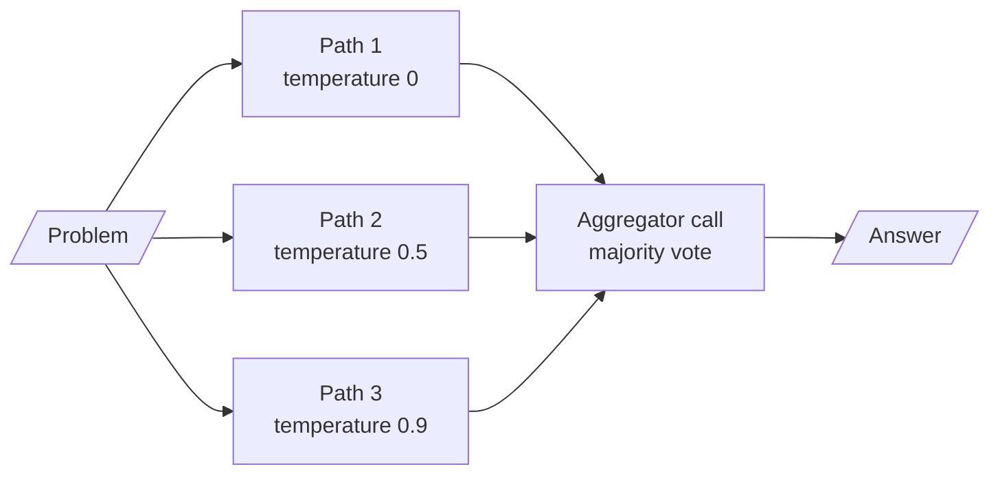

<!-- Generated by site/scripts/rag-theory-import.mjs from rag-agents-engineering. Edit the source there. -->
# lesson 2 of T3.1 Theory: Reasoning prompts: chain-of-thought, self-consistency, least-to-most, ReAct

*Notebooks on GitHub: [Advanced prompt engineering patterns](https://github.com/Sourav692/rag-agents-engineering/blob/main/course/p02_prompt_engineering/m05_prompt_engineering_patterns/notebooks/02a_advanced_prompt_engineering_patterns.ipynb)*

## Chain-of-thought

A chain-of-thought (CoT) prompt asks the model to write its reasoning before the answer. The answer is then conditioned on the steps, and the steps are on the page for you to check. Notebook 02a uses one question for every variant: from a game summary, *How many yards was the shortest valid field goal?* The summary has a 35-yard field goal and a 31-yard one that was blocked, so the right answer is 35, and a model that skips the word "blocked" says 31.

Three ways to ask for the reasoning:

- **Zero-shot CoT** adds one instruction: `Think step-by-step to get to your answer. Show your step-by-step reasoning and then the answer.`
- **Few-shot CoT** shows worked examples with numbered steps (`Step 1: Roger started with 5 balls.`) and lets the model copy the shape.
- **Least-to-most** asks the model to list the subproblems first, then solve them in order: `break down the problem first into sub problems, answer each sub problem sequentially`.

In few-shot CoT the model copies the reasoning of the examples as well as their format, so the examples have to be right. Two in notebook 02a are not:

- The keystroke example ends `9 + 90 + 401 = 1392 keystrokes`. Those three numbers add up to 500, the count of numbers from 1 to 500. The keystrokes are 9 × 1 + 90 × 2 + 401 × 3 = 1,392: the answer is right and the step that reaches it is wrong.
- The least-to-most example lists *28-yard, 57-yard and 59-yard which are all valid goals*, but its own text says the 28-yard attempt was blocked. The final answer, 59, survives only because the blocked kick was not the longest.

The second example teaches the exact mistake the test question checks for: counting a blocked kick as valid.

Least-to-most fits Larkspur questions that combine rules. *Can I get a refund after 45 days?* breaks into three subproblems:

1. Is day 45 inside the 30-day window for a full refund? No.
2. Which rule applies after day 30? The refund is prorated to the unused whole months, minus a 15% early-termination fee.
3. How many whole months are unused? That depends on the customer's plan start date, which is in the billing system, not in the handbook.

The third subproblem cannot be solved by reasoning alone. It needs a lookup, which is where ReAct comes in.

## Self-consistency

Self-consistency samples several chain-of-thought paths for the same question and keeps the answer most of them reach (Wang et al., 2022). Notebook 02a builds it from three CoT chains run in parallel with `RunnableParallel`, all `gpt-4o-mini` at temperatures 0, 0.5 and 0.9, and a fourth call at temperature 0 that reads the three paths and is told to *aggregate, take the majority vote as needed*:



That is four calls where plain CoT makes one. Whether the extra calls pay depends on how the wrong answers are spread, which the [interactive lab](/labs/rag/m05_prompt_engineering_patterns/self-consistency-vote-lab.html) computes exactly. It treats each path as an independent draw that is right with probability `p` and otherwise gives one of `W` equally likely wrong answers, then counts how often the most common answer is the right one, with ties split at random:

| One path right | Wrong answers | N = 1 | N = 3 | N = 5 | N = 15 |
|---|---|---|---|---|---|
| 0.60 | 1 (yes/no) | 0.600 | 0.648 | 0.683 | 0.787 |
| 0.40 | 1 (yes/no) | 0.400 | 0.352 | 0.317 | 0.213 |
| 0.40 | 4 | 0.400 | 0.460 | 0.549 | 0.780 |
| 0.60 | 4 | 0.600 | 0.720 | 0.835 | 0.987 |


```lab
src: /labs/rag/m05_prompt_engineering_patterns/self-consistency-vote-lab.html
title: Self-consistency: when a vote helps
```

Three rules follow:

- **A vote amplifies whatever answer is most common.** If one path is right more often than any single wrong answer, more paths help. If not, they make the wrong answer look certain: a yes/no grader that is right 40% of the time drops to 0.213 with 15 votes.
- **Scattered errors are where voting pays.** With four distinct wrong answers, a path that is right only 40% of the time still wins the vote 78% of the time at N = 15, because no single wrong answer gathers enough votes. Numeric answers such as a prorated refund behave like this; yes/no grades never do.
- **On two labels, use an odd N.** An even N can split evenly, and a split is a coin flip, so N = 4 scores exactly what N = 3 scores (0.648 at `p` = 0.60) for one more call.

The lab's independence assumption is the best case. Paths from one model share its blind spots, so they agree on the same wrong answer more often than independent draws would, and a real vote gains less. A path at temperature 0, as in the notebook, repeats the model's most likely path rather than sampling a new one. For a measured case where the wrong answers clustered on one value, see [T9.4's self-consistency page](../../p08_agent_foundations/m26_planning_reflection_reasoning/06_self_consistency_tree_of_thoughts_and_lats.md#lesson-tree-of-thoughts-lats).

## ReAct format

ReAct prompts the model to alternate reasoning with actions: a Thought, an Action with its input, the Observation the action returns, and another Thought, until it can write a Final Answer (Yao et al., 2022). Notebook 02a puts that format in its system prompt:

```text
Thought: you should always think about what to do
Action: the action to take … call the tool [search_web]
Action Input: the input to the action
Observation: the result of the action
… (this Thought/Action/Action Input/Observation can repeat N times)
Thought: I now know the final answer
Final Answer: the final answer to the original input question
```

```animated
<figure class="anim sheet" aria-labelledby="anim-react-loop-cap">
  <div class="anim__canvas" tabindex="0" aria-label="The ReAct loop, scrolls sideways on a narrow screen">
    <svg viewBox="0 0 800 310" role="img" aria-labelledby="anim-react-loop-title anim-react-loop-desc">
      <title id="anim-react-loop-title">The ReAct loop</title>
      <desc id="anim-react-loop-desc">A question goes to a Thought. The Thought chooses an Action, a call to a handbook search tool. The tool runs and its result comes back as an Observation, which feeds the next Thought. When a Thought has enough evidence, the loop ends in a Final Answer.</desc>
      <defs>
        <marker id="ah-rl" viewBox="0 0 8 8" refX="7" refY="4" markerWidth="8" markerHeight="8" markerUnits="userSpaceOnUse" orient="auto-start-reverse"><path class="ah" d="M0 0 L8 4 L0 8 z"/></marker>
      </defs>

      <g class="n-1"><rect class="box" x="20" y="136" width="130" height="48"/><text class="label" x="85" y="160">Question</text></g>
      <g class="n-2 n-5"><rect class="box" x="220" y="136" width="130" height="48"/><text class="label" x="285" y="160">Thought</text></g>
      <g class="n-3"><rect class="box" x="420" y="40" width="170" height="48"/><text class="label" x="505" y="64">Action</text></g>
      <g class="n-4"><rect class="box" x="620" y="40" width="160" height="48"/><text class="label" x="700" y="64">Observation</text></g>
      <g class="n-6"><rect class="box" x="420" y="244" width="170" height="48"/><text class="label" x="505" y="268">Final Answer</text></g>

      <path class="edge e-2 in-2" d="M150 160 H217" marker-end="url(#ah-rl)"/>
      <path class="edge e-3 in-3" d="M285 136 C285 84 340 64 417 64" marker-end="url(#ah-rl)"/>
      <path class="edge e-4 in-4" d="M590 64 H617" marker-end="url(#ah-rl)"/>
      <path class="edge e-5 in-5" d="M700 88 C700 150 420 160 353 160" marker-end="url(#ah-rl)"/>
      <path class="edge e-6 in-6" d="M285 184 C285 262 340 268 417 268" marker-end="url(#ah-rl)"/>

      <g class="in-3"><text class="fig" x="505" y="106">search_handbook(</text><text class="fig" x="505" y="124">“export after cancel”)</text></g>
      <g class="in-4"><text class="small" x="700" y="22">export and retention chunks</text></g>
      <g class="in-5"><text class="small" x="560" y="184">enough evidence?</text></g>
      <g class="in-6">
        <rect class="doc" x="620" y="240" width="160" height="56"/>
        <text class="small" x="700" y="258">yes, within 30 days,</text>
        <text class="small" x="700" y="278">Settings, then Data</text>
      </g>

      <circle class="tok" cx="0" cy="0" r="7"/>
    </svg>
  </div>
  <div class="anim__controls" hidden>
    <button class="anim__btn" type="button" data-act="prev">Previous</button>
    <button class="anim__btn" type="button" data-act="play" aria-pressed="false">Play</button>
    <button class="anim__btn" type="button" data-act="next">Next</button>
  </div>
  <ol class="anim__steps" id="anim-react-loop-cap">
    <li><button type="button" data-tok="20,136">Question</button><span>A customer asks “Can I export my data after I cancel my plan?”</span></li>
    <li><button type="button" data-tok="220,136">Thought</button><span>The model reasons that the handbook holds the answer and that it should search it.</span></li>
    <li><button type="button" data-tok="420,40">Action</button><span>It names a tool and its input. With tool calling this is a structured call, not a line of text to parse.</span></li>
    <li><button type="button" data-tok="620,40">Observation</button><span>The tool runs and returns the export and retention chunks: exports from Settings, data kept 30 days after cancelling.</span></li>
    <li><button type="button" data-tok="220,136">Thought</button><span>The next Thought reads the Observation and decides the evidence is enough.</span></li>
    <li><button type="button" data-tok="420,244">Answer</button><span>The Final Answer: yes, export from Settings, then Data, within 30 days of cancelling.</span></li>
  </ol>
</figure>
```

The notebook's tool, `search_web`, takes the top five DuckDuckGo results, fetches each page with `requests` and returns its text through BeautifulSoup. The agent is `gpt-4o` built with `create_tool_calling_agent` and run by `AgentExecutor`. That combination changes what the format means:

- **The Action is a tool call, not text.** `bind_tools` gives the model the tool's schema, and the model returns a structured `tool_calls` entry with the tool name and arguments. The agent runs it and feeds the result back as a tool message. Nothing parses an `Action:` line: a reply with no `tool_calls` is taken as the final answer, even if its text says `Action:`. The `PAUSE` in the prompt has no effect.
- **The Thought lines are guidance.** They ask the model to plan and to check the Observation before answering. The model may write them, or may call the tool straight away.
- **The loop needs a stop.** `AgentExecutor` ends the run when the model replies without a tool call, or after `max_iterations` (15 by default).

The notebook first asks *Tell me about LangGraph in detail including who made it and key features* with no tool, and its own comment expects the model to decline or make up an answer; the agent then answers the same question from the pages `search_web` fetched. For Larkspur the tool is a handbook search, and *Can I export my data after I cancel my plan?* takes one round: the search returns the `export` and `retention` chunks, and the answer is to export from Settings, then Data, within 30 days of cancelling. The proration question from the section above takes two tools, the handbook and the customer's billing record. [T9.1](../../p08_agent_foundations/m23_agent_loop_and_tools/00_overview.md) and [T9.2](../../p08_agent_foundations/m24_react_agents/00_overview.md) build this loop in LangGraph.

## Check yourself

<details>
<summary>1. Why does the least-to-most example in notebook 02a make the field goal test harder to pass?</summary>

In few-shot chain-of-thought the model copies the reasoning of the examples, not only their format. That example lists a 28-yard kick as valid although its own text says it was blocked; its answer survives only because that kick was not the longest. It teaches the exact mistake the test checks for: counting the blocked 31-yard kick and answering 31 instead of 35.

</details>

<details>
<summary>2. A yes/no grader path is right 40% of the time. What does a 15-path majority vote score, and how would four distinct wrong answers change that?</summary>

0.213, worse than a single path's 0.400: the one wrong answer is more common than the right one, and the vote amplifies it. With four equally likely wrong answers the same 40% path wins the vote 78% of the time (0.780), because no single wrong answer gathers enough votes. These figures assume independent paths, the best case; paths from one model share blind spots and gain less.

</details>

<details>
<summary>3. A ReAct agent built with create_tool_calling_agent replies with text that says Action: search_web, but no search runs. Why?</summary>

The action is a structured `tool_calls` entry, not text, and nothing parses an `Action:` line. `AgentExecutor` takes a reply with no `tool_calls` as the final answer, even if its text says `Action:`, and ends the run there.

</details>
