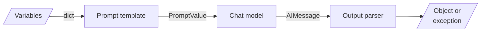

<!-- Generated by site/scripts/rag-theory-import.mjs from rag-agents-engineering. Edit the source there. -->
# M07 Theory: LangChain Core: Models, Prompts & Parsers

Every LangChain program in this course has the same three parts: a prompt template that turns variables into messages, a chat model that turns messages into an `AIMessage`, and an output parser that turns the `AIMessage` into something your code can use. The M07 notebooks build on four ideas: chat models, messages, prompt templates and output parsers.

The running example is the Larkspur Cloud support assistant that [M11](../../p04_rag_foundations/m11_rag_lifecycle/00_overview.md) to [M13](../../p05_ingestion_and_indexing/m13_chunking/00_overview.md) build, at the step after retrieval. It holds three handbook passages (`refund-window`, `refund-timing` and `billing`) for the question *How long does a refund take?* and must return a JSON answer with a list of the passages it cites. That is the module's lab brief, and the lab runs it.

## In short

- LangChain 1.x splits the old `langchain` package by how fast each part changes: base types in `langchain-core`, one partner package per provider, retired APIs in `langchain-classic`. A 0.x path such as `langchain.chains` raises `ModuleNotFoundError` with no deprecation warning first.
- Every chat model takes a string, a message list or a `PromptValue` and returns an `AIMessage` with `.content`, `.usage_metadata` and `.response_metadata`. Changing provider changes one class or one `"provider:model"` string.
- A chat model keeps no state. The conversation is the message list you send, so every earlier turn is paid for again on every call.
- A prompt template turns variables into a `PromptValue`, which becomes a string or a message list for whichever model receives it. Its `input_variables` are recomputed from the template text, so a typo in the list you pass is replaced without an error.
- A parser cannot make a reply good. It decides whether a bad reply raises. On the lab's eight replies, `JsonOutputParser` raises on 1 and returns 4 unusable results; `PydanticOutputParser` with the passage ids as a `Literal` raises on 5 and returns none. Both give the same 3 usable answers.

## Mental model

The prompt template and the parser are where your code meets the model's text. The template decides what the model reads; the parser decides what reaches the rest of your program, and whether a malformed reply arrives as an exception or as a value that looks fine.

## Interactive lab

[**The parser bench**](/labs/rag/m07_langchain_core/parser-bench-lab.html): open the file in a browser. Start on `JsonOutputParser` and read the four rows marked unusable: each one parsed without an error. Switch to `PydanticOutputParser` with `Literal` ids and watch them move to the raised column while the usable count stays at 3. Then pick *Clean JSON* in the inspector and drag the cut slider down, as a `max_tokens` limit would, to see `JsonOutputParser` repair almost every truncated reply into a dict.

## How it connects

- **Before:** [M02](../../p01_ai_engineering_foundations/m02_llm_apis_and_model_selection/00_overview.md) calls the provider SDKs that M07 wraps. [M05](../../p02_prompt_engineering/m05_prompt_engineering_patterns/00_overview.md) writes the prompt patterns that M07 turns into templates, and [M06](../../p02_prompt_engineering/m06_multimodal_prompting/00_overview.md) sends images through the same message lists.
- **Next:** [M08](../m08_lcel_runnables_and_chains/00_overview.md) pipes templates, models and parsers into LCEL chains. [M11](../../p04_rag_foundations/m11_rag_lifecycle/00_overview.md) builds the first RAG pipeline from them, and [M24](../../p08_agent_foundations/m24_react_agents/00_overview.md) returns to structured output for agents. [M28](../../p09_agentic_rag/m28_retrieval_grading_rewriting/00_overview.md) grades retrieved passages with schema-bound model calls.

## Key Takeaways

- Import from `langchain_core` for prompts, messages and parsers, and from a partner package for the model. A `ModuleNotFoundError` on an old path means the module moved; an `ImportError` means the name did.
- Send the conversation every time. The model remembers nothing between calls, and every resent turn costs input tokens.
- Build prompts from templates with explicit slots, and check `input_variables` and the formatted messages before the first model call.
- Pick the parser for which failures you want to see. Put every rule you can into the schema, so a bad reply raises instead of passing.
