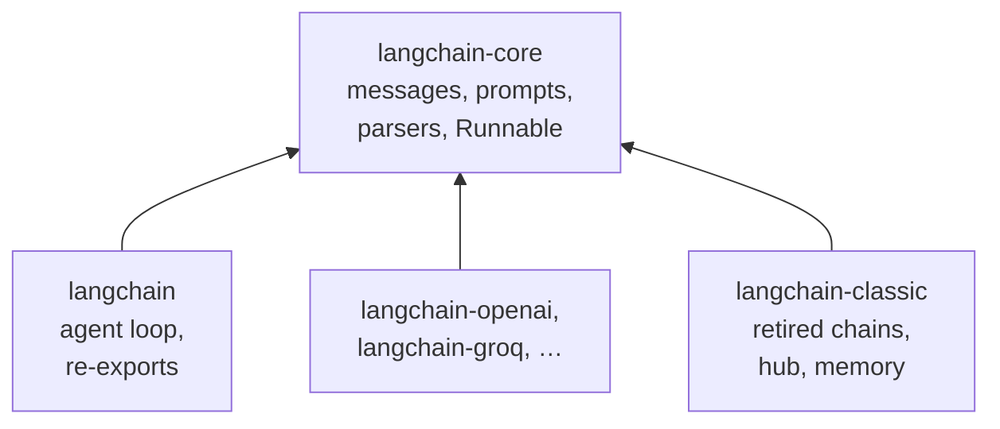

<!-- Generated by site/scripts/rag-theory-import.mjs from rag-agents-engineering. Edit the source there. -->
# lesson 1 of T4.2 Theory: LangChain introduction and the 1.x package split

## The 1.x package split

Through the 0.x releases, the `langchain` package held the whole ecosystem: chains, agents, memory, retrievers, every provider integration and the prompt hub. Installing it pulled in all of that, and a break in any one integration could break the import. Version 1.0 split the surface by how fast each part changes and by who owns it:

| Package | Holds | Changes |
|---|---|---|
| `langchain-core` | messages, documents, prompts, output parsers, `Runnable` | rarely, deliberately |
| `langchain` | the agent loop and short re-exports such as `init_chat_model` | with the agent API |
| `langchain-openai`, `langchain-groq`, … | one provider each | at that provider's pace |
| `langchain-classic` | retired chains, retrievers, indexing, the hub | frozen |

Everything else in this module comes from `langchain-core`: the prompt template classes, the message classes and all four output parsers. Only the model class comes from a partner package (`langchain_openai.ChatOpenAI`), or from `langchain.chat_models.init_chat_model` when the provider is named in a string.

The first notebook already shows the shape every later chain keeps: `prompt | llm | StrOutputParser()`, a template, a model and a parser joined with LCEL's `|`. [T4.2](../m07_lcel_runnables_and_chains/00_overview.md) covers the pipe itself; the next pages of this module cover the three parts.

## Reading an import error

Old code fails on 1.x in two different ways, and the exception class says what moved. Checked against the course environment (`langchain` 1.4.7, `langchain-core` 1.7.0):

- `from langchain.chains import LLMChain` raises `ModuleNotFoundError: No module named 'langchain.chains'`. The module is gone, so the fix is a new path: `langchain_classic.chains`, or a rewrite as an LCEL chain ([T4.2](../m07_lcel_runnables_and_chains/00_overview.md)).
- `from langchain import hub` raises `ImportError: cannot import name 'hub' from 'langchain'`. The package still exists; it no longer exports the name. Import it from `langchain_classic` instead.
- `No module named 'langchain_classic'` is a third problem: the package is not installed in this environment. `uv add langchain-classic` declares it in `pyproject.toml` and installs it.

The short paths that `langchain` keeps are aliases. `langchain.messages.HumanMessage is langchain_core.messages.HumanMessage` returns `True`; the notebook reads a `False` as two LangChain installs on `sys.path`.

Memory is the one place where the moved class is not the recommended answer. `ConversationBufferMemory` still imports from `langchain_classic.memory`, but the 1.x replacement is a LangGraph checkpointer with a `thread_id` ([T4.4](../m09_langgraph_runtime/00_overview.md), [T10.1](../../p09_memory_layer/m33_short_term_memory_conversation_state/00_overview.md)).

## Run the notebooks

The code for this lesson is in these notebooks. Colab runs one in your browser: install the packages its first cell imports and set the API keys it reads. To run every notebook as written, clone the repository and use its uv environment.

| Notebook | GitHub | Colab |
|---|---|---|
| LangChain Introduction | [Open on GitHub](https://github.com/Sourav692/rag-agents-engineering/blob/main/p03_llm_application_frameworks/m06_langchain_core/mandatory/notebook/01a_LangChain_Introduction.ipynb) | [Open in Colab](https://colab.research.google.com/github/Sourav692/rag-agents-engineering/blob/main/p03_llm_application_frameworks/m06_langchain_core/mandatory/notebook/01a_LangChain_Introduction.ipynb) |
| Package Split and Imports LangChain v1 | [Open on GitHub](https://github.com/Sourav692/rag-agents-engineering/blob/main/p03_llm_application_frameworks/m06_langchain_core/mandatory/notebook/01b_Package_Split_and_Imports_LangChain_v1.ipynb) | [Open in Colab](https://colab.research.google.com/github/Sourav692/rag-agents-engineering/blob/main/p03_llm_application_frameworks/m06_langchain_core/mandatory/notebook/01b_Package_Split_and_Imports_LangChain_v1.ipynb) |

## Key Takeaways

- Version 1.0 split LangChain by pace of change. Prompts, messages, parsers and `Runnable` live in `langchain-core`, each provider in its own package, and retired chains and the hub in the frozen `langchain-classic`.
- Read the exception class. `ModuleNotFoundError` means the module moved, `ImportError` means the package no longer exports the name, and a missing `langchain_classic` means it is not installed.
- Not every old class should simply move. Replace conversation memory with a LangGraph checkpointer and a `thread_id`, and rewrite retired chains in LCEL.

## Check yourself

1. Why did version 1.0 split the single langchain package into several packages?

In 0.x, installing `langchain` pulled in every provider integration, and a break in any one of them could break the import. Version 1.0 split the surface by how fast each part changes and who owns it: `langchain-core` changes rarely, each partner package moves at its provider's pace, and `langchain-classic` is frozen.

2. Old code runs from langchain import hub on 1.x. Which error do you expect, and where should hub come from now?

`ImportError: cannot import name 'hub' from 'langchain'`. The package still exists but no longer exports the name, so import it from `langchain_classic`. Compare `langchain.chains`, where the module itself is gone and the error is `ModuleNotFoundError`.

3. A 0.x app keeps chat history in ConversationBufferMemory. Is changing its import path the right migration?

It runs, but it is not the recommended answer. The class still imports from `langchain_classic.memory`; the 1.x replacement is a LangGraph checkpointer with a `thread_id` ([T4.4](../m09_langgraph_runtime/00_overview.md), [T10.1](../../p09_memory_layer/m33_short_term_memory_conversation_state/00_overview.md)). Memory is the one place where moving the import is not the fix.

