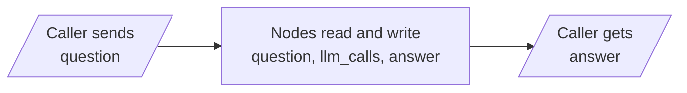
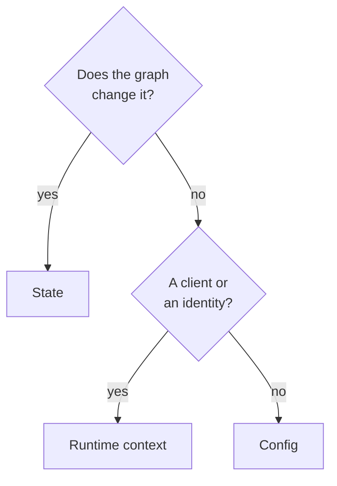

<!-- Generated by site/scripts/rag-theory-import.mjs from rag-agents-engineering. Edit the source there. -->
# lesson 5 of T4.3 Theory: Input/output schemas and configuration

<!-- subtitle: How input and output schemas narrow what a caller sends and receives, and which values belong in state, config or runtime context -->
<!-- format: approved -->

## Every caller sees the counter

> **What you'll learn**
>
> - **Explain** how one overall state can show callers a narrower input and output.
> - **Trace** what crosses the boundary with one schema and with three.
> - **Diagnose** a leaked internal key and an unchecked output.
> - **Choose** between state, config and runtime context for each value a node needs.

Lesson 4 of T4.3 gave `classify` a route reason in state and a database client in runtime context. Every key in state still goes back to whoever called the graph.

Here is what that costs. The Larkspur widget receives the whole final state: the messages, `route`, the route reason and a counter of model calls. A widget developer starts reading `route` to choose an icon. Months later the graph team renames `route` during a refactor, no test in the graph fails, and the widget breaks in production. The key was never meant for callers, and nothing said so.

The one-line reason: with one schema, the state is the graph's public interface. This page separates the two, then sorts the values a node needs into state, config and context.

## Input, output and private state

**An input schema and an output schema are narrower views of the state: the caller may send only the input schema's keys and receives only the output schema's keys, while nodes keep reading and writing the whole state.** The advanced state notebook starts from one schema with `question`, `answer` and `llm_calls`, a counter the node bumps on each model call. It then splits that state into four schemas:

| Schema | Keys | Who sees it |
|---|---|---|
| Input | `question` | the caller, on the way in |
| Private | `llm_calls` | nodes only |
| Output | `answer` | the caller, on the way out |
| Overall | all three, by inheriting from the other three | every node |

*Table 1: The four schemas of the split graph. The graph is built on the overall schema and given the input and output schemas as well.*

What crosses the boundary:

*Figure 1: The caller's view of the split graph. The nodes in the middle still see every key.*

We reran both builds on LangGraph 1.2.18 with a stub in place of the model, which answers the notebook's mountain question with a fixed string:

| Build | Sent | Returned |
|---|---|---|
| One schema | `question` | `question`, `answer`, `llm_calls` (1) |
| Split schemas | `question` | `answer` only |

*Table 2: The same node under one schema and under split schemas.*

The node did not change. In the notebook it even sets the counter and the answer on the state it received and returns that whole state. The output schema still lets only `answer` out.

### Planted failures at the boundary

We planted two cases on the split graph:

| Planted case | What happened | What it means |
|---|---|---|
| Caller also sends `llm_calls` as 7 | the node sees no `llm_calls` at all | the input schema drops keys it does not name |
| Node writes the number 5 as `answer` | the caller receives 5, no error | **unchecked output** |

*Table 3: Two planted cases on the split graph (LangGraph 1.2.18).*

The first row is a guard working: a caller cannot set private keys. The second is the unchecked write from lesson 3 of T4.3, now at the exit. A `TypedDict` output schema filters keys and checks no types. Type checks come from a Pydantic state schema, and they cover the input only.

For the Larkspur support graph, the input is the question and the output is the structured answer (`route`, `source`, `text`). The message history, the route reason and the top-level `route` key stay private. That is what lets the team rename or add internal keys without breaking the widget: the **leaked key** from the opening never leaves the graph.

## Config, context or state

Some values a node needs are not data the graph works on. In the advanced state notebook, the model node reads a `language` setting from `config["configurable"]`, falling back to English, and puts it in a system message. The notebook asks the same mountain question in Spanish, then in German, from one compiled graph. We confirmed the plumbing with a stub: `language` reaches the node, defaults to English when the config has none, and never appears in the returned state.

**Config holds per-call settings; runtime context holds dependencies; state holds the data the graph reads and changes.** Each place has one job:

| Place | Holds | Returned? |
|---|---|---|
| State | data the graph reads and changes | yes, through the output schema |
| `config["configurable"]` | per-call settings: language, `thread_id` | no |
| Runtime context | dependencies: clients, the caller's identity | no |

*Table 4: The three places a node's inputs can live.*

Two questions sort any value:

*Figure 2: Where a value belongs.*

Putting a client or a secret in state is the usual mistake, and we call it **state as a junk drawer**. State is returned to the caller. Once [T4.4](../m09_langgraph_runtime/00_overview.md) adds a checkpointer, state is also saved after every step, and a secret in it is written to storage on every turn. The `thread_id` in config is what that checkpointer uses to find a conversation's saved state.

## In practice: the widget contract

The Larkspur support graph, with every value in its place. Each stage shows which channel a value travels in and who can see it:

Step through one widget call and see what crosses the graph's boundary at each stage.

<button type="button" data-step="send" aria-pressed="false" aria-controls="contract-send">1. Widget sends</button>
<button type="button" data-step="server" aria-pressed="false" aria-controls="contract-server">2. Server adds</button>
<button type="button" data-step="nodes" aria-pressed="false" aria-controls="contract-nodes">3. Nodes run</button>
<button type="button" data-step="receive" aria-pressed="false" aria-controls="contract-receive">4. Widget receives</button>

<section id="contract-send" class="step-panel"><h4>The widget sends the question</h4><dl><dt>State</dt><dd>the question, the only key the input schema admits</dd><dt>Config</dt><dd>the reply language and the conversation's <code>thread_id</code></dd><dt>Dropped</dt><dd>any other key the widget sends, such as a forged <code>llm_calls</code></dd></dl></section>
<section id="contract-server" class="step-panel"><h4>The server adds runtime context</h4><dl><dt>Context</dt><dd>the customer id and the database client</dd><dt>Visible to the widget</dt><dd>neither; they never enter the state</dd></dl></section>
<section id="contract-nodes" class="step-panel"><h4>The nodes run on the full state</h4><dl><dt>Read and written</dt><dd>messages, <code>route</code>, the route reason and the answer</dd><dt>Unchecked</dt><dd>the types nodes write; validate the answer inside the node that builds it</dd></dl></section>
<section id="contract-receive" class="step-panel"><h4>The widget receives the answer</h4><dl><dt>Returned</dt><dd>only the structured answer: route, source and text</dd><dt>Held back</dt><dd>every private key, so a refactor that renames <code>route</code> changes nothing the widget sees</dd></dl></section>

<button type="button" data-walk="previous">Previous</button>
<button type="button" data-walk="next">Next</button>

That completes the boundary of one run. [T4.4](../m09_langgraph_runtime/00_overview.md) makes runs remember each other, using the `thread_id` this page placed in config.

## Limits of this evidence

- **A stub model.** Tables 2 and 3 come from the advanced state notebook's graph rerun on LangGraph 1.2.18 with a fixed-string stub in place of `gpt-4o-mini`. The Spanish and German replies are the notebook's description; we checked only that `language` reaches the node.
- **The widget contract is a design.** The Larkspur schemas, the reply language and the walkthrough apply the notebook's pattern to the running example; no notebook builds them.
- **Filtering, not security.** An input schema drops unknown keys and an output schema hides private ones. Neither authenticates a caller or encrypts a checkpoint, and the checkpointer that saves state arrives in [T4.4](../m09_langgraph_runtime/00_overview.md).

## References

1. LangChain, [LangGraph Graph API overview](https://docs.langchain.com/oss/python/langgraph/graph-api), on multiple schemas, private state, config and runtime context.
2. LangChain, [LangGraph persistence](https://docs.langchain.com/oss/python/langgraph/persistence), on checkpointers and the `thread_id` they use.

## Run the notebooks

The code for this lesson is in these notebooks. Colab runs one in your browser: install the packages its first cell imports and set the API keys it reads. To run every notebook as written, clone the repository and use its uv environment.

| Notebook | GitHub | Colab |
|---|---|---|
| Advanced State | [Open on GitHub](https://github.com/Sourav692/rag-agents-engineering/blob/main/p03_llm_application_frameworks/m08_langgraph_core/mandatory/notebook/05a_Advanced_State.ipynb) | [Open in Colab](https://colab.research.google.com/github/Sourav692/rag-agents-engineering/blob/main/p03_llm_application_frameworks/m08_langgraph_core/mandatory/notebook/05a_Advanced_State.ipynb) |

## Key Takeaways

- Give a graph separate input, private and output schemas, so callers send only the question and receive only the answer. Internal keys can then change without breaking callers.
- A `TypedDict` output schema filters keys but checks no types. Type checks come from a Pydantic state schema and cover input only.
- Put data the graph changes in state, per-call settings such as language and `thread_id` in config, and clients and identity in runtime context. Never put a client or secret in state.

## Check yourself

1. Why split a graph's state into input, private and output schemas when the nodes still read and write every key?

Because only what crosses the boundary changes. The caller sends the question and gets the answer, and bookkeeping such as `llm_calls` stays private, where no caller can depend on it or set it. For Larkspur, that leaves room to rename or add internal keys without breaking the web widget.

2. The Larkspur graph needs a reply language, a thread id, a customer id and a database client. Where does each one go?

The reply language and the `thread_id` go in `config["configurable"]`, as per-call settings. The customer id and the database client go in runtime context, as dependencies. Neither place is returned; state holds only the question, the route and the answer the graph works on.

3. A teammate puts the database client and a secret in state. Why is that a mistake, and why does it get worse once a checkpointer is added?

State is returned to the caller, and the client and the secret leave the graph with the answer. Once [T4.4](../m09_langgraph_runtime/00_overview.md) adds a checkpointer, state is also saved after every step, and the secret is written to storage on every turn. Dependencies and secrets belong in runtime context, which is never returned.

