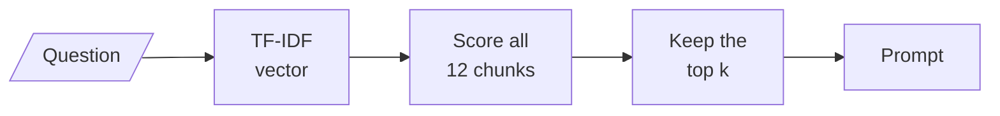
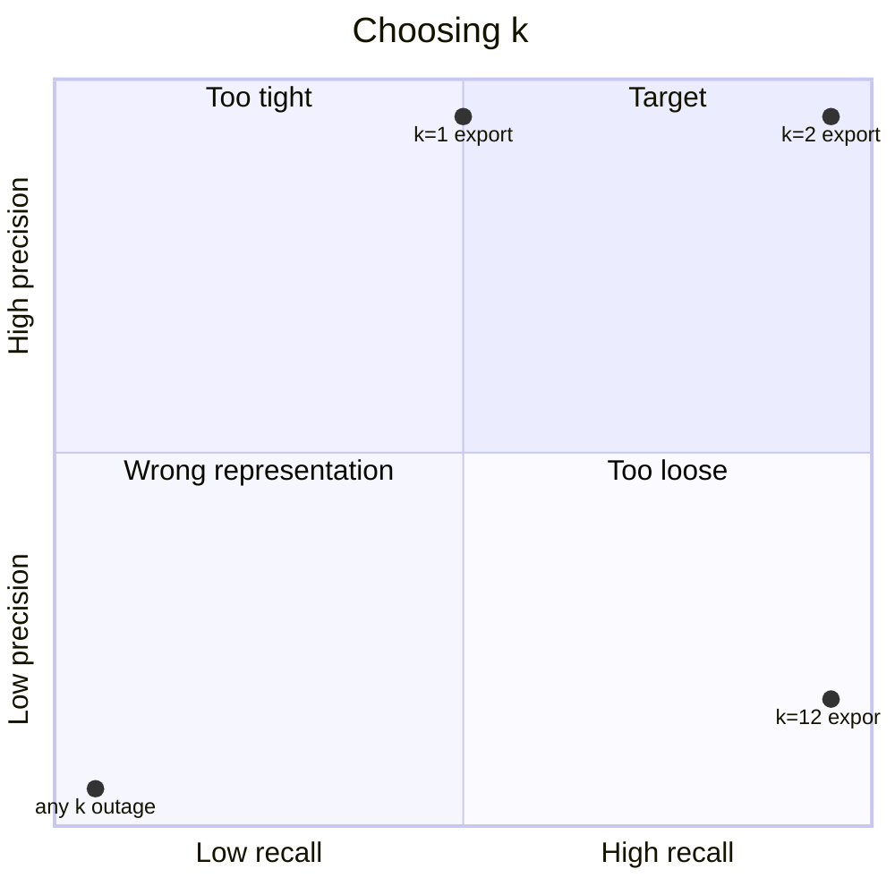

<!-- Generated by site/scripts/rag-theory-import.mjs from rag-agents-engineering. Edit the source there. -->
# lesson 2 of T5.1 Theory: Indexing from scratch with TF-IDF and nearest neighbours

<!-- subtitle: k decides what the model reads, and no k rescues a chunk that scores zero -->

## Top-k

> **What you'll learn**
>
> - **Explain** what top-k retrieval returns, and why those k chunks are all the model sees.
> - **Measure** a retriever with recall@k and precision@k against labelled evidence.
> - **Diagnose** whether a miss is a ranking problem a bigger k fixes, or a representation problem it cannot fix.
> - **Choose** k from the recall curve and the token cost of each extra chunk.

Lesson 1 of T5.1 moved knowledge out of the model and into an index. This lesson builds the smallest index that works: a vector for each of twelve Larkspur handbook chunks, and a search that finds the chunks closest to a question.

Three customers ask three questions, and the index holds both evidence chunks for each of them. At two chunks per question, the retriever finds both for the first question, one for the second and none for the third. Each miss has a different cause, and only one of the causes has anything to do with how many chunks we keep.

**TF-IDF** (term frequency, inverse document frequency) turns a text into a vector with one weight per word. A word gets a high weight when it is frequent in this chunk and rare across the others, and a weight of zero when the chunk does not contain it. The question gets a vector the same way, and each chunk is scored by the **cosine similarity** between the two vectors: 1 when they share the same words in the same proportions, 0 when they share none.

**Top-k retrieval** scores every chunk against the question and returns the `k` best:



*Figure 1: Top-k retrieval. Only the k kept chunks reach the prompt.*

Those `k` chunks are all the model sees. To judge them we need a **golden set**: questions whose evidence chunks someone has labelled by hand. Two metrics compare the top `k` with that label:

| Metric | How it is computed | What it answers |
|---|---|---|
| **Recall@k** | Evidence chunks in the top k, divided by all evidence chunks for the question | Did the model receive everything it needs? |
| **Precision@k** | Evidence chunks in the top k, divided by k | How much of what it read was evidence? |

*Table 1: The two retrieval metrics used throughout this module.*

The [interactive lab](/labs/rag/m10_rag_lifecycle/top-k-retrieval-lab.html) indexes the twelve chunks with real TF-IDF (the same weighting scikit-learn uses, English stop words removed) and scores three golden questions, each with two evidence chunks. Its numbers, with R for recall and P for precision:

| Question | k = 1 | k = 2 | k = 5 | k = 12 |
|---|---|---|---|---|
| *Can I export my data after I cancel my plan?* | R 0.50 · P 1.00 | **R 1.00 · P 1.00** | R 1.00 · P 0.40 | R 1.00 · P 0.17 |
| *How long does a refund take?* | R 0.50 · P 1.00 | R 0.50 · P 0.50 | R 0.50 · P 0.20 | R 0.50 · P 0.08 |
| *What happens if my server goes down?* | R 0.00 · P 0.00 | R 0.00 · P 0.00 | R 0.00 · P 0.00 | R 0.00 · P 0.00 |
| Context sent (≈ tokens) | ~30 | ~60 | ~150 | ~348 |

*Table 2: Recall and precision at four values of k, from the lab. Tokens use the four-characters-per-token rule of thumb.*

Each question fails in its own way:

- **Ranking problem** (export): both evidence chunks score above zero, and `k = 2` retrieves them. Past that, each extra chunk is noise. Precision falls from 1.00 to 0.17 while the prompt grows almost sixfold.
- **Word-form miss** (refund): the `refund-timing` chunk says "Refunds" and the question says "refund". TF-IDF matches exact tokens, so that chunk scores 0 and no `k` retrieves it. Meanwhile `reboot` scores 0.194, because both it and the question contain "does".
- **Vocabulary gap** (outage): the evidence talks about "outage" and "availability", and the question says "server goes down". TF-IDF ranks `reboot` and `sizing` first because they contain "server". Embeddings ([lesson 3 of T5.1](03_semantic_retrieval_with_embedding_similarity.md), [T5.4](../m13_embeddings/00_overview.md)) and query rewriting ([T6.2](../../p05_retrieval_quality_and_rag_apps/m17_query_transformation/00_overview.md)) close this gap, while a bigger `k` only adds noise.

```lab
src: /labs/rag/m10_rag_lifecycle/top-k-retrieval-lab.html
title: Top-k and the baseline
```

A larger `k` fixes only the first kind. The other two are representation problems: the chunk scores zero, and no cut-off below the twelfth place can bring it in.

## What an extra chunk costs

Raising `k` has costs beyond tokens. Every extra chunk adds latency and gives the model more text it can misread. Long prompts also have a position effect: models use information at the start and end of the context more reliably than information in the middle [1].

The arithmetic for the export question, from Table 2:

| k | Evidence chunks sent | Noise chunks sent | Tokens sent (≈) |
|---|---|---|---|
| 2 | 2 | 0 | 60 |
| 5 | 2 | 3 | 150 |
| 12 | 2 | 10 | 348 |

*Table 3: What the model reads for the export question as k grows. The evidence is complete at k = 2. Everything after it is noise.*

Plotted against recall and precision, the choices land in four regions:



*Figure 2: Choosing k for the handbook. The outage question sits in the bottom-left corner at every k.*

> **Pitfall: k as a safety margin.** A large `k` "to be safe" pays the token and latency cost on every call and still cannot retrieve a chunk that scores zero. Retrieve generously only when a reranker ([T6.3](../../p05_retrieval_quality_and_rag_apps/m18_reranking_post_retrieval/00_overview.md)) will trim the list before the model reads it. Retrieve tightly when chunks go straight to the model.

## In practice: picking k for the Larkspur baseline

For the handbook, the choice of `k` comes from the lab in four steps:

1. **Sweep `k` from 1 to 12** for each golden question and read recall and precision at each value.
2. **Find where recall stops rising.** For the export question, at `k = 2`.
3. **Note the flat lines.** The refund and outage questions never improve. They go on the list for lesson 3 of T5.1, which changes the representation.
4. **Record the baseline at `k = 2`.** Mean recall@2 is (1.00 + 0.50 + 0.00) / 3 = 0.50, and mean precision@2 is also 0.50. Lesson 5 of T5.1 makes this the number every later change must beat.

## References

1. Liu, N. F., et al. *Lost in the Middle: How Language Models Use Long Contexts*. arXiv:2307.03172, July 2023; Transactions of the ACL, 2024. [arxiv.org/abs/2307.03172](https://arxiv.org/abs/2307.03172)

## Run the notebooks

The code for this lesson is in these notebooks. Colab runs one in your browser: install the packages its first cell imports and set the API keys it reads. To run every notebook as written, clone the repository and use its uv environment.

| Notebook | GitHub | Colab |
|---|---|---|
| Indexing from scratch | [Open on GitHub](https://github.com/Sourav692/rag-agents-engineering/blob/main/p04_rag_foundations/m10_rag_lifecycle/mandatory/notebook/02a_indexing_from_scratch.ipynb) | [Open in Colab](https://colab.research.google.com/github/Sourav692/rag-agents-engineering/blob/main/p04_rag_foundations/m10_rag_lifecycle/mandatory/notebook/02a_indexing_from_scratch.ipynb) |

## Key Takeaways

- Measure retrieval against labelled evidence with recall@k and precision@k. The `k` chunks returned are all the model ever sees.
- A larger `k` fixes only ranking problems. When a chunk scores zero through a word-form miss or a vocabulary gap, change the representation instead.
- Extra chunks cost tokens and latency, and models use the middle of a long context less reliably. Retrieve generously only when a reranker trims the list afterwards.
- Pick `k` where recall stops rising on the golden set, and record that row as the baseline.

## Check yourself

<details>
<summary>1. Why does no value of k let TF-IDF retrieve the refund-timing chunk for How long does a refund take?</summary>

It is a word-form miss, a representation problem. The chunk says "Refunds" and the question says "refund", and TF-IDF matches exact tokens, so the chunk scores 0. Recall stays at 0.50 at every `k`, and a bigger `k` only adds noise.

</details>

<details>
<summary>2. For the export question, what are recall and precision at k = 2 and at k = 12, and which k do you pick?</summary>

At `k = 2` recall and precision are both 1.00, for about 60 tokens of context. At `k = 12` recall is still 1.00, but precision falls to 0.17 and the context grows almost sixfold, to about 348 tokens. Pick `k = 2`: past it every extra chunk is noise.

</details>

<details>
<summary>3. When should a pipeline retrieve generously with a large k, and when tightly?</summary>

Retrieve generously when a reranker ([T6.3](../../p05_retrieval_quality_and_rag_apps/m18_reranking_post_retrieval/00_overview.md)) will trim the list afterwards. Retrieve tightly when the chunks go straight to the model, because every extra chunk adds latency and text the model can misread, and models use information in the middle of a long context less reliably than at its start and end.

</details>
