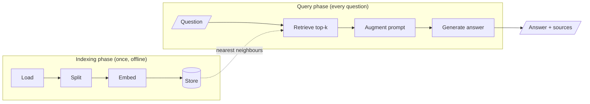

<!-- Generated by site/scripts/rag-theory-import.mjs from rag-agents-engineering. Edit the source there. -->
# M11 Theory: The RAG lifecycle

A language model answers from what it memorised during training. RAG adds a second source: passages retrieved from your own documents at the moment the question arrives. The M11 notebooks build on four ideas: where knowledge lives, the stages of the pipeline, how many chunks to retrieve, and why you measure a baseline before you optimise anything.

The running example throughout these pages and the lab is a small product handbook for a fictional cloud host, Larkspur Cloud. [M12](../../p05_ingestion_and_indexing/m12_document_ingestion/00_overview.md) and [M13](../../p05_ingestion_and_indexing/m13_chunking/00_overview.md) reuse the same handbook.

## In short

- RAG moves knowledge out of model weights (parametric) into an index you control (non-parametric), so you can update it, restrict it and cite it.
- The pipeline has an offline **indexing** phase (load → split → embed → store) and an online **query** phase (retrieve → augment → generate). A mistake made at indexing time often surfaces only in the generated answer.
- `k` controls how much context the model reads. It trades recall against precision, tokens and latency, and it cannot recover a chunk the retriever scores as irrelevant.
- Embeddings match meaning where TF-IDF matches exact words. On the handbook they find the refund and outage evidence TF-IDF misses, and lose the export question TF-IDF answered at `k = 2`.
- Build the plain pipeline first, record its numbers on a fixed question set, then change one stage at a time and compare.

## Mental model

The index is the only thing the two phases share. A bad chunk written at indexing time is retrieved, quoted and cited at query time, and nothing in the query phase can repair it.

## Interactive lab

[**Top-k and the baseline**](/labs/rag/m11_rag_lifecycle/top-k-retrieval-lab.html): open the file in a browser. Pick *Can I export my data after I cancel my plan?* and slide `k` from 1 to 12 to see recall saturate at `k = 2` while tokens keep climbing. Then switch to *What happens if my server goes down?* and look for a `k` that helps; there is none.

## How it connects

- **Before:** [M07](../../p03_langchain_and_langgraph/m07_langchain_core/00_overview.md) to [M10](../../p03_langchain_and_langgraph/m10_langgraph_runtime/00_overview.md) teach the LangChain and LangGraph pieces this pipeline is built from.
- **Next:** [M12](../../p05_ingestion_and_indexing/m12_document_ingestion/00_overview.md) and [M13](../../p05_ingestion_and_indexing/m13_chunking/00_overview.md) open up the first two indexing steps. [M14](../../p05_ingestion_and_indexing/m14_embeddings/00_overview.md) to [M16](../../p05_ingestion_and_indexing/m16_advanced_indexing/00_overview.md) cover embedding, storing and changing what gets indexed; [M17](../../p06_retrieval_quality/m17_retrievers_hybrid_search/00_overview.md) to [M19](../../p06_retrieval_quality/m19_reranking_post_retrieval/00_overview.md) improve retrieval against this module's baseline.

## Key Takeaways

- RAG answers from an index you control. Update it by re-indexing, and cite chunks instead of trusting memory.
- Indexing happens once and is where most failures start. Always ask whether the correct passage was retrieved before you change the prompt.
- `k` trades recall against precision, tokens and latency. If a chunk scores zero, no `k` will retrieve it; fix the representation instead.
- Record a baseline on a frozen golden set, change one stage at a time, and keep only the changes that beat it.
