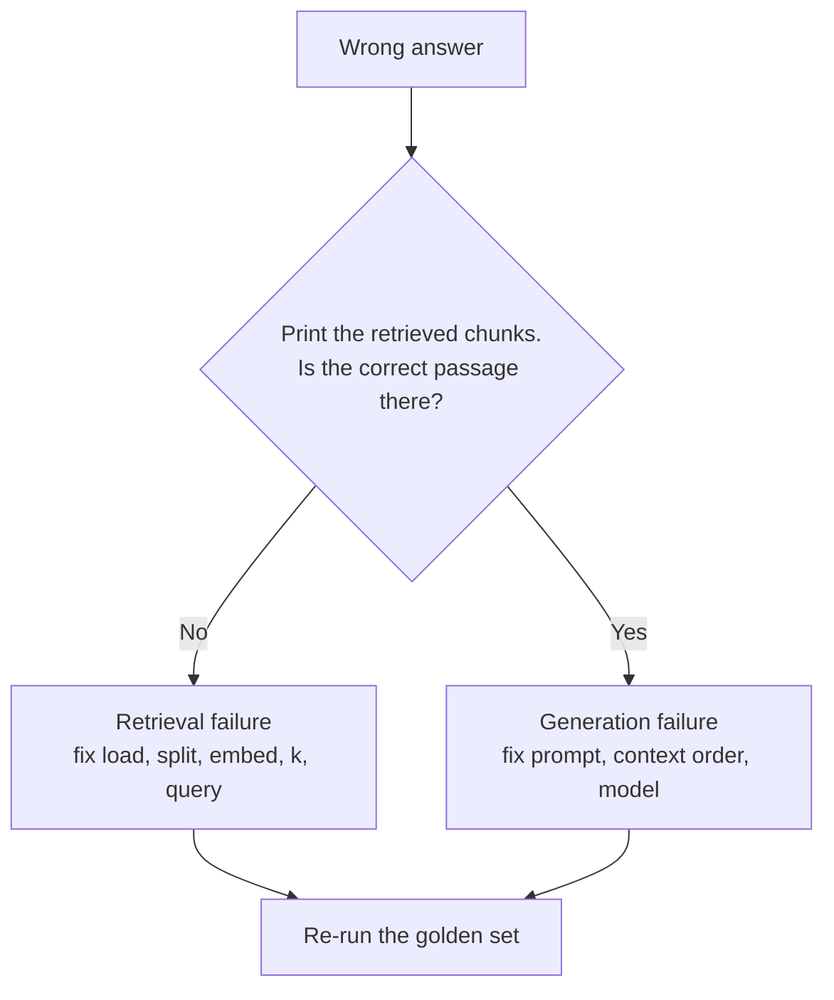
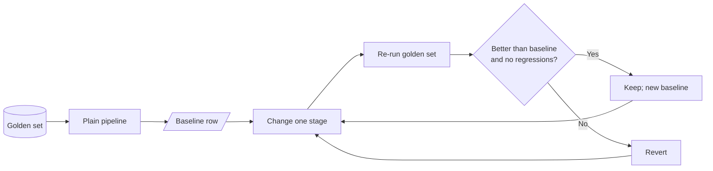

<!-- Generated by site/scripts/rag-theory-import.mjs from rag-agents-engineering. Edit the source there. -->
# M11.5 Theory: The RAG lifecycle and a measured baseline

*Notebooks: [`05a_rag_lifecycle_and_baseline.ipynb`](https://github.com/Sourav692/rag-agents-engineering/blob/main/course/p04_rag_foundations/m11_rag_lifecycle/notebooks/05a_rag_lifecycle_and_baseline.ipynb)*

## Indexing vs retrieval vs generation

The lifecycle has seven steps in two phases. Each step has one job and one typical failure.

| Phase | Step | Job | Typical failure | Fixed in |
|---|---|---|---|---|
| Indexing | Load | Turn files into `Document`s with metadata | Garbled PDF text, missing metadata | [M12](../../p05_ingestion_and_indexing/m12_document_ingestion/00_overview.md) |
| Indexing | Split | Cut documents into retrievable chunks | A fact split across two chunks | [M13](../../p05_ingestion_and_indexing/m13_chunking/00_overview.md) |
| Indexing | Embed | Turn each chunk into a vector | Model cannot tell paraphrases apart, or blurs exact codes | [M14](../../p05_ingestion_and_indexing/m14_embeddings/00_overview.md) |
| Indexing | Store | Index vectors for nearest-neighbour search | Chunk count ≠ vector count; no metadata filters | [M15](../../p05_ingestion_and_indexing/m15_vector_stores/00_overview.md) |
| Query | Retrieve | Return the top-k chunks with scores | Evidence ranked below the cut-off, or not at all | [M17](../../p06_retrieval_quality/m17_retrievers_hybrid_search/00_overview.md) to [M19](../../p06_retrieval_quality/m19_reranking_post_retrieval/00_overview.md) |
| Query | Augment | Format the chunks into the prompt | Sources dropped, so no citations | [M20](../../p07_rag_applications/m20_end_to_end_rag_systems/00_overview.md) |
| Query | Generate | Answer from the supplied context | Ignores the evidence, or answers beyond it | [M20](../../p07_rag_applications/m20_end_to_end_rag_systems/00_overview.md), [M28](../../p09_agentic_rag/m28_retrieval_grading_rewriting/00_overview.md) and [M29](../../p09_agentic_rag/m29_crag_and_self_rag/00_overview.md) |

When an answer is wrong, one question tells you which half to debug:

Tuning the prompt cannot fix a retrieval failure, because the model never saw the evidence. Lesson 11.5's notebook prints chunks with their scores (`similarity_search_with_score`) for this check.

## Baseline-first optimisation

Every later module in this course changes one stage of the pipeline: chunking, embeddings, hybrid search, reranking, query rewriting. Without a baseline, you cannot tell whether a change helped, hurt, or only moved the failure to another question.

The method:

1. **Fix a golden set.** 20 to 50 real questions, each with its evidence chunks and a reference answer. Freeze it, and add questions when production shows a new failure.
2. **Build the plain pipeline.** Default loader, recursive splitter, one embedding model, top-k similarity, a simple prompt.
3. **Record the baseline row.** Retrieval metrics (recall@k, hit rate, MRR), answer metrics (correctness, faithfulness), latency and cost per question.
4. **Change one stage, re-run, compare.** Keep the change only if the row improves on the questions it targets without breaking the others.

At `k = 2` the [top-k lab](/labs/rag/m11_rag_lifecycle/top-k-retrieval-lab.html)'s baseline row is mean recall@2 = 0.50 and mean precision@2 = 0.50. That number already points at the next modules: the export question is solved, the refund question needs better term matching ([M14](../../p05_ingestion_and_indexing/m14_embeddings/00_overview.md), [M17](../../p06_retrieval_quality/m17_retrievers_hybrid_search/00_overview.md)), and the outage question needs paraphrase-aware retrieval ([M14](../../p05_ingestion_and_indexing/m14_embeddings/00_overview.md), [M18](../../p06_retrieval_quality/m18_query_transformation/00_overview.md)).

The lifecycle notebook ends with the map from symptom to module:

| What you observe | Likely cause | Where it is fixed |
|---|---|---|
| Question worded unlike the documents; evidence never retrieved | Vocabulary mismatch | [M14](../../p05_ingestion_and_indexing/m14_embeddings/00_overview.md) embeddings, [M18](../../p06_retrieval_quality/m18_query_transformation/00_overview.md) query transformation |
| Exact codes or names missed (`ORD-88213`) | Dense retrieval blurs rare tokens | [M17](../../p06_retrieval_quality/m17_retrievers_hybrid_search/00_overview.md) hybrid search |
| Half an answer; one fact found, another missed | Question needs several chunks | [M18](../../p06_retrieval_quality/m18_query_transformation/00_overview.md) query decomposition |
| Evidence retrieved but ranked low | Ranking noise | [M19](../../p06_retrieval_quality/m19_reranking_post_retrieval/00_overview.md) reranking |
| Retrieved chunk holds half the fact | Chunk boundary | [M13](../../p05_ingestion_and_indexing/m13_chunking/00_overview.md) chunking |
| Answer contradicts the retrieved chunk | Generation | [M20](../../p07_rag_applications/m20_end_to_end_rag_systems/00_overview.md) per-claim citations, [M29](../../p09_agentic_rag/m29_crag_and_self_rag/00_overview.md) Self-RAG |
