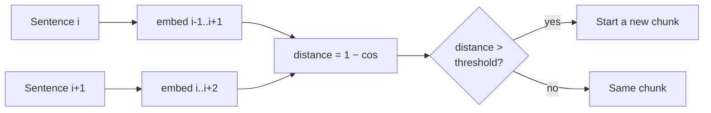

<!-- Generated by site/scripts/rag-theory-import.mjs from rag-agents-engineering. Edit the source there. -->
# lesson 2 of T5.3 Theory: Semantic chunking: breakpoints on embedding distance

## Breakpoint threshold

Semantic chunking cuts on meaning instead of length:

1. Split the text into sentences.
2. Embed each sentence, combined with its neighbours (`buffer_size=1` adds one sentence on each side).
3. Compute the distance between consecutive sentences: `1 − cosine similarity`.
4. Mark every distance above the **breakpoint threshold** as a boundary.
5. Group the sentences between boundaries into chunks.

`SemanticChunker` turns the distances into a threshold in one of four ways:

| `breakpoint_threshold_type` | Default amount | Cuts where the distance is above… |
|---|---|---|
| `percentile` | 95 | the 95th percentile of this document's distances |
| `standard_deviation` | 3 | mean + 3 standard deviations |
| `interquartile` | 1.5 | mean + 1.5 × IQR |
| `gradient` | 95 | the 95th percentile of the distance *gradient* (for text where everything is similar) |

All four are computed from the document's own distances, so a threshold tuned on one corpus does not transfer to another. In the diagram, the refund section has three real topic changes, but the default 95th percentile cuts only once. A 13-sentence section has 12 distances, and only the largest clears their 95th percentile. Lowering the amount to 75 cuts at all three.

`percentile` always cuts somewhere, so a document with no topic change still gets split at its own top 5% of distances. `standard_deviation` and `interquartile` can decide a document has no boundary at all. On a short text, no distance is 3 standard deviations above the mean, so the default `standard_deviation` returns one chunk. That is correct for a document about one thing, and it leaves chunk size unbounded.

Only local change counts. The comparison is sentence *i* against sentence *i + 1*, so a topic that drifts across five sentences never produces one large distance and never triggers a cut; `gradient` helps somewhat. Read the chunks before you trust the boundaries, and cap chunk size afterwards, because semantic chunks can grow past the embedding model's limit.

The cost is a full extra embedding pass over every sentence at index time, before the chunks themselves are embedded.

## Run the notebooks

The code for this lesson is in these notebooks. Colab runs one in your browser: install the packages its first cell imports and set the API keys it reads. To run every notebook as written, clone the repository and use its uv environment.

| Notebook | GitHub | Colab |
|---|---|---|
| Semantic chunking | [Open on GitHub](https://github.com/Sourav692/rag-agents-engineering/blob/main/p04_rag_foundations/m12_chunking/mandatory/notebook/02a_semantic_chunking.ipynb) | [Open in Colab](https://colab.research.google.com/github/Sourav692/rag-agents-engineering/blob/main/p04_rag_foundations/m12_chunking/mandatory/notebook/02a_semantic_chunking.ipynb) |
| Semantic chunking walkthrough (optional) | [Open on GitHub](https://github.com/Sourav692/rag-agents-engineering/blob/main/p04_rag_foundations/m12_chunking/optional/notebook/02b_semantic_chunking_walkthrough.ipynb) | [Open in Colab](https://colab.research.google.com/github/Sourav692/rag-agents-engineering/blob/main/p04_rag_foundations/m12_chunking/optional/notebook/02b_semantic_chunking_walkthrough.ipynb) |
| Semantic chunking RAG techniques (optional) | [Open on GitHub](https://github.com/Sourav692/rag-agents-engineering/blob/main/p04_rag_foundations/m12_chunking/optional/notebook/02c_semantic_chunking_rag_techniques.ipynb) | [Open in Colab](https://colab.research.google.com/github/Sourav692/rag-agents-engineering/blob/main/p04_rag_foundations/m12_chunking/optional/notebook/02c_semantic_chunking_rag_techniques.ipynb) |

## Key Takeaways

- Semantic chunking embeds each sentence with its neighbours and cuts where the distance between consecutive sentences clears a threshold.
- Every threshold type is relative to the document's own distances, so tune it per corpus. `percentile` always cuts somewhere; `standard_deviation` may return one chunk.
- Only local change triggers a cut, so slow drift is missed. Read the chunks, cap their size afterwards, and budget an extra embedding pass over every sentence.

## Check yourself

1. A topic drifts slowly across five sentences. Why does semantic chunking never cut there?

The distance compares sentence i with sentence i + 1 only, so a gradual drift never produces one large distance to clear the threshold. The `gradient` threshold helps somewhat. Read the chunks before you trust the boundaries.

2. The 13-sentence refund section has three real topic changes, yet the default percentile threshold cuts only once. Why, and what changes that?

A 13-sentence section has 12 distances, and only the largest clears their 95th percentile. Lowering the amount to 75 cuts at all three topic changes. Every threshold type is computed from the document's own distances, so a value tuned on one corpus does not transfer to another.

3. The standard deviation threshold returns a short document as one chunk. Is that a bug, and what should you add after the chunker?

Not necessarily: on a short text no distance is 3 standard deviations above the mean, and one chunk is correct for a document about one thing. But it leaves chunk size unbounded. Cap chunk size afterwards, because semantic chunks can grow past the embedding model's limit.

