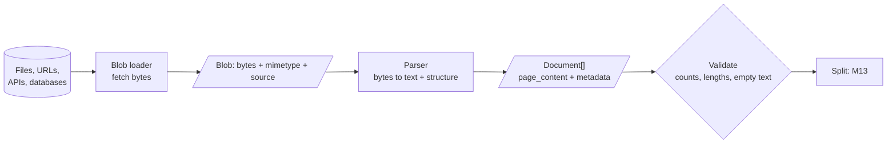

<!-- Generated by site/scripts/rag-theory-import.mjs from rag-agents-engineering. Edit the source there. -->
# M12 Theory: Document ingestion and metadata design

Retrieval can only return text that ingestion extracted, labelled with metadata that ingestion attached. M12 rests on four ideas: what a loader does compared with a parser, why element-level parsing matters for PDFs, how to design a metadata schema before you need it, and why loaders should stream.

The running example is page 7 of the Larkspur Cloud customer handbook: two columns, a pricing table, a refund section, a header and a footer.

## In short

- Every loader returns `Document(page_content, metadata)`. `page_content` is embedded and shown to the model; `metadata` is never embedded, and it is the only thing you can filter on exactly.
- A **loader** gets bytes from a source; a **parser** turns those bytes into text and structure. Which parser you choose decides what the index can contain.
- **Element-level parsing** gives one typed Document per title, paragraph, table or list item, so you can drop boilerplate, keep tables whole and tag every chunk with its section.
- Design the **metadata schema** for the filters, citations and access rules you will need later. Adding a field after indexing means re-ingesting the corpus, and every loader names its fields differently (`page` counts from 0 in PyPDF, `seq_num` from 1 in JSONLoader), so map them onto the schema at load time.
- Implement `lazy_load` so a large source streams through the pipeline instead of loading into memory at once.

## Mental model

Loading is lossy. A PDF parser drops layout, an HTML loader drops visual hierarchy, a Word loader drops comments, and a CSV loader drops column types. Know what each loader drops; you cannot retrieve what was never extracted.

## Interactive lab

[**One PDF page, three parsers**](/labs/rag/m12_document_ingestion/pdf-parsers-lab.html): open the file in a browser. Switch between `PyPDFLoader`, `PyMuPDFLoader` and `UnstructuredPDFLoader`, hover each output Document to see which part of the page it came from, and compare how many schema fields each loader fills.

## How it connects

- **Before:** [M11](../../p04_rag_foundations/m11_rag_lifecycle/00_overview.md) puts Load first in the lifecycle and gives you the baseline to measure against.
- **Next:** [M13](../m13_chunking/00_overview.md) splits these Documents into chunks; structure-aware splitting works best when the parser kept the structure. [M15](../m15_vector_stores/00_overview.md) uses the metadata for filtered search, and [M16](../m16_advanced_indexing/00_overview.md) copies section titles into chunk text.

## Key Takeaways

- `page_content` is what gets embedded; `metadata` is what you filter and cite by, and it is never embedded.
- Choose the parser by what the documents contain. Element-level parsing keeps structure and costs speed.
- Write the metadata schema down before the first ingest, including access control, and normalise values at load time.
- Stream with `lazy_load`, batch the downstream work, and validate counts after every run.
