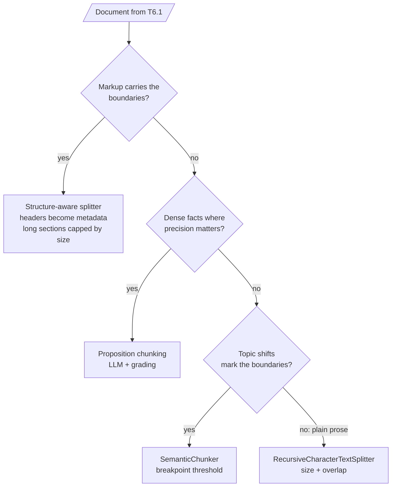

<!-- Generated by site/scripts/rag-theory-import.mjs from rag-agents-engineering. Edit the source there. -->
# T6.2 Theory: Chunking strategies

The chunk is the unit of retrieval. The retriever scores chunks, returns chunks and hands chunks to the model, so a chunk boundary decides whether a fact can be found whole. T6.2 rests on four ideas: chunk size and overlap, the breakpoint threshold in semantic chunking, propositions, and structure-aware splitting.

The running example is the "Refunds and cancellations" section of the Larkspur Cloud handbook, 1,111 characters long, and one golden question: *How long do I have to get a full refund on an annual plan?* The answer is one 141-character sentence: *You can get a full refund on an annual plan within 30 days of purchase, as long as the account has used less than 100 GB of outbound traffic.*

## In short

- Small chunks retrieve precisely but can cut a fact in two; large chunks keep facts whole but dilute the embedding and cost tokens. The right size comes from measurement on your own corpus.
- Overlap repeats the tail of one chunk at the head of the next. It rescues facts that straddle a boundary, but only when the cut piece fits inside the overlap, and it inflates the index.
- Semantic chunking cuts where neighbouring sentences drift apart in embedding space. The **breakpoint threshold** is computed from each document's own distances; the default `percentile` type always produces some cuts, while `standard_deviation` and `interquartile` can find none.
- **Propositions** are atomic, self-contained facts written by an LLM. They retrieve sharply, cost an LLM call per chunk, and need a grading pass because an LLM can invent text and a splitter cannot.
- **Structure-aware splitting** uses the document's own boundaries (headings, HTML tags, code blocks) first, and falls back to size limits second.

## Mental model

Every route then feeds the embedder ([T6.3](../m14_embeddings/00_overview.md)) and ends with the same check. Read a sample of the chunks, because the parameters say what the splitter was asked to do and only the chunks show what it did, then run the golden set.

## Interactive lab

[**Chunk size and overlap**](/labs/rag/m13_chunking/chunk-size-overlap-lab.html): open the file in a browser. Click **300 and 0** to see the refund answer cut after "used less than", then **300 and 150** to watch overlap carry it whole into chunk 3, and **1200 and 0** to see the answer shrink to 13% of its chunk.

## How it connects

- **Before:** [T6.1](../m12_document_ingestion/00_overview.md) decides what text and structure reach the splitter; [T5.1](../../p04_rag_foundations/m11_rag_lifecycle/00_overview.md) gives the baseline the T6.2 lab is measured against.
- **Next:** [T6.3](../m14_embeddings/00_overview.md) embeds these chunks; [T6.5](../m16_advanced_indexing/00_overview.md) changes what gets indexed (parent documents, multi-representation, contextual headers) when no single chunk size works.

## Key Takeaways

- The chunk boundary decides whether a fact can be retrieved whole. Read the chunks as well as the parameters.
- Overlap only rescues a cut piece that fits inside it, and you pay for it in storage.
- Semantic thresholds come from each document's own distances and do not transfer between corpora; propositions need a grading pass; structural boundaries come first when the document has them.
- Choose chunk size by sweeping it on your golden set against the [T5.1](../../p04_rag_foundations/m11_rag_lifecycle/00_overview.md) baseline. If no size wins on both precision and completeness, index small and return large ([T6.5](../m16_advanced_indexing/00_overview.md)).
