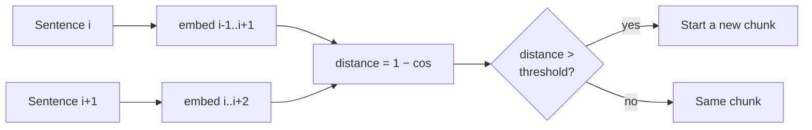

<!-- Generated by site/scripts/rag-theory-import.mjs from rag-agents-engineering. Edit the source there. -->
# M13.2 Theory: Semantic chunking: breakpoints on embedding distance

*Notebooks: [`02a_semantic_chunking.ipynb`](https://github.com/Sourav692/rag-agents-engineering/blob/main/course/p05_ingestion_and_indexing/m13_chunking/notebooks/02a_semantic_chunking.ipynb), [`02b_semantic_chunking_walkthrough.ipynb`](https://github.com/Sourav692/rag-agents-engineering/blob/main/course/p05_ingestion_and_indexing/m13_chunking/optional/02b_semantic_chunking_walkthrough.ipynb) (optional), [`02c_semantic_chunking_rag_techniques.ipynb`](https://github.com/Sourav692/rag-agents-engineering/blob/main/course/p05_ingestion_and_indexing/m13_chunking/optional/02c_semantic_chunking_rag_techniques.ipynb) (optional)*

## Breakpoint threshold

Semantic chunking cuts on meaning instead of length:

1. Split the text into sentences.
2. Embed each sentence, combined with its neighbours (`buffer_size=1` adds one sentence on each side).
3. Compute the distance between consecutive sentences: `1 − cosine similarity`.
4. Mark every distance above the **breakpoint threshold** as a boundary.
5. Group the sentences between boundaries into chunks.

`SemanticChunker` turns the distances into a threshold in one of four ways:

| `breakpoint_threshold_type` | Default amount | Cuts where the distance is above… |
|---|---|---|
| `percentile` | 95 | the 95th percentile of this document's distances |
| `standard_deviation` | 3 | mean + 3 standard deviations |
| `interquartile` | 1.5 | mean + 1.5 × IQR |
| `gradient` | 95 | the 95th percentile of the distance *gradient* (for text where everything is similar) |

All four are computed from the document's own distances, so a threshold tuned on one corpus does not transfer to another. In the diagram, the refund section has three real topic changes, but the default 95th percentile cuts only once. A 13-sentence section has 12 distances, and only the largest clears their 95th percentile. Lowering the amount to 75 cuts at all three.

`percentile` always cuts somewhere, so a document with no topic change still gets split at its own top 5% of distances. `standard_deviation` and `interquartile` can decide a document has no boundary at all. On a short text, no distance is 3 standard deviations above the mean, so the default `standard_deviation` returns one chunk. That is correct for a document about one thing, and it leaves chunk size unbounded.

Only local change counts. The comparison is sentence *i* against sentence *i + 1*, so a topic that drifts across five sentences never produces one large distance and never triggers a cut; `gradient` helps somewhat. Read the chunks before you trust the boundaries, and cap chunk size afterwards, because semantic chunks can grow past the embedding model's limit.

The cost is a full extra embedding pass over every sentence at index time, before the chunks themselves are embedded.

