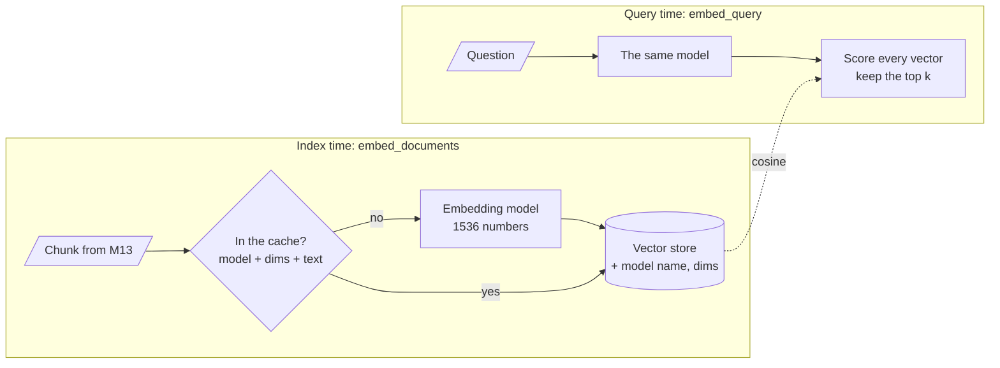

<!-- Generated by site/scripts/rag-theory-import.mjs from rag-agents-engineering. Edit the source there. -->
# M14 Theory: Embeddings and model selection

An embedding model turns each chunk into a fixed-length list of numbers, and retrieval ranks chunks by how close those lists are to the question's. The model therefore decides what "similar" means for your corpus, and changing it later means re-embedding every chunk. The M14 notebooks build on four ideas: how to compare two vectors, what the number of dimensions costs, how to stop paying twice for the same vector, and how to tell whether a model fits your documents.

The running example is the Larkspur Cloud handbook from [M11](../../p04_rag_foundations/m11_rag_lifecycle/00_overview.md) to [M13](../m13_chunking/00_overview.md), cut into the chunks the [M11](../../p04_rag_foundations/m11_rag_lifecycle/00_overview.md) lab uses, and the same three golden questions: *How long does a refund take?*, *Can I export my data after I cancel my plan?* and *What happens if my server goes down?* The lab adds one chunk that answers none of them: `plans-overview`, the long pricing page kept as a single chunk.

## In short

- **Check the norm before you choose a metric.** OpenAI returns unit-length vectors, and for those cosine, dot product and Euclidean distance rank identically. sentence-transformers does not normalise by default; there, dot product favours longer vectors. In the lab, stretching one off-topic chunk to 1.15× its length is enough for dot product to rank it above the refund answer.
- **Dimensions are a cost paid on every query.** `text-embedding-3-small` returns 1536 numbers, `-large` 3072. At four bytes each, a million chunks take 6.1 GB at 1536 and 12.3 GB at 3072 before any index overhead. The `dimensions` parameter shortens the vector; measure what that costs on your own questions.
- **Cache embeddings, and namespace the cache by model and dimensions.** `CacheBackedEmbeddings` keys each vector by `namespace + sha256(text)`. Re-embedding the 12 handbook chunks after one edit sends 1 text to the model instead of 12. Without a namespace, a model swap silently returns the old model's vectors.
- **Domain fit is measured on your own golden set, not read off a leaderboard.** The same model must embed documents and queries; a mismatch raises no error and returns noise.

## Mental model

A chunk becomes a vector once, at index time, and the cache makes sure it stays once. A question becomes a vector on every request, and it has to come from the same model with the same dimensions as the stored vectors; otherwise the scores compare two unrelated coordinate systems. Recording the model name and dimensions beside the vectors is how a query service can check that before it searches.

## Interactive lab

[**Cosine, dot and Euclidean**](/labs/rag/m14_embeddings/similarity-metrics-lab.html): open the file in a browser. With *How long does a refund take?* selected, move the length of `plans-overview` from 1.0× to 1.2×: dot product now ranks the pricing page first while cosine still ranks `refund-timing` first. Push it to 3.0×, the scaling notebook 14.1 uses, and Euclidean distance drops the same chunk to last place. Then press **Normalise first** and watch the three rankings agree again.

## How it connects

- **Before:** [M13](../m13_chunking/00_overview.md) decides what text each vector stands for; a chunk that mixes topics gets a vector that averages them. [M11](../../p04_rag_foundations/m11_rag_lifecycle/00_overview.md) gives the golden questions and the baseline any model choice is measured against.
- **Next:** [M15](../m15_vector_stores/00_overview.md) stores these vectors and runs the nearest-neighbour search; its distance setting must match the metric chosen here. [M16](../m16_advanced_indexing/00_overview.md) changes what gets embedded (summaries, parents, contextual headers), and [M17](../../p06_retrieval_quality/m17_retrievers_hybrid_search/00_overview.md) adds keyword search for the identifiers and negations embeddings handle badly.

## Key Takeaways

- Print a vector's norm before you choose a metric. With unit vectors, use whichever metric your store computes fastest; without them, use cosine or normalise first.
- Dimensions cost storage and search time on every query. Shrink them only after measuring the margin on your own golden set.
- Wrap the embedder in `CacheBackedEmbeddings` with a namespace that names the model and its dimensions, so re-runs and small edits cost almost nothing.
- Choose a model on your own documents and questions, use the same model on both sides, and record it in the index metadata so a mismatch fails loudly.
