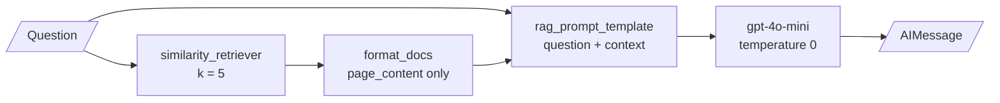

<!-- Generated by site/scripts/rag-theory-import.mjs from rag-agents-engineering. Edit the source there. -->
# lesson 1 of T6.4 Theory: Environment setup and a complete RAG system

## Grounded generation

A grounded answer comes from evidence the system retrieved for this question, and the model is told to use nothing else. Lesson 1 of T6.4 builds the whole pipeline in one notebook, from two kinds of source to a chain that answers from them.

| Stage | What `01b` does |
|---|---|
| Load | `JSONLoader` reads `wikidata_rag_demo.jsonl` one line per Document; each article's `paragraphs` are joined and `title`, `id` and `source` kept as metadata. `PyMuPDFLoader` reads every PDF in `data/sample/`. |
| Split | `RecursiveCharacterTextSplitter`, `chunk_size=3500`, `chunk_overlap=200`, for the PDFs. Wikipedia articles stay whole. |
| Embed | `text-embedding-3-small`, 1,536 dimensions. |
| Store | Chroma, persisted to `./my_db`, with `collection_metadata={"hnsw:space": "cosine"}`. Without it Chroma uses Euclidean distance ([lesson 4 of T5.1](../../p04_rag_foundations/m10_rag_lifecycle/04_your_first_langchain_rag_with_chroma.md#lesson-distance-not-similarity)). |
| Retrieve | `as_retriever(search_type="similarity", search_kwargs={"k": 5})`. |
| Generate | `gpt-4o-mini` at `temperature=0`, with a prompt that restricts it to the retrieved context. |

The chain is three LCEL steps:

Grounding rests on three things, and the notebook's prompt has all three:

1. **The evidence is retrieved for this question.** The model sees five chunks, not the corpus.
2. **The instruction limits the model to that evidence.** "Answer the following question using only the following pieces of retrieved context."
3. **The model has a way out.** "If the answer is not in the context, do not make up answers, just say that you don't know." Without a permitted refusal, a model asked about something the context lacks will answer from what it learned in training.

On the Larkspur handbook, *Can I export my data after I cancel my plan?* retrieves the `export` and `retention` chunks, and the answer should say "within 30 days, from Settings, then Data". *Does Larkspur offer a free tier?* has no chunk in the handbook, so the grounded answer is "I don't know". Whether a given model complies is a property you test: put questions with no answer in the golden set and count the refusals.

The instruction does not guarantee compliance. A model can still blend in outside knowledge or misread a chunk; [T9.2](../../p08_agentic_rag/m29_crag_and_self_rag/00_overview.md) and [T9.5](../../p08_agentic_rag/m32_reliability_feedback/00_overview.md) add a second call that grades the answer against its evidence.

### What this chain throws away

`format_docs` joins `doc.page_content` and nothing else, so the title, id and source in metadata never reach the model, and the chain returns only an `AIMessage`. The answer may be grounded, but nobody can check it. There is no list of chunks and no way to say which one a sentence came from. Lesson 2 of T6.4 keeps both.

### A setup trap from the notebook

`openai_embed_model.embed_documents("Hello, world!")` returns 13 vectors. `embed_documents` expects a list of strings, and a Python string is iterable, so each of the 13 characters is embedded on its own. Use `embed_query(text)` for one string, or `embed_documents([text])`; either gives one 1,536-dimension vector. The same mistake inside an indexing loop embeds characters and stores garbage without an error.

The optional `01c` notebook builds the same pipeline on FAISS from one PDF, `Understanding_Climate_Change.pdf`, with 1,000-character chunks, 200 overlap and `k=2`, and reconstructs the index matrix to show its shape: one row per chunk, 1,536 columns.

## Run the notebooks

The code for this lesson is in these notebooks. Colab runs one in your browser: install the packages its first cell imports and set the API keys it reads. To run every notebook as written, clone the repository and use its uv environment.

| Notebook | GitHub | Colab |
|---|---|---|
| Setup | [Open on GitHub](https://github.com/Sourav692/rag-agents-engineering/blob/main/p05_retrieval_quality_and_rag_apps/m19_end_to_end_rag_systems/mandatory/notebook/01a_setup.ipynb) | [Open in Colab](https://colab.research.google.com/github/Sourav692/rag-agents-engineering/blob/main/p05_retrieval_quality_and_rag_apps/m19_end_to_end_rag_systems/mandatory/notebook/01a_setup.ipynb) |
| Build a simple RAG system | [Open on GitHub](https://github.com/Sourav692/rag-agents-engineering/blob/main/p05_retrieval_quality_and_rag_apps/m19_end_to_end_rag_systems/mandatory/notebook/01b_build_a_simple_rag_system.ipynb) | [Open in Colab](https://colab.research.google.com/github/Sourav692/rag-agents-engineering/blob/main/p05_retrieval_quality_and_rag_apps/m19_end_to_end_rag_systems/mandatory/notebook/01b_build_a_simple_rag_system.ipynb) |
| Simple RAG PDF (optional) | [Open on GitHub](https://github.com/Sourav692/rag-agents-engineering/blob/main/p05_retrieval_quality_and_rag_apps/m19_end_to_end_rag_systems/optional/notebook/01c_simple_rag_pdf.ipynb) | [Open in Colab](https://colab.research.google.com/github/Sourav692/rag-agents-engineering/blob/main/p05_retrieval_quality_and_rag_apps/m19_end_to_end_rag_systems/optional/notebook/01c_simple_rag_pdf.ipynb) |

## Key Takeaways

- Grounding needs three things in the prompt: evidence retrieved for this question, an instruction to use only that evidence, and permission to say "I don't know".
- The instruction does not guarantee compliance. Put questions with no answer in the golden set and count the refusals.
- A chain that formats only `page_content` and returns only the answer cannot be checked. Keep the chunks and their metadata if anyone needs to verify a sentence.

## Check yourself

1. What three things in the 01b prompt keep an answer grounded?

The evidence is retrieved for this question, five chunks rather than the corpus. The instruction limits the model to that evidence. And the model has a way out: it may say it does not know, because without a permitted refusal a model asked about something the context lacks answers from training.

2. A user asks the Larkspur system whether Larkspur offers a free tier. What should the grounded answer be, and how do you know the model complies?

"I don't know", because no chunk in the handbook covers a free tier. The instruction does not guarantee compliance, so put questions with no answer in the golden set and count the refusals.

3. Embedding the string Hello, world! with embed documents returns 13 vectors. What went wrong?

`embed_documents` expects a list of strings, and a Python string is iterable, so each of the 13 characters was embedded on its own. Use `embed_query(text)` or `embed_documents([text])` for one 1,536-dimension vector. Inside an indexing loop the same mistake stores garbage without an error.

