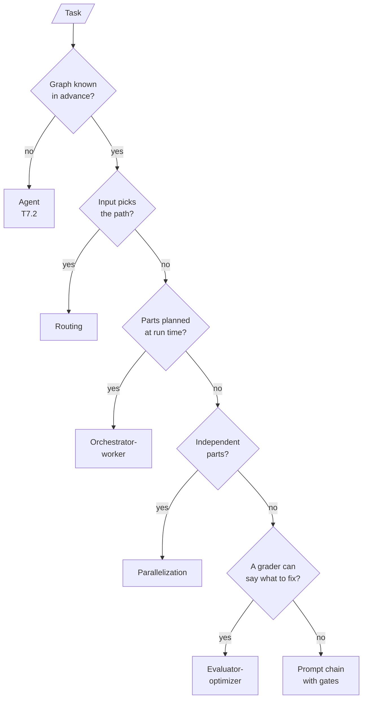

<!-- Generated by site/scripts/rag-theory-import.mjs from rag-agents-engineering. Edit the source there. -->
# T7.3 Theory: Agentic workflow patterns

A Larkspur support request may need a sequence of policy checks, one specialist queue or several independent lookups. Those tasks need different control paths. You will build the fixed paths first, inspect where each model decision belongs, then test joins and retry limits. The tutorials cover workflow versus agent control, quality gates, fan-out and fan-in, and bounded feedback loops.

The running example is the Larkspur Cloud support assistant from [T5.1](../../p04_rag_foundations/m10_rag_lifecycle/00_overview.md) to [T5.3](../../p04_rag_foundations/m12_chunking/00_overview.md), answering from the same handbook. Its golden question *Can I export my data after I cancel my plan?* needs two evidence chunks, `export` and `retention`, which makes it the natural case for orchestrator-worker decomposition. The notebooks run their own small demos (an email, a story, a joke, a code review), and every number on these pages is one they printed or one the lab computes.

## In short

- In a workflow, code fixes the path through the LLM calls; in an agent ([T7.2](../m23_react_agents/00_overview.md)), the model picks its next step. Each T7.3 pattern hands the model one decision at most: a gate's verdict, a route, a vote, a plan's length or a grade.
- A **quality gate** checks an intermediate result before the next step spends tokens on it. In lesson 1 of T7.3 a concrete topic passed on attempt 1 (four LLM calls); an abstract one was rejected three times and stopped before drafting (six calls, no email).
- Routing by model tier sent 1 of 7 requests to `o4-mini` and scored 86%, against 71% for all-cheap and 100% for all-reasoning. The router's costly mistake is sending a hard request to the cheap tier.
- A **fan-out** lasts as long as its slowest branch: the 24.3 sections took 7.0 s in parallel against a 13.4 s sum. In the lab a cap of two concurrent branches costs nothing on that workload, until the slowest branch is submitted last.
- Every loop gets a cap in code. LCEL cannot loop at all, so a generate, critique, refine cycle lives in LangGraph, a Python loop or agent middleware, and at `MAX_ITERATIONS = 5` it makes at most ten LLM calls.

## Mental model

Real systems nest these. CRAG ([T9.2](../../p08_agentic_rag/m29_crag_and_self_rag/00_overview.md)) is an evaluator-optimizer around retrieval, adaptive RAG ([T9.3](../../p08_agentic_rag/m30_adaptive_rag_routing/00_overview.md)) is a router, and query decomposition ([T6.2](../../p05_retrieval_quality_and_rag_apps/m17_query_transformation/00_overview.md)) is orchestrator-worker. Read an architecture by asking which of the five each node belongs to, and where the model, rather than your code, makes the call.

## Interactive lab

[**Fan-out and the concurrency cap**](/labs/rag/m24_agentic_workflow_patterns/fan-out-lab.html): open the file in a browser. Keep *Story sections* and drag the cap from 3 to 1 to watch the wall time grow from 10.6 s to 16.9 s. Set it to 2: the wall time goes back to 10.6 s, because the two short branches share one slot. Then pick *Fastest first* at a cap of 2 and see it rise to 12.2 s, because the slowest branch now waits for a slot.

## How it connects

- **Before:** [T4.2](../../p03_llm_application_frameworks/m07_lcel_runnables_and_chains/00_overview.md) (LCEL) and [T4.3](../../p03_llm_application_frameworks/m08_langgraph_core/00_overview.md) to [T4.4](../../p03_llm_application_frameworks/m09_langgraph_runtime/00_overview.md) (LangGraph state, conditional edges, reducers) supply every primitive these graphs use. [T7.2](../m23_react_agents/00_overview.md) builds the agent these workflows are contrasted with. [T6.2](../../p05_retrieval_quality_and_rag_apps/m17_query_transformation/00_overview.md) introduces the query decomposition that lesson 4 of T7.3 rebuilds as orchestrator-worker.
- **Next:** [T8.1](../../p07_advanced_agents/m25_planning_reflection_reasoning/00_overview.md) turns evaluator-optimizer into reflection, where the model also decides what to check. [T9.1](../../p08_agentic_rag/m28_retrieval_grading_rewriting/00_overview.md) to [T9.3](../../p08_agentic_rag/m30_adaptive_rag_routing/00_overview.md) assemble the patterns into agentic RAG: grading and rewriting, CRAG and Self-RAG, adaptive routing.

## Key Takeaways

- Draw the graph first. If you can, it is a workflow; give the model one decision per node at most, and keep that decision in a closed set your edges cover.
- Put a gate where a bad intermediate result would waste the steps after it, and give every gate a retry count and a terminal "stop with a reason" node.
- Measure a router against both of its baselines, and bias it toward the error that costs money rather than the one that costs correctness.
- Every loop has a cap in code, and hitting the cap is a metric. A fan-out costs its slowest branch, so time branches one by one before tuning any of them.
