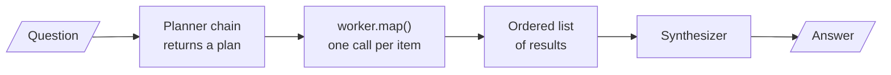

<!-- Generated by site/scripts/rag-theory-import.mjs from rag-agents-engineering. Edit the source there. -->
# lesson 4 of T7.3 Theory: Orchestrator–worker with the Send API

<!-- subtitle: Let a planner decide how many workers run, and make sure the plan, not the wiring, drives them -->
<!-- format: approved -->

## Dynamic fan-out with Send

> **What you'll learn**
>
> - **Explain** how orchestrator-worker differs from parallelisation: who decides the branches, and when.
> - **Trace** a plan from the orchestrator through one worker per item to the merged result.
> - **Diagnose** a padded plan, a decorative plan and an empty plan from what ran.
> - **Compare** LangGraph's `Send` with LCEL's map for failures and durability.

Lesson 3 of T7.3 ran branches you wrote into the graph. Larkspur questions do not all have the same number of parts. *Can I export my data after I cancel my plan?* needs two answers: how to export, and how long data stays after cancellation. *How long does a refund take?* needs one. A fixed set of branches either wastes calls on the second question or misses half of the first.

**Orchestrator-worker** lets an orchestrator LLM decide, per input, how many subtasks there are and what each one covers. A worker runs once per subtask, and a final step merges the results.

### A plan instead of fixed branches

The pattern looks like parallelisation from outside. The difference is who decides the branches, and when:

| | Parallelization (24.3) | Orchestrator-worker (24.4) |
|---|---|---|
| Who decides the subtasks | you, when you build the graph | the orchestrator, at run time |
| Number of branches | fixed | follows the input |
| Branch identity | known in advance (characters, setting, premise) | generated (whatever sections this input needs) |
| Graph shape | static fan-out edges | one conditional edge returning a list of `Send` |

*Table 1: Fixed branches against a run-time plan.*

The same graph is often called **map-reduce**: the plan is the list, the fan-out maps one worker over it, and the synthesizer reduces the results to one answer:

```animated
<figure class="anim sheet" aria-labelledby="anim-send-cap">
  <div class="anim__canvas" tabindex="0" aria-label="The Send fan-out, scrolls sideways on a narrow screen">
    <svg viewBox="0 0 800 330" role="img" aria-labelledby="anim-send-title anim-send-desc">
      <title id="anim-send-title">Orchestrator-worker with Send</title>
      <desc id="anim-send-desc">A question goes to an orchestrator, which returns a plan with two items, export and retention. One Send per item starts two llm_call workers. The retention worker finishes first, but the reducer merges the results in Send order, export then retention, and a synthesizer writes one reply.</desc>
      <defs>
        <marker id="ah-send" viewBox="0 0 8 8" refX="7" refY="4" markerWidth="8" markerHeight="8" markerUnits="userSpaceOnUse" orient="auto-start-reverse"><path class="ah" d="M0 0 L8 4 L0 8 z"/></marker>
      </defs>

      <g><rect class="box" x="20" y="136" width="110" height="56"/><text class="label" x="75" y="156">Question</text><text class="small" x="75" y="176">two parts</text></g>
      <path class="edge e-1" d="M130 164 H167" marker-end="url(#ah-send)"/>
      <g class="n-1"><rect class="box" x="170" y="136" width="140" height="56"/><text class="label" x="240" y="156">Orchestrator</text><text class="small" x="240" y="176">returns a plan</text></g>
      <g class="in-1">
        <path class="edge dashed" d="M240 192 V219"/>
        <rect class="doc" x="180" y="222" width="120" height="64"/>
        <text class="fig" x="240" y="242">1 export</text>
        <text class="fig" x="240" y="266">2 retention</text>
        <text class="small" x="240" y="306">the plan</text>
      </g>

      <path class="edge e-2" d="M310 164 C352 164 360 95 397 95" marker-end="url(#ah-send)"/>
      <path class="edge e-2" d="M310 164 C352 164 360 233 397 233" marker-end="url(#ah-send)"/>
      <text class="small in-2" x="344" y="106">Send</text>
      <text class="small in-2" x="344" y="226">Send</text>
      <g class="n-3"><rect class="box" x="400" y="70" width="150" height="50"/><text class="label" x="475" y="88">llm_call</text><text class="small" x="475" y="106">export</text></g>
      <g class="n-3 n-4"><rect class="box" x="400" y="208" width="150" height="50"/><text class="label" x="475" y="226">llm_call</text><text class="small" x="475" y="244">retention</text></g>
      <text class="small in-4" x="475" y="280">finishes first</text>

      <path class="edge e-5" d="M550 95 C576 95 574 142 597 142" marker-end="url(#ah-send)"/>
      <path class="edge e-5" d="M550 233 C576 233 574 192 597 192" marker-end="url(#ah-send)"/>
      <g class="n-5"><rect class="box" x="600" y="110" width="180" height="110"/><text class="small" x="690" y="130">completed_sections</text></g>
      <text class="fig mv-5" x="690" y="166" style="--from: translate(-215px, -71px)">1 export</text>
      <text class="fig mv-5" x="690" y="194" style="--from: translate(-215px, 39px)">2 retention</text>
      <path class="edge e-6" d="M690 220 V255" marker-end="url(#ah-send)"/>
      <g class="n-6"><rect class="box" x="600" y="258" width="180" height="48"/><text class="label" x="690" y="282">Synthesizer</text></g>

      <circle class="tok" cx="0" cy="0" r="7"/>
    </svg>
  </div>
  <div class="anim__controls" hidden>
    <button class="anim__btn" type="button" data-act="prev">Previous</button>
    <button class="anim__btn" type="button" data-act="play" aria-pressed="false">Play</button>
    <button class="anim__btn" type="button" data-act="next">Next</button>
  </div>
  <ol class="anim__steps" id="anim-send-cap">
    <li><button type="button" data-tok="170,136">Plan</button><span>The orchestrator reads <em>Can I export my data after I cancel my plan?</em> and returns a plan with two items: export and retention.</span></li>
    <li><button type="button" data-tok="310,164">Send</button><span>assign_workers returns one Send per item, so LangGraph starts two llm_call runs. A one-part question would start one.</span></li>
    <li><button type="button" data-tok="400,70">Work</button><span>Each worker gets its own WorkerState, the question and one plan item, and answers only that item.</span></li>
    <li><button type="button" data-tok="400,208">Finish</button><span>Workers finish in their own order. Say retention returns first: stream_mode updates reports it first.</span></li>
    <li><button type="button" data-tok="600,110">Merge</button><span>The operator.add reducer appends both results in Send order, export then retention, whichever finished first.</span></li>
    <li><button type="button" data-tok="600,258">Answer</button><span>The synthesizer reads the merged list and writes one reply.</span></li>
  </ol>
</figure>
```

*Figure 1: Orchestrator-worker. The dotted edge fires once per plan item, a number the graph learns only after the orchestrator runs.*

### From plan item to worker

Four pieces make the plan load-bearing:

| Piece | What it does | Why it matters |
|---|---|---|
| **A variable-length plan** | The orchestrator returns structured output: a list of sections, each with a name and a description | The list length is the number of workers |
| **Dispatch from the plan** | The conditional edge returns one `Send` per section, each naming the worker node and carrying its own payload | A normal edge returns one node; this returns as many runs as the plan has items |
| **A narrow worker state** | Each worker sees the topic and its one section, and writes from that section's description | The worker does what the plan asked, nothing else |
| **A reducer for results** | The results key concatenates lists, so any number of workers can write it in the same step | Without it the parallel writes collide, as in 24.3 |

*Table 2: The four pieces of a Send fan-out.*

A **`Send`** is an instruction to run a named node with a given input. The graph drawing shows the orchestrator-to-worker edge once, because the count is unknown until the plan exists.

### Tracing dispatch

We ran a model-free graph of the same shape, with hand-written plans in place of the orchestrator's, in the LangGraph version this course pins (1.2.18):

| Plan | `Send`s created | Workers ran | Synthesizer ran | Answer |
|---|---|---|---|---|
| export instructions; retention after cancellation | 2 | 2 | yes | both sections |
| refund timing | 1 | 1 | yes | one section |
| (empty) | 0 | 0 | **no** | **none, and no error** |

*Table 3: Dispatch follows the plan, including when the plan is empty.*

The last row is a planted failure we call the **silent empty plan**. With nothing to dispatch, no worker runs, the synthesizer is never reached, and the run ends without an answer or an exception. A caller that only checks for errors sees success.

### Finish order and merge order

Workers finish in whatever order their calls return, but the reducer does not merge them in that order. In the same model-free graph, an export worker took 0.3 s and a retention worker 0.05 s:

| View | Order |
|---|---|
| Streamed updates, as workers finish | retention, export |
| Merged results key in the final state | export, retention |

*Table 4: Completion order against merge order.*

The merged list follows the order the `Send`s were created, which is the plan order, so the final report reads in the planned order whichever worker finishes first. The notebook's own order check makes the same point.

### Planted failures

Each guard answers one way the plan stops driving execution:

| Failure | What it looks like | The guard |
|---|---|---|
| **Padded plan** | A planner told "simple topics might need 2 sections, broad topics 5+" returned five sections, Introduction and Conclusion included, for every topic | Ask for one section per distinct question and ban padding sections |
| **Decorative plan** | The orchestrator plans, but five fixed workers wired with plain edges ignore it; the same five run for every input | Dispatch one `Send` per plan item, and have each worker use its section's description |
| **Silent empty plan** | Table 3: no workers, no synthesizer, no answer, no error | Decide in code what an empty plan returns |
| **Runaway plan** | A planner that splits one question into many sub-questions multiplies calls | Cap the number of `Send`s in code, not only in the prompt |

*Table 5: Four ways the plan fails, and the guard for each.*

> **Pitfall: the decorative plan.** If the set of workers that ran is identical for every input while the plan changes, the plan drives nothing. That graph is parallelisation with an extra LLM call in front.

### Send compared with LCEL's map

LCEL can express the fan-out by mapping one runnable over the plan's list. There is no graph state: the plan goes in, a list of results comes out, in input order.



*Figure 2: The same fan-out in LCEL. One runnable is mapped over the plan; nothing is checkpointed between steps.*

It covers the shape, with four gaps:

| | LangGraph `Send` | LCEL map |
|---|---|---|
| Worker identity | each `Send` names its own target node | every item goes to the same runnable |
| Results land in | shared state, merged by a reducer | an ordered list matching the input |
| One worker fails | the graph can route around it | the whole batch raises and the good results are lost, unless failures are returned as values |
| Durability | per-worker checkpoints, interrupts, resume | none: the chain is stateless |

*Table 6: The same fan-out in two runtimes.*

The LCEL notebook plants a failing worker to show the third row: the mapped call raised and kept nothing, while a batch call that returns exceptions kept the successes and reported the failure.

## In practice: decomposing the export question

This is the shape of query decomposition ([T6.2](../../p05_retrieval_quality_and_rag_apps/m17_query_transformation/00_overview.md)), applied to the golden question. The trace below is illustrative; its plan matches the model-free run in Tables 3 and 4.

<div class="walkthrough learning-widget" data-stepper id="export-plan-walkthrough">
<p class="widget-intro">Step through the export question from plan to reply, then the two edge cases.</p>
<div class="step-controls" hidden role="group" aria-label="Stages of the export question"><button type="button" data-step="0" aria-pressed="false" aria-controls="export-step-0">1. Plan</button><button type="button" data-step="1" aria-pressed="false" aria-controls="export-step-1">2. Dispatch</button><button type="button" data-step="2" aria-pressed="false" aria-controls="export-step-2">3. Merge</button><button type="button" data-step="3" aria-pressed="false" aria-controls="export-step-3">4. Edge cases</button></div>
<div class="step-panels"><section id="export-step-0" class="step-panel" aria-labelledby="export-heading-0"><h4 id="export-heading-0">1. Plan</h4><dl><dt>Input</dt><dd><em>Can I export my data after I cancel my plan?</em></dd><dt>Plan</dt><dd>two items: how do I export, and what happens to my data after I cancel</dd></dl></section><section id="export-step-1" class="step-panel" aria-labelledby="export-heading-1"><h4 id="export-heading-1">2. Dispatch</h4><dl><dt>Sends</dt><dd>two, one per item, each carrying only its own sub-question</dd><dt>Evidence</dt><dd>one worker retrieves the <code>export</code> chunk, the other the <code>retention</code> chunk of the [T5.1](../../p04_rag_foundations/m10_rag_lifecycle/00_overview.md) golden set</dd></dl></section><section id="export-step-2" class="step-panel" aria-labelledby="export-heading-2"><h4 id="export-heading-2">3. Merge</h4><dl><dt>Finish order</dt><dd>whichever worker returns first, retention in our run</dd><dt>Results key</dt><dd>export, then retention: plan order, and the synthesizer writes one reply from both</dd></dl></section><section id="export-step-3" class="step-panel" aria-labelledby="export-heading-3"><h4 id="export-heading-3">4. Edge cases</h4><dl><dt>One item</dt><dd><em>How long does a refund take?</em> plans one item and can skip the fan-out</dd><dt>No items</dt><dd>an empty plan returns a fixed reply instead of ending silently, and the plan size has a cap in code</dd></dl></section></div><div class="step-footer" hidden><button type="button" data-walk="previous">Previous</button><p class="step-status" aria-live="polite"></p><button type="button" data-walk="next">Next step</button></div></div>

Lesson 5 of T7.3 adds the last ingredient the patterns so far lack: a loop that goes back and tries again.

## Limits of this evidence

- **Model-free traces.** Tables 3 and 4 come from our own graph of the same shape with hand-written plans; the notebook's live planner was not rerun.
- **Padded plans from one model.** The five-section result is the notebook's report for `gpt-4o-mini` with that prompt; other models pad differently.
- **Rerun on 14 November 2026.** We repeated Tables 3 and 4 on langgraph 1.2.18 with the same delays, and both reproduce.

## References

1. Anthropic, [Building effective agents](https://www.anthropic.com/research/building-effective-agents), December 2024: orchestrator-workers.
2. LangChain, [LangGraph Graph API: Send and map-reduce](https://docs.langchain.com/oss/python/langgraph/graph-api).
3. LangChain, [Runnable reference: map and batch](https://reference.langchain.com/python/langchain-core/runnables).

## Run the notebooks

The code for this lesson is in these notebooks. Colab runs one in your browser: install the packages its first cell imports and set the API keys it reads. To run every notebook as written, clone the repository and use its uv environment.

| Notebook | GitHub | Colab |
|---|---|---|
| Orchestrator worker send API | [Open on GitHub](https://github.com/Sourav692/rag-agents-engineering/blob/main/p06_agent_foundations/m24_agentic_workflow_patterns/mandatory/notebook/04a_orchestrator_worker_send_api.ipynb) | [Open in Colab](https://colab.research.google.com/github/Sourav692/rag-agents-engineering/blob/main/p06_agent_foundations/m24_agentic_workflow_patterns/mandatory/notebook/04a_orchestrator_worker_send_api.ipynb) |
| Orchestrator worker lcel map (optional) | [Open on GitHub](https://github.com/Sourav692/rag-agents-engineering/blob/main/p06_agent_foundations/m24_agentic_workflow_patterns/optional/notebook/04b_orchestrator_worker_lcel_map.ipynb) | [Open in Colab](https://colab.research.google.com/github/Sourav692/rag-agents-engineering/blob/main/p06_agent_foundations/m24_agentic_workflow_patterns/optional/notebook/04b_orchestrator_worker_lcel_map.ipynb) |

## Key Takeaways

- In orchestrator-worker an LLM decides at run time how many subtasks there are, and a conditional edge returns one `Send` per plan item. A reducer merges the results in plan order.
- Make the plan drive execution: each worker gets only its own section and writes from its description. Fixed workers that ignore the plan make it decorative.
- Guard the plan in code: ban padding in the prompt, cap the number of `Send`s, and decide what an empty plan returns, because it otherwise ends with no answer and no error.

## Check yourself

<details>
<summary>1. Both orchestrator-worker and parallelisation run several LLM calls at once and merge them. What separates them?</summary>

Who decides the branches, and when. In parallelisation you wrote them into the graph as fixed edges. In orchestrator-worker an LLM decides at run time how many subtasks there are and what each covers, and one conditional edge returns a list of Send, one per plan item.

</details>

<details>
<summary>2. The orchestrator returns an empty plan for a Larkspur question. What does the caller get, and what should you add?</summary>

No worker runs, the synthesizer is never reached, and the run ends with no answer and no error, so a caller that only checks for errors sees success. Decide in code what an empty plan returns, such as a direct answer or a fixed reply, and cap the plan size as well.

</details>

<details>
<summary>3. The orchestrator's plan changes with every topic, yet the same five workers run every time. What is wrong?</summary>

The plan drives nothing: five fixed workers wired with plain edges ignore the orchestrator's output, so the graph is parallelisation with a decorative LLM call in front. Dispatch one Send per section, and have each worker write from its section's description.

</details>
