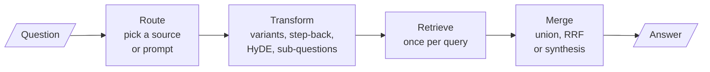

<!-- Generated by site/scripts/rag-theory-import.mjs from rag-agents-engineering. Edit the source there. -->
# M18 Theory: Query transformation and routing

Users ask short, vague or compound questions, and the retriever searches with exactly what they typed. M18 changes the query before retrieval: rewrite it, ask it several ways, ask a broader question, search with an invented answer, split it, or send it to the right place first. The M18 notebooks build on four ideas: why a question and its answer sit far apart, how to fuse rankings from several phrasings, how a hypothetical answer becomes a search key, and the two ways to route a question.

The running example is the Larkspur Cloud handbook from [M11](../../p04_rag_foundations/m11_rag_lifecycle/00_overview.md): twelve chunks on billing, refunds, outages, servers and data exports, and the same three golden questions. [M11](../../p04_rag_foundations/m11_rag_lifecycle/00_overview.md) left one of them unsolved. *What happens if my server goes down?* shares no word with the two chunks that answer it, so no value of `k` could retrieve them. M18 starts there.

## In short

- Questions and documents differ in vocabulary ("server goes down" against "outage" and "availability") and in shape (a nine-word question against a 400-token passage). Every technique here closes one of those gaps, or splits a question that has more than one need.
- Multi-query and RAG-Fusion search with several LLM-written phrasings. In the lab, five variants per question lift mean recall@3 over the three golden questions from 0.50 to 0.83 with a flat union and to 1.00 with RRF.
- RRF's constant `k` is a real setting. At two chunks sent, `k = 60` scores 0.67 and `k = 1` scores 0.83, because a large `k` lets chunks that several variants rank low outvote a chunk two variants rank high.
- HyDE embeds an LLM-written answer instead of the question. It costs one LLM call per query and can mislead on a private corpus the model knows nothing about. Decomposition costs five LLM calls and three retrievals where plain RAG costs one and one.
- An LLM classifier routes by reasoning and pays a generation call per query; semantic routing compares embeddings with example questions and cannot say "none of these". Guard it with a minimum score and a minimum margin, and hand unclear cases to the classifier.

## Mental model

Everything in M18 happens before the first vector search or after the last one. The index from [M12](../../p05_ingestion_and_indexing/m12_document_ingestion/00_overview.md) to [M17](../m17_retrievers_hybrid_search/00_overview.md) stays as it is. A transformation multiplies the queries, so the stage after retrieval has to merge their results, and the merge decides which chunks survive the cut to the model.

## Interactive lab

[**Query variants and rank fusion**](/labs/rag/m18_query_transformation/query-variant-fusion-lab.html): open the file in a browser. It opens on the outage question at three chunks: both evidence chunks are in, against none for the question as asked. Switch to **Flat union** and `incidents` drops to rank 5. Then pick *How long does a refund take?*, set the cut to 2, and move `k` from 60 to 1 to watch `refund-window` climb back above `retention`.

## How it connects

- **Before:** [M11](../../p04_rag_foundations/m11_rag_lifecycle/00_overview.md) supplies the index, the golden questions and the baseline row (recall@2 0.50) that the lab compares against. [M14](../../p05_ingestion_and_indexing/m14_embeddings/00_overview.md) narrows the vocabulary gap with embeddings; [M17](../m17_retrievers_hybrid_search/00_overview.md) adds keyword search and teaches RRF for fusing BM25 with dense retrieval.
- **Next:** [M19](../m19_reranking_post_retrieval/00_overview.md) reranks what the merged lists retrieve, which matters more once several queries widen the pool. [M25](../../p08_agent_foundations/m25_agentic_workflow_patterns/00_overview.md) rebuilds decomposition as an orchestrator and workers; [M28](../../p09_agentic_rag/m28_retrieval_grading_rewriting/00_overview.md) has an agent rewrite failed queries; [M30](../../p09_agentic_rag/m30_adaptive_rag_routing/00_overview.md) turns routing into adaptive RAG.

## Key Takeaways

- Print what the retriever saw before you change the prompt: the original query, every variant and every list. Fluent answers can come from an empty context, as the 02a notebook's merge bug showed.
- Match the transformation to the gap. Vocabulary gaps want variants or expansion, shape gaps want HyDE, compound questions want decomposition, facts the embedding cannot compare want a metadata filter.
- RRF rewards agreement, and agreement on a distractor still counts. Tune `k` and the cut on your golden set instead of taking 60 on trust.
- Route cheaply by similarity, check the margin, and pay for an LLM classifier only when the margin is small.
