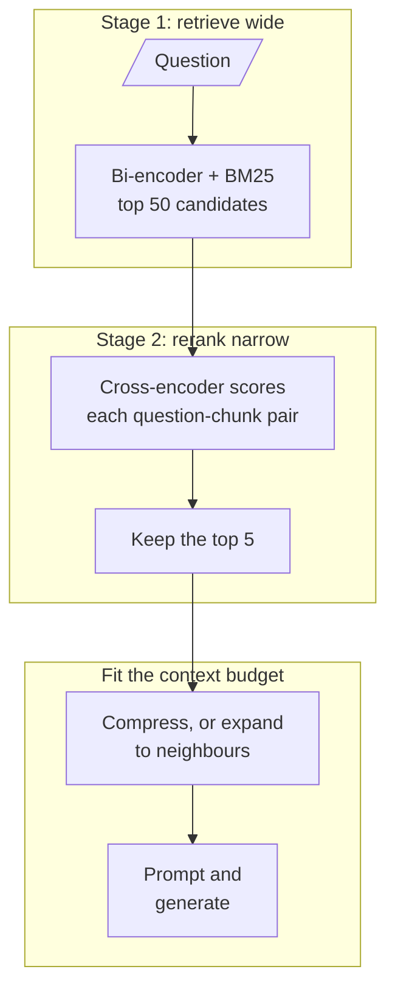

<!-- Generated by site/scripts/rag-theory-import.mjs from rag-agents-engineering. Edit the source there. -->
# M19 Theory: Post-retrieval optimisation and reranking

A retriever that scores every chunk in the index has to be cheap, so it is coarse. M19 adds a second, slower pass over a short candidate list, then decides how much of each surviving chunk the model reads. The M19 notebooks build on four ideas: why a bi-encoder and a cross-encoder do different jobs, why the first stage is judged on recall and the second on precision, why a model reads the middle of a long prompt less reliably, and how to spend a fixed context budget.

The running example is the Larkspur Cloud handbook from [M11](../../p04_rag_foundations/m11_rag_lifecycle/00_overview.md) to [M13](../../p05_ingestion_and_indexing/m13_chunking/00_overview.md), and two of its golden questions: *Can I export my data after I cancel my plan?* (evidence: the `export` and `retention` chunks) and *How long does a refund take?* (evidence: `refund-window` and `refund-timing`). The first has a distractor that shares its words, the `cancel` chunk, which is the kind of near miss a reranker is for.

## In short

- Retrieval runs in two stages. A bi-encoder (with BM25 alongside it in the [M17](../m17_retrievers_hybrid_search/00_overview.md) hybrid) scores every chunk and returns a wide candidate list; a cross-encoder or an LLM reads each question and candidate together and reorders the list. Stage 1 is judged on recall at depth 50, stage 2 on precision in the top 5.
- The reranker only reorders what stage 1 returned. Evidence missing from the candidates stays missing, so recall at the first-stage depth caps everything after it.
- Reranking cost grows with the number of candidates. A cross-encoder runs one forward pass per question and chunk pair; the pointwise LLM reranker in `03a_reranking_methods.ipynb` makes one `gpt-4o` call per candidate, up to 30 per question in its custom retriever.
- Models use the start and end of a long prompt more reliably than the middle. Send a few chunks in rank order, best first, rather than a long list in retrieval order.
- After reranking, the context budget decides the shape of each chunk: compress it to the sentences that answer the question, or expand it to its neighbours when the answer runs across a boundary.

## Mental model

Each stage has its own metric and its own failure. Stage 1 fails when the evidence is not among the candidates, stage 2 fails when the evidence is a candidate but does not reach the top 5, and the last step fails when the evidence reaches the prompt cut short or buried. Debug them in that order.

## Interactive lab

[**Rerank precision lab**](/labs/rag/m19_reranking_post_retrieval/rerank-precision-lab.html): open the file in a browser. It ranks a 100-chunk handbook with `all-MiniLM-L6-v2`, reranks with two real cross-encoders, and prints rerank latency measured on a laptop CPU.

- On the outage question, switch the reranker from Off to `bge-reranker-v2-m3` at `k = 20`. The two SLA chunks climb from ranks 9 and 11 into the top three, and precision@5 goes from 0.20 to 0.60 for about 623 ms.
- Drop `k` to 10 with the reranker on. One SLA chunk falls outside the candidates and precision@5 stops at 0.40, because no reranker can return a chunk the first stage never retrieved.
- Switch to MiniLM-L6. It costs 39 ms at `k = 20` instead of 623 ms and gains nothing on these questions. Measure a reranker on your golden set before you pay for it.

## How it connects

- **Before:** [M11](../../p04_rag_foundations/m11_rag_lifecycle/00_overview.md) defines recall@k and precision@k and the baseline every change is measured against. [M13](../../p05_ingestion_and_indexing/m13_chunking/00_overview.md) sets the chunk size that compression and enrichment windows work around. [M14](../../p05_ingestion_and_indexing/m14_embeddings/00_overview.md) covers the embedding models that stage 1 runs as bi-encoders. [M17](../m17_retrievers_hybrid_search/00_overview.md) builds the hybrid first stage, and [M18](../m18_query_transformation/00_overview.md) rewrites the question before it reaches it.
- **Next:** [M20](../../p07_rag_applications/m20_end_to_end_rag_systems/00_overview.md) assembles the full pipeline with sources and citations on top of these stages. [M28](../../p09_agentic_rag/m28_retrieval_grading_rewriting/00_overview.md) and [M29](../../p09_agentic_rag/m29_crag_and_self_rag/00_overview.md) add an LLM grader that judges each retrieved chunk, the same pointwise judgement as the LLM reranker in 19.3, with a yes or no instead of a score.

## Key Takeaways

- Judge stage 1 on recall at its depth and stage 2 on precision at the cut. A reranker cannot fix a candidate list that lacks the evidence.
- Reranking cost scales with the candidate count. Choose the depth from the recall curve and the latency budget, not from habit.
- Send the model a few chunks, best first. Position in a long prompt changes how reliably the model uses a fact.
- Spend the context budget where the evidence is: compress noisy chunks, expand chunks whose answer crosses a boundary, and count both against the same token limit.
