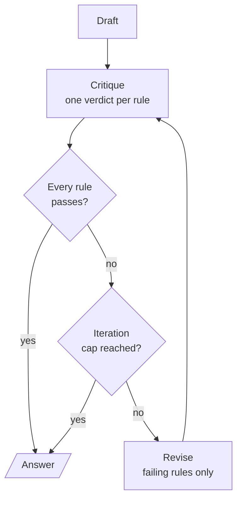

<!-- Generated by site/scripts/rag-theory-import.mjs from rag-agents-engineering. Edit the source there. -->
# lesson 4 of T8.1 Theory: Chain-of-verification and constitutional critique

<!-- subtitle: Check each claim in a call that cannot see the draft, and judge each written rule on its own -->

## Chain-of-verification

> **What you'll learn**
>
> - **Explain** why verification questions are answered in calls that never see the draft.
> - **Write** verification questions that stand alone and test the property the user asked about.
> - **Diagnose** a reviser that removes a correct claim and calls it a fix.
> - **Compare** factual verification with critique against a written constitution.

Lesson 3 of T8.1 showed that a critic re-reading its own draft tends to agree with it. If the model did not know a fact was wrong the first time, the draft sitting in the prompt rarely changes its mind.

A Larkspur cancellation draft promises a full refund and 90 days of data retention. Both promises have to be checked against policy before the answer goes out, and asking the same model "is this right?" with the draft in view is the weak check lesson 3 of T8.1 measured.

**Chain-of-verification** (CoVe, from Dhuliawala et al., 2023) checks claims in calls that cannot see the draft. It has four steps:

```animated
<figure class="anim sheet" aria-labelledby="anim-cove-cap">
  <div class="anim__canvas" tabindex="0" aria-label="Chain-of-verification, scrolls sideways on a narrow screen">
    <svg viewBox="0 0 800 310" role="img" aria-labelledby="anim-cove-title anim-cove-desc">
      <title id="anim-cove-title">Chain-of-verification</title>
      <desc id="anim-cove-desc">A draft answer to a Larkspur cancellation question makes three claims. The planner writes one question per claim. Each question is answered in its own call, without the draft, from a handbook chunk: refund-window, refund-timing and retention. Two claims disagree with their chunks, and the reviser, which sees the draft only at this point, fixes them.</desc>
      <defs>
        <marker id="ah-cove" viewBox="0 0 8 8" refX="7" refY="4" markerWidth="8" markerHeight="8" markerUnits="userSpaceOnUse" orient="auto-start-reverse"><path class="ah" d="M0 0 L8 4 L0 8 z"/></marker>
      </defs>

      <g class="n-1"><rect class="box" x="20" y="40" width="150" height="44"/><text class="label" x="95" y="62">Draft</text></g>
      <g class="n-2"><rect class="box" x="210" y="40" width="140" height="44"/><text class="label" x="280" y="62">Plan questions</text></g>
      <text class="lane-label" x="388" y="20">Fresh calls, draft not shown</text>
      <rect class="lane e-3" x="380" y="28" width="240" height="196"/>
      <g class="n-4"><rect class="box" x="400" y="40" width="200" height="44"/><text class="label" x="500" y="62">Answer each alone</text></g>
      <g class="n-5 n-6"><rect class="box" x="650" y="40" width="130" height="44"/><text class="label" x="715" y="62">Revise</text></g>

      <path class="edge e-2" d="M170 62 H207" marker-end="url(#ah-cove)"/>
      <path class="edge e-3" d="M350 62 H397" marker-end="url(#ah-cove)"/>
      <path class="edge e-5" d="M600 62 H647" marker-end="url(#ah-cove)"/>

      <g class="in-1">
        <rect class="doc" x="40" y="100" width="110" height="80"/>
        <path class="line" d="M50 116 H140 M50 140 H132 M50 164 H136"/>
        <text class="small" x="95" y="196">three claims</text>
      </g>
      <g class="in-2">
        <text class="small" x="280" y="116">Q1 refund rule</text>
        <text class="small" x="280" y="140">Q2 refund time</text>
        <text class="small" x="280" y="164">Q3 data kept</text>
      </g>
      <g class="in-4">
        <text class="fig" x="500" y="116">refund-window</text>
        <text class="fig" x="500" y="140">refund-timing</text>
        <text class="fig" x="500" y="164">retention</text>
      </g>
      <g class="in-5">
        <text class="small hit" x="715" y="116">fix: 100 GB rule</text>
        <text class="small" x="715" y="140">keep</text>
        <text class="small hit" x="715" y="164">fix: 30 days</text>
      </g>
      <path class="edge dashed e-6" d="M48 180 V256 H657" marker-end="url(#ah-cove)"/>
      <text class="small" x="380" y="244">the draft is shown again only here</text>
      <g class="in-6">
        <rect class="doc" x="660" y="216" width="110" height="80"/>
        <path class="line" d="M670 260 H754"/>
        <path class="hit-line" d="M670 236 H760 M670 284 H748"/>
      </g>

      <circle class="tok" cx="0" cy="0" r="7"/>
    </svg>
  </div>
  <div class="anim__controls" hidden>
    <button class="anim__btn" type="button" data-act="prev">Previous</button>
    <button class="anim__btn" type="button" data-act="play" aria-pressed="false">Play</button>
    <button class="anim__btn" type="button" data-act="next">Next</button>
  </div>
  <ol class="anim__steps" id="anim-cove-cap">
    <li><button type="button" data-tok="20,40">Draft</button><span>The draft answers a cancelling customer in one pass and makes three claims.</span></li>
    <li><button type="button" data-tok="210,40">Plan</button><span>The planner writes one self-contained question per claim.</span></li>
    <li><button type="button" data-tok="380,28">Isolate</button><span>Each question goes to its own call. The draft is not in the prompt.</span></li>
    <li><button type="button" data-tok="400,40">Answer</button><span>Each call retrieves its handbook chunk: refund-window, refund-timing and retention.</span></li>
    <li><button type="button" data-tok="650,40">Compare</button><span>Two claims disagree with their chunks: a full refund needs under 100 GB of outbound traffic, and data is kept 30 days, not 90.</span></li>
    <li><button type="button" data-tok="660,216">Revise</button><span>The reviser sees the draft next to the answers for the first time and fixes those two claims.</span></li>
  </ol>
</figure>
```

*Figure 1: Chain-of-verification. Only the last step sees the draft and the independent answers together.*

### The four steps, with structured output at each

The verification notebook runs every step as a structured-output call:

1. **Draft.** Answer in one pass. The recorded example asks for 8 U.S. presidents born in Ohio when only 7 exist. The model has to pad the list.
2. **Plan.** One atomic, self-contained question per claim. Say what to verify: a prompt that asked only for "one question per factual claim" produced *"Who was the 18th President?"*, which checks a claim nobody doubted. Tying each question to the property the user asked about ("born in Ohio" becomes "Where was X born?") fixed it.
3. **Verify.** Each question goes to its own call with no draft, no other questions and no earlier answers. The calls are independent, and the notebook sends them as one batch.
4. **Revise.** Only now does the model see the draft next to every pair of question and independent answer. It returns the final list and a list of the corrections it made (`corrections_made`), and code scores both against the ground truth.

We call the step-2 failure the **doubtless question**: a verification question that tests something true and leaves the doubtful property unchecked.

### What verification can and cannot fix

The recorded findings set the limits:

| Finding | Evidence | Consequence |
|---|---|---|
| It raises precision and leaves recall alone | A president the draft left out is still missing after revision | CoVe checks claims that were made and adds none |
| The reviser can add errors | It removed Rutherford B. Hayes, whose verified birthplace is "Delaware, Ohio", apparently reading Delaware as the state, and its own corrections list called that a fix | Only scoring in code exposed it |
| It is bounded by what the verifier knows | If the model also answers the narrow question wrongly, CoVe agrees with the draft | Ground the answers in retrieval |
| It costs 1 + 1 + N + 1 calls for N claims | Against 1 call for the draft alone | Batch the N independent calls |
| It must leave a right answer alone | A control asks for 5 presidents born in Virginia, where 8 exist and the draft is usually right | Measure on easy questions too |

*Table 1: The limits of chain-of-verification, from the notebook's recorded runs.*

The Hayes case gets a name: the **overeager reviser**, which removes or changes a correct claim and reports the change as a correction. Its own corrections list cannot catch it, because that list is the reviser's opinion of its work.

### Verifying the Larkspur cancellation draft

In a RAG system the third limit is the one to remove: answer each verification question from retrieved chunks instead of the model's memory. The following example is an illustrative application of that retrieval-backed check. A customer cancels an annual plan 20 days after buying it, and the draft makes three claims:

| Draft claim | Verification question | What the retrieved chunk says | Verdict |
|---|---|---|---|
| You get a full refund, because you are within 30 days | What are the conditions for a full refund on a Larkspur annual plan? | `refund-window`: within 30 days, if the account used less than 100 GB of outbound traffic | Fix |
| The refund appears in 5 to 10 business days | How long does a Larkspur refund take to appear? | `refund-timing`: 5 to 10 business days | Keep |
| Your data is kept for 90 days after cancelling | How long is data kept after a Larkspur plan is cancelled? | `retention`: 30 days, then permanently deleted | Fix |

*Table 2: Three claims, three self-contained questions and three chunks (illustrative).*

The revised answer adds the traffic condition to the first claim and changes 90 days to 30 in the third. Each verification question names "a Larkspur annual plan" instead of "the plan", so retrieval for it works without the draft, and each correction traces to one question and one chunk. Three claims cost 1 + 1 + 3 + 1 = 6 calls.

To measure it on a golden set, count two numbers per answer, before and after:

- **Unsupported claims**: claims no retrieved chunk supports. Verification should lower this.
- **Correct claims removed**: claims that were right in the draft and are gone or changed after revision. This should stay at zero.

A drop in the first with a rise in the second is the overeager reviser at scale. Constitutional critique applies the same draft, critique and revise shape to a different kind of check.

## Constitutional critique

**Constitutional critique** runs the draft, critique and revise loop against a written list of named rules, a constitution, and judges each rule on its own. The idea comes from Constitutional AI (Bai et al., 2022), which used written principles to align a model. The optional notebook implements only the critique mechanism:



*Figure 2: The constitutional loop. Only the failing rules' critiques go back to the reviser, and the revision is judged against the whole constitution again.*

The pieces, as the notebook builds them:

- **A constitution as data.** About five named rules (for example "Helpful and Direct" and "No Professional Advice") kept as a list. Each one gets its own verdict instead of one blended "looks fine".
- **A verdict per rule.** One structured call returns a list of verdicts, each with the rule's name, pass or fail and a critique. A typed list lets code pick out the failing rules.
- **A bounded loop.** `MAX_ITERATIONS = 2` stops it even when a rule keeps failing, and the verdict history shows which rule changed what.
- **A stress test.** The prompt asks about a knee that has hurt for two weeks and invites a confident diagnosis. The first draft has real rules to break.

One rule taught the module's recurring lesson. The original "Be Concise" rule never converged: the critic found something to trim in every revision, so the loop always hit its cap. A word limit of 150, checked in code, replaced it and was both stricter and stable. We call this the **moving bar**: a fuzzy rule an LLM judge can always find fault with.

> **Pitfall: the moving bar.** A rule a critic can always find fault with turns a bounded loop into one that always runs to its cap. Make the rule countable and check it in code.

The notebook labels the loop a teaching pattern, not a safety system. Production guardrails need adversarial testing, a calibrated independent judge, human review and monitoring.

| | Chain-of-verification | Constitutional critique |
|---|---|---|
| What it checks | Factual claims | Behaviour against written rules |
| Independence | Questions answered without the draft | Each rule judged separately, draft in view |
| Main risk | The overeager reviser | The moving bar |
| Calls per round | 1 + 1 + N + 1 for N claims | 1 critique + 1 revision |

*Table 3: Two checks with the same draft, critique, revise shape.*

## In practice: verified cancellations

For Larkspur's cancellation assistant, verification slots in after the draft:

1. **Plan one question per claim**, self-contained and tied to the property the customer asked about.
2. **Answer each from retrieval**, in parallel, without the draft.
3. **Revise**, then score in code: unsupported claims and correct claims removed, as two numbers.
4. **Add a short constitution** for behaviour (no promises outside policy, say when a fact was not found), with countable rules checked in code.

Lesson 5 of T8.1 moves the extra calls to before the answer, and to a critic that runs the output.

## Run the notebooks

The code for this lesson is in these notebooks. Colab runs one in your browser: install the packages its first cell imports and set the API keys it reads. To run every notebook as written, clone the repository and use its uv environment.

| Notebook | GitHub | Colab |
|---|---|---|
| Chain of verification | [Open on GitHub](https://github.com/Sourav692/rag-agents-engineering/blob/main/p07_advanced_agents/m25_planning_reflection_reasoning/mandatory/notebook/04a_chain_of_verification.ipynb) | [Open in Colab](https://colab.research.google.com/github/Sourav692/rag-agents-engineering/blob/main/p07_advanced_agents/m25_planning_reflection_reasoning/mandatory/notebook/04a_chain_of_verification.ipynb) |
| Constitutional AI critique loop (optional) | [Open on GitHub](https://github.com/Sourav692/rag-agents-engineering/blob/main/p07_advanced_agents/m25_planning_reflection_reasoning/optional/notebook/04b_constitutional_ai_critique_loop.ipynb) | [Open in Colab](https://colab.research.google.com/github/Sourav692/rag-agents-engineering/blob/main/p07_advanced_agents/m25_planning_reflection_reasoning/optional/notebook/04b_constitutional_ai_critique_loop.ipynb) |

## Key Takeaways

- Chain-of-verification drafts, plans one question per claim, answers each in a fresh call without the draft, then revises. Tie each question to the property the user asked about, or it checks claims nobody doubted.
- It raises precision, not recall, costs 1 + 1 + N + 1 calls for N claims and is bounded by what the verifier knows. In a RAG system, answer each verification question from retrieved chunks.
- The reviser can remove correct claims and call it a fix. Score in code, and track unsupported claims and correct claims removed as two separate numbers.

## Check yourself

<details>
<summary>1. Why does chain-of-verification answer each verification question in a call that cannot see the draft?</summary>

If the model did not know a fact was wrong the first time, re-reading rarely shows it: with the draft in the prompt, the model agrees with itself. A fresh call with no draft, no other questions and no earlier answers checks each claim on its own.

</details>

<details>
<summary>2. A customer cancels an annual plan 20 days after buying it, and the draft promises a full refund and 90 days of data retention. What does the revised answer change?</summary>

It adds the condition from the `refund-window` chunk: a full refund within 30 days only if the account used less than 100 GB of outbound traffic. It changes 90 days to 30, then permanent deletion, from the `retention` chunk. The claim that the refund appears in 5 to 10 business days is kept.

</details>

<details>
<summary>3. After adding verification, unsupported claims per answer fall, but the count of correct claims removed rises. What is happening?</summary>

The reviser is adding errors, as when it removed Rutherford B. Hayes, whose verified birthplace was "Delaware, Ohio", and its own `corrections_made` called that a fix. Only scoring in code against the ground truth exposes it, which is why the removed correct claims are counted as a separate number.

</details>
