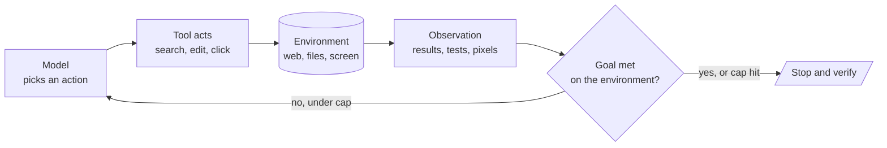

<!-- Generated by site/scripts/rag-theory-import.mjs from rag-agents-engineering. Edit the source there. -->
# T8.2 Theory: Coding, computer-use and deep agents

Agents that write code, drive a browser or run for hours need a harness: sub-agents, a file system, skills and a tester that checks the work. This module moves the ReAct loop from web search into files, browsers and screens, pairs a developer agent with a tester agent, and then configures a deep agent instead of wiring a graph node by node. The T8.2 notebooks build on two ideas: the same agent loop running in new environments, and a deep-agent harness around one orchestrator.

The lessons keep the notebooks' own examples, because their numbers come from those runs: a research report on *Artificial Intelligence in Healthcare*, a coding agent fixing a six-test project in a temporary folder, a mock shop with a cart, a checkout page read from pixels, two small games for the developer and tester pair, and an insurer's analytics agents in the deep-agent scripts. Each lesson and the interview questions then move the same designs onto Larkspur Cloud, the fictional host whose handbook runs through the course: a weekly outage summary, a control-panel agent that resizes servers, a refund-proration helper, and a deep agent for support engineers that delegates research and remembers each engineer's preferences.

## In short

- A planned research pipeline fixes its searches before any result comes back. A ReAct researcher picks each search after reading the last one. In one recorded run the pipeline made 3 searches and 2 LLM calls, the agent 4 searches and 5 LLM calls, which is an observation and not a benchmark.
- Moving the loop to code, browsers or screens keeps the `agent ⇄ tools` graph and changes the tools, the observation and the success signal. Tests grade the coding agent (3 of its 6 tests fail before it starts), the cart grades the browser agent. On pixels, `gpt-4o-mini` missed 53 of 53 clicks, and `gpt-4o` missed 15 of 26 and met the goal in 2 of 3 runs.
- A developer and tester pair is a critique-and-revise loop that ends by a rule in code: a reflection counter in state, a pure router and a `recursion_limit` of 2r + 4. Stub nodes show the developer runs r + 1 times and the tester r times, with zero model calls. A tester without a Python tool only estimates its pass rate.
- A deep agent is one orchestrator inside a harness: file tools, a `task` tool that runs each sub-agent in its own context, skills whose `name` and `description` alone sit in the prompt, a backend and memory. `03a_simple_coding_agent.py` configures 7 sub-agents and 8 skills.
- The backend decides what code can do. `FilesystemBackend(virtual_mode=True)` blocks path traversal without isolating anything, and `USE_SANDBOX=true` selects `LocalShellBackend`, unrestricted shell on the host.

## Mental model

Every lesson keeps this loop and changes one part of it. Lesson 1 of T8.2 swaps the environment: search results, a test run, a mock browser, a screenshot. Lesson 2 of T8.2 adds a tester whose critique becomes the next observation, and a counter in state ends the loop. Lesson 3 of T8.2 wraps the model in a harness whose backend decides whether an action can run at all. In each case the success check and the stop belong to code or to the environment, never to the agent's final message.

## How it connects

- **Before:** [T7.2](../../p06_agent_foundations/m23_react_agents/00_overview.md) teaches the ReAct loop, `create_agent` and middleware such as `ModelCallLimitMiddleware`, which lesson 1 of T8.2 uses as the researcher's bound. [T8.1](../m25_planning_reflection_reasoning/00_overview.md) weighs plan-and-execute against ReAct and builds reflection loops. The planned pipeline of lesson 1 of T8.2 and the developer and tester pair of lesson 2 of T8.2 are applied versions of both. [T7.3](../../p06_agent_foundations/m24_agentic_workflow_patterns/00_overview.md) treats the pipeline side as workflow patterns.
- **Next:** [T8.3](../m27_human_approval_applied_agents/00_overview.md) adds human approval with `interrupt()`, the mechanism behind the `interrupt_on` approval a deep agent's `execute` calls need. [T11.3](../../p10_multi_agent_systems/m37_multi_agent_applied_builds/00_overview.md) builds multi-agent systems from the other end, with a coordinator and specialists wired node by node and routing, caps and checks kept in code.

## Key Takeaways

- Keep the agent loop and change the tools: when the loop moves to code, browsers or screens, decide the observation, the success signal and the cap for each new environment.
- Grade success on the environment (tests, the cart, the files written) and stop the loop with a counter or cap in code, never with the agent's own claim that it is done.
- A tester that only reads code estimates. A tester that runs code measures. Pay for the measurement when the result matters.
- A deep agent's safety comes from its harness: check which backend actually runs, which tools each sub-agent has, and which user key its memory uses.
