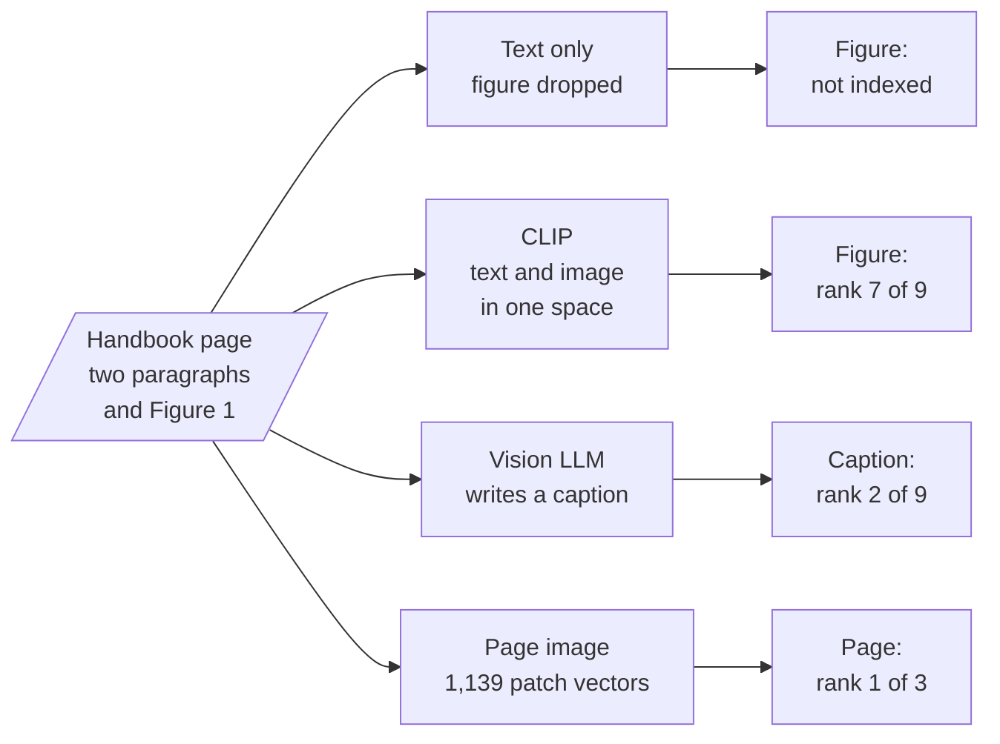

<!-- Generated by site/scripts/rag-theory-import.mjs from rag-agents-engineering. Edit the source there. -->
# M21 Theory: Multimodal RAG

A PDF loader that reads text keeps the paragraphs and drops the charts, so any fact that lives only in a figure never reaches the index. The three M21 notebooks get figures into retrieval three ways: embed the image beside the text with CLIP, have a vision model write a caption and index the caption, or embed the whole page as an image with ColPali. The M21 notebooks build on four ideas: one vector space for text and images, captions as a text stand-in for a figure, late interaction between query tokens and page patches, and retrieving whole pages instead of chunks.

The running example is three pages of the Larkspur Cloud handbook from [M11](../../p04_rag_foundations/m11_rag_lifecycle/00_overview.md) to [M13](../../p05_ingestion_and_indexing/m13_chunking/00_overview.md): availability, refunds and server plans. Each page has two short paragraphs and one figure, and the numbers are only in the figure. Three golden questions need them: *Which month missed the 99.95% availability target?* (May, at 99.91%, in Figure 1), *How many business days did a refund take in May?* (9, in Figure 2) and *How much memory does the Medium server have?* (8 GB, in Table 1). The lab indexes the three pages four ways with real models and ranks the results.

## In short

- Text extraction keeps "Figure 1 shows monthly availability…" and drops the bars. A text-only index of the three pages cannot reach any of the three answers at any `k`.
- CLIP embeds text and images into one space, but on these pages its text-to-text cosines run from 0.692 to 0.912 and its text-to-image cosines from 0.200 to 0.382. In one shared ranking the right figure is the best image for every question and still ranks 7 of 9, so `k = 3` sends no figure at all.
- Captioning turns each figure into text once, at index time. The captions rank 2, 1 and 1, and the model can answer from them only as far as the caption wrote the numbers down.
- Late interaction keeps one vector per query token and one per page patch, and scores a page by summing each token's best match (MaxSim). ColSmol-256M, a small ColPali-family model, ranks the right page first for all three questions, at 1,139 vectors of 128 dimensions per page.
- Choose by what the model must read at answer time: a caption is cheap to store and search, while a page image keeps the chart, the table layout and the text together.

## Mental model

The ranks are for *Which month missed the 99.95% availability target?* in the lab. Every route ends in the same place: the top-`k` items go to a model that can read what they hold, text, a caption or an image. What differs is whether the figure survives indexing, and whether it can outscore the text around it.

## Interactive lab

[**Four ways to index a chart**](/labs/rag/m21_multimodal_rag/chart-retrieval-lab.html): open the file in a browser. Start on CLIP joint space and slide `k` from 1 to 9: the figure stays below every text chunk until `k = 7`. Switch to Captions at `k = 1` and watch the first question miss, because the figure note outscores the caption, then pass at `k = 2`. Then try Page images, where `k = 1` answers all three.

## How it connects

- **Before:** [M06](../../p02_prompt_engineering/m06_multimodal_prompting/00_overview.md) shows how to put an image or a PDF page into a prompt, which is where every route here ends. [M12](../../p05_ingestion_and_indexing/m12_document_ingestion/00_overview.md) covers the loaders that drop figures, and [M14](../../p05_ingestion_and_indexing/m14_embeddings/00_overview.md) the text embeddings the caption route reuses. The lab reports against the [M11](../../p04_rag_foundations/m11_rag_lifecycle/00_overview.md) habit: fixed golden questions, the rank of the evidence, the cut at `k`.
- **Next:** [M22](../m22_llamaindex/00_overview.md) rebuilds pipelines in LlamaIndex. A multimodal index is one more retriever in the agentic RAG designs of [M28](../../p09_agentic_rag/m28_retrieval_grading_rewriting/00_overview.md) to [M31](../../p09_agentic_rag/m31_rag_as_agent_tool/00_overview.md).

## Key Takeaways

- Check what the loader keeps before you tune anything: a number that only exists in a figure is not in a text index.
- Never let text and image vectors from CLIP compete in one top-`k`; give each modality its own quota or turn images into text.
- A caption answers only what it wrote down. Store the image id with it and send the image when the question needs exact values.
- Page images with late interaction keep everything on the page and need no OCR, and they cost many vectors per page and a vision call per answer.
