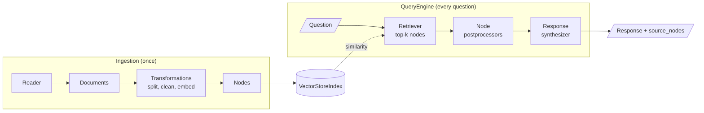

<!-- Generated by site/scripts/rag-theory-import.mjs from rag-agents-engineering. Edit the source there. -->
# M22 Theory: Framework fluency with LlamaIndex

M22 rebuilds pipelines you already know from the LangChain modules in LlamaIndex: a plain vector RAG, hybrid fusion, reranking and an enrichment window. The ideas are the same; the class names and several defaults change. The M22 notebooks build on four ideas: the Node as the unit LlamaIndex indexes, the QueryEngine that wraps retrieval and answering, the postprocessors that edit the retrieved list in between, and the sentence window that retrieves one sentence and sends its neighbours.

The notebooks run on a 33-page climate-change PDF and a 100-row customer CSV. These pages and the lab use the Larkspur Cloud handbook from [M11](../../p04_rag_foundations/m11_rag_lifecycle/00_overview.md) to [M13](../../p05_ingestion_and_indexing/m13_chunking/00_overview.md), loaded as two Documents: the refunds section from [M13](../../p05_ingestion_and_indexing/m13_chunking/00_overview.md) and a short exports section. Three golden questions carry the module: *Can I get a refund on an annual plan after 45 days?*, *How long does a refund take to appear?* and *Can I export my data after I cancel my plan?* The first one is the hard case. Its best-matching sentence is the 30-day full-refund rule, and the answer sits in the sentence after it.

## In short

- A LlamaIndex Node is a chunk with an id, metadata and links to its source Document and its neighbours. `chunk_size` counts tokens, and the metadata string counts against it: on the notebook's PDF the page label and file path take 38 of the 200 tokens.
- `index.as_query_engine()` builds a retriever, a list of node postprocessors and a response synthesizer, and returns the answer with its `source_nodes`. Check the defaults: `similarity_top_k` is 2, and `QueryFusionRetriever` makes 4 queries (3 of them written by the LLM) unless you set `num_queries=1`.
- Postprocessors run in list order on the retrieved nodes. On the handbook, retrieving 10 sentences and letting the `ms-marco-MiniLM-L-6-v2` cross-encoder keep 2 brings in the prorated-refund rule that plain top-2 retrieval misses.
- A sentence window embeds one sentence and sends up to `window_size` sentences on each side. In the lab the retrieval scores are identical for every window size; only the text the LLM reads changes, from 142 characters for the bare sentence to 621 at the notebook's `window_size=3`.
- The notebooks pass a FAISS store to `IngestionPipeline` without an embedding step, so FAISS stays empty and `VectorStoreIndex(nodes)` builds a second, in-memory index. Read what each object actually holds before trusting a port.

## Mental model

The diagram is [M11](../../p04_rag_foundations/m11_rag_lifecycle/00_overview.md)'s lifecycle with LlamaIndex names on the boxes, plus a stage [M11](../../p04_rag_foundations/m11_rag_lifecycle/00_overview.md) does not have. Node postprocessors sit between retrieval and the LLM, and reranking, filtering and window replacement all plug in there. Each one takes a scored list of nodes and returns another.

## Interactive lab

[**Sentence window lab**](/labs/rag/m22_llamaindex/sentence-window-lab.html): open the file in a browser. Pick *Can I get a refund on an annual plan after 45 days?* with `window_size` at 0: the model gets the 30-day rule and no answer. Move it to 1 and the prorated rule arrives in 284 characters. Then pick the export question, where the window stops growing at 2 because the exports Document has only four sentences, and set `similarity_top_k` to 2 on the refund-timing question to see neighbouring windows send the same sentences twice.

## How it connects

- **Before:** [M11](../../p04_rag_foundations/m11_rag_lifecycle/00_overview.md) is the lifecycle this module renames. [M13](../../p05_ingestion_and_indexing/m13_chunking/00_overview.md) wrote the refunds section and the small-chunk trade-off the sentence window answers. [M17](../../p06_retrieval_quality/m17_retrievers_hybrid_search/00_overview.md) covers score fusion and rank fusion in LangChain, and [M19](../../p06_retrieval_quality/m19_reranking_post_retrieval/00_overview.md) covers cross-encoder and LLM reranking and character-based enrichment windows.
- **Next:** [M23](../../p08_agent_foundations/m23_agent_loop_and_tools/00_overview.md) starts Part VIII, where the retriever becomes one tool an agent can call; [M31](../../p09_agentic_rag/m31_rag_as_agent_tool/00_overview.md) wraps a RAG pipeline as that tool.

## Key Takeaways

- Map the concepts first: Document and Node, retriever, postprocessor, QueryEngine. Then read the defaults, because they differ from LangChain's.
- Check what each component holds after the pipeline runs: vectors in the store, metadata in the embedding text, and the score direction of every retriever.
- Put reranking, filtering and window replacement in `node_postprocessors`, in the order you want them applied.
- Retrieve small, send big: a sentence window keeps the retrieval scores of a sentence and gives the model the paragraph around it. Size the window per question type and watch overlap when `k` is above 1.
