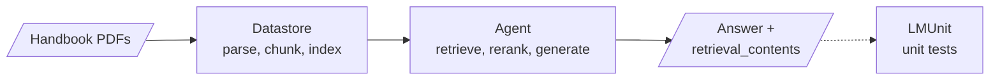
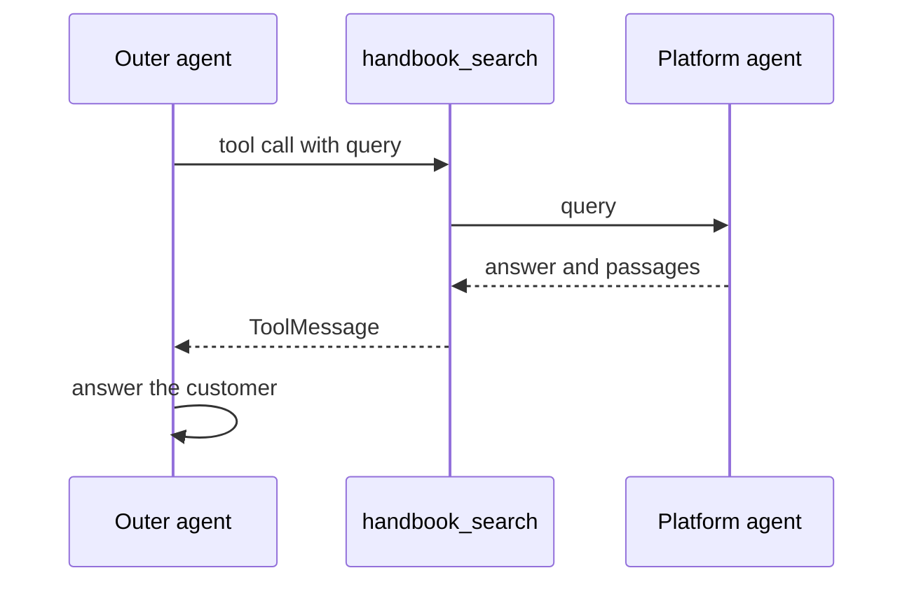

<!-- Generated by site/scripts/rag-theory-import.mjs from rag-agents-engineering. Edit the source there. -->
# lesson 2 of T9.4 Theory: Managed RAG platforms: Contextual AI

<!-- subtitle: What a managed platform runs for you, what you stop controlling, and why the agent loop stays the same -->

## Managed RAG

> **What you'll learn**
>
> - **Explain** what a managed RAG platform runs behind one endpoint, and which earlier module each part replaces.
> - **Trace** a handbook document from upload to a cited answer.
> - **Test** the two behaviours a support agent depends on: preferring the current policy, and refusing when the handbook has no answer.
> - **Choose** between your own pipeline and a managed one by what you give up.

Lesson 1 of T9.4 assembled retrieval from parts you run yourself: an embedding model, a Chroma collection, a retriever and a prompt, wrapped as one tool. Every part is a thing the Larkspur team now maintains.

Here is the failure that makes a team look elsewhere. Larkspur changes its refund policy, and for a week the index holds both versions. A customer asks about annual refunds, the archived rule ranks first, and the agent quotes it. Fixing that by hand touches the parser, the chunker, the index and the reranker.

**Managed RAG** is retrieval run as a service: you upload documents to a **datastore**, create an agent over it, and send questions to one endpoint that parses, chunks, indexes, retrieves, reranks and generates. The notebook does this with Contextual AI's Python SDK over four PDFs, two of them quarterly revenue slides:

*Figure 1: The managed pipeline. The answer comes back with the passages behind it; LMUnit scores answers offline, outside the query path.*

### What runs behind the endpoint

Each box in Figure 1 is a component the course builds by hand in an earlier module. The notebook exercises each one on its own:

| Component | What it does in the notebook | Built by hand in |
|---|---|---|
| **Datastore** | Parses, chunks and indexes each upload; a document reports processing until it is completed | [T5.2](../../p04_rag_foundations/m11_document_ingestion/00_overview.md) to [T5.5](../../p04_rag_foundations/m14_vector_stores/00_overview.md) |
| **Parser** | Turns a PDF into Markdown per page, keeping the section hierarchy as structure | [T5.2](../../p04_rag_foundations/m11_document_ingestion/00_overview.md) |
| **Reranker** | Reorders passages by relevance and by a plain-language instruction about sources and dates | [T6.3](../../p05_retrieval_quality_and_rag_apps/m18_reranking_post_retrieval/00_overview.md) |
| **Grounded language model** | Answers only from the passages it is given, or says it has no relevant information | [T9.5](../m32_reliability_feedback/00_overview.md) |
| **Agent** | Runs retrieval, reranking and generation in one request | [T6.4](../../p05_retrieval_quality_and_rag_apps/m19_end_to_end_rag_systems/00_overview.md) |
| **LMUnit** | Scores one answer against one natural-language test, from 1 to 5 | [T5.1](../../p04_rag_foundations/m10_rag_lifecycle/00_overview.md)'s golden set |

*Table 1: The platform's components and the module each one stands in for.*

An answer from the agent carries its retrieval contents, the passages it used, so a reviewer can check a claim against its evidence. That keeps the habit from lesson 1 of T9.4's lost source: the platform returns the sources as well as the text.

The next two sections test the two components a support agent leans on hardest.

### Planted case: two versions of one policy

After every policy change the Larkspur index can hold two versions of the same rule. We call the failure from the opening the **stale-policy win**: the archived version outranks the current one, and the answer quotes it with full confidence.

An **instruction-following reranker** takes a plain-language instruction alongside the query and orders passages by both. The notebook plants a conflict about enterprise GPU pricing, with the instruction *Prioritise internal sales documents over market analysis reports. More recent documents should be weighted higher. Enterprise portal content supersedes distributor communications.* It passes three passages, each with its date and source as metadata:

| Passage | Metadata | Role in the test |
|---|---|---|
| Bulk orders run on a $2,899 baseline | Enterprise sales portal, January 15, 2025, internal | the current internal figure |
| Bulk orders cost $3,100 to $3,300 per unit | Analyst report, November 30, 2023 | the older, external figure |
| The GPU needs 450W and 20% cooling overhead | Enterprise sales portal, January 25, 2025, internal | recent and internal, but off topic |

*Table 2: The notebook's planted conflict. The first two answer the question and disagree.*

The third row makes the test honest: it matches the instruction on date and source, so a reranker that only read the metadata would rank it first. The notebook ranks the passages with the instruction and without it, so the two orders can be compared. It ships without saved outputs, so this page quotes no scores, and the benchmark claims in its text are the vendor's own.

For Larkspur the instruction would read *Prefer the current handbook over archived handbook versions and community forum posts*, with each chunk's date and source passed as metadata.

### Planted case: a question the handbook cannot answer

The **grounded language model** answers from the passages it is handed. It has a flag, `avoid_commentary`, that decides whether the answer may add context beyond those passages. The notebook runs three cases:

| Question | Passages given | Flag | What to check |
|---|---|---|---|
| Solar in rural Africa and its economic impact | renewable-energy reports | off | which sentences go beyond the passages |
| The same question | the same reports | on | that the extra commentary is gone |
| Latest quantum computing hardware | the same renewable-energy reports | off | that the model says it has no relevant information |

*Table 3: The notebook's three generation runs.*

For a support agent the third row is the one to test first. A question the handbook does not answer should get "I don't have that information", never a **plausible policy**, an answer that sounds like Larkspur's rules and is not in the handbook. The flag narrows the answer to the evidence; it does not prove the answer is correct, so read the retrieved passages beside it.

## Keeping the tool contract

A managed platform fits behind the tool interface from lesson 1 of T9.4. The outer LangGraph agent keeps a `handbook_search` tool with the same name, description and one `query` argument; only its body changes, from calling your own retriever to calling the platform agent:

*Figure 2: The outer agent still decides when to search. The platform decides how.*

Because the interface is fixed, the routing golden set from lesson 1 of T9.4 still applies unchanged, and swapping the platform in or out is a change to one tool's implementation. The platform's answer arrives as a tool result, so the outer agent can still combine it with other tools.

> **Pitfall: a grounded answer inside an ungrounded loop.** The platform refuses when its datastore has no answer, but the outer agent can still skip the tool and answer from memory. The silent skip from lesson 1 of T9.4 does not go away; measure it on the routing golden set.

## Build or buy the pipeline

What you trade when the pipeline moves behind an endpoint:

| | Your own pipeline | Managed platform |
|---|---|---|
| Parts you run and maintain | all of them | the tool wrapper and the evaluation |
| Chunk size, embedding model, `k` | yours to set | the platform's, unless its configuration exposes them |
| Where documents live | your infrastructure | the vendor's |
| How you measure it | [T5.1](../../p04_rag_foundations/m10_rag_lifecycle/00_overview.md) golden set | the same golden set |

*Table 4: Build or buy, row by row.*

- **You run fewer parts.** Parsing, chunking, reranking and grounded generation come configured, and the platform's UI shows ingested documents and agent answers.
- **You control fewer settings.** Beyond its name and datastore, the notebook's agent sets only a system prompt, suggested queries and whether multi-turn is on.
- **Your documents leave your infrastructure.** Check data residency, access control on each datastore, and how a deleted document leaves the index.
- **You measure it the same way.** A managed platform is one more change to test against the baseline.

## In practice: moving the Larkspur handbook to a platform

1. Upload the handbook to a datastore and wait until every document reports completed.
2. Point `handbook_search` at the platform agent, keeping its name, description and argument.
3. Run the [T5.1](../../p04_rag_foundations/m10_rag_lifecycle/00_overview.md) golden set through both pipelines and compare answer quality, refusals and latency.
4. Plant the two cases from this page: an archived and a current refund rule with dated metadata, and a question the handbook cannot answer.
5. Rerun the routing golden set, which should not move, because the tool interface did not change.

## Limits

- **No saved outputs.** The notebook ships without outputs, so this page reports what each run tests and no scores or rankings. The parser, reranker and LMUnit benchmark figures in the notebook are the vendor's claims.
- **One vendor.** The trade-offs in Table 4 apply to any managed RAG service; the component names and settings are Contextual AI's.
- **What it needs to run.** A Contextual AI API key; the four sample PDFs download on first run.

## Run the notebooks

The code for this lesson is in these notebooks. Colab runs one in your browser: install the packages its first cell imports and set the API keys it reads. To run every notebook as written, clone the repository and use its uv environment.

| Notebook | GitHub | Colab |
|---|---|---|
| Agentic RAG contextual AI (optional) | [Open on GitHub](https://github.com/Sourav692/rag-agents-engineering/blob/main/p08_agentic_rag/m31_rag_as_agent_tool/optional/notebook/02a_agentic_rag_contextual_ai.ipynb) | [Open in Colab](https://colab.research.google.com/github/Sourav692/rag-agents-engineering/blob/main/p08_agentic_rag/m31_rag_as_agent_tool/optional/notebook/02a_agentic_rag_contextual_ai.ipynb) |

## Key Takeaways

- A managed RAG platform runs parsing, chunking, reranking and grounded generation behind one endpoint. Wrap its agent in the same tool, and your own agent still decides when to search.
- You run fewer parts but control fewer settings, and your documents leave your infrastructure. Check data residency, access control on each datastore and how a deleted document leaves the index.
- Test the two behaviours a support agent depends on: the current policy outranking an archived one, and a refusal when the handbook has no answer. Run the same golden set through both pipelines.

## Check yourself

1. What do you trade when you replace your own retrieval pipeline with a managed RAG platform?

You run fewer parts, since parsing, chunking, reranking and grounded generation come configured. You control fewer settings, such as chunk size, the embedding model and `k`, and your documents leave your infrastructure, so check residency, access control and deletion. You measure it the same way, by running the [T5.1](../../p04_rag_foundations/m10_rag_lifecycle/00_overview.md) golden set through it.

2. After a Larkspur policy change, the index holds an old and a new version of the same rule. How would the instruction-following reranker handle it, and what planted passage keeps the test honest?

Pass each passage's date and source as metadata with an instruction such as "Prefer the current handbook over archived handbook versions and community forum posts", and the reranker orders passages by relevance and by that instruction. Include a recent, current-source passage that does not answer the question, as the notebook does with the GPU cooling spec. A reranker that reads only the metadata would rank it first.

3. Larkspur wraps the platform agent as its handbook_search tool, and a customer still gets a refund policy from the model's memory. Which part failed?

The outer agent's routing, not the platform. The platform refuses when its datastore lacks an answer, but it only runs when the outer agent calls the tool. The model skipped the call, a silent skip from lesson 1 of T9.4, so the fix is in the tool description and the routing golden set.

