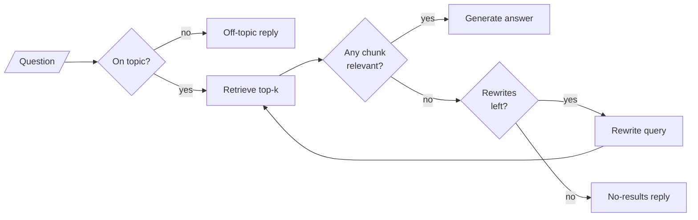

<!-- Generated by site/scripts/rag-theory-import.mjs from rag-agents-engineering. Edit the source there. -->
# M28 Theory: Grading and query rewriting

A plain RAG pipeline hands the model whatever the retriever returned. The smallest agentic step is to read what came back first, and to search again with a better query when it is wrong. The M28 notebooks build on four ideas: a grader that judges each retrieval, conditional edges that route on its verdict, a bound on how often the loop may retry, and a topic check that stops off-topic questions before retrieval.

The notebooks run on a research paper (lesson 28.1) and a fictional company's support documents (lesson 28.3). These pages put the same graphs on the Larkspur Cloud handbook from [M11](../../p04_rag_foundations/m11_rag_lifecycle/00_overview.md): its twelve chunks, and five golden questions that each take a different path through the loop. *Can I export my data after I cancel my plan?* is answered on the first retrieval, *How long does a refund take?* after one rewrite, *What happens if my server goes down?* after two, *Do you offer a student discount?* has no answer in the handbook, and *What's the weather like today?* is off topic.

## In short

- A document grader is an LLM call with structured output that reads retrieved text next to the question and says whether it helps answer it. A conditional edge turns that verdict into the next node: generate, or rewrite and retrieve again.
- A retriever returns `k` chunks for every query. In the lab, the student-discount question retrieves two chunks at 0.000, and a rewrite of it retrieves `support` at 0.503; neither says anything about discounts, and only the grader keeps them from the model.
- A rewrite loop without a counter runs until the grader says yes or LangGraph stops it. At the default recursion limit of the pinned `langgraph` 1.2.18 (10,007 steps), a grader that always says no costs 3,336 retrievals.
- Lesson 28.3's graph allows 2 rewrites per question. On the five golden questions, that bound answers 3 at 31 LLM calls; a bound of 3 answers the same 3 at 34.
- A topic check before retrieval costs one call per question and stops off-topic ones early: the weather question costs 1 call instead of 8, and gets an off-topic reply instead of "not found".

## Mental model

Every self-correcting design in Part IX is this loop with more branches. The grader decides whether the loop runs again, and the counter decides when it must stop. Without the grader the model answers from whatever came back; without the counter an unanswerable question never ends.

## Interactive lab

[**Grade, rewrite, retry**](/labs/rag/m28_retrieval_grading_rewriting/grade-rewrite-retry-lab.html): open the file in a browser. Pick *What happens if my server goes down?* and lower the bound from 2 to 1: the evidence is one rewrite out of reach. Pick *Do you offer a student discount?* and raise the bound to 3: three more calls and no answer. Then switch the topic check off and pick the weather question.

## How it connects

- **Before:** [M11](../../p04_rag_foundations/m11_rag_lifecycle/00_overview.md) supplies the handbook, the golden set and the baseline this loop is measured against. [M09](../../p03_langchain_and_langgraph/m09_langgraph_core/00_overview.md) builds LangGraph state and conditional edges, [M10](../../p03_langchain_and_langgraph/m10_langgraph_runtime/00_overview.md) adds checkpointers and bounded loops, [M23](../../p08_agent_foundations/m23_agent_loop_and_tools/00_overview.md) binds tools to a model, and [M18](../../p06_retrieval_quality/m18_query_transformation/00_overview.md) rewrites queries before retrieval.
- **Next:** [M29](../m29_crag_and_self_rag/00_overview.md) adds a web-search fallback when the grade fails (CRAG) and checks the answer itself (Self-RAG). [M30](../m30_adaptive_rag_routing/00_overview.md) routes each question to a knowledge base or the web before retrieving, [M31](../m31_rag_as_agent_tool/00_overview.md) hands the whole RAG pipeline to an agent as one tool, and [M32](../m32_reliability_feedback/00_overview.md) detects unsupported answers and learns from user feedback.

## Key Takeaways

- Grade retrieved text against the question before the model reads it. A similarity score measures shared words; only reading the chunk tells you whether it answers.
- Put the verdict in the state and route on it with a conditional edge, so every path the graph takes can be logged and explained.
- Bound every retry loop with a counter in the state that resets each turn, and set the bound where the golden set stops gaining answers.
- Check the topic before retrieval when off-topic traffic is real, and watch the no-results rate it leaves behind: those questions are gaps in the handbook.
