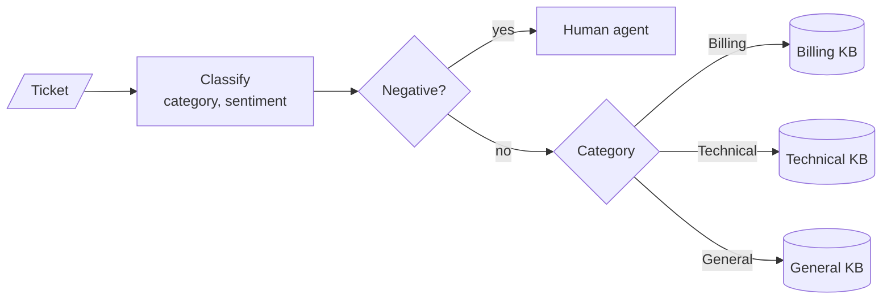

<!-- Generated by site/scripts/rag-theory-import.mjs from rag-agents-engineering. Edit the source there. -->
# M30 Theory: Adaptive RAG and query routing

A plain RAG pipeline sends every question down the same path. An adaptive one decides first: which knowledge base to search, whether to search the web instead, whether a person should take over, and how much retrieval work the question deserves. The M30 notebooks build on four ideas: classifying the query into a closed set of labels, routing each label to its own knowledge base, escalating to a human, and choosing a retrieval strategy per query type.

The running example is the Larkspur Cloud support desk. The twelve handbook chunks from [M11](../../p04_rag_foundations/m11_rag_lifecycle/00_overview.md) are split into the three knowledge bases the 01a notebook routes between: billing (five chunks), technical (four) and general (three). The lab routes eighteen support tickets, each labelled with the knowledge base that holds its answer, such as *Why was I billed twice this month?* (billing) and *How long do you keep my data after I cancel?* (general).

## In short

- A router is a classifier in front of retrieval. In the notebooks it is one LLM call with structured output that must return a label from a fixed set (`Literal['Technical', 'Billing', 'General']`), and the label becomes a metadata filter or a branch in a LangGraph graph.
- A misroute hides the answer: the filter restricts retrieval to a knowledge base that does not hold it. In the lab, a router that always picks sends 15 of 18 tickets to the right knowledge base at one search each. A score floor of 0.42 removes all 3 misroutes, but 11 tickets then fall back to searching all three knowledge bases, 2.22 searches per ticket.
- Escalation is checked before the category. A negative ticket goes to a person whatever it is about; the healthcare notebook adds a fourth sentiment, Distress, that goes to an on-call team.
- Adaptive RAG routes between the vector store and the web, then checks twice: a document grader sends the question to the web when half or fewer chunks pass, and a hallucination grader sends an unsupported answer back for regeneration.
- A strategy per query type spends LLM calls where the question needs them. In the 04a notebook a factual or contextual question costs up to 11 LLM calls and an analytical or opinion question 4.

## Mental model

The router decides what retrieval is allowed to see. Each knowledge base then retrieves and the model answers from what came back. Grading and generation work only with what the chosen path returns, so a misroute surfaces as a confident wrong answer or an apology, never as an error.

## Interactive lab

[**Routing confidence and the fallback**](/labs/rag/m30_adaptive_rag_routing/kb-router-lab.html): open the file in a browser. Start at floor 0.00 and find the three misroutes in the ledger. Move to 0.01: the ticket that shares no word with any chunk falls back, and the cost rises only to 1.11 searches per ticket. Then push the floor to 0.42 to catch the last misroute, and read what it costs: 11 of 18 tickets now search all three knowledge bases.

## How it connects

- **Before:** [M18](../../p06_retrieval_quality/m18_query_transformation/00_overview.md) introduced logical and semantic routing and metadata filters built from the question; this module puts a router at the front of a whole graph. [M10](../../p03_langchain_and_langgraph/m10_langgraph_runtime/00_overview.md) covers checkpointers and interrupts, which a production escalation path needs. [M28](../m28_retrieval_grading_rewriting/00_overview.md) and [M29](../m29_crag_and_self_rag/00_overview.md) built the document grader and the hallucination check that lesson 30.3 combines with routing. The lab reuses the handbook and the TF-IDF index of [M11](../../p04_rag_foundations/m11_rag_lifecycle/00_overview.md).
- **Next:** [M31](../m31_rag_as_agent_tool/00_overview.md) hands retrieval to an agent as one tool among many, so the agent's choice of tool becomes the router. [M32](../m32_reliability_feedback/00_overview.md) covers source attribution, unsupported-answer detection and feedback loops for systems like these.

## Key Takeaways

- Give the router a closed label set in its output schema, and normalise the label before it becomes a filter.
- Plan for the misroute. A score floor with an unfiltered fallback catches routes with no signal cheaply; confident misroutes only show up on a labelled routing set.
- Check escalation before the category, and make the handoff a pause with saved state rather than a node that blocks while it waits.
- Every grader loop needs a counter, and every query type should spend only the LLM calls its question needs.
