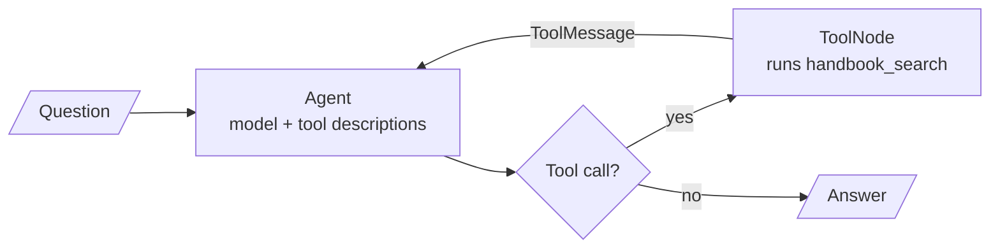

<!-- Generated by site/scripts/rag-theory-import.mjs from rag-agents-engineering. Edit the source there. -->
# M31 Theory: RAG as an agent tool

In [M28](../m28_retrieval_grading_rewriting/00_overview.md) to [M30](../m30_adaptive_rag_routing/00_overview.md) the graph decides when to retrieve: a grader, a router or a fixed edge sends every question down a path someone drew in advance. In M31 retrieval becomes one tool among several, and the model decides whether to call it and what query to send. The M31 notebooks build on four ideas: the agent deciding when to retrieve, the tool description as the only thing it knows about the retriever, managed platforms that run the whole RAG pipeline as a service, and the chat UI that puts an agent in front of users.

The running example is the Larkspur Cloud support agent. It has two tools: `handbook_search`, a retriever over the handbook from [M11](../../p04_rag_foundations/m11_rag_lifecycle/00_overview.md) to [M13](../../p05_ingestion_and_indexing/m13_chunking/00_overview.md), and `web_search` for everything outside Larkspur. The lab routes twenty mixed questions between them, ten about the handbook (*How long does a refund take?*, *Can I export my data after I cancel my plan?*), six for the web (*What does Hetzner charge for a 4 GB server?*) and four that need no tool at all (*What is 15% of 240?*).

## In short

- As a tool, retrieval runs inside a loop: the agent node calls the model, the model may reply with a tool call, `ToolNode` runs the retriever, and the chunks go back to the model as a `ToolMessage`. The loop ends when the model replies without a tool call.
- All the model knows about a tool is its name, its description and its argument schema. In the lab, where TF-IDF stands in for the model, two tools both described as "Search tool." route 4 of 20 questions correctly, and only the four that needed no tool; specific descriptions route 15 of 20.
- Tune descriptions like any retrieval setting: on a golden set, then on questions held out from it. Fitted to the lab's twenty questions they route 19 of 20 and 4 of 5 held-out questions, and they cost 133 tokens on every model call instead of 84.
- A managed RAG platform (Contextual AI in lesson 31.2) runs the datastore, parser, reranker and grounded generator behind one API. The agent can call the whole platform as a single tool, so swapping it in leaves the agent loop unchanged.
- A chat UI adds sessions, settings and visible tool steps. State such as the index and the agent belongs to the user's session, not to module globals.

## Mental model

Retrieval sits inside the loop, so the model decides whether it runs, how often, and with which query. A question that never triggers a tool call is answered from the model's weights, with no handbook text in front of it. The quality of the retriever matters only for questions the model sends to it.

## Interactive lab

[**Tool descriptions and routing**](/labs/rag/m31_rag_as_agent_tool/tool-routing-lab.html): open the file in a browser. Start on **Names only** and see all sixteen handbook and web questions get no tool. Switch to **Specific** and find the one question sent to the wrong tool, then add the word "refund" to the `handbook_search` description and watch *How long does a refund take?* move and the score reach 16 of 20. Finish on **Tuned** and compare its golden-set score with its held-out score.

## How it connects

- **Before:** [M23](../../p08_agent_foundations/m23_agent_loop_and_tools/00_overview.md) and [M24](../../p08_agent_foundations/m24_react_agents/00_overview.md) teach tool calling and the ReAct loop this module puts a retriever into. [M28](../m28_retrieval_grading_rewriting/00_overview.md) to [M30](../m30_adaptive_rag_routing/00_overview.md) make the retrieval decision inside a fixed graph; here the model makes it. [M11](../../p04_rag_foundations/m11_rag_lifecycle/00_overview.md) gives the retriever and the golden-set habit the lab reuses.
- **Next:** [M32](../m32_reliability_feedback/00_overview.md) checks whether an answer is supported by what was retrieved. [M33](../../p10_memory_and_multi_agent/m33_conversational_memory_rag/00_overview.md) adds conversation memory to the chat. [M40](../../p11_agent_protocols/m40_mcp_applications/00_overview.md) exposes retrieval as a tool over MCP, so any agent can call it.

## Key Takeaways

- An agent retrieves only when the model calls the tool. Measure how often it does on questions that need the handbook, and how often it does not.
- Write each tool description for the model: what it searches, the topics in users' words, and where it stops and the neighbouring tool starts. Keep it short, because it is sent on every call.
- Tune descriptions against a routing golden set and score them on held-out questions too, as you would any retrieval setting.
- A managed platform or a chat UI changes what sits behind or in front of the tool, not the loop. Keep the tool's name, description and arguments stable across both.
