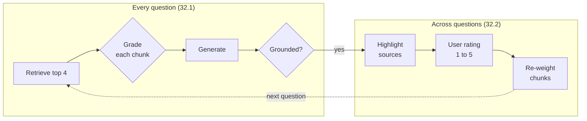

<!-- Generated by site/scripts/rag-theory-import.mjs from rag-agents-engineering. Edit the source there. -->
# M32 Theory: Reliability, Feedback Loops & Diversity

A RAG pipeline returns an answer whether or not the chunks behind it were relevant, whether or not the answer stays inside them, and whether or not the reader can check it. M32 adds a check for each of those, then lets user ratings reorder retrieval, then makes sure the chunks the model reads are not copies of each other. The M32 notebooks build on four ideas: catching an answer the retrieved chunks do not support, showing the exact passages an answer used, the difference between ratings users give and signals they leave, and choosing chunks that are relevant without repeating each other.

The running example is the Larkspur Cloud handbook from [M11](../../p04_rag_foundations/m11_rag_lifecycle/00_overview.md): the same twelve chunks and the same TF-IDF index as the [M11 top-k lab](../../p04_rag_foundations/m11_rag_lifecycle/02_indexing_from_scratch_with_tf_idf_and_nearest_neighbours.md#lesson-top-k). The golden set keeps [M11](../../p04_rag_foundations/m11_rag_lifecycle/00_overview.md)'s three questions and adds two: *Is there a credit if my server plan has an outage?*, whose evidence ranks third, and *Can I still use my server after I cancel the plan?*, whose top answer carries an unrelated chunk along with the right one.

## In short

- `01a` wraps generation in two LLM graders: one answers yes or no for each retrieved chunk before generation, the other answers yes or no for whether the answer is grounded in the kept chunks. Both run `llama-3.1-8b-instant` on Groq at temperature 0 with structured output.
- Source highlighting asks the model for verbatim segments of the chunks it used. Nothing in the parser enforces "verbatim", so check every segment against its chunk in code.
- `02a` re-ranks with `relevance_score *= average rating / 3`, which keeps every chunk between 0.333 and 1.667. In the lab, 100 rated answers lift mean recall@2 on the golden set from 0.50 to 0.70, the order stops changing after event 8, and 40 of the 41 wrong answers go to two questions whose evidence the retriever never returns.
- A thumbs-up or thumbs-down on the answer lands on every chunk in it. In the lab an unrelated chunk rides a good answer up to 1.667, and an evidence chunk is pushed down to 0.333 next to the distractor it was served with.
- With the handbook stored five times, plain top-3 for the export question returns the `export` chunk three times. The notebook's dartboard search returns `export`, `retention`, `export` at its default oversampling of 3, and `export`, `retention`, `cancel` at 4.

## Mental model

The checks in the top row act on one answer and can only remove: a grader drops a chunk or rejects an answer, and neither can add the chunk that was missing. The loop in the bottom row acts across many answers and can only reorder the chunks retrieval already returns. A missing chunk is a retrieval problem in both rows, and the fixes for it sit in [M14](../../p05_ingestion_and_indexing/m14_embeddings/00_overview.md) to [M19](../../p06_retrieval_quality/m19_reranking_post_retrieval/00_overview.md).

## Interactive lab

[**The feedback flywheel**](/labs/rag/m32_reliability_feedback/feedback-flywheel-lab.html): open the file in a browser. Pick *Is there a credit if my server plan has an outage?* and move the slider from 3 to 4 events: one thumbs-down drops `sizing` and `reboot` to 0.333 and the evidence chunk `sla` moves into the answer. Then slide to 100 and pick *How long does a refund take?*: 20 wrong answers, and no rating reaches `refund-timing`. Last, pick *Can I still use my server after I cancel the plan?* and switch between the two signals to watch `sizing` go from 1.667 to 0.333.

## How it connects

- **Before:** [M11](../../p04_rag_foundations/m11_rag_lifecycle/00_overview.md) supplies the golden set and the baseline this module's lab reports against. [M28](../m28_retrieval_grading_rewriting/00_overview.md) introduced the document grader that 32.1 reuses, and [M29](../m29_crag_and_self_rag/00_overview.md) the groundedness check. [M17](../../p06_retrieval_quality/m17_retrievers_hybrid_search/00_overview.md) taught MMR, the older answer to the problem Dartboard solves, and [M19](../../p06_retrieval_quality/m19_reranking_post_retrieval/00_overview.md) the cross-encoder reranker, a second way to reorder the same candidates.
- **Next:** [M33](../../p10_memory_and_multi_agent/m33_conversational_memory_rag/00_overview.md) adds conversation memory, where feedback and grading have to handle follow-up questions that only make sense with the turns before them.

## Key Takeaways

- Graders filter and verify; they never add evidence. When every chunk is graded irrelevant or the answer is not grounded, rewrite the query or abstain instead of answering anyway.
- Check source highlights in code: every segment must be found in the chunk it claims to come from.
- Feedback re-ranking moves only chunks that were shown. Read its result per question, and send questions it cannot fix to retrieval work.
- Remove duplicate chunks at indexing time, then use a diversity-aware selector with a candidate pool larger than the number of copies.
