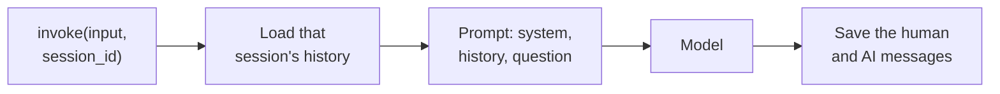

<!-- Generated by site/scripts/rag-theory-import.mjs from rag-agents-engineering. Edit the source there. -->
# lesson 2 of T10.1 Theory: RunnableWithMessageHistory, multi-user sessions and persistence

## One history per session

Two Larkspur customers use the same chat service. You will load history by session, map the wrapper input and output keys, and restart the chain to test whether memory is in Python or the database.

### Step 1: Load exactly one session history

`RunnableWithMessageHistory` does the load and save of lesson 1 of T10.1 around any runnable. You give it the chain and a factory, `get_session_history(session_id)`, that returns the history for one conversation. Every call then carries the id in its config:

Implementation excerpt from the configured application. The practice material supplies its models, data and session setup:

```text
chain_with_history.invoke({"query": "Which plan am I on?"},
                          config={"configurable": {"session_id": "cust-4821"}})
```



### Step 2: Map the history placeholder and saved answer

Two keys tell the wrapper where things go when the chain takes a dict. `input_messages_key` names the input that holds the new message (it is saved after the call), and `history_messages_key` names the `MessagesPlaceholder` that receives the stored history. The model then receives the system message, the history at the placeholder and the new question, in that order. A chain that returns a dict, like the retrieval chain of lesson 4 of T10.1, also needs `output_messages_key` to say which output to save as the AI message.

### Step 3: Keep the session identifier server-controlled

The `session_id` is the only thing that separates one customer's conversation from another's. In the recorded example, two users talk to the same chain with their turns interleaved, and each one's *Summarise what we discussed* sees only their own messages; a new `session_id` starts empty. Any string works: a user id, a chat id, or both combined, so one customer can hold several separate chats. Because whoever supplies the id chooses which history loads, take it from the authenticated session on the server, never from text the user can edit.

## Where the history lives

### Step 1: Test persistence after a new process

Only the factory changes when the store changes. The chain and the wrapper stay the same.

| Backend | Survives a restart | Many users | Typical use |
|---|---|---|---|
| `InMemoryChatMessageHistory` in a dict | No | Yes, one per key | Tests and notebooks |
| `FileChatMessageHistory` | Yes | One JSON file per session | Single-user CLI or desktop tools |
| `SQLChatMessageHistory` | Yes | Yes, one table keyed by `session_id` | Web apps and services |

### Step 2: Restart the chain without deleting the records

The example proves the database does the remembering. Run 1 stores a user's preferences through one chain and deletes the chain object; four rows sit in the `message_store` table. Run 2 builds a brand-new chain with no Python-side state, and it still answers *What's my name?* from those rows. Pass the database URL by keyword, `SQLChatMessageHistory(session_id=..., connection="sqlite:///x.db")`: the second positional argument is `table_name`, so the positional form creates no connection and fails only when invoked.

SQLite is fine for one process. For a service with concurrent writers, use the same interface on Postgres or Redis. These classes come from `langchain-community`, and `RunnableWithMessageHistory` is deprecated in `langchain-core`; lesson 6 of T10.1 does the same job with a LangGraph checkpointer, which is where new code should go.

### Try it yourself

Interleave two sessions and ask each to summarise its conversation. Check that each sees only its own messages. Recreate the chain against the same SQLite history and repeat the recall question. Use connection= for the database URL. The second positional parameter names the table.

### Practice notebook

Run the complete implementation from the practice material after checking the trace or calculation above. Use its stated environment for live model or server calls; recorded model choices and timings are observations, not guaranteed outputs.

- [Runnable with message history](https://github.com/Sourav692/rag-agents-engineering/blob/main/p09_memory_layer/m33_short_term_memory_conversation_state/mandatory/notebook/02a_runnable_with_message_history.ipynb).
- [Multi user sessions and](https://github.com/Sourav692/rag-agents-engineering/blob/main/p09_memory_layer/m33_short_term_memory_conversation_state/mandatory/notebook/02b_multi_user_sessions_and_persistence.ipynb).

## Run the notebooks

The code for this lesson is in these notebooks. Colab runs one in your browser: install the packages its first cell imports and set the API keys it reads. To run every notebook as written, clone the repository and use its uv environment.

| Notebook | GitHub | Colab |
|---|---|---|
| Runnable with message history | [Open on GitHub](https://github.com/Sourav692/rag-agents-engineering/blob/main/p09_memory_layer/m33_short_term_memory_conversation_state/mandatory/notebook/02a_runnable_with_message_history.ipynb) | [Open in Colab](https://colab.research.google.com/github/Sourav692/rag-agents-engineering/blob/main/p09_memory_layer/m33_short_term_memory_conversation_state/mandatory/notebook/02a_runnable_with_message_history.ipynb) |
| Multi user sessions and persistence | [Open on GitHub](https://github.com/Sourav692/rag-agents-engineering/blob/main/p09_memory_layer/m33_short_term_memory_conversation_state/mandatory/notebook/02b_multi_user_sessions_and_persistence.ipynb) | [Open in Colab](https://colab.research.google.com/github/Sourav692/rag-agents-engineering/blob/main/p09_memory_layer/m33_short_term_memory_conversation_state/mandatory/notebook/02b_multi_user_sessions_and_persistence.ipynb) |

## Key Takeaways

- `RunnableWithMessageHistory` loads and saves history around any runnable, and the `session_id` in the call's config alone separates conversations. Take that id from the authenticated server session, never from text the user can edit.
- Changing the store means changing only the factory. Use an in-memory dict for tests, one file per session for single-user tools, and SQL, Postgres or Redis for services that must survive restarts.
- Pass the database URL to `SQLChatMessageHistory` by keyword, because the second positional argument is `table_name`. Put new code on a LangGraph checkpointer, since `RunnableWithMessageHistory` is deprecated.

## Check yourself

<details>
<summary>1. Two customers send interleaved turns to the same chain wrapped in RunnableWithMessageHistory. What keeps their conversations apart?</summary>

The `session_id` in each call's config. The wrapper passes it to `get_session_history(session_id)`, which returns that conversation's history, loads it before the call and saves the new messages after it. A new `session_id` starts empty, so each customer's summary sees only their own turns.

</details>

<details>
<summary>2. A notebook prototype keeps histories in a dict of InMemoryChatMessageHistory. It must now serve a web app and survive restarts. What do you change?</summary>

Only the factory: return `SQLChatMessageHistory` keyed by `session_id`, and the chain and wrapper stay the same. The in-memory store loses everything on restart. For a service with concurrent writers, use the same interface on Postgres or Redis rather than SQLite.

</details>

<details>
<summary>3. SQLChatMessageHistory(session_id, "sqlite:///x.db") builds without complaint but fails on the first invoke. What went wrong?</summary>

The second positional argument is `table_name`, not the connection, so this form creates no database connection and fails only when invoked. Pass the URL by keyword: `SQLChatMessageHistory(session_id=..., connection="sqlite:///x.db")`.

</details>
