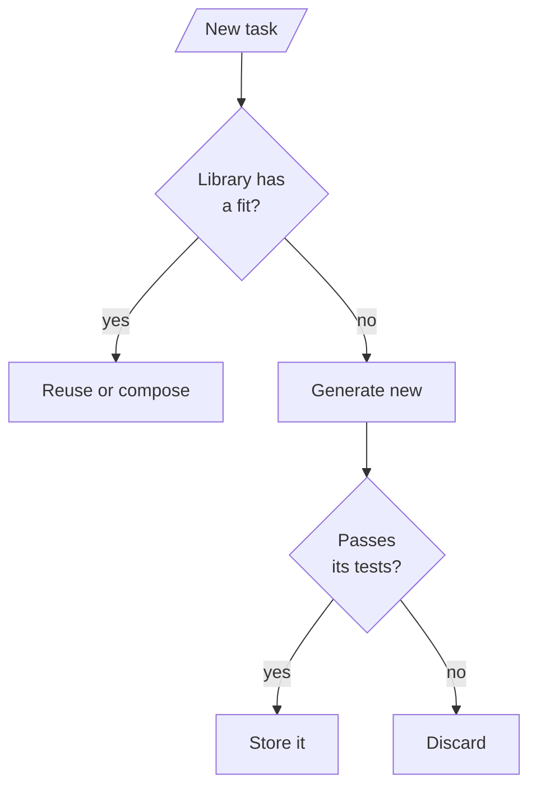
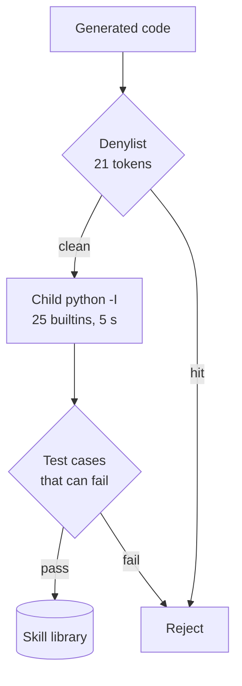
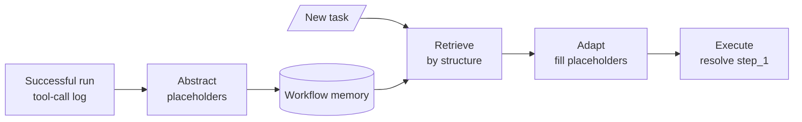

<!-- Generated by site/scripts/rag-theory-import.mjs from rag-agents-engineering. Edit the source there. -->
# lesson 5 of T10.2 Theory: MemGPT tiers, Voyager skill library, Agent Workflow Memory

<!-- subtitle: An agent that pages its own context, and agents that remember what worked as code or as tool-call templates -->
<!-- format: approved -->

## Start with a refund rule that needs two old numbers

> **What you'll learn**
>
> - **Explain** how MemGPT splits memory into an always-visible core, a message window and a searchable archive.
> - **Measure** what a bigger window costs per call against what it keeps in view, using the lab's numbers.
> - **Diagnose** an archived fact that never comes back because of the words in the agent's own query.
> - **Compare** remembering facts with remembering skills (Voyager) and workflows (Agent Workflow Memory).

Lessons 1 to 4 of T10.2 decided in code what to remember and when to read it. This lesson hands part of that decision to the agent, then looks at memories that are capabilities rather than facts.

Dana opens a Larkspur chat by saying her shop is on an annual business plan. In her second message she adds that they bought it 12 days ago and have used 80 GB of outbound traffic. Three unrelated questions later she asks whether she can still get a full refund. The handbook's rule needs both numbers: a full refund within 30 days of purchase if the account used less than 100 GB. By then the traffic message has scrolled out of a short context window.

## Tiered memory

MemGPT (Packer et al., 2023; the framework is now called Letta) treats the context window the way an operating system treats RAM. A small **main context** is always in the prompt. An unbounded **archival memory** sits outside it, like disk. The agent moves information between the two with tools, so the agent decides what stays close, where the earlier lessons used a fixed rule:

| Tier | Holds | In the prompt? | In the notebook |
|---|---|---|---|
| Core memory | A few durable facts, in named blocks (`persona`, `human`) | Always | A dict, edited by tools |
| Message window | The last N messages | Always | A list capped at `max_messages = 6` |
| Archival memory | Evicted messages and anything inserted on purpose | Only what a search returns | A list with a keyword-overlap search, top 3 |

*Table 1: MemGPT's three tiers as the notebook implements them.*

The model gets four tools. Two edit core memory (`core_memory_append`, `core_memory_replace`), and two move things to and from the archive (`archival_memory_insert`, `archival_memory_search`). Every turn rebuilds the system prompt from the current core memory, runs any tool calls for at most `MAX_TOOL_ROUNDS = 5` rounds, and then appends the answer to the window, which evicts the oldest messages once the window is full:

```animated
<figure class="anim sheet" aria-labelledby="anim-paging-cap">
  <div class="anim__canvas" tabindex="0" aria-label="Paging messages to the archive, scrolls sideways on a narrow screen">
    <svg viewBox="0 0 800 352" role="img" aria-labelledby="anim-paging-title anim-paging-desc">
      <title id="anim-paging-title">Paging messages out and searching them back</title>
      <desc id="anim-paging-desc">Eleven messages arrive over six turns. Core memory keeps the customer’s plan. When the sixth turn arrives the window keeps the last six messages and pages five out to the archive, including the turn-2 message with 12 days and 80 GB. The model searches the archive for outbound traffic, gets that message back at rank 1, and can answer the refund question.</desc>
      <defs>
        <marker id="ah-paging" viewBox="0 0 8 8" refX="7" refY="4" markerWidth="8" markerHeight="8" markerUnits="userSpaceOnUse" orient="auto-start-reverse"><path class="ah" d="M0 0 L8 4 L0 8 z"/></marker>
      </defs>

      <text class="lane-label" x="16" y="20">The conversation, oldest first (c customer, a agent)</text>
      <rect class="lane" x="8" y="28" width="784" height="136"/>
      <text class="lane-label" x="16" y="200">Each call</text>
      <rect class="lane" x="8" y="208" width="784" height="136"/>
      <g class="in-1">
        <rect class="doc" x="24" y="60" width="60" height="36"/><text class="fig" x="54" y="78">c1</text>
        <rect class="doc" x="92" y="60" width="60" height="36"/><text class="fig" x="122" y="78">a1</text>
        <rect class="doc" x="160" y="60" width="60" height="36"/><text class="fig" x="190" y="78">c2</text>
        <rect class="doc" x="228" y="60" width="60" height="36"/><text class="fig" x="258" y="78">a2</text>
      </g>
      <g class="in-2">
        <rect class="doc" x="296" y="60" width="60" height="36"/><text class="fig" x="326" y="78">c3</text>
        <rect class="doc" x="364" y="60" width="60" height="36"/><text class="fig" x="394" y="78">a3</text>
        <rect class="doc" x="432" y="60" width="60" height="36"/><text class="fig" x="462" y="78">c4</text>
        <rect class="doc" x="500" y="60" width="60" height="36"/><text class="fig" x="530" y="78">a4</text>
        <rect class="doc" x="568" y="60" width="60" height="36"/><text class="fig" x="598" y="78">c5</text>
        <rect class="doc" x="636" y="60" width="60" height="36"/><text class="fig" x="666" y="78">a5</text>
      </g>
      <g class="in-3">
        <rect class="doc" x="704" y="60" width="60" height="36"/><text class="fig" x="734" y="78">c6</text>
        <rect class="box" x="20" y="54" width="340" height="48"/><text class="small" x="190" y="78">paged out</text>
        <path class="hit-line" d="M360 48 H770 M360 48 V56 M770 48 V56"/>
        <text class="small" x="565" y="124">window: the last 6 messages</text>
      </g>
      <g class="in-1"><text class="small" x="190" y="124">c2: 12 days, 80 GB</text></g>
      <g class="n-1"><rect class="box" x="24" y="236" width="180" height="64"/><text class="label" x="114" y="256">Core memory</text></g>
      <g class="in-1"><text class="small" x="114" y="282">annual business plan</text></g>
      <g class="n-3"><rect class="box" x="244" y="236" width="150" height="64"/><text class="label" x="319" y="256">Prompt</text><text class="small" x="319" y="282">core + window</text></g>
      <g class="n-4 n-6"><rect class="box" x="434" y="236" width="150" height="64"/><text class="label" x="509" y="256">Model</text></g>
      <path class="edge e-3" d="M204 268 H241" marker-end="url(#ah-paging)"/>
      <path class="edge e-3 in-3" d="M565 104 C565 170 319 170 319 233" marker-end="url(#ah-paging)"/>
      <path class="edge e-3" d="M394 268 H431" marker-end="url(#ah-paging)"/>

      <g class="n-3 n-5">
        <path class="box" d="M626 238 a77 10 0 0 0 154 0 v84 a77 10 0 0 1 -154 0 z"/>
        <ellipse class="box" cx="703" cy="238" rx="77" ry="10"/>
        <text class="label" x="703" y="262">Archive</text>
      </g>
      <path class="edge e-4" d="M584 256 H623" marker-end="url(#ah-paging)"/>
      <path class="edge e-5" d="M626 288 H587" marker-end="url(#ah-paging)"/>
      <rect class="chunk mv-3" style="--from: translate(-607px, -230px)" x="631" y="290" width="26" height="14"/>
      <rect class="chunk mv-3" style="--from: translate(-569px, -230px)" x="661" y="290" width="26" height="14"/>
      <rect class="chunk mv-3" style="--from: translate(-531px, -230px)" x="691" y="290" width="26" height="14"/>
      <rect class="chunk mv-3" style="--from: translate(-493px, -230px)" x="721" y="290" width="26" height="14"/>
      <rect class="chunk mv-3" style="--from: translate(-455px, -230px)" x="751" y="290" width="26" height="14"/>
      <g class="in-5"><rect class="hit" x="691" y="290" width="26" height="14"/><text class="fig" x="704" y="318">c2, rank 1</text></g>

      <g class="in-4"><text class="fig" x="509" y="324">“outbound traffic”</text></g>
      <g class="in-6"><text class="small" x="509" y="282">30 days, 100 GB</text></g>

      <circle class="tok" cx="0" cy="0" r="7"/>
    </svg>
  </div>
  <div class="anim__controls" hidden>
    <button class="anim__btn" type="button" data-act="prev">Previous</button>
    <button class="anim__btn" type="button" data-act="play" aria-pressed="false">Play</button>
    <button class="anim__btn" type="button" data-act="next">Next</button>
  </div>
  <ol class="anim__steps" id="anim-paging-cap">
    <li><button type="button" data-tok="114,226">Facts</button><span>Dana states her plan, and the model appends it to core memory. Turn 2 says 12 days and 80 GB of outbound traffic.</span></li>
    <li><button type="button" data-tok="462,40">Filler</button><span>Three unrelated questions bring the conversation to 10 messages.</span></li>
    <li><button type="button" data-tok="565,40">Evict</button><span>Turn 6 arrives. The window keeps the last 6 messages and pages the 5 oldest out to the archive, the turn-2 message with them.</span></li>
    <li><button type="button" data-tok="604,236">Search</button><span>The model calls archival_memory_search with the query “outbound traffic”.</span></li>
    <li><button type="button" data-tok="704,274">Recall</button><span>The turn-2 message comes back at rank 1, sharing 2 words with the query.</span></li>
    <li><button type="button" data-tok="509,226">Answer</button><span>With 12 days and 80 GB back in context, the model can apply the handbook rule: a full refund within 30 days if under 100 GB.</span></li>
  </ol>
</figure>
```

*Figure 1: Paging. Overflow moves the oldest messages to the archive, and only a search the model makes brings them back.*

The notebook runs the same pattern on a trip planner whose $2,500 budget is evicted before a sixth turn asks for it. Its system prompt has to keep one-off details out of core memory: without that rule gpt-4o-mini tends to store every detail there, and the archive stops mattering.

### The window is a budget

The lab replays Dana's six turns through the notebook's own window and archive classes, ported to JavaScript. We checked the port against the Python classes on every window size from 1 to 12 and 97 queries (1,176 comparisons, 0 mismatches). Pick a window size to see the conversation at turn 6:

<div class="learning-widget evidence-switcher" data-comparison id="window-switcher">
<p class="widget-intro">Pick a window size and see what the model holds at turn 6. Tokens are characters of core memory plus the window, divided by four.</p>
<div class="mode-controls" hidden role="group" aria-label="Window size">
<button type="button" data-mode="w1" aria-pressed="false" aria-controls="window-w1">1 message</button>
<button type="button" data-mode="w6" aria-pressed="false" aria-controls="window-w6">6, the notebook's</button>
<button type="button" data-mode="w9" aria-pressed="false" aria-controls="window-w9">9 messages</button>
<button type="button" data-mode="w11" aria-pressed="false" aria-controls="window-w11">11 or more</button>
</div>
<section id="window-w1" class="mode-panel" data-announcement="Window of 1 selected. Turn-2 message archived, about 44 tokens."><h4>Window of 1</h4><ul><li>1 message in view, 10 archived, about 44 tokens per call.</li><li>The turn-2 traffic message is archived.</li></ul></section>
<section id="window-w6" class="mode-panel" data-announcement="Window of 6 selected. Turn-2 message archived, about 117 tokens."><h4>Window of 6, the notebook's setting</h4><ul><li>6 messages in view, 5 archived, about 117 tokens per call.</li><li>The turn-2 traffic message is archived; only a search brings it back.</li></ul></section>
<section id="window-w9" class="mode-panel" data-announcement="Window of 9 selected. Turn-2 message in view, about 156 tokens."><h4>Window of 9</h4><ul><li>9 messages in view, 2 archived, about 156 tokens per call.</li><li>The turn-2 message is in view: 39 more tokens than a window of 6, paid on every call whether or not the question needs it.</li></ul></section>
<section id="window-w11" class="mode-panel" data-announcement="Window of 11 or more selected. Nothing archived, about 195 tokens."><h4>Window of 11 or more</h4><ul><li>All 11 messages in view, none archived, about 195 tokens per call.</li><li>No paging at all, and the bill grows with every turn.</li></ul></section>
<p class="switch-status" aria-live="polite"></p>
</div>

### Recall depends on the query

At a window of 6 the traffic message is in the archive, and the answer depends on a search the model must decide to make and on the words it chooses. The notebook's search lower-cases both sides, splits on spaces and counts shared words, so punctuation stays attached:

| Query the agent sends | Turn-2 message | Why |
|---|---|---|
| `outbound traffic` | Rank 1 | Shares 2 words |
| `refund annual plan` | Rank 3 of 3 | Shares only `plan`; both turn-1 messages also score 1, on `annual`, and come first |
| `how much traffic?` | Missed | `traffic?` is not `traffic`; the search returns "How do I reboot a server?" on `how` |
| `data usage this month` | Missed | No shared word at all |

*Table 2: Four archive queries at a window of 6, from the lab.*

We call the last two rows the **wrong-words miss**: the fact is stored, the agent searched, and the answer still lacks it. Open the [tiered memory lab](/labs/rag/m34_long_term_agentic_memory/tiered-memory-lab.html), set the window to 6 and switch between `outbound traffic` and `how much traffic?`, then slide the window to 9:

```lab
src: /labs/rag/m34_long_term_agentic_memory/tiered-memory-lab.html
title: The window and the archive
```

### Three costs of letting the agent page

- **The window is paid on every call.** A bigger window removes the search at the price of tokens on every turn.
- **Recall depends on the agent asking.** The notebook checks in code whether the model called `archival_memory_search` in turn 6. If it did not, the answer comes without the figure, a failure we call the **unasked search**.
- **The search is part of memory quality.** Keyword overlap keeps punctuation and ties easily. A real system embeds archive entries and searches by meaning, the same retrieval choices as any RAG index ([T5.4](../../p04_rag_foundations/m13_embeddings/00_overview.md)).

For Dana, that becomes four settings: keep "annual business plan" in core memory, size the window from cost, log whether a question about past numbers called the archive search, and embed archive entries so `how much traffic?` finds the 80 GB message.

## Skill library

Tiers remember facts and events. A **skill library** stores capabilities that worked: code in Voyager, tool-call sequences in Agent Workflow Memory. Both follow one loop: look in the library first, build something new only when nothing fits, check it, and store only what passed:



*Figure 2: The skill-library loop shared by Voyager and Agent Workflow Memory.*

### Voyager: executable skills behind tests

Voyager (Wang et al., 2023) played Minecraft without fine-tuning by saving each working piece of code as a named skill. The notebook moves the idea to small Python text tasks and puts every candidate through the same gate:



*Figure 3: Voyager's store path in the notebook. Only code that clears the screen and its tests is saved.*

The library starts with two seeds, `count_vowels` and `reverse_string`. Step through the four tasks. A live model makes each decision; the stages show what the notebook expects:

<div class="walkthrough learning-widget" data-stepper id="voyager-walkthrough">
<p class="widget-intro">Follow the notebook's four tasks through the library check. Each stage shows the decision and what gets stored.</p>
<div class="step-controls" hidden role="group" aria-label="Voyager tasks"><button type="button" data-step="0" aria-pressed="false" aria-controls="voyager-step-0">1. Uppercase</button><button type="button" data-step="1" aria-pressed="false" aria-controls="voyager-step-1">2. Whitespace</button><button type="button" data-step="2" aria-pressed="false" aria-controls="voyager-step-2">3. Compose</button><button type="button" data-step="3" aria-pressed="false" aria-controls="voyager-step-3">4. Palindrome</button></div>
<div class="step-panels"><section id="voyager-step-0" class="step-panel" aria-labelledby="voyager-heading-0"><h4 id="voyager-heading-0">1. Count uppercase letters</h4><dl><dt>Library decision</dt><dd>No fit among the two seeds</dd><dt>What happens</dt><dd>A new skill is generated, passes 3 tests and is stored as the third skill</dd></dl></section><section id="voyager-step-1" class="step-panel" aria-labelledby="voyager-heading-1"><h4 id="voyager-heading-1">2. Remove all whitespace</h4><dl><dt>Library decision</dt><dd>No fit</dd><dt>What happens</dt><dd>A fourth skill is generated, tested and stored</dd></dl></section><section id="voyager-step-2" class="step-panel" aria-labelledby="voyager-heading-2"><h4 id="voyager-heading-2">3. Remove whitespace, then reverse</h4><dl><dt>Library decision</dt><dd>Reuse two skills</dd><dt>What happens</dt><dd>Task 2's skill is composed with the seeded <code>reverse_string</code>, with no code-generation call; the composition still runs against tests</dd></dl></section><section id="voyager-step-3" class="step-panel" aria-labelledby="voyager-heading-3"><h4 id="voyager-heading-3">4. Palindrome check ignoring case and spaces</h4><dl><dt>Library decision</dt><dd>No fit</dd><dt>What happens</dt><dd>New code that calls library skills inside it</dd><dt>Tests</dt><dd>Mixed answers: "Never odd or even" is True, "Voyager" is False, "Step on no pets" is True, "ab" is False</dd></dl></section></div><div class="step-footer" hidden><button type="button" data-walk="previous">Previous</button><p class="step-status" aria-live="polite"></p><button type="button" data-walk="next">Next step</button></div></div>

The tests must be able to fail. When every expected answer is `True`, a function that always returns `True` passes and the library stores a skill that checks nothing. We call that the **vacuous test**. Run against Task 4's mixed tests, an always-`True` candidate fails on its second case, "Voyager", and the notebook checks that it is rejected.

Generated code is untrusted. The notebook's screen and child process (Figure 3) limit the damage, and the notebook says plainly that a denylist is not a sandbox: code from a model you do not control belongs in a container or a hosted sandbox with no network and no secrets.

### Agent Workflow Memory: templates from successful runs

Agent Workflow Memory (Wang et al., 2024) stores procedures instead of code:



*Figure 4: Workflow memory. Only successful trajectories become templates.*

A small ReAct loop logs every tool call. After a success, a model call turns the trajectory into a template with placeholders: look up `{entity}`, then multiply by `{factor}`. For a new task, one model call picks the structurally similar template, a second fills in the placeholders, and the executor runs the plan, filling `{step_1}` from the first observation. A task with a new shape matches no template and falls back to planning from scratch. Templates can also overfit to the first task's wording, or go stale when the tools change.

The payoff is in the call count: adapting costs a fixed two calls, and planning from scratch costs one per step plus the final answer:

| Steps in the workflow | Adapt a template | Plan from scratch |
|---|---|---|
| 2 (the notebook's lookup-then-scale) | 2 | 3 |
| 5 | 2 | 6 |
| 10 | 2 | 11 |

*Table 3: LLM calls per task, from the notebook's stated call counts. Rows past 2 steps extend its formula.*

### Three kinds of procedural memory

All three store "how to do it", with different writers and checks:

| | Remembers | Written by | Checked by |
|---|---|---|---|
| Procedural memory (lesson 2 of T10.2) | Instructions | A staff proposal | A human, through `interrupt()` |
| Voyager skill library | Python functions | The agent | Test cases that can fail |
| Agent Workflow Memory | Tool-call templates | The agent, after a success | The success of the run it came from |

*Table 4: Procedures, skills and workflows compared.*

Both notebooks retrieve with a model call over a short list, which works at their size. With hundreds of skills or workflows, embed the descriptions and retrieve by similarity, as lesson 4 of T10.2 does for facts.

> **Interview tip:** when asked how an agent remembers, separate what it knows (facts), what happened (episodes) and what it can do (skills and workflows). Each needs its own writer and its own check.

## Limits of this evidence

- **The lab replays code, not a model.** Its customer turns are written for the lab and its assistant replies are representative; the eviction and search are the notebook's own. Whether a live model calls the search, and with which words, is not measured.
- **Tokens are estimated.** Characters divided by four, for conversation text only; a real prompt adds the system prompt and tool schemas.
- **Voyager and workflow runs are not recorded.** Notebooks ship without outputs: the task decisions are what the notebooks expect. Table 3's rows past 2 steps extend the notebook's stated formula.

## References

1. Packer, C. et al. (2023). *MemGPT: Towards LLMs as Operating Systems*. [arXiv:2310.08560](https://arxiv.org/abs/2310.08560).
2. Wang, G. et al. (2023). *Voyager: An Open-Ended Embodied Agent with Large Language Models*. [arXiv:2305.16291](https://arxiv.org/abs/2305.16291).
3. Wang, Z. Z. et al. (2024). *Agent Workflow Memory*. [arXiv:2409.07429](https://arxiv.org/abs/2409.07429).
4. Letta, [documentation](https://docs.letta.com/), the framework MemGPT became.

## Run the notebooks

The code for this lesson is in these notebooks. Colab runs one in your browser: install the packages its first cell imports and set the API keys it reads. To run every notebook as written, clone the repository and use its uv environment.

| Notebook | GitHub | Colab |
|---|---|---|
| Memgpt tiered memory | [Open on GitHub](https://github.com/Sourav692/rag-agents-engineering/blob/main/p09_memory_layer/m34_long_term_agentic_memory/mandatory/notebook/05a_memgpt_tiered_memory.ipynb) | [Open in Colab](https://colab.research.google.com/github/Sourav692/rag-agents-engineering/blob/main/p09_memory_layer/m34_long_term_agentic_memory/mandatory/notebook/05a_memgpt_tiered_memory.ipynb) |
| Voyager skill library (optional) | [Open on GitHub](https://github.com/Sourav692/rag-agents-engineering/blob/main/p09_memory_layer/m34_long_term_agentic_memory/optional/notebook/05b_voyager_skill_library.ipynb) | [Open in Colab](https://colab.research.google.com/github/Sourav692/rag-agents-engineering/blob/main/p09_memory_layer/m34_long_term_agentic_memory/optional/notebook/05b_voyager_skill_library.ipynb) |
| Agent workflow memory (optional) | [Open on GitHub](https://github.com/Sourav692/rag-agents-engineering/blob/main/p09_memory_layer/m34_long_term_agentic_memory/optional/notebook/05c_agent_workflow_memory.ipynb) | [Open in Colab](https://colab.research.google.com/github/Sourav692/rag-agents-engineering/blob/main/p09_memory_layer/m34_long_term_agentic_memory/optional/notebook/05c_agent_workflow_memory.ipynb) |

## Key Takeaways

- MemGPT keeps core memory and a short message window in the prompt and moves everything else to an archive the agent searches with tools. The window is a budget paid on every call: 117 tokens at 6 messages, 156 at 9, in the lab.
- Archived facts come back only if the agent searches, with words that match. At a window of 6, Dana's 80 GB message ranked first for `outbound traffic` and was missed for `how much traffic?` and `data usage this month`.
- Voyager and Agent Workflow Memory store what worked, as code or tool-call templates. Check the library first, store only what passed tests that can fail, and treat generated code as untrusted.

## Check yourself

<details>
<summary>1. In MemGPT-style tiered memory, what has to happen for a message evicted from the window to reach the prompt again?</summary>

The agent has to call `archival_memory_search` with words that match it, and the message returns only among the top 3 results. Core memory is always in the prompt, but the archive appears only through a search the model decides to make. Recall therefore depends on the agent asking, and on the search itself.

</details>

<details>
<summary>2. At a window of 6, Dana's turn-2 traffic message is archived by turn 6. Which lab query ranks it first, and why do some queries miss it?</summary>

`outbound traffic` finds it at rank 1, because it shares two words. `how much traffic?` misses because the keyword overlap keeps punctuation, so `traffic?` is not `traffic`, and `data usage this month` shares no word with it at all. A window of 9 would keep the message in view, at about 156 tokens per call against 117.

</details>

<details>
<summary>3. A Voyager-style agent generates a palindrome check that always returns True. What should keep it out of the skill library?</summary>

Test cases that can fail. The notebook runs every new skill, and every reuse, against tests before it counts, and Task 4's tests include `False` answers. The always-`True` candidate fails on its second case, "Voyager", and is never stored.

</details>
