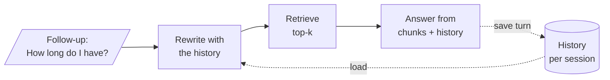

<!-- Generated by site/scripts/rag-theory-import.mjs from rag-agents-engineering. Edit the source there. -->
# M33 Theory: Conversation memory and conversational RAG

A chat model keeps nothing between calls. What looks like memory is the application sending earlier messages back with each new one, and in RAG the retriever needs that history as much as the model does. The M33 notebooks build on four ideas: the message history, the summary that keeps a long history affordable, the history-aware retriever that rewrites a follow-up before searching, and the checkpointer and `thread_id` that give a LangGraph agent the same memory per user.

The running example is the Larkspur Cloud support assistant answering from the same twelve handbook chunks as the [M11 lab](../../p04_rag_foundations/m11_rag_lifecycle/00_overview.md). Customers ask a first question and then follow up: *Can I get a refund on my annual plan?* then *How long until the money is back?*, or *How do I export my data?* then *How long do I have?* The [lab](#lesson-interactive-lab) runs six of these three-turn chats.

## In short

- The model is stateless. Turn N of a chat that keeps everything sends 2N − 1 messages, so six turns send 36 messages in total, and cost grows with every turn.
- A `session_id` (LCEL) or `thread_id` (LangGraph) picks whose history is loaded. The same chain or graph serves every user; the id is the whole isolation story, so it must come from your server, never from the user.
- Bounding a history is a choice between forgetting and paying: a window or a token trim drops early facts for free, and a running summary keeps them in compressed form for one extra LLM call per fold.
- A follow-up such as *How long do I have?* names no subject, so the retriever searches for the wrong thing. In the lab at `k = 1`, sending the latest message finds the evidence on 6 of 12 follow-ups; a rewritten standalone question finds it on 10.
- Appending earlier questions to the query recovers turn 2 (5 of 6) but drowns a change of topic on turn 3 (1 of 6 at `k = 1`). The rewrite costs an LLM call per follow-up and cannot fix a vocabulary mismatch.

## Mental model

One history feeds two consumers. The rewrite step reads it so the retriever searches for the real subject; the answer step reads it so the model can refer back. After the answer, both messages go into the history, keyed by the session, and the next turn starts from there.

## Interactive lab

[**Follow-ups and the retriever**](/labs/rag/m33_conversational_memory_rag/follow-up-retrieval-lab.html): open the file in a browser. Start on *The latest message* at `k = 1` and open the *Exports* chat: turns 2 and 3 both miss. Switch to *Earlier questions + latest* and watch turn 2 recover while turn 3 stays stuck on the export chunk. Then pick *A rewritten question* and compare the three rows of the table, and try `k = 2` to see appending catch up by spending a second slot.

## How it connects

- **Before:** [M08](../../p03_langchain_and_langgraph/m08_lcel_runnables_and_chains/00_overview.md) builds the LCEL chains that `RunnableWithMessageHistory` wraps, and [M10](../../p03_langchain_and_langgraph/m10_langgraph_runtime/00_overview.md) introduces LangGraph checkpointers. The lab reuses the handbook and TF-IDF index from [M11](../../p04_rag_foundations/m11_rag_lifecycle/00_overview.md); the vocabulary misses it shows are the problem [M14](../../p05_ingestion_and_indexing/m14_embeddings/00_overview.md) solves with embeddings, and [M18](../../p06_retrieval_quality/m18_query_transformation/00_overview.md) rewrites single questions the way lesson 33.4 rewrites follow-ups.
- **Next:** [M34](../m34_long_term_agentic_memory/00_overview.md) keeps memory across threads: facts about a user that outlive one conversation. [M37](../m37_multi_agent_builds_deep_agents/00_overview.md) compacts context at agent-harness scale with the summary idea from lesson 33.3.

## Key Takeaways

- Memory is the list of messages you resend. Decide on purpose which ones go back, because every one costs tokens on every later turn.
- Key every history by a session or thread id that your server controls, and choose a store that survives a restart before real users arrive.
- Rewrite follow-ups into standalone questions before retrieval, and measure hit rate on turns 2 and 3, not only on first questions.
- Bound long threads by hiding or summarising old turns rather than deleting them, and test that an early fact still reaches the model late in the thread.
