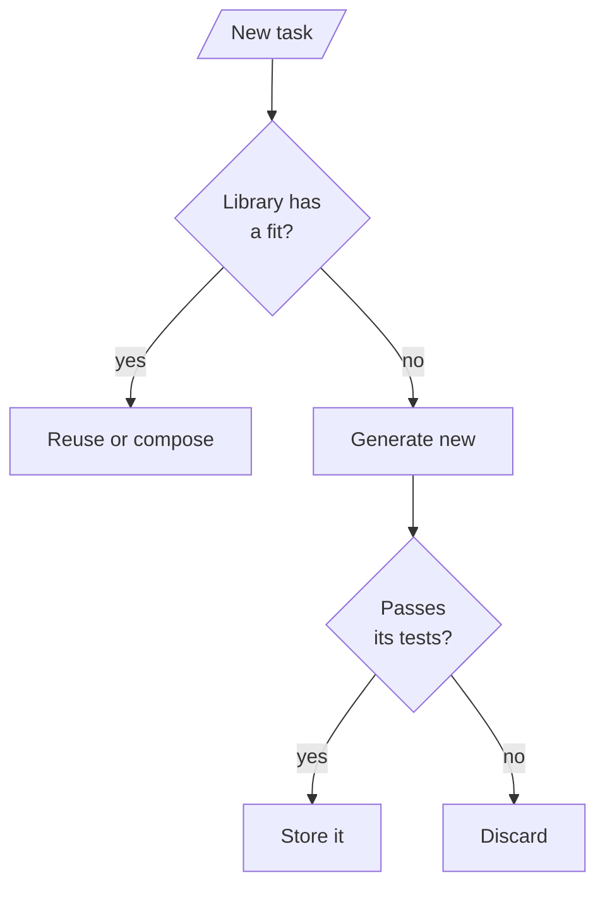

<!-- Generated by site/scripts/rag-theory-import.mjs from rag-agents-engineering. Edit the source there. -->
# M34.5 Theory: MemGPT tiers, Voyager skill library, Agent Workflow Memory

*Notebooks: [`05a_memgpt_tiered_memory.ipynb`](https://github.com/Sourav692/rag-agents-engineering/blob/main/course/p10_memory_and_multi_agent/m34_long_term_agentic_memory/notebooks/05a_memgpt_tiered_memory.ipynb), [`05b_voyager_skill_library.ipynb`](https://github.com/Sourav692/rag-agents-engineering/blob/main/course/p10_memory_and_multi_agent/m34_long_term_agentic_memory/optional/05b_voyager_skill_library.ipynb) (optional), [`05c_agent_workflow_memory.ipynb`](https://github.com/Sourav692/rag-agents-engineering/blob/main/course/p10_memory_and_multi_agent/m34_long_term_agentic_memory/optional/05c_agent_workflow_memory.ipynb) (optional)*

## Tiered memory

MemGPT (Packer et al., 2023, [arXiv:2310.08560](https://arxiv.org/abs/2310.08560); the framework is now Letta) treats the context window like an operating system treats RAM. A small **main context** is always in the prompt; an unbounded **archival memory** sits outside it, like disk. The agent moves information between the two with tools, so the agent decides what stays close, where the earlier lessons used a fixed rule.

| Tier | Holds | In the prompt? | The notebook's version |
|---|---|---|---|
| Core memory | A few durable facts, in named blocks (`persona`, `human`) | Always | A dict, edited by tools |
| Message window | The last N messages | Always | A list capped at `max_messages = 6` |
| Archival memory | Evicted messages and anything inserted on purpose | Only what a search returns | A list with a keyword-overlap search, top 3 |

The model gets four tools: `core_memory_append` and `core_memory_replace` edit core memory, `archival_memory_insert` and `archival_memory_search` move things to and from the archive. Every turn rebuilds the system prompt from the current core memory, runs any tool calls (at most `MAX_TOOL_ROUNDS = 5` rounds), and then appends the answer to the window, which evicts the oldest messages once the window is full.

```animated
<figure class="anim sheet" aria-labelledby="anim-paging-cap">
  <div class="anim__canvas" tabindex="0" aria-label="Paging messages to the archive, scrolls sideways on a narrow screen">
    <svg viewBox="0 0 800 352" role="img" aria-labelledby="anim-paging-title anim-paging-desc">
      <title id="anim-paging-title">Paging messages out and searching them back</title>
      <desc id="anim-paging-desc">Eleven messages arrive over six turns. Core memory keeps the customer’s plan. When the sixth turn arrives the window keeps the last six messages and pages five out to the archive, including the turn-2 message with 12 days and 80 GB. The model searches the archive for outbound traffic, gets that message back at rank 1, and can answer the refund question.</desc>
      <defs>
        <marker id="ah-paging" viewBox="0 0 8 8" refX="7" refY="4" markerWidth="8" markerHeight="8" markerUnits="userSpaceOnUse" orient="auto-start-reverse"><path class="ah" d="M0 0 L8 4 L0 8 z"/></marker>
      </defs>

      <text class="lane-label" x="16" y="20">The conversation, oldest first (c customer, a agent)</text>
      <rect class="lane" x="8" y="28" width="784" height="136"/>
      <text class="lane-label" x="16" y="200">Each call</text>
      <rect class="lane" x="8" y="208" width="784" height="136"/>
      <g class="in-1">
        <rect class="doc" x="24" y="60" width="60" height="36"/><text class="fig" x="54" y="78">c1</text>
        <rect class="doc" x="92" y="60" width="60" height="36"/><text class="fig" x="122" y="78">a1</text>
        <rect class="doc" x="160" y="60" width="60" height="36"/><text class="fig" x="190" y="78">c2</text>
        <rect class="doc" x="228" y="60" width="60" height="36"/><text class="fig" x="258" y="78">a2</text>
      </g>
      <g class="in-2">
        <rect class="doc" x="296" y="60" width="60" height="36"/><text class="fig" x="326" y="78">c3</text>
        <rect class="doc" x="364" y="60" width="60" height="36"/><text class="fig" x="394" y="78">a3</text>
        <rect class="doc" x="432" y="60" width="60" height="36"/><text class="fig" x="462" y="78">c4</text>
        <rect class="doc" x="500" y="60" width="60" height="36"/><text class="fig" x="530" y="78">a4</text>
        <rect class="doc" x="568" y="60" width="60" height="36"/><text class="fig" x="598" y="78">c5</text>
        <rect class="doc" x="636" y="60" width="60" height="36"/><text class="fig" x="666" y="78">a5</text>
      </g>
      <g class="in-3">
        <rect class="doc" x="704" y="60" width="60" height="36"/><text class="fig" x="734" y="78">c6</text>
        <rect class="box" x="20" y="54" width="340" height="48"/><text class="small" x="190" y="78">paged out</text>
        <path class="hit-line" d="M360 48 H770 M360 48 V56 M770 48 V56"/>
        <text class="small" x="565" y="124">window: the last 6 messages</text>
      </g>
      <g class="in-1"><text class="small" x="190" y="124">c2: 12 days, 80 GB</text></g>
      <g class="n-1"><rect class="box" x="24" y="236" width="180" height="64"/><text class="label" x="114" y="256">Core memory</text></g>
      <g class="in-1"><text class="small" x="114" y="282">annual business plan</text></g>
      <g class="n-3"><rect class="box" x="244" y="236" width="150" height="64"/><text class="label" x="319" y="256">Prompt</text><text class="small" x="319" y="282">core + window</text></g>
      <g class="n-4 n-6"><rect class="box" x="434" y="236" width="150" height="64"/><text class="label" x="509" y="256">Model</text></g>
      <path class="edge e-3" d="M204 268 H241" marker-end="url(#ah-paging)"/>
      <path class="edge e-3 in-3" d="M565 104 C565 170 319 170 319 233" marker-end="url(#ah-paging)"/>
      <path class="edge e-3" d="M394 268 H431" marker-end="url(#ah-paging)"/>

      <g class="n-3 n-5">
        <path class="box" d="M626 238 a77 10 0 0 0 154 0 v84 a77 10 0 0 1 -154 0 z"/>
        <ellipse class="box" cx="703" cy="238" rx="77" ry="10"/>
        <text class="label" x="703" y="262">Archive</text>
      </g>
      <path class="edge e-4" d="M584 256 H623" marker-end="url(#ah-paging)"/>
      <path class="edge e-5" d="M626 288 H587" marker-end="url(#ah-paging)"/>
      <rect class="chunk mv-3" style="--from: translate(-607px, -230px)" x="631" y="290" width="26" height="14"/>
      <rect class="chunk mv-3" style="--from: translate(-569px, -230px)" x="661" y="290" width="26" height="14"/>
      <rect class="chunk mv-3" style="--from: translate(-531px, -230px)" x="691" y="290" width="26" height="14"/>
      <rect class="chunk mv-3" style="--from: translate(-493px, -230px)" x="721" y="290" width="26" height="14"/>
      <rect class="chunk mv-3" style="--from: translate(-455px, -230px)" x="751" y="290" width="26" height="14"/>
      <g class="in-5"><rect class="hit" x="691" y="290" width="26" height="14"/><text class="fig" x="704" y="318">c2, rank 1</text></g>

      <g class="in-4"><text class="fig" x="509" y="324">“outbound traffic”</text></g>
      <g class="in-6"><text class="small" x="509" y="282">30 days, 100 GB</text></g>

      <circle class="tok" cx="0" cy="0" r="7"/>
    </svg>
  </div>
  <div class="anim__controls" hidden>
    <button class="anim__btn" type="button" data-act="prev">Previous</button>
    <button class="anim__btn" type="button" data-act="play" aria-pressed="false">Play</button>
    <button class="anim__btn" type="button" data-act="next">Next</button>
  </div>
  <ol class="anim__steps" id="anim-paging-cap">
    <li><button type="button" data-tok="114,226">Facts</button><span>Dana states her plan, and the model appends it to core memory. Turn 2 says 12 days and 80 GB of outbound traffic.</span></li>
    <li><button type="button" data-tok="462,40">Filler</button><span>Three unrelated questions bring the conversation to 10 messages.</span></li>
    <li><button type="button" data-tok="565,40">Evict</button><span>Turn 6 arrives. The window keeps the last 6 messages and pages the 5 oldest out to the archive, the turn-2 message with them.</span></li>
    <li><button type="button" data-tok="604,236">Search</button><span>The model calls archival_memory_search with the query “outbound traffic”.</span></li>
    <li><button type="button" data-tok="704,274">Recall</button><span>The turn-2 message comes back at rank 1, sharing 2 words with the query.</span></li>
    <li><button type="button" data-tok="509,226">Answer</button><span>With 12 days and 80 GB back in context, the model can apply the handbook rule: a full refund within 30 days if under 100 GB.</span></li>
  </ol>
</figure>
```

The [interactive lab](/labs/rag/m34_long_term_agentic_memory/tiered-memory-lab.html) runs the notebook's `MainContext` and `ArchivalMemory` code, ported to JavaScript and checked against the Python classes on every window size from 1 to 12 and 408 queries (4,932 comparisons, 0 mismatches). Dana tells the Larkspur assistant her plan in turn 1, says in turn 2 that she bought it 12 days ago and has used 80 GB of outbound traffic, asks three unrelated questions, and in turn 6 asks whether she can still get a full refund. The handbook's rule needs both numbers.

| Window (`max_messages`) | Messages in view at turn 6 | Archived | Prompt, about this many tokens | Turn-2 message |
|---|---|---|---|---|
| 1 | 1 | 10 | 44 | Archived |
| 6 | 6 | 5 | 117 | Archived |
| 9 | 9 | 2 | 156 | In view |
| 11 or more | 11 | 0 | 195 | In view |

Token counts are characters divided by four, for core memory plus the window. At the notebook's window of 6, the answer depends on a search the model must decide to make, and on the words it chooses:

| Query the agent sends | Turn-2 message | Why |
|---|---|---|
| `outbound traffic` | Rank 1 | Shares 2 words |
| `refund annual plan` | Rank 3 of 3 | Shares only `plan`; both turn-1 messages also score 1, on `annual`, and come first |
| `how much traffic?` | Missed | `traffic?` is not `traffic`; the search returns "How do I reboot a server?" on `how` |
| `data usage this month` | Missed | No shared word at all |

```lab
src: /labs/rag/m34_long_term_agentic_memory/tiered-memory-lab.html
title: The window and the archive
```

Three things follow from those numbers:

- **The window is a budget.** Each extra message is paid on every call. A window of 9 keeps Dana's traffic message in view at about 156 tokens of conversation per call, against 117 at a window of 6.
- **Recall depends on the agent asking.** The notebook checks in code whether the model called `archival_memory_search` in turn 6. If it did not, the answer comes without the 80 GB figure. The notebook also had to tell the model to keep one-off details out of core memory; without that rule gpt-4o-mini tends to put every detail in core memory, and the archive stops mattering.
- **The search is part of memory quality.** The notebook's keyword overlap keeps punctuation and ties easily. A real system embeds archive entries and searches by meaning ([M14](../../p05_ingestion_and_indexing/m14_embeddings/00_overview.md)), the same retrieval choices as any RAG index.

## Skill library

The earlier layers remember facts and events. Two architectures remember capabilities: code that worked, and tool-call sequences that worked. Both follow one loop: look in the library first, build something new only when nothing fits, check it, and store only what passed.



**Voyager** (Wang et al., 2023, [arXiv:2305.16291](https://arxiv.org/abs/2305.16291)) played Minecraft without fine-tuning by saving each working piece of code as a named skill. The notebook moves the idea to small Python text tasks:

- The library maps a skill name to its description, code, function and usage count, seeded with `count_vowels` and `reverse_string`.
- Before generating, a model call reads the library's descriptions and decides `reuse: true` or `false`. Task 3 composes the whitespace remover the agent wrote in Task 2 with `reverse_string`, with no code-generation call at all. Task 4's new palindrome check calls library skills inside its own code.
- Every new skill, and every reuse, runs against test cases before it counts, and the test cases must be able to fail. A candidate that always returns `True` is rejected on Task 4's first `False` case.
- Generated code is untrusted. The notebook screens it with a denylist, runs it with restricted builtins in a child `python -I` process with an empty environment and a timeout, and says plainly that a denylist is not a sandbox: code from a model you do not control belongs in a container or a hosted sandbox with no network and no secrets.

**Agent Workflow Memory** (Wang et al., 2024, [arXiv:2409.07429](https://arxiv.org/abs/2409.07429)) stores procedures instead of code. A small ReAct loop logs every tool call; after a success, a model call turns the concrete trajectory into a template with placeholders (look up `{entity}`, then multiply by `{factor}`). For a new task, a model call picks the structurally similar template, a second fills in the placeholders as a full plan, and the executor runs it, resolving `{step_1}` from earlier observations. Adapting costs a fixed two model calls however many steps the workflow has; planning from scratch costs one call per step plus the final answer. A task with a new shape matches no template and falls back to planning.

| | Remembers | Written by | Checked by |
|---|---|---|---|
| Procedural memory (34.2) | Instructions | A staff proposal | A human, through `interrupt()` |
| Voyager skill library | Python functions | The agent | Test cases that can fail |
| Agent Workflow Memory | Tool-call templates | The agent, after a success | The success of the run it came from |

Both notebooks retrieve with a model call over a short list, which works at their size. With hundreds of skills or workflows, embed the descriptions and retrieve by similarity, as lesson 34.4 does for facts.
