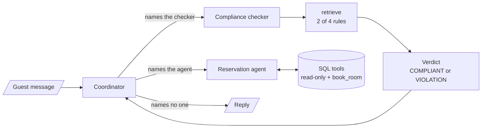

<!-- Generated by site/scripts/rag-theory-import.mjs from rag-agents-engineering. Edit the source there. -->
# M37 Theory: Multi-Agent Applied Builds & Deep Agents

[M35](../m35_multi_agent_architectures/00_overview.md) and [M36](../m36_collaboration_parallel_agents/00_overview.md) teach multi-agent patterns one at a time. M37 builds whole systems from them and spends most of its time off the happy path: the request that breaks a rule, the reply that names the wrong agent, the node that fails, the conversation that outgrows the context. The M37 notebooks build on four ideas: a compliance agent that screens every request before anyone acts on it, tests that check routes and side effects in code, merging the outputs of parallel agents and of old turns back into one state, and the harness that turns a model into a deep agent.

Lessons 37.1 to 37.3 follow the notebooks' hotel support desk: a coordinator that talks to the guest, a compliance checker over four hotel rules, and a reservation agent over a SQLite database of eight rooms. Room 105, the Family Suite, is booked from today+30 to today+33, and the notebooks use it to show a clash. Lesson 37.5 and the interview questions move the same designs onto Larkspur Cloud, the fictional cloud host whose handbook runs through [M11](../../p04_rag_foundations/m11_rag_lifecycle/00_overview.md) to [M13](../../p05_ingestion_and_indexing/m13_chunking/00_overview.md): its support desk, its refund and export policies, and a research team that answers from the handbook and the web.

## In short

- The compliance checker is a small RAG agent. It retrieves the 2 most relevant of the hotel's 4 rules and returns a typed verdict, `COMPLIANT` or `VIOLATION`. The coordinator sends every new request to it first, and a loop guard in code stops it being asked twice.
- The guards that matter live in tools and code, not in prompts: a read-only SQL connection whose authorizer hides guest names, one parameterised `book_room` tool, a date check in plain Python, a hard cap on revision loops.
- Test the router as a pure function. Notebook 02b's seven router tests need no model. In the lab, any threshold from 71 to 90 turns all seven green, because the confidence gate hides the known issue instead of fixing it.
- Parallel agents need one message key per branch, a join that waits for every branch, and one merge that writes one reply. Long threads fold old messages into a summary and delete them by id.
- A deep agent is a harness around a model: file tools, a `task` tool that runs sub-agents in their own context, skills read only when they apply, a backend that decides whether code can run, and memory that outlives the thread.

## Mental model

One node talks to the guest, specialists do the work, and plain functions between them decide where the turn goes. Every later build in the module keeps that split: the research system in 37.5 and the deep agent in 37.6 change who the specialists are, while routing, caps and checks stay in code where a test can reach them.

## Interactive lab

[**Router test bench**](/labs/rag/m37_multi_agent_builds_deep_agents/router-test-bench-lab.html): open the file in a browser. Start at threshold 50: six of the seven router tests pass, and the seventh is the known issue the suite records on purpose. Slide to 75 and all seven pass, because the confidence gate now ends the known-issue turn before the name check runs. Then write your own coordinator reply under *Route your own reply* and find one that forwards while saying it will not.

## How it connects

- **Before:** [M33](../m33_conversational_memory_rag/00_overview.md) and [M34](../m34_long_term_agentic_memory/00_overview.md) teach the checkpointers, threads, summaries and stores these builds use for memory. [M35](../m35_multi_agent_architectures/00_overview.md) and [M36](../m36_collaboration_parallel_agents/00_overview.md) teach supervisors, routers, parallel branches and `Send` one at a time. [M24](../../p08_agent_foundations/m24_react_agents/00_overview.md) covers `create_agent` and middleware, and [M27](../../p08_agent_foundations/m27_human_approval_applied_agents/00_overview.md) human approval with `interrupt()`.
- **Next:** [M38](../../p11_agent_protocols/m38_mcp_foundations/00_overview.md) to [M41](../../p11_agent_protocols/m41_a2a_protocol/00_overview.md) move tools and agents behind protocols: MCP servers for tools, A2A between agents. The coordinator and specialist split stays the same.

## Key Takeaways

- Put every rule that must hold in code or in a tool: a read-only connection, a parameterised write, a pure router, a loop cap. Prompts ask; code enforces.
- Test routing as a pure function on hand-built states, keep known issues as tests, and check side effects in the database, never in the agent's wording.
- Fan out with one state key per branch, join before you merge, keep writes out of parallel branches, and summarise old turns into state before the thread outgrows the context.
- A deep agent's safety comes from its harness: the backend decides what code can do, sub-agents keep their own context, and memory needs a real user key.
